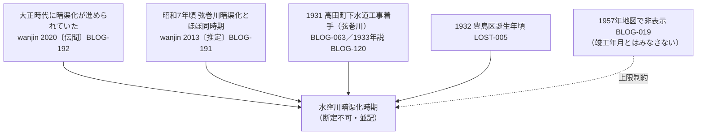
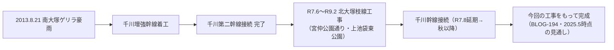

# 第58回定期調査ノート（2026-11-13）

## 概要

- wanjin水窪川カテゴリ（全5回）の未取得3回分を本文取得して**完結**（[BLOG-191](sources/blogs/BLOG-191.md)・[BLOG-192](sources/blogs/BLOG-192.md)・[BLOG-193](sources/blogs/BLOG-193.md)）。取得手段: カテゴリ頁（blog-category-1.html）のWayback id_付きスナップショットに5回分の全文が含まれていた。
- 粟島神社の境内由緒文言（[BLOG-195](sources/blogs/BLOG-195.md)）と、風土記系の伝承まとめ（[BLOG-196](sources/blogs/BLOG-196.md)）を新規登録。谷端川水源=弁天池説の神社側由緒が初めて文言レベルで確認できた。
- 千川増強幹線の北大塚接続の続報（[BLOG-194](sources/blogs/BLOG-194.md)）を登録。「今回の工事をもって完成」の完了段階情報と枝線工事の詳細（期間・公園使用・マンホール搬出入）がrepo初出。
- 元池袋史跡公園の「池袋地名の由来」説明板文言全文（[BLOG-197](sources/blogs/BLOG-197.md)）を登録。BLOG-063/155に同文言なし（重複確認済み）。
- [BLOG-019](sources/blogs/BLOG-019.md)に明治天皇御野立所跡石柱（美久仁小路南東）の追記バレット、[BLOG-183](sources/blogs/BLOG-183.md)の末尾制限記述をカテゴリ完結に合わせて更新。

## 水窪川暗渠化時期説の対立（新情報による更新）

wanjin 2020年記事の「**大正時代には暗渠化が進められていた**」文言が、既存の昭和初期系の諸説と**同一筆者内で食い違う**ことが判った。断定せず並記する。

## 千川増強幹線の完成工程（BLOG-134→BLOG-194 の整理）

## 今回の見送り（重複確認済み・資料化せず）

- tkobays 2020-04-18記事＝BLOG-019既登録（追記バレットのみ反映）。
- kak-dela千川上水まち歩きその2＝BLOG-131既登録。
- 武蔵学園ORG-025: Fauna/アルバム公開は既に記録済み。ただし**Fauna Musashinoensis No.1（2026.09.03）・No.2（2026.10.01）がデジタル公開され、PAP-033課題①（千川上水産2種の種名特定）の原典が閲覧可能になった**（個別頁はGUID形式URLで特定不能→次回課題）。
- ゆる歴史散歩会弦巻川2025-03-14・CBC 2025水窪川（BLOG-123）・文春50033・サンポー（BLOG-036）・4travel 2026-04・joshuanchin -4既出。joshuanchin -1〜-3/-5のentry URLは今回も特定不能（CDX不可・継続課題）。
- news_search: 四河川関連の新報道なし。
- 東京都下水道局「枝線再構築工事」公表日別頁（2026-11-02更新）の存在を検索で確認したがURLが切れて本文未確認→次回課題。

## 次回課題

1. Fauna Musashinoensis No.1/No.2 の個別頁GUID特定とPAP-033課題①の解消。
2. BLOG-197説明板・BLOG-195/196粟島神社由緒の現地採録（設置年・案内板文言・「前野池」位置）。
3. 枝線再構築工事公表頁の再取得。
4. joshuanchin -1〜-3/-5のentry URL特定。
5. BLOG-191〜192の暗渠化時期対立の一次史料（行政文書・新聞）による絞り込み。
6. 御野立所石柱の文言全文・建立年の現地採録（BLOG-019追記）。

## 実行メモ

- 実行: 第58回（2026-11-13）。push直前のmain headは 48922faf…で変化なし（並行実行の競合なし）を確認のうえpush。
- 採番: BLOG-191〜197（新規7件）。次回の採番はBLOG-198から。
