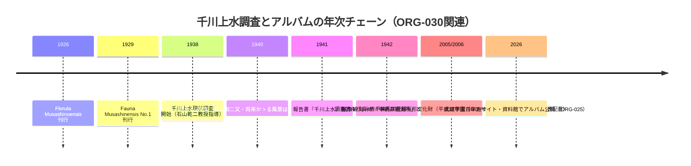

# 2026-11-13（第59回）調査ノート

## 概要

- 武蔵学園百年史サイトの正史（通史編II第4章「生徒の課外活動」）を直接確認し、**千川上水調査アルバムの写真キャプション（1940年7月撮影・江古田二又「将来かゝる風景は消えん」・学園前の橋で生徒が実測中）を引用する正史レベルの記述**を [ORG-030](sources/org/ORG-030.md) として新規資料化した。
- そのほかの調査角度（都下水道局枝線頁・wanjin残り回・joshuanchin・echo-lab紀要20号・西光院橋供養碑の追加web情報・news_search）は既収録・アクセス不能・新出なしに振り分け。

## ORG-030の解釈

- **「将来かゝる風景は消えん」**: 調査アルバム（昭和13〜16年調査）の時点で、江古田二又の開渠風景の消失がすでに予見されていたことを示す写真説明。撮影は1940年7月、説明の執筆時期（撮影時か1941年刊行時か）は特定できないため、**千川上水の暗渠化予見が調査時点に遡る〔仮説〕**とし、断定しない。
- **2006年（平成18）登録表記 vs GOV-076の平成17年度区登録**: 年度呼称と暦年のずれの可能性もあるが表記差として記録。文化財登録の正式年次は練馬区の指定・登録原簿レベルでの確認が次の一手。

## 調査角度と結果（重複確認・見送り・アクセス不能）

- **武蔵学園百年史サイトの構造調査**: sitemap.xml（Kiden/Story/Information/History系59 URLのみ収載）と robots.txt を確認。**資料館（Historical_Materials）の個別頁URLはsitemapに含まれず**、検索エンジンにも未インデックスのため、千川上水調査アルバム・Fauna Musashinoensis No.1/No.2 の個別頁GUIDは今回も特定できず。
- **博物館「濯川と自然観察」頁・「濯川」頁・Story「清濁を呑み今日も流れる」頁（ケム川）**: いずれもrepo既収録（PAP-033併記・ORG-026・ORG-024系）で差分なし。
- **sirakigi senkawa51（千川地蔵・五良久保橋・昭和27年移設）**: 検索スニペットを再確認したが [BLOG-032](sources/blogs/BLOG-032.md) に既収録の内容と同一。
- **百年史通史編第6章の「濯川=千川上水の分水・宝永年間（1704-10）開削」**: [GOV-005](sources/gov/GOV-005.md)の宝永4年（1707）中新井村分水と整合し新規性なし。
- **都下水道局「枝線再構築工事」公表日別頁（令和8年11月2日更新）**: topics頁・documents頁ともに「お探しのページ」応答で本文取得不可。枝線の実施内容は [BLOG-194](sources/blogs/BLOG-194.md) 既収録のため、これ以上の追跡は見送り。
- **wanjin水窪川カテゴリ**: 第58回で全5回完結済みを再確認（Waybackのカテゴリ頁2019年スナップショットは entry-4=[BLOG-184](sources/blogs/BLOG-184.md) の本文で既知内容）。
- **news_search（2026-11-06〜11-13・四河川）**: 関連する新報道なし。
- **西光院（中丸）橋供養碑**: 追加のweb上の碑文・写真情報は新出なし。現地採録が引き続き最重要課題。
- **echo-lab（中央学術研究所）紀要20号（PAP-029格上げ）**: 直アクセス9回目も遮断。Waybackのfetchも本回は不安定（「temporarily unreachable」応答が多発）。

## 次回課題

1. 武蔵学園百年史・資料館の『千川上水調査アルバム』個別頁URL特定（サイト内検索・資料館更新情報頁のリンク抽出の別手段。Guid形式Index頁の探索を継続）。
2. ORG-030の「2006年登録」vs GOV-076「平成17年度」の表記差解消（練馬区指定・登録文化財一覧の年度原簿）。
3. アルバム写真「江古田二又・将来かゝる風景は消えん」の該当コマ判読（個別頁公開後に実施）。
4. （継続）echo-lab紀要20号本文（PAP-029）・joshuanchin -1〜-3/-5 entry URL・BOOK-062『旧谷端川の橋の跡を探る』現物・西光院橋供養碑の現地採録。
5. （継続）README冒頭bulletのprepend（保留分は第6〜58回分）と INDEX.md の build.py 再生成。本回も git は実行環境に存在せず（which git 不通）、README（約1.37MB）の部分更新は不可のため変更していない。
