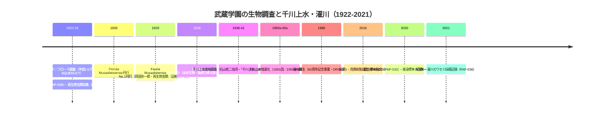

# 2026-11-13（第60回）・武蔵学園生物学研究3資料の追加（鳥類剥製・カワセミ濯川採餌・液浸標本Fauna）

## 1. 実行概要

- search_code・get_file_contents・push_filesとも正常。push前head確認（0c3d43f=第59回）で競合なし。
- 第59回ノートの次回課題①③（武蔵大リポジトリの白井一連の他登録）を進め、**PAP-035/036/037の3件**を新規資料化した。
- 採番はpapersディレクトリの実測（PAP-034まで）に基づく。INDEX.mdは例により未更新（build.py再生成はgit環境待ち）。

## 2. 新規3件の要点

1. **PAP-035（高田陽・白井亮久2016・紀要1 pp.45-76）**：武蔵高中標本庫の鳥類剥製30種34点のうち12点が1924-26年採集。**鳥類のFauna Musashinensisが未刊のまま中断した事実＝repo初出**。種リストに水辺依存種の**バン**を含み、1920年代の学校周辺（千川上水・中新井流域）の水域環境の傍証を追加〔要旨確認・本文未取得〕。
2. **PAP-036（紀要5・2021）**：「武蔵学園で一時的に保護されたカワセミの幼鳥，および**濯川でのカワセミの採餌行動の記録**」の掲載題目をリポジトリ紀要5号目次で確認。**濯川の生物相を直接扱う紀要論文の書誌登録はrepo初出**。本文・著者・頁数は未確認〔書誌確認のみ〕。
3. **PAP-037（原塚・白井2020・日本生態学会67回要旨PH-08）**：液浸標本900点超のうち両生類31点・爬虫類49点を整理。**Fauna No.1（1929）岡田弥一郎両生爬虫類項の図版と一致する標本（シロマダラ・ツチガエル等）が現存＝repo初出**。採集地は練馬・上板橋など。ツチガエル＝水田・湿地環境で、1920年代の千川上水流域水環境の標本傍証〔要旨本文直接確認〕。

## 3. 武蔵学園生物学調査と千川上水の系譜（Mermaid）

## 4. その他の確認・見送り

- 武蔵学園百年史サイトの資料館トップで更新情報の**アルバム追加日付「2026.07.15」をスニペットで再確認**（ORG-025の08.01との表記差は第58回記録のまま）。
- 渡邉-東馬加奈・白井・福田2022「大正末期に出版された武蔵野植物目録における6種の和名新称について」・2024「外来植物8種」（植物研究雑誌99(1)）：Florula研究の学術文献群だが**四河川への直接言及は確認できず、PAP-033の整理にとどめ資料化せず**〔researchmapの再検討PDF添付は404〕。
- 「武蔵高等学校中学校収蔵の戦前の東京産キバネツノトンボ標本とその生息地」（紀要6 pp.57-64・2022）：PAP-034にhandle 2416として書誌確認済み。採集地は和田山（中野区・哲学堂付近）で四河川流域外のため本文確認は優先度低。
- 「武蔵学園のカラスはどんな暮らしをしているか」（紀要8・2024）：千川通沿いの営巣・**カラスの濯川利用（水浴び・水飲み）**の記述をスニペットで確認したが、濯川生物相の本格記録はPAP-036が本体のため今回はノート記録のみ。
- echo-lab紀要20号PDF（PAP-029格上げ）は推定パス直アクセスで遮断（10回目）。news_search（11/6-11/13）で四河川関連の新報道なし。

## 5. 次回課題

1. PAP-035本文PDF（repository handle 11149/1873・bitstream）の取得と12点の採集地・採集者特定。
2. PAP-036のbitstream URL特定と本文確認（カワセミ採餌の魚種・観察年・濯川の導入魚の有無）。
3. Fauna No.1原本（武蔵学園記念室デジタル公開・ORG-025）での千川上水産2種の種名特定（PAP-033課題・PAP-037の標本照合が補助手段）。
4. （継続）echo-lab紀要20号・joshuanchin -1〜-3/-5・BOOK-062現物・README冒頭bullet prepend（第6〜59回分）・INDEX.md build.py再生成（git環境待ち）。
