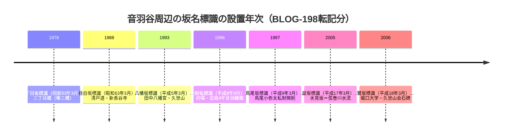

# 2026-11-13（第61回）・音羽の谷の坂道標識群と『日本歴史地名大系』音羽項の追加調査

前回（第60回・コミット e64caa6）からの継続。search_code・get_file_contents・push_filesとも正常、push前head確認（e64caa6）で競合なし。

## 今回の新資料

- **[BLOG-198](../sources/blogs/BLOG-198.md)**: miwa3k「坂道探訪 音羽の谷に下りる坂道」その1〜その3（はてなブログ・直接確認、投稿年未詳）。音羽谷両側台地の名付き坂10本の記録で、**文京区教委坂名標識の文言群**（三丁目坂・鼠坂・鳥尾坂・鉄砲坂・八幡坂・鷺坂・目白坂＋都設置の目白新坂）を転記している。新事実: **三丁目橋（権三橋）**＝弦巻川の橋の「権三橋」表記〔repo初出〕、**水見坂（鼠坂の別名）の由来が弦巻川の水流眺望**〔文京区教委・平成17年3月・repo初出〕、鳥尾小弥太私財開削〔BLOG-161鳥尾坂の独立裏付け〕、**安政四年『音羽繪圖』**〔図名repo初出候補〕、付属横坂坂下=水窪川（音羽川）川跡・大塚弾薬庫。
- **[GAZ-023](../sources/gazetteers/GAZ-023.md)**: 『日本歴史地名大系』「音羽」項（コトバンク部分転載・直接確認）。**音羽低地=かつての弦巻川の流域**の明記、『徳川実紀』「寺前の市井百石の地」、『風土記稿』の五ヵ村耕地＋安藤氏屋敷一部（高100石）、**正徳3年（1713）町奉行支配**、国語大辞典の「江戸末期私娼」。
- **[橋名調査への追補](四河川の橋名・橋跡調査.md)**: 三丁目橋（権三橋）の異表記（雑三橋／三丁目橋／権三橋）の整理と水見坂由来を弦巻川の項に追記。

## 解釈

- 弦巻川下流（音羽谷）の**開渠時代の景観記憶**が、文京区教委の公式坂名標識という比較的一次性の高い媒体で2件（三丁目橋=権三橋・水見坂）残っていた。いずれも「高速道路に沿って流れていた」という**首都高5号線建設前の弦巻川位置**を標識が直接証言しており、弦巻川流路のうち首都高架下区間（痕跡完全消滅とBLOG-198筆者が観察）の位置特定に公的裏付けを与える。
- 地名大系「音羽」項は、音羽低地を弦巻川流域とする行政・学術側の定式化を示す。1697年護国寺寄進の土地構成（五ヵ村耕地100石＋安藤氏屋敷一部）は、谷端川・弦巻川流域の村（雑司ヶ谷・小石川・小日向・関口・巣鴨）と武家屋敷の関係を集約する記録として、四河川周辺の土地利用史の骨格となる。

## 標識の設置年次（BLOG-198で確認できた文京区教委標識）

## 第60回課題の進捗

- ①PAP-035本文PDF（武蔵大リポジトリ handle 11149/1873）: 直・Waybackとも遮断。123deta.comのミラーらしき全文ページを見つけたが**503応答**で本文未取得（次回再試行）。CiNiiはJS遮断。
- ②PAP-036（紀要5号カワセミ論文）のbitstream URL: **bitstream直URLのパターン特定はならず**（紀要5号の他論文2本のbitstream URL 11149/2247・2249は把握）。武蔵大リポジトリのhandle/kiyo/chugaku頁は遮断。発刊ブログ（musashi.ed.jp 20210630-305）は本文取得可だが目次詳細なし。
- ③Fauna No.1個別頁GUID: 武蔵百年史サイトの「濯川と自然観察」頁（Museum/Index/f9a8d486…）を検索で発見したが、Fauna No.1/No.2の**個別頁GUIDは今回も特定不能**。
- ④echo-lab紀要20号（PAP-029）: 直・Wayback（libraries目録頁）とも不変・不可。西康智Zenodo一覧からの紀要20号再公開確認も今回未了。
- joshuanchin「水窪川跡を辿る」-1〜-3/-5: **entry URL特定は今回も失敗**（Web検索で-4のみヒット）。

## 見送り・重複確認

- **武蔵高校中学校紀要の白井亮久関連新着**: 紀要5号の魚類標本論文（白井・薄井・鵬原寮76点・CiNii crid/1050851398241087488）と**紀要7号151-160頁の白井・池原・村松論文**（bitstream 11149/2519存在、題目未特定）を発見したが、いずれも本文未取得・四河川との直接関係未確認のためsource file化せず（次回: 題目特定と抄録取得）。
- urbanlife.tokyo目白の情景（千登世橋1932年架設・西島三重子「千登勢橋」1979）: repo既登録（urbanlife 1件）で差分なし。
- **wanjinの「千歳橋」（BLOG-188・弦巻川橋名候補）と千登世橋（目白通り・明治通り跨道橋）の異同**: 千登世橋は跨道橋で河川橋ではなく、wanjinの千歳橋とは別橋か表記差かの判断材料がなく**保留**（次回課題）。
- tkobays 2020-04-18記事=BLOG-019既登録（第58回と同じ結論を再確認）。
- msamp（武蔵野散歩Ⅱ）のカワセミ記事=落合川（武蔵野市）で四河川対象外。
- news_search（四河川キーワード）: 関連する新報道なし。
- suddendeafness弦巻川シリーズ・xaymaca 2023聖地巡礼・文春50033等: 既出再構成で差分なし。

## アクセス不能（継続・再確認）

- 武蔵大リポジトリ（repository.musashi.ac.jp）: handle・bitstreamとも直は遮断（bitstream 11149/2058のPAP-033系のみ第55回取得済み）。
- researchmap.jp/aki_shirai: open_urlでは404（検索スニペットでのみ業績一覧の一部が読める状態）。
- 123deta.com: 503 Service Temporarily Unavailable。
- echo-lab紀要20号・wanjin entry-2（Wayback未収蔵）・かたりべ45・寅さん歩PDF（第43回でWayback id_取得済みのもの以外）: 継続。

## 次回課題

1. PAP-035本文（123detaミラーの再試行、または武蔵学園記念室）とPAP-036カワセミ論文bitstreamの題目・抄録特定（紀要7号151-160の白井・池原・村松論文を含む）。
2. **『音羽繪圖』（安政4年・1857）の所在・書誌特定**（鉄砲坂標識に部分掲載。MAP候補）。
3. **三丁目橋（権三橋）と『御府内備考』GAZ-013の駒止橋（鼠ケ谷橋）の位置照合**（大塚警察署前交差点周辺の弦巻川橋群の名寄せ）。
4. 音羽局給地説・清水寺音羽滝説の初出文献（大辞泉が依拠する原典）の特定。
5. 『徳川実紀』「寺前の市井百石の地」の原箇所と『風土記稿』音羽関係項の確認。
6. （継続）echo-lab紀要20号・joshuanchin -1〜-3/-5・BOOK-062現物・西光院橋供養碑現地採録・README prepend・INDEX再生成（git環境待ち）。
