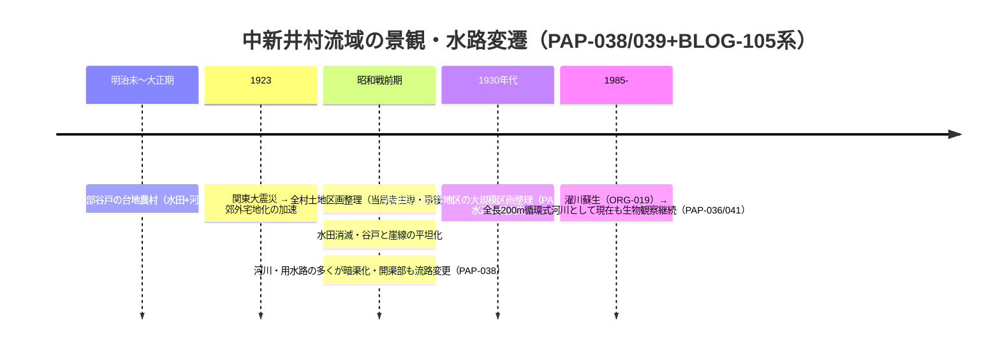
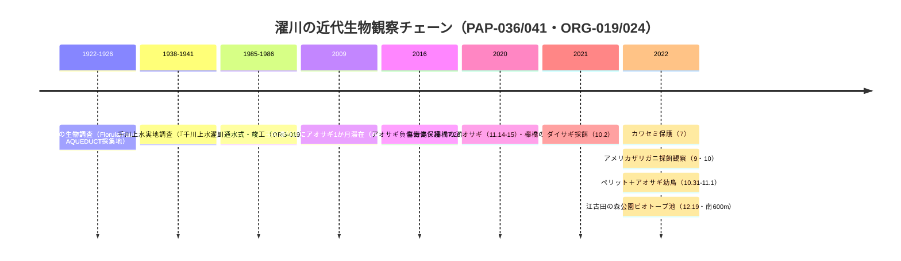

# 2026-11-13（第62回）実行ノート：武蔵高中紀要の濯川・中新井村研究4論文（PAP-036格上げ・PAP-038〜041）と弦巻通り商友会会長証言（BLOG-199）

## 1. 今回の概要

- 第61回head（93aab9c）確認 → 競合なし。search_code・get_file_contents・push_filesとも正常。
- 武蔵大学機関リポジトリの武蔵高等学校中学校紀要について、**handle走査（紀要5号=2245〜2249、6号=2412〜2417、7号=2513〜2519）で全itemの同定に成功**し、repo未収録の4論文を新規資料化、PAP-036を直接確認へ格上げした。
- この結果、**第60回ノートの「紀要5号のカワセミ論文」の収録号は誤りで、正しくは第7号（2023年3月）**。PAP-036の本文取得により第60回課題（採餌魚種・観察年）を解消した。

## 2. 新規資料

| ID | 内容 | 状態 |
|---|---|---|
| PAP-036格上げ | カワセミ保護・濯川採餌（2022.7保護幼鳥・9/10アメリカザリガニ採餌観察・濯川=循環型河川でカワセミ定住なし・練馬区2012調査に記録なし） | 直接確認（Wayback PDF全文） |
| PAP-038 | 亀岡2021「中新井村の土地区画事業のはじまり（１）」紀要5号pp.77-92。「河川や用水路の多くは暗渠化され、開渠部分も流路が変更」「谷戸の低地・崖線は平坦化」「明治末〜大正期の中新井村=南部谷戸の台地農村」 | 直接確認（本文冒頭） |
| PAP-039 | 亀岡2022「西貝家文書から見る中村の土地利用」紀要6号pp.3-24。**西貝家文書=石神井ふるさと文化館所蔵**・中村町第一土地区画整理組合 | 書誌・要旨確認 |
| PAP-040 | 渡邉-東馬・白井・福田2022「Florula Musashinoensisの再検討」紀要6号pp.65-114。1,283分類群・証拠標本87.3%現存・23区レッドリスト249分類群・**指揮=久内清孝・牧野富太郎助言**（PAP-033の和田八重造発案説と並記） | 直接確認（本文冒頭） |
| PAP-041 | 白井2023「濯川のペリットとサギ類」紀要7号pp.139-150。**濯川=全長200m程度の循環式河川**・2022.10.31ペリット・11.1アオサギ幼鳥採餌・サギ類2016-2022・**江古田の森公園ビオトープ池（学園の南600m）との水辺パッチ移動**・欅橋のカワラナデシコ | 直接確認（PDF全文） |
| BLOG-199 | 都電さんぽspecial-1378・清田明商友会会長証言。**丸池が弦巻川の水源（伝聞）**・昭和7年暗渠化・「今も地下で流れている」・商店街=昭和20年代後半形成・昭和50年70軒超 | 直接確認（Wayback） |

## 3. 解釈・repo仮説への影響

### 3.1 中新井分水流域の水環境喪失の学術裏付けが一段強まった

PAP-033が引用していた「亀岡（2017）」の研究シリーズ本体（第5号・第6号の2論文）がrepoに直接入った。とくにPAP-038の「河川や用水路の多くは暗渠化され、開渠部分も流路が変更されている」は、**中新井川・千川上水分水群（濯川含む）の近代的流路変更を明文化した初の学術論文レベルの記述**。

### 3.2 武蔵学園生物調査系譜（PAP-033/034/035/037）の植物側本体が入った

PAP-040により、1922-25年Florula調査が**標本ベースで再検討され、証拠標本の87.3%が現存**することが確認された。PAP-033の「千川上水産2種」動物側に対し、植物側の定量的基盤が揃った。一方、**PAP-040はFlorula調査の「指揮」を久内清孝に嘱託されたとし、PAP-033経由の「和田八重造発案」説（大坪2003）と役割が食い違いうる**。発案と指揮の分担と解する余地を残し断定しない。

### 3.3 丸池水源説の新たな伝承例（弦巻川側）

BLOG-199の清田会長証言は丸池を「弦巻川の水源」とする。丸池の帰属を谷端川とする既存資料群（BLOG-073/074・高田雲雀1788）と合わせ、**「丸池＝谷端川」「丸池＝弦巻川」の両伝承が併存**することがより明確になった。断定せず、引き続き対照表・open-questions管理。

### 3.4 濯川の橋名の位置が観察記録で具体化

PAP-041で一の橋・欅橋・玉の橋・喜寿島の各地点の観察年月日が特定された（ORG-024の写真館と接続）。

## 4. 今回見送ったもの

- 都電さんぽsupporters-54（special-1378と同一商店街の別記事・弦巻川言及なし）。
- 東京新聞article/518187（暗渠マニアックス記事。第38回評価済みの同内容）。
- note「noble_pothos2988」暗渠趣味コラム（谷端川は列挙のみで新事実なし）。
- 武蔵高中紀要9号のフクロウ論文（handle 11149/2790・2024年度。Wayback未収蔵で本文取得不能。濯川言及の有無は未確認）。
- 紀要6号キバネツノトンボ論文（handle 11149/2416・第60回評価済み＝PAP-034系）。
- 亀岡2021・西貝家文書論文の本文全文（WaybackのPDF本文抽出が部分的なため。千川上水固有名の言及有無は次回課題）。

## 5. アクセス不能・継続課題

- **joshuanchin「水窪川跡を辿る」-1〜-3/-5**：ameblo月次アーカイブ（2010年8月）のWaybackスナップショット取得に再挑戦するも不安定で断念。entry番号は-4（12490754603）のみ特定済み。
- **echo-lab紀要20号（PAP-029格上げ）**：直もWaybackも不可（11回目）。
- **wanjin entry-2・240/241**：引き続きFC2直403・Wayback未収蔵。
- **武蔵高中紀要の白井一連の他論文**（紀要5号魚類標本=handle 2249本文、紀要6号キバネツノトンボ=2416本文、紀要9号フクロウ=2790）：Wayback PDF取得の可否を次回試す。
- **西貝家文書の目録**（石神井ふるさと文化館・千川上水関係文書の有無）。
- **PAP-040本文全文**（32KB打ち切り以降の千川上水言及の有無）。
- （継続）BOOK-062現物・README冒頭bullet prepend（第6〜61回分の保留bullet・git環境待ち）・INDEX.md build.py再生成。

## 6. 次回の一手

1. PAP-040・PAP-038の本文全文取得（Wayback id_の再試行、もしくは武蔵大リポジトリの別ルート）で千川上水固有名の言及確認。
2. 石神井ふるさと文化館の西貝家文書目録の所在確認（GOV-092の所蔵資料リストとの突合）。
3. joshuanchin 2010年8月のWayback月次アーカイブ再取得。
4. （継続）README prepend・INDEX再生成はgit環境が使える実行でまとめて実施。
