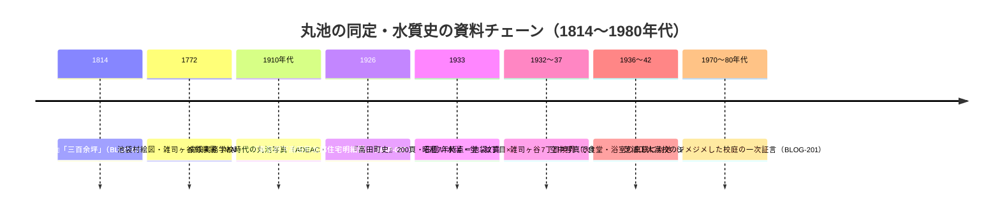

# 2026-11-13（第63回）実行ノート：丸池の火保図・空撮読図、武蔵オンライン博物館「濯川と自然観察」頁、青木哲夫論文書誌

## 1. 今回の概要

- 第62回head（a8a662e）確認 → 競合なし。search_code・get_file_contents・push_filesとも正常。
- 武蔵大学機関リポジトリの紀要6号item（handle 11149/2412〜2417）の同定を進め、**PAP-040（Florula再検討）のitem＝handle 2417・bitstreamファイル名を特定して本文冒頭〜中盤を再取得**（32KB打ち切りで千川上水固有名の言及確認には至らず）。
- 武蔵学園百年史「オンライン博物館」の**「濯川と自然観察」頁（看板№9）のGUID付きURLを特定し本文全文取得**（第55回ノートで未取得だった頁）。
- 丸池関連で2件の新資料（toshima_lab続・丸池＝火保図・空撮読図、川俣晶の一次証言）と青木哲夫2009論文の書誌（DOI）を登録。

## 2. 新規資料

| ID | 内容 | 状態 |
|---|---|---|
| ORG-031 | オンライン博物館「濯川と自然観察」頁。**Florula（半径4km・1926）／Fauna（半径2.5哩・1929）の出版費用を根津嘉一郎理事長が援助・調査写真の人物同定（和田八重造・山川黙・柳田友輔講師〔repo初出〕・高宮篤・桑原萬寿太郎）** | 直接確認（本文全文） |
| BLOG-200 | toshima_lab「続・池袋地名の由来「丸池」（鉄道教習所時代）」2025-03-22。**昭和12年火保図で鉄道教習所＝池袋二丁目（旧西巣鴨町大字池袋字向原）×雑司ヶ谷七丁目境界・1936〜42年空中写真で食堂・浴室の真横に丸池を判読** | 直接確認 |
| BLOG-201 | 川俣晶（mag.autumn.org・2008-10-28）。**芝浦工大高校（丸池跡地）在学生の一次証言：ジメジメした校庭・木造2階校舎・裏口に養老の滝とソープランド（70〜80年代池袋駅前）。板橋新校舎の地下川と渡り廊下屋根なしの伝聞** | 直接確認 |
| PAP-042 | 青木哲夫2009「丸池（「池袋地名由来の池」）説話成立に関する文献的考証」『生活と文化』18号pp.3-20。**DOI 10.24484/sitereports.128212-113596・NCID AN10304337・nabunken総覧ページ直接確認** | 書誌・所在確認（本文未取得） |
| BLOG-054更新 | 皆川まち歩き報告に**近藤勇供養塔への立ち寄り**（千川上水跡尾根筋ルート）を追記 | 直接確認 |

## 3. 解釈・repo仮説への影響

### 3.1 丸池の位置特定の資料チェーンが裏付け図種2種（火保図・空撮）で補強された

BLOG-200は、BLOG-073の高田町史文言（石囲いの水溜・1933年時点の水質）に対し、**火保図（区画・街区レベル）と空中写真（敷地内の相対位置＝食堂・浴室の隣）**という2種の図資料で位置と実在を裏付ける。丸池の同定は従来（MAP-003・MAP-037・GOV-55・BLOG-029等）地図と沿革の継ぎはぎだったが、**1930年代の同時代図像2種が加わった**。BLOG-201はその後（昭和40〜50年代）の用地を「ジメジメした校庭」と在学生の体感で裏付け、**丸池跡地の湿潤性が1980年代まで体感レベルで残存していた**ことを示唆する。

### 3.2 武蔵学園生物調査（PAP-033〜041系）のSSOTが看板文言で一段確定

ORG-031で、①Florula＝植物・Fauna＝動物（写真つき）の1926/1929年出版、②**出版費用の根津嘉一郎援助**、③調査写真の人物同定（**柳田友輔講師が新出**）が看板文言レベルで確定した。PAP-040がFlorula再検討の学術論文、PAP-037が標本の現存確認、ORG-031が学校側の公式看板解説という**三層の相互裏付け**が揃った。

### 3.3 青木哲夫2009の書誌がDOI付きで確定

MAP-037の読図（丸池を越える弦巻川上流の水路）の学術的裏付けとなる論文の所在がDOI・NCIDつきで確定した。本文はまだ未確認で、丸池説話の文献考証の内容（池袋地名由来研究の重要文献）は現物確認待ち。

## 4. 今回見送ったもの

- 武蔵高中紀要6号の他items（2412西貝家=既にPAP-039、2413=ELF、2414=古典講座、2415=ベッコウトンボ、2416=キバネツノトンボ）＝いずれも既登録・四河川非対象を再確認。
- researchmap掲載の渡邉-東馬ほか2022 Florula再検討（植物研究雑誌系）＝第60回評価済み（四河川直接言及なし）。
- deathcrusher.hatenablog（暗渠・川カテゴリ）＝2026年の記事は西井堀・千間堀・竜井堀など葛飾・足立方面で四河川対象外。
- suddendeafness「水窪川の跡を歩く①」2017＝第48回で横断調査ノート既参照と確認済み。
- dai-neo（東京江戸ぶら）「音羽川（水窪川）の消失はいつ？①」＝BLOG-045既登録（entry-12285256068の一致を確認）。
- D.2.C COLUMN・toshima_lab丸池第1回・続々（高田雲雀）＝既収録（BLOG-073/074）。
- PAP-040本文：Wayback id_で再取得するも32KB打ち切り。**千川上水（SENKAWA AQUEDUCT）固有名の言及有無は本文中盤以降で未確認**。

## 5. アクセス不能・継続課題

- **echo-lab紀要20号**：kiyou20.htm相当のWayback未収蔵を再確認（12回目）。
- **nabunken文化財論文検索**（search-article）：「アクセス集中」で千川上水・谷端川検索は今回も不可。青木哲夫の個別ページは取得可だった。
- **板橋区立郷土資料館紀要の目次**：CiNii（AN10129259）の収録記事リストは創刊号〜第5号分までしか読み取れず、**「千川」「谷端川」を含む記事の有無は未確認のまま**（第24回以来の課題）。
- **武蔵高中紀要5号魚類標本論文（handle 11149/2249）・9号フクロウ論文（handle 2790）**：handle頁のWayback取得が「temporarily unreachable」で失敗。bitstreamファイル名の特定から次回再試行。
- **joshuanchin「水窪川跡を辿る」-1〜-3/-5**：月次アーカイブのWayback未収蔵を再確認。entry URL特定不能のまま。
- **西貝家文書の目録**（石神井ふるさと文化館・千川上水関係文書の有無）：検索で新情報なし。
- （継続）BOOK-062現物・README冒頭bullet prepend（第6〜62回分の保留bullet・git環境待ち）・INDEX.md build.py再生成。

## 6. 次回の一手

1. PAP-040本文中盤以降（千川上水固有名の言及確認）＝Wayback id_の別タイムスタンプ再試行。
2. 武蔵高中紀要5号（2249）・9号（2790）のhandle頁・bitstreamファイル名特定と本文取得。
3. PAP-042（青木哲夫2009）本文の現物確認手段（豊島区立郷土資料館・水道歴史館・板橋区立図書館の所蔵確認）。
4. BLOG-200の火保図（昭和12年）の刊行者・所蔵先特定と、1936〜42年空撮のコマ番号特定。
5. 板橋区立郷土資料館紀要目次の別ルート（CiNii全202件の後半部分）。
6. （継続）echo-lab紀要20号・joshuanchin -1〜-3/-5・README prepend・INDEX再生成。
