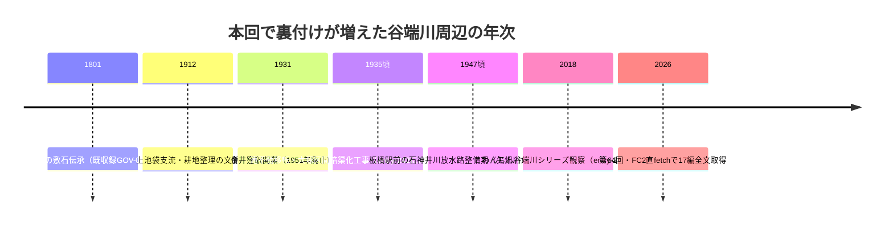

# 第64回（2026-11-13）: wanjin谷端川シリーズFC2直fetchによる未取得17編の全文取得

## 概要

長年本文取得ができていなかったFC2ブログ「水の行方を追って」（わんじん）の谷端川（西大下水）シリーズについて、環境側で`curl`＋User-Agent指定による直接取得が可能になったことを受けて、未取得だったentry 17本（233,235,236,237,238,240,241,242,244,245,246,251,252,253,254,255,256）を全取得し、本文を精読した。うち記録価値のある内容を[BLOG-202](../sources/blogs/BLOG-202.md)〜[BLOG-210](../sources/blogs/BLOG-210.md)の9件のソースファイルとして整理した。

- 取得方法: `curl -A "Mozilla/5.0" https://wanjin.blog.fc2.com/blog-entry-<n>.html`（web検索経由ではなく直fetch。open_urlの32KB制限を回避）
- 既登録との重複確認: codeload tarball（main, HEAD=d3f32bd時点）を展開してローカルgrep。既登録entry: 2(BLOG-191)・234(BLOG-030)・239(BLOG-122)・243(BLOG-157)・247(BLOG-141)・248(BLOG-140)・249(BLOG-142)・250(BLOG-080)

## 新情報の要点

1. **「樋口（とよぐち）」地名**（entry-235, [BLOG-203](../sources/blogs/BLOG-203.md)）: 『いたばしの河川』由来の板橋区側の小字。長崎村分水の引水路がマンション敷地内の白砂利空間として現存する2018年観察。
2. **金井窪・下板橋駅移転史**（entry-240, [BLOG-205](../sources/blogs/BLOG-205.md)）: 金井窪駅1931年開業・1951年廃止、下板橋駅の大塚辻町起点案の断念と昭和10年頃の現位置移転説。前田橋上流の素掘り水路跡現存。
3. **矢畑川ガード2018年観察**（entry-241, [BLOG-206](../sources/blogs/BLOG-206.md)）: 板橋区公文書館電子展示室76号（既収録）の独立裏付け。三の橋・一の橋袂の支流合流位置。
4. **滝不動「1935年頃の暗渠化工事」説**（entry-242, [BLOG-207](../sources/blogs/BLOG-207.md)）: 大塚区間の暗渠化年次の独立データポイント。谷端地名由来＝北区滝野川7丁目説。
5. **やよい児童遊園2源流説**（entry-244, [BLOG-208](../sources/blogs/BLOG-208.md)）: 南長崎支流は中落合・やよい児童遊園（雨水浸透施設併設）と南長崎・子育て地蔵の2源流。合流点＝真和中学校（現・心身障害者福祉センター）跡脇。
6. **新田堀之内村＝梶原堀之内分郷説**（entry-251/252, [BLOG-209](../sources/blogs/BLOG-209.md)）: 下り谷・雲雀が谷戸支流の読図とともに村名由来の説明。上池袋支流の源流＝西巣鴨橋北・山手線際（2018観察）。
7. **大塚〜文京区の橋名群と市兵衛河岸**（entry-254〜256, [BLOG-210](../sources/blogs/BLOG-210.md)）: 姿見橋・見返り橋・熊野窪橋・東福寺橋・松浦橋・宮原橋・一木橋（「一本橋」誤字定着説）。『続江戸砂子』湯立坂文言（「往古はこの坂の下は大河の入江」）。柳町支流（仮）。東大下水との3度の合流。市兵衛河岸＝砲兵工廠荷揚場（〜昭和8年）。

## タイムライン

## 断定を避けた点

- wanjinの観察は2018年時点の民間踏査記録であり、「観察」または本文主張の「確認（二次記述）」として区別した。
- 滝不動1935年説は既存の年次議論（1967年説等）との対立があるため、データポイント追加にとどめ断定しない。
- 「第二石神井川放水路」の呼称はwanjinの用語であり、repoの放水路年次議論との照合課題とする。

## 今後の課題

- entry-246（耕地整理バイパス支流の後半）は要約中心で精読が浅い。`dl/wanjin246.html`を再読してBLOG-208の追記候補を確認する。
- かたりべ45号PDF（取得済み・1.6MB）はスキャン画像のみでテキスト層がないためOCRが必要。環境側にOCRツールがない場合は次回以降。
- curl直fetchの手法を他の遮断資料（sinsui.pdf・torasampo PDFなどDNS遮断続きのもの）にも順次試す。

