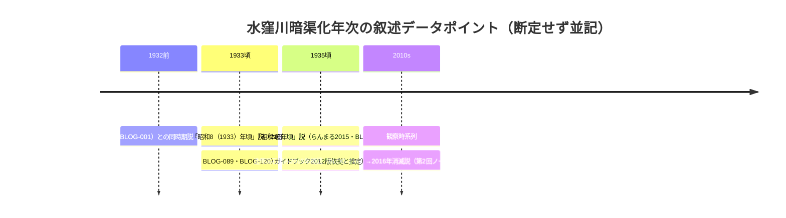

# 2026-11-13（第66回）・らんまる水窪川1/2取得・武蔵学園千川上水調査アルバム公開PDF特定・CARI紀要DB確認の追加調査

第65回（コミット 2e3d64d）の続き。search_codeは本セッションも機能不全のため、重複確認はtarball展開によるローカルgrep・get_file_contentsで代替。

## 取得した新情報

### 1. BLOG-216 らんまる「水窪川跡を歩く 1/2」（2015-12-27）

- [BLOG-046](../sources/blogs/BLOG-046.md)（2/2）・[BLOG-161](../sources/blogs/BLOG-161.md)（弦巻川散歩）で未取得だった1/2のentry IDを**既知entry（2/2）の本文HTML内に埋め込まれた前後entryリンクから特定**（entry-12110772803）し、curl+UAで本文全文取得。第47回・第55回の未解決を解消。
- **水窪川暗渠化「昭和10年（1935）頃」説**〔二次・出典明示なしだが携行ガイドブック=BOOK-083（洋泉社2012版）に由来すると推定〕。水窪川暗渠化年次のデータポイントが「昭和7年（1932）工事開始説」「昭和8（1933）年頃説」に加わえて3つ目。断定せず並記。
- 造幣局東京支局（巣鴨プリズン跡）石垣下の**排水溝石組みが2015年時点で視認できた**観察。BLOG-036（2019年露出目撃）・第2回ノート記録の「造幣局排水溝石組の2016年消滅」との時系列整理（2015年視認→2016年消滅→2019年露出報告の食い違い）は原観察の精査が必要で断定しない。
- その他: 水源の「湿原」（美久仁小路水源説と調和する読図）・都電荒川線渡河個所・ミョウガ畑民家の荒廃（2015年時点）・ラムネ工場跡・S字カーブ路・護岸らしき壁など、既知流路観察の2015年時点追認。

### 2. BOOK-083 本田創『地形を楽しむ東京「暗渠」散歩』洋泉社2012年12月

- [BOOK-001](../sources/books/BOOK-001.md)（2021実業之日本社改訂版）の**前身版の書誌を登録**（所在のみ）。ISBN 978-4-8030-0004-1・239p。
- 出版系譜の確認: 『東京ぶらり暗渠探検』（2010）→本書（2012・TRC「改題増補改訂」）→『失われた川を歩く 東京「暗渠」散歩 改訂版』（2021・NDL書誌 R100000002-I031230858 に「初版のタイトル等」として本書が明記）。
- 水窪川・弦巻川は第2章「神田川支流の暗渠」、千川上水は第6章「上水・用水の暗渠」とみられる（ブクログ目次転記による。本文未見）。

### 3. GOV-076更新: 武蔵学園「千川上水調査アルバム」個別頁・公開PDF特定（第36/58/59回課題解消）

- 資料館Historical_MaterialsのIndex頁GUID（所蔵資料一覧=019eaa28-fb7a-71de-be84-a3364ff3c36b）をcurlで辿り、**千川上水調査アルバム個別頁（019fabe9-a277-7601-ada7-c39c92f8ebf7・2026-08-01公開）と全4冊の公開PDF URL**を特定。
- **アルバム4冊・写真216葉（第1巻27項47葉・第2巻27項50葉・第3巻27項42葉・第4巻21項77葉）の確定値**〔枚数表記差（区ページ「200カットあまり」・BLOG-113「約160枚」・sirakigi「約100枚」）に確定値が加わった。展示抜粋差か断定せず〕。
- 「石山」印=石山乾二教授（当時民族文化部顧問）。成果は**昭和16年6月刊行『千川上水』→1982年10月「クオリ」再版**〔クオリ再版の書誌=repo初出〕。「平成17年に練馬区文化財に登録」〔区ページ「平成17年度」と整合・ORG-030「2006年」表記との食い違いは並記継続〕。調査主体「校友会である文化学部民族文化部」〔区ページ「交友会文化学部」と整合〕。
- 公開PDFはGoogle Docs Viewer経由で直接取得可（第1巻5.6MB）だが**スキャン画像のみでテキスト層なし**。サンドボックスにOCR環境がないため、庚申橋・長崎村分水・谷端川分水口のコマ判読（1953 vs 1959-60年次差解消の一次資料）はOCR環境のある実行・人手閲覧待ち。

### 4. ORG-032: 武蔵学園「Florula Musashinoensis, Fauna Musashinensis」頁

- 第55/58回ノートの未取得頁を解消（個別頁GUID 01a06492-7d76-7fc9-b661-853702b3a687・2026-10-01公開）。
- **Fauna Musashinensis No.2＝1936年刊行**〔repo初出の書誌〕。サイト表記「April, 2589(1929)」〔No.1〕「2598(1936)」〔No.2〕は誤植と解されるが表記のまま記録。[PAP-035](../sources/papers/PAP-035.md)「鳥類のFauna未刊中断」との関係（シリーズとしてはNo.2まで刊行で鳥類編が中断だった可能性）は要原文確認。
- **Fauna No.1本文PDFの公開URL**を特定（約8.8MB・スキャンのみ）。[PAP-033](../sources/papers/PAP-033.md)課題「千川上水産2種の種名特定」の原典アクセスが開通。
- 著作者表記: 和田八重造・**久内清孝**・根津嘉一郎〔久内の表記は初確認〕。

### 5. PAP-029・PAP-027更新: 中央学術研究所（CARI）の紀要目録DB

- **cari.ne.jp（中央学術研究所の現行サイト）に研究業績検索DBがあり、GETパラメータで動作する**ことを発見（第36回「JSフォーム不可」の認識を更新。検索フォームのname属性からGETクエリを構成）。
- PAP-029（深田1991・紀要20号pp.84-100）の公式DBレコード（`https://cari.ne.jp/search/detail/paper/id/310`）を直接確認〔書誌をrepoで初めて公式DBレベルで確認〕。**本文PDFは会員登録制ダウンロード**で取得できず、本文未見のまま。
- 深田の「千川」関係はDB上で紀要20号と42号（[PAP-027](../sources/papers/PAP-027.md)・レコードid=648・pp.158-180も直接確認）の2件のみ。キーワード「谷端川」「湧水」「弦巻川」「小石川」は0件。
- **echo-lab.ddo.jpは接続自体が不成立**（DNS/接続不可・ドメイン沈静化の可能性）。以後の代替ルートはcari.ne.jp DB＋会員登録制PDF、または図書館所蔵原本。

## 見送り・アクセス不能の記録

- **板橋区公式サイトはWAFで全面遮断**（curl+UAでも2254バイトの拒否ページ。浸水履歷頁・五十音別PDF12本・道路冠水一覧の取得は不可）。第65回課題①は未解決のまま。
- **nabunken（sitereports.nabunken.go.jp）は直が429レート制限**。CiNii誌名頁（ncid AN10129259・板橋区立郷土資料館紀要・21号まで目録・「15号からは年報と合綴」の注記）は取得可だが、記事検索APIがJS化しており個別論文タイトル抽出は未達。
- 毎日新聞英語版「Could a giant underground river save Tokyo from torrential rain?」（2026-08-24）は環七地下河川（白子川3.2km＋神田川環七4.5km貯留管を5.4kmの環七地下広域調節池で接続、将来的に約30km・1985年鈴木都知事時代の39km構想の再燃）の記事で、四河川直接関係なし。参考: 2026年6月台風6号で神田川に氾濫緊急発表レベル4・神田川環七貯留管が約23.7万m³（容量44%）取水・水位約60cm低下。
- FRIDAY「渋谷区の住宅街に湧き水」記事は対象地域違いで見送り。豊島区「谷端川南緑道」公式頁の文言（昭和37年河川廃止・昭和41/42年児童遊園開放）はGOV-008追記済みで差分なし。ゆる歴史散歩会弦巻川跡を歩く（2025-03-14）も第28回評価済み。
- news_search（千川上水・谷端川・豊島区浸水、2026-10-01以降）で四河川関連の新報道なし。

## Mermaid: 水窪川暗渠化年次データポイントの累積

## 次回課題

1. **千川上水調査アルバムPDFの判読**（OCR環境がある実行での4冊PDF画像処理、または人手閲覧）。庚申橋・長崎村分水・谷端川分水口・武蔵学園前区間のコマ特定は1953 vs 1959-60年次差解消の一次資料。
2. Fauna No.1 PDFの判読で千川上水産2種の種名特定（PAP-033課題）。
3. CARI会員登録制PDFの別ルート（紀要20号の図書館所蔵・CiNii館蔵検索）。
4. BLOG-216「昭和10年頃」説の原典確認（BOOK-083本文該当頁・水窪川項）。
5. （継続）板橋区浸水履歴五十音別PDF（WAF回避手段）・nabunken板橋区郷土資料館紀要記事タイトル・BOOK-062現物・西光院橋供養碑現地採録・角田2023本文・Fauna No.2 PDF頁。
