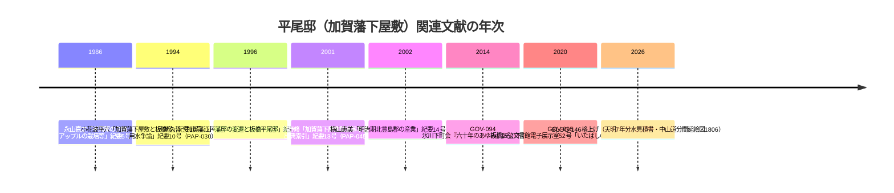

# 2026-11-14（第67回）・板橋区立郷土資料館紀要全巻目録取得（小林保男水車論文の書誌特定・平尾邸論文群・横山恵美産業論文）

第66回（コミット 9b7e032）の続き。search_codeは本セッション未検証（tarball展開によるローカルgrepで重複確認を代替）。push前にAPIで最新head（9b7e032＝第66回・競合なし）を確認。

## 取得した新情報

### 1. nabunken（全国文化財総覧）復旧と板橋区立郷土資料館紀要全巻目録の取得

- **第24回以来「アクセス集中」で遮断され続けていたnabunkenの板橋区立郷土資料館紀要・年報の巻別ページが、curl+ブラウザUAでSSR本文ごと取得できるようになった**（`https://sitereports.nabunken.go.jp/ja/<id>`）。紀要は創刊号（1980-08）〜第21号（2017-03）、年報は第1〜7号相当を確認。まれにJSシェル（約6KB）だけが返るIDがあるが、時間を空けた再取得で本文が返る。
- **紀要2〜21号＋創刊号・年報の所収論文の著者・タイトル・頁数を目録レベルで全取得**し、「千川/谷端/水車/用水/水路/上水/湧水/平尾/池袋/水窪/弦巻/石神井川」の語で走査。**水系・平尾邸関連の論文は以下の通り**（いずれも本文は総覧に外部PDFリンクなし）。

#### 1-1. PAP-030更新: 小林保男水車論文の著者・頁数を特定（第24回課題の残りを解消）

- 小林保男「**東京都公文書館収蔵史料に見る板橋の水車 その用水争論をめぐって**」紀要**第10号（1994-03）pp.1-18**・総覧巻別ページ [sitereports.nabunken.go.jp/ja/127118](https://sitereports.nabunken.go.jp/ja/127118)。総覧分類は時代＝近世/近代、**遺跡種別＝集落・田畑**、テーマ＝資料紹介。〔確認：総覧目録／**本文・対象河川は未確認のまま**〕
- [PAP-030](../sources/papers/PAP-030.md)の「著者名と頁数の特定」制限を解消して更新。**本文の所蔵史料・扱う川（千川上水系か石神井川系か）の特定が次の一手**。板橋区立郷土資料館での現物確認が必要。

#### 1-2. PAP-043〜046新規: 平尾邸論文群と北豊島郡産業論文

- [PAP-043](../sources/papers/PAP-043.md): 辻崎久哲「**加賀藩江戸藩邸の変遷と板橋平尾邸**」紀要**第11号（1996-03）pp.1-25**（総覧 id=127119）。〔repo初出〕
- [PAP-044](../sources/papers/PAP-044.md): 永山嘉之「**平尾邸の夕餉 廻遊式庭園・アップルの栽培等**」紀要**第5号（1986-03）pp.8-14**（id=127113）。〔repo初出〕
- [PAP-045](../sources/papers/PAP-045.md): 海野修「**加賀藩下屋敷関係基本史料（『加賀藩史料』）の出典索引ならびに論考等の一覧**」紀要**第13号（2001-03）pp.56-65**（id=127121・テーマ＝資料集成）。〔repo初出〕
- [PAP-046](../sources/papers/PAP-046.md): 横山恵美「**明治期における北豊島郡の産業について 内国勧業博覧会の出品状況から**」紀要**第14号（2002-11）pp.31-55**（id=127122）。〔repo初出。[BOOK-064](../sources/books/BOOK-064.md)（湧き水紀要11号・2001）と同一著者〕
- **位置づけ**: 平尾邸は天明7年（1787）千川用水引き入れ見積書（[BLOG-146](../sources/blogs/BLOG-146.md)）・庭園内の大池（[GOV-093](../sources/gov/GOV-093.md)）でrepoの千川上水用水史と直接重なる。上記4本は**平尾邸の通史・庭園・史料索引・周辺産業**を扱う（と推定される）文献群で、本文確認後に分水経路・大池の水源特定へつなげる。いずれも本文未見で断定しない。

#### 1-3. ノート記録のみの関連書誌（source file化せず）

- 小花波平六「加賀藩下屋敷と板橋宿、宿場の人たちとの交流」紀要第10号（1994-03）pp.19-29（id=127118所収）。〔平尾邸と板橋宿の交流。千川上水直接言及の有無は本文未見〕
- 渡辺嘉之「東京北郊地域における農家副業としての漬物製造 東京府北豊島郡下練馬村田中宇兵衛家の沢庵漬販売を事例として」紀要第14号（2002-11）pp.56-73（id=127122所収）。〔**下練馬村田中家**＝[GOV-069](../sources/gov/GOV-069.md)・[GOV-092](../sources/gov/GOV-092.md)の田中水車（観音山水車）の田中家と同姓だが同一家かは未確認**。漬物製造は用水と無関係の可能性もあり断定しない〕
- 紀要6号（1987-03）に千川関連記事なし（第24回からの対応づけ確認。所収は徳丸畝堀・四葉土器・縄文石製品等の考古系が中心）。

### 2. 武蔵学園公開PDFの取得と判読断念の記録

- [GOV-076](../sources/gov/GOV-076.md)の千川上水調査アルバム全4巻PDF（合計約21MB）と[ORG-032](../sources/org/ORG-032.md)のFauna Musashinensis No.1本文PDF（約8.8MB・36頁）をcurlで取得。**いずれも画像のみでテキスト層なし（`/Font` 0件）**。サンドボックスはpipインストール不可・PILなし・tesseractなしで**OCR判読は今回も不可**。アルバムの庚申橋・長崎村分水・谷端川分水口コマ判読とFauna No.1の千川上水産2種の種名特定は、OCR環境のある実行・人手閲覧待ち。
- 武蔵学園サイトの所蔵資料Index頁（Historical_Materials）はcurlで取得可。千川上水アルバム個別頁（GUID 019fabe9-…）とFlorula/Fauna頁（01a06492-…）の親Index（019eaa28-…）を再確認。**第66回の記載と変更なし**。

### 3. 平尾邸・板橋区関連の一次情報源の探索（いずれも遮断）

- 板橋区公文書館「行政資料目録 令和8年3月31日現在」PDF（gyour8.pdf・検索で発見。東京府北豊島郡板橋町全図等を含む）は**WAF遮断で不可**（curl 403・open_url「お探しのページ」）。浸水履歴sinsuinew.pdfも同様に403で、第65回の取得後は再遮断。
- CiNii OpenSearch API（`opensearch/articles`）は本セッション0件応答で利用不可。CiNii誌名頁AN10129259（第21号まで）経由が代替。
- 東京都公文書館の小林論文の元史料（「板橋の水車」が引用する都公文書館収蔵史料）の特定は、都公文書館検索システムがJS描画で直接問い合わせ不可のため未実施。

## アクセス不能・見送り

- **アクセス不能**: 板橋区公式WAF（浸水履歴・行政資料目録PDF）・echo-lab.ddo.jp（curl接続不成立・13回目）・meiji.repo（503・JAIRO Cloudメンテ継続）・寄藤昂「東京の"消えた川"を探る」waseda20241116a.pdf（**57MBの講演スライド画像でテキスト層なし**・四河川言及の抽出不可・見送り）。
- **見送り**: 玉川上水の日本イコモス提言報道（東京民報2026-10-16・玉川上水が千川上水の本流だが四河川直接言及なし）・WEB東京民報・都環境局・朝日湧水復活記事（36日連続降水・[BLOG-130](../sources/blogs/BLOG-130.md)既収録の2026年実例と同種）・news_searchで四河川関連の新報道なし。

## 平尾邸研究文献の年次整理

## 次回課題

1. **小林保男論文（PAP-030）の本文確認**（板橋区立郷土資料館）＝千川上水系の水車・争論かの判別が最重要。都公文書館収蔵史料の請求番号特定。
2. **PAP-043〜046の本文確認**（同館・1回の館訪で4本とも確認可能）。
3. 武蔵学園アルバム4巻PDF・Fauna No.1 PDFの**OCR環境のある実行での判読**（庚申橋・長崎村分水・谷端川分水口コマ・千川上水産2種）。
4. 渡辺嘉之論文の田中宇兵衛家と田中水車（観音山水車）の同異同定。
5. （継続）echo-lab紀要20号（PAP-029本文）・BOOK-062現物・西光院橋供養碑現地採録・板橋区WAF回避手段・README prepend（第68回以降分）・板橋区立郷土資料館年報8号以降の総覧ID特定。
