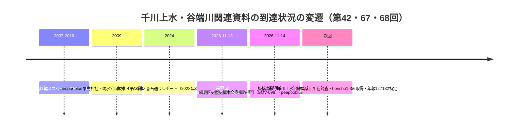

# 2026-11-14（第68回）・練馬区史歴史編本文取得・nabunken年報ID調査・巻石通り整備計画

第67回（コミット bd2d9c2）の続き。search_codeは本セッション未検証（tarball展開ローカルgrepで重複確認を代替）。push前にAPIで最新headを再取得して競合確認。

## 取得した新情報

### 1. 練馬区史歴史編の本文XHTMLが直接取得可（i-repository新ルート・GOV-098）

- `https://www2.i-repository.net/contents/myc/text_2rekishihen/rekishihen_honchoX.xhtml` の形式で『練馬区史 歴史編』の本文が機械可読XHTMLとして公開されており、curl+UAで本文全文取得可（honcho4＝第四部近世・約360KB、honcho5＝近代用水史・約440KB）。**第20回以来「i-repository本文遮断」としてきた練馬区史系の新しい直接取得ルート**（[GOV-098](../sources/gov/GOV-098.md)として新規登録）。
- **千川上水の基礎史料の所在が本文に明記**: 「千川上水起立之義」「千川上水古記録上申」「千川上水路履暦」の三書は**豊島区西福寺所蔵の千川家文書**で、明治13年までの記録がある「千川上水路履暦」が中心〔neribun 297点（GOV-089）との異同は未確認〕。宝永4年灌漑許可を「**千川文書写**」（東京都公文書館蔵と推定されるが本文に請求番号なし）所収原文として引用し、**高札16か所（うち8か所新規修覆）**・水料米3升/反・担当奉行4名の文言は**repo初出**。
- **昭和6年「東京市第二水道拡張計画参考書」の定量値**: 最大取水量0.844 m³/s・灌漑面積88町4反歩・利用人員2,750人（飲用2,130人）・水車4台・六義園引水1か所〔数値群としてrepo初出〕。
- **水車不許可の練馬区史側裏付け**: 文化4年・文化6年の水車願いが天明以降の不許可方針で却下、「**遂に明治に至るまで、この水系での水車稼は見ることが出来なかった**」〔[BLOG-094](../sources/blogs/BLOG-094.md)の板橋区史側記述の独立裏付け。明治17年路図の8水車（BLOG-094）との折り合わせは解釈を保留〕。
- honcho5では**中新井川への江戸期引水**〔GOV-005・ORG-020の裏付け〕と**田柄用水の詳述**（明治4年秋完成・玉川上水北側新井筋分水・田無町外八か村組合）を確認〔BLOG-118「千川から田柄川を引いた説」の背景資料。田柄用水は玉川上水起水で千川との直接関係は本文上明示なし〕。
- **参考文献に都立板橋高校『千川上水沿線集落』（昭和31年）**を見出し、[BOOK-084](../sources/books/BOOK-084.md)として書誌のみ新規登録（所在調査は次回課題）。
- **制限**: 区史歴史編の刊年特定不可（本文が昭和51年文献まで引用するため昭和51年以降と推定のみ）。honcho1〜3・6以降は未取得で、谷端川・弦巻川・水窪川の記述有無は未確認。

### 2. peepooblue「東京の池」（2009）の本文直接取得可（BLOG-217・第42回課題の解消）

- 第42回では「本文取得不可」だった粟島神社弁天池（2009-10-27）・谷端川親水公園（2009-11-04）の両記事がcurlで直接取得可に変化。[BLOG-217](../sources/blogs/BLOG-217.md)として登録。
- **粟島神社**: 「地元の人々が湧水の池のほとりに水神を祀ったのが始まり」「**現在は湧水も失われ、人工的に給水**」（2009年観察）〔湧水枯渇の時点観察としてrepo初出〕。雨乞いの神事の言及もある。
- **谷端川流路**: 弁天池＝水源のひとつ、旧流路（椎名町駅付近で東折→山手通り東側で北上→下板橋駅・板橋駅→大塚→小石川→神田川合流）→**板橋駅付近から北流して石神井川接続に流路変更**・現在は完全暗渠化・山手通り並行区間が緑道〔BLOG-101・MAP-160系の流路変更2段階説の一般記事側裏付け〕。
- **谷端川親水公園**（池袋3-2-5・山手通りと要町通り交差点の北東）: 壁面から落ちる滝・スイレン・花菖蒲・金魚の2009年現況を観察記録〔GOV-097近傍の谷端川緑道の2009年時点の様子〕。

### 3. 巻石通りの整備計画（GOV-097・BLOG-218）

- 文京区のバリアフリー整備頁で巻石通り（区道889号・音羽2丁目〜水道2丁目）が**平成28年度ネットワーク計画対象、令和8年度着工予定**と確認〔[GOV-097](../sources/gov/GOV-097.md)〕。
- いたくら美千代区議のレポート（2024-07-15・[BLOG-218](../sources/blogs/BLOG-218.md)）で**音羽通り〜江戸川橋体育館400m区間の管路工事が2024-05-24終了・バリアフリー工事込みで2028年3月完成予定・第2期（安藤坂〜金富小学校）は2024年度設計＋埋蔵文化財調査**と確認。**第2期の埋蔵文化財調査は、旧谷端川・小石川低地縁の音羽・水道周辺で遺構確認の機会が生じる可能性**がある点を記録価値ありと判断（結果は未公表・断定しない）。

### 4. nabunken年報IDの特定（第67回課題の部分解消）

- 板橋区立郷土資料館**年報**の総覧IDを特定: **127130（1988-03）・127131（1989-03）・127133（1993-03）・127134（1994-03）・127135（1995-03）・127136（1996-03）・127137（1997-02）・127138（1998-01）・127139（1999-01）・127140（1999-09）・127141（2000-09）・127142（2001-09）・127143（2002-12）・127147（2011-03・紀要18号と合綴）・127148（2013-03）**。
- 年報ページには**目次表示なし・巻号表示なし**で、所収論文の書誌はこれだけでは取れない（ID特定のみ）。127132の該当・年報第2〜5号相当の欠落との対応づけは次回以降。

## アクセス不能・見送り

- **echo-lab.ddo.jp**: DNS解決するがNo route to host＝サーバ停止。Wayback CDXに紀要20号（1991）配下のPDF収蔵なし〔PAP-029格上げは不変の継続課題〕。
- **CiNii OpenSearch API**: 遮断（0件応答）。
- **東京都公文書館デジタルアーカイブ（dasasp03.i-repository.net）**: bsearch APIはセッション必須で不可。archives.metro.tokyo.lg.jpは403。
- **板橋区WAF**: 継続遮断（浸水履歴PDFのWayback収蔵なし）。
- **武蔵アルバム・Fauna PDF**: 画像のみでテキスト層なし・pip不可でOCR不能（第67回と同一状況）。

## 千川上水・谷端川の情報源の変遷

## 次回以降の課題

1. 都立板橋高校『千川上水沿線集落』（昭和31年・BOOK-084）の所蔵調査（NDL・都立中央・板橋郷土資料館）。
2. 練馬区史歴史編 honcho1〜3・6以降の取得（谷端川・弦巻川・水窪川記述の有無）・刊年の特定。
3. 「千川上水路履暦」三書（西福寺所蔵）とneribun 297点（GOV-089）の対応。「千川文書写」の都公文書館請求番号。
4. nabunken年報127132の特定・年報目次の取得手段。
5. echo-lab.ddo.jpの復旧監視（PAP-029格上げ）。
