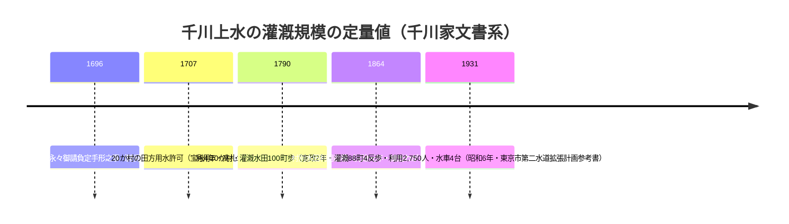

# 2026-11-14（第69回）・練馬区史歴史編第六〜八部の千川地蔵造立年・道しるべ地蔵・寛政2年定量値の追加調査

第68回で直接取得ルートを確立した『練馬区史 歴史編』本文XHTML（i-repository）のうち、第68回未取得だった honcho1〜3・6〜8 を取得して四河川関連記述を精査した。あわせて nabunken 年報ID（第68回課題④）を確認し、Web・報道検索で新情報の有無を確認した。

## 取得と確認状況

- **honcho1（第一部 練馬、地と人と）・honcho2（第二部 埋蔵文化財）・honcho3（第三部 古代・中世）**: 千川上水・谷端川・弦巻川・水窪川の言及なし（キーワード走査で確認）。地文・地形記述に本四河川の手がかりは見えず。
- **honcho4・honcho5**: 第68回（[GOV-098](../sources/gov/GOV-098.md)）で登録済み。今回再取得して差分なし。
- **honcho6（第六部 社寺・民俗・約170,000字）・honcho7（第七部 歴史資料編・約163,000字）・honcho8（第八部 年表稿・約47,000字）**: 千川上水関連の新情報を確認（下記）。**谷端川・弦巻川・水窪川の固有名の言及は honcho6〜8 でも確認できず**（練馬区史の記述範囲は千川上水系が中心）。
- **honcho9**: XHTML不存在（404）。第八部で全巻完結と判断。
- **現勢資料編（GOV-075）の本文XHTML**: `text_2genseihen` 系URLは404で、現勢資料編の本文テキスト公開は確認できず（スニペット経由のまま）。

## 今回の新情報（GOV-098追記・GAZ-022追記・BOOK-085/086新規）

### 千川地蔵の造立年・移設年次（honcho6・第六部第一章）

「千川地蔵（丸彫 享保十一年〔1726〕旭丘2-15-5 能満寺）」と、**造立年（享保11年）・現所在地**が区史レベルで明記されていたのは repo初出。また「**昭和27年千川上水暗渠工事のため、能満寺の境内へ移された**」と移設理由・年次が具体的で、[PAP-027](../sources/papers/PAP-027.md)（深田2013）の「1940年代移設」説と年次が食い違う。

- 発見年次は大正14年（1925）川ざらい（[PAP-027](../sources/papers/PAP-027.md)・[BLOG-032](../sources/blogs/BLOG-032.md)）で一致。
- 能満寺縁起側の叙述は「**明治末年**に千川上水から拾い上げた」とも伝え、発見時期の第3表記が現れた。断定せず3表記を並記。
- 移設「昭和27年」は [BLOG-113](../sources/blogs/BLOG-113.md)（武蔵学園記念室年表）の「昭和27年3月暗渠着手」と整合するが、「1940年代」説との折り合わせは未解決。

### 道しるべ地蔵（repo初出の石仏）

「道しるべ地蔵（丸彫 享保元年〔1716〕丙申九月吉祥日 能満寺）」＝**千川堤沿いの清戸道にあり、道標を兼ねた地蔵**で、千川地蔵とともに能満寺へ移設。清戸道（千川上水沿いの東西古道）沿いの石仏として、上流域の通行史・千川堤の位置特定の手がかりになる。現物銘の直接確認は未実施。

### 阿弥陀堂墓地（北町2-18）の千川家墓

歴代没年（明和4年〜明治27年）は [GOV-078](../sources/gov/GOV-078.md) と同一データ。「千川徳兵衛の三代後、**北町の漆原家から養子に入った**関係から屋敷も北町に移った」の漆原家養子説の文言は repo初出。

### 谷原村条の千川上水堀の川幅（honcho7・GAZ-022追記）

『新編武蔵風土記稿』谷原村条の引用に「千川上水堀 村の巽の方にあり **幅二間許**」があり、谷原村（現富士見台）付近の川幅約3.6mの定量値を確認（[GAZ-022](../sources/gazetteers/GAZ-022.md)の画像読取では幅の文言は転記済みでなかった）。

### 郷土資料室蔵書目録（honcho7）からの新書誌

- **吉野俊『江戸上水史（千川上水の灌漑利用）』昭和30年** → [BOOK-085](../sources/books/BOOK-085.md)
- **東京都『千川上水の沿草』昭和27年** → [BOOK-086](../sources/books/BOOK-086.md)。昭和27年＝暗渠化着手期の行政側沿革書で、着手年次問題（[GOV-072](../sources/gov/GOV-072.md)）の一次資料候補。
- 「千川上水 石川乾二 昭16」表記＝[GOV-076](../sources/gov/GOV-076.md)「石山乾二」との表記差（どちらが正しいかは原本待ち）。
- 「水車（加藤八十八氏文書及び加藤家の水車稼について）」（明27）・「水車文書（武蔵野地方）」〔加藤家水車は未登録、現物確認待ち〕。

### 年表稿（honcho8）からの千川家文書の年次

- 元禄9年（1696）5月25日「**御上水永々御請負定手形之事**」（千川家文書）＝文書名 repo初出候補。
- **寛政2年（1790）: 千川上水利用村数20か村・灌漑水田面積100町歩**（千川家文書）＝repo初出の1790年定量値。[GOV-067](../sources/gov/GOV-067.md)（元治元年1864・村別水田利用面積）と比較できる基準点。

## nabunken 年報ID（第68回課題④）

- **127132 = 板橋区立郷土資料館年報4号（1992年3月・板橋区教委・NCID AN10129248）** と特定。所収論文は「はじめに」（阿曽政昭）のみの目録で、四河川関連論文の掲載は目録レベルでは確認できず。
- 127147（年報22・23合冊・2011・紀要18号と合綴）・127148（年報24・25合冊・2013・紀要19号と合綴）も確認。いずれも所収論文は「はじめに」のみ。

## 見送り・アクセス不能

- Web検索（2026-10-01以降）・news_search相当の新報道確認で、四河川関連の新情報なし。BE-PAL GREEN WAY FILE.49（竪川）・宇田川記事（渋谷）・中野区観光協会暗渠コラムはいずれも対象外の川。
- 現勢資料編本文XHTML（text_2genseihen系）は404。

## 次回課題

1. **道しるべ地蔵・千川地蔵の現地採録**（能満寺・旭丘2-15-5。造立享保11年/享保元年の銘確認＝最重要）。
2. BOOK-085・BOOK-086・BOOK-084の所蔵調査（NDL・練馬区立図書館・水道歴史館）。
3. 加藤八十八氏文書（明治27年・水車）の所在と千川上水との関係。
4. 大系本コマ139谷原村条「幅二間許」の直接再読取・浄書本照合。
5. 「御上水永々御請負定手形之事」の千川家文書297点（neribun・[GOV-089](../sources/gov/GOV-089.md)）内での対応文書特定。
6. （継続）echo-lab紀要20号（PAP-029格上げ）・武蔵アルバムOCR・かたりべ45号OCR・角田2023本文・README保留bullet（第6回分は第65回で解消済み、以降分は各回bulletとして反映済み）・西光院橋供養碑現地採録。
