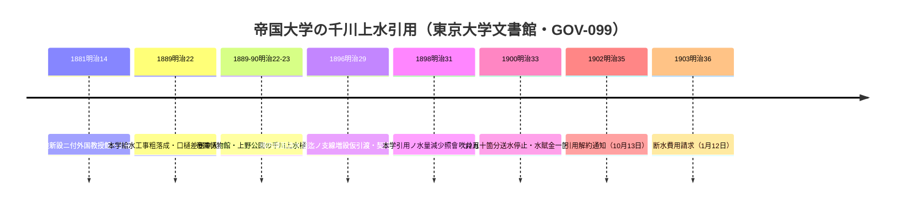

# 2026-11-14（第70回）・東京大学文書館の千川引用17件・小川家文書目録・山口1976・森島2023・吉野1955の追加調査

第69回までの残課題（BOOK-084/085/086の所在調査・角田2023本文・echo-lab紀要20号・OCR環境）を確認しつつ、**NDLサーチのOpenSearch API（ndlsearch.ndl.go.jp）がcurl+UAで直接利用できる**ことを本回発見し、これを軸に公的アーカイブ横断の新情報を調査した。

## 環境の確認

- **pip/パッケージ導入は禁止**のため、武蔵学園千川上水調査アルバムPDF・かたりべ45号PDFのOCR判読は今回も不可（第66・67回と同じ結論。`PIL`・`tesseract`なし）。
- **ndlsearch OpenSearch API**（`https://ndlsearch.ndl.go.jp/api/opensearch?any=…&cnt=20`）が有効。adeac（小平・豊島）・東京大学デジタルアーカイブ・nabunken・CiNiiの索引を横断して発見に使える**新しい汎用手法**（従来のgoogle系検索では拾えない個別目録レコードが出る）。
- **東京大学文書館デジタル・アーカイブ**（uta.u-tokyo.ac.jp）の検索 `docarchive?search=…` もcurl+UAで動作（フォームの `search` パラメータを特定）。
- アクセス不能: nabunken（アクセス集中が本回継続・吉野1955の総覧ページ本文取得不可）、CiNii/cir.nii（遮断）、meiji.repo（JAIRO Cloudメンテ継続）、echo-lab.ddo.jp（ドメイン沈静化の見立てどおり接続不成立）、東京大学デジタルアーカイブポータルの検索URL（ポータルは403、文書館直が有効）。

## 今回の新情報（GOV-099・GOV-100・PAP-047〜049新規・BOOK-085追記）

### 東京大学文書館の千川関係17件（GOV-099＝本回最大の収穫）

帝国大学（→東京帝大）の**千川上水引用の通史**が一次文書の年次で一括確認できた。mermaidで整理すると:

- **上野公園への千川上水樋線（谷中上三崎北町→上野公園・土管）の伏替工事記録（明治29年）**は、森島2021が三菱史料館「樋線切絵図11葉」から復元した支線（白山坂上→肴町→千駄木林町→谷中三崎町→上野公園）の**維持実務を裏付ける行政文書**。
- **明治31年「水量減少照會」**は、世紀転換期の千川上水水量低下を文書レベルで指摘する最初の一次記録として、湧水・透水面減衰仮説（PAP-018/PAP-021/PAP-028）の文書側傍証候補。
- **竹内松次郎「千川上水ノ由来並千川堤桜ノ事」**（柏図書館蔵・冊子2点・1932年頃/1937年以降推測・要審査）＝千川堤桜（植桜楓碑1915・千川通りの桜1957）を主題とする昭和期冊子の実在。
- 東大引用解約（明治35年）は千川水道会社解散（1908年・森島2021）の6年前で、大口需要者離脱の過程が年次で並んだ。

### 小平市立図書館ADEAC・小川家文書の千川関係目録（GOV-100）

- **安永6年（1777）「千川上水江戸内懸渡願ニ付願人筆頭の件」**（差出6名・宛所宇田川長十郎殿）
- **天明2年（1782）「千川上水素堀通御高札見守之儀ニ付請書」**（西窪村他5か村14名→関東郡代伊奈半左衛門宛）＝「素堀通」文言repo初出候補。宝永4年御高札16か所（GOV-098）の維持側の村方請負文書。
- **天明3年頃「千川上水土手萱課苅取二付口上之覚」**＝千川堤の草刈管理。
- **安永10年「千川上水土手敷の件ニ付金子請取手形」**・「御請負渡世取続金ニ付証文」
- **明治13年（1880）「号外（千川水道之義ニ付故障云々の上申却下ニ付達）」**（北多摩郡役所→小川村戸長中）＝千川水道会社設立期の沿線村側の摩擦を伝える行政文書。
- いずれも**東京都指定有形文化財（古文書）**・本文画像は未公開。小川家文書＝千川家文書とは別系統の、**水源側（小川村）から見た千川上水運営の文書群**。

### 学術書誌3件（PAP-047〜049）

- **山口高志1976**「雨天時合流式下水道からの汚濁流出シミュレーション──都内谷端川排水区の場合」『土木技術資料』18(2) pp.71–76＝[PAP-003](../sources/papers/PAP-003.md)（1975年観測資料）のデータを用いた**谷端川排水区の汚濁流出解析記事**。
- **森島知之2023**「明治前半期の会社形式による水道設置──千川水道会社を例に」『駿台史學』179 pp.1–26＝2021年論文の後続でrepo未収録だった。
- **吉野俊1955**「千川上水の灌漑利用について 江戸上水史の一こま」『西郊文化』1955-06-26 pp.2–9＝[BOOK-085](../sources/books/BOOK-085.md)単行書の同年の記事版にあたる書誌。

## 重複確認・見送り

- 「絵図と写真に見る千川上水」（練馬区ふるさと文化館2013）＝BOOK-018既登録。
- 大橋欣治「江戸・東京の水利探訪」＝PAP-023既登録。adeac豊島区「まち歩きアルバム 千川」（令和4年）＝adeac既知系列（READMEの50年のあゆみ関連と同系統の頁で、判読手段がadeac viewer依存のままのため本次は資料化せず）。
- 建設省土木研究所「都内谷端川・桃園川排水区水文観測資料/測定資料」1975＝PAP-003で既にPDF判読まで実施済み。
- 雑司が谷講演会プレスリリース（2000・mp408233）・『写真でみる豊島区50年のあゆみ』NDLデジタルコレクション（pid 9642736）＝README既述（adeac viewerの頁判読課題のまま、NDL版はIIIFマニフェスト取得不可）。
- news_search（谷端川・千川上水・池袋下水道幹線）で四河川関連の新報道なし。

## 次回課題

1. **GOV-099の各文書本文**（IIIF画像の判読・S0004系の画像有無確認・要審査のF0264竹内冊子の閲覧手続き）。特に明治31年水量減少照會・明治14年引樋の本文。
2. **GOV-100の小川家文書目録（上・下）の全体調査**（adeac JS描画の回避・NDL索引語の網羅）と、安永6年懸渡願の差出人6名と千川家系譜の照合。
3. nabunken復旧後の吉野1955（PAP-049）の総覧ページ本文と『西郊文化』の書誌特定。
4. 森島2023（PAP-048）本文＝meiji.repo復旧後の取得（2021年論文との差分確認）。
5. 山口1976（PAP-047）本文＝NDL個人送信・図書館現物。
6. （継続）echo-lab紀要20号（PAP-029格上げ）・武蔵アルバム・かたりべ45号のOCR環境のある実行・BOOK-062現物・西光院橋供養碑現地採録・角田2023本文・Fauna No.1種名特定。
