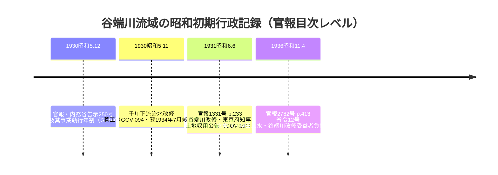

# 2026-11-14（第71回）・官報の谷端川改修記録2件・江戸会誌横井時冬記事・NDL索引の豊島区記録群の追加調査

第70回で確立した**NDLサーチOpenSearch API**を軸に、四河川名の全面走査（千川上水・谷端川・弦巻川・水窪川）を行い、repo未収録の書誌を6件登録した。あわせて**NDLデジタルコレクションの本文HTMLページは遮断されるがIIIF API（`https://dl.ndl.go.jp/api/iiif/<pid>/manifest.json`）は官報等のインターネット公開資料で有効**であることを発見した。

## 環境・手法の確認

- pip/パッケージ導入は禁止（`PIL`・`tesseract`なし）。武蔵アルバム・かたりべ45号のOCR判読は今回も不可。
- **ndlsearch OpenSearch APIが引き続き有効**。四河川名の全件走査で、雑誌記事索引（江戸会誌・観光文化・西郊文化）・官報の目次・豊島区立図書館の区政資料レコード（R100000094）が出る。
- **NDLデジタルコレクションのIIIF API発見（本回最大の手法上の収穫）**: `dl.ndl.go.jp/pid/<pid>` のHTMLは遮断されるが、**`dl.ndl.go.jp/api/iiif/<pid>/manifest.json` は官報などインターネット公開資料で有効**（官報1931-06-09＝PID 2957799で全26コマの画像URL取得を確認）。ただし江戸会誌（PID 2895780）・観光文化（PID 2835474）は「checkResult: NG」で画像配信されず〔複製制限・個人送信対象などの可能性。要因は未確認〕。
- **東京大学文書館のIIIF画像実URL特定**: GOV-099のS0001/Mo110/0098（明治29年・煉瓦造水溜支線）のIIIF画像3枚を`uta.u-tokyo.ac.jp/uta/files/original/<hash>.jpg`で取得できた（手書きのため機械判読不可・人手待ち）。
- **meiji.repo（森島2021・PAP-017）の本文PDFをWayback 2025-07-30スナップショットで取得**（6.9MB・12ページ）。ただしテキスト層はCIDフォントエンコードで抽出不能（表題英題は判読）。Waybackは一時的に429レート制限が出たが待機後に取得成功。
- アクセス不能: nabunken（吉野1955の総覧ページ本文）・CiNii/cir.nii・meiji.repo直（JAIRO Cloud継続）・echo-lab.ddo.jp（DNS解決するがNo route・沈静化）。**news_search（11月以降）で四河川関連の新報道なし**。

## 今回の新情報（GOV-101〜104・PAP-050/051新規・PAP-017/GOV-099更新）

### 官報の谷端川改修記録2件（GOV-101・GOV-102＝本回最大の収穫）

NDLサーチの官報目次索引から、**谷端川改修の一次行政記録2件**を発見した。昭和初期の谷端川流域の行政過程を官報レベルで並べると:

- **1931年6月9日の土地収用公告**は、README既述の「昭和5〜6年に谷端川など7河川の改修計画告示」（都土木年報）と年次が一致する。**IIIFマニフェストが取得できているため、p.233の該当コマ判読で公告本文（収用対象地・起終点）が読める可能性がある**＝谷端川放水路1924/25年次問題・改修区間比定への次の一手。
- **1936年4月14日の省令12号**は谷端川・神田上水（谷端川下流の小石川系）・立會川（石神井川下流候補）の改修受益者負担を一括で定める。**1936年時点でも改修事業の費用徴収が続いていた**ことを示唆する〔千川下流竣工1934以降の全流域改修の継続候補。本文未読のため断定しない〕。
- 官報の「水窪川」hit（1924・1927・1929・1934）はすべて**静岡県の水窪川水力電氣株式会社**（遠信省の電気事業認定等）で、東京の水窪川とは無関係と確認した〔誤同定防止の記録〕。

### 江戸会誌の横井時冬記事（PAP-050）

- 横井時冬「上水渠鑿通ノ紀事──(神田上水○千川上水)」『江戸会誌』2(12)・1890年12月・pp.39-40〔NDLデジタルコレクションPID 2895780・「全文あり」〕。**明治23年の千川上水開鑿史記事でrepo初出**。横井時冬は江戸地誌研究の大家で、千川水道会社給水期（1881-1908）直後の研究史の起点になり得る。IIIF画像は配信NGのため本文未確認。
- 同じNDL索引で**柳井乃武夫「千川上水」『観光文化』13(2)(74)・1989年3月・p.1**（PAP-051）もrepo初出。清流復活（平成元年）直前の一般向け記事。

### 豊島区立図書館区政資料の水辺記録（GOV-103・GOV-104）

- 谷端川: **1991年2月20日の公園条例・児童遊園条例改正議案資料**（谷端川南・北緑道を条例上の公園に位置づける議案）と**2001年7月31日の「谷端川一号幹線の一部完了について」**（副都心開発調査特別委員会資料・「谷端川一号幹線」という幹線名がrepo初出）。
- 弦巻川・水窪川: **2000年2月13日の「弦巻川の昔を語る 名こそ流れて」講演会**（雑司が谷を語る集い）・**1999年10月9日の水窪川跡フィールドワーク開催**・**2018年の「弦巻川がきえちゃったよ」**（資料種別不明）。
- **2000年1月21日の広報記事**「かつて区内を流れていた川筋を辿って 冊子『旧谷端川の橋の跡を探る』…」＝BOOK-062の発行時点の広報記録。

### PAP-017の書誌確定（森島2021）

- NDLサーチ書誌で**著者＝森島知之・誌名＝『文学研究論集』55号（2021年度・明治大学大学院文学研究科）・2021年9月10日・pp.129-139**を確定し、PAP-017の「著者名・誌名・巻号未確認」制限を解消。本文PDF（Wayback取得）の英題も確認。ステータスをREADME本文引用と整合する直接確認へ格上げした（PDFの新規判読はCIDエンコードで不可）。

### その他の記録（ノートのみ）

- **朝日新聞「楽問のススメ」2026年11月14日付で本田創インタビュー「不自然に曲がった道、細長い緑道 街の歴史が見える『暗渠』の魅力」**（聞き手・立岩穣一）。掲載当日のため本文は有料部分まで未取得だが、**撮影場所が板橋区大山東町（2026年10月7日）＝千川上水暗渠沿い**で、本田創の原点が東京・田端の谷田川（小3時に暗渠と知った）とある。四河川の直接の新情報ではないためsource file化せず、本田創関連記事の時系列（BLOG-130・BOOK-078・BLOG-089/114等）に加わる最新データポイントとして記録。
- Wander x Wonder水窪川暗渠ツアー頁（2026-06-28・第39回404→本回アクセス可）。本田創プロフィール（1972年新宿区生まれ・1997年から活動）と**ルート詳細（江戸川橋→音羽今宮神社→大塚坂下通り→東池袋→美久仁小路・約4.8km）**を確認。イベント告知頁のためsource file化せず（第47回の見送り判断を維持）。
- NDL索引の「池袋木賃アパート生活5年のあとさき」（2026・谷端川hit）は回想文学作品で、谷端川言及の有無が見えないため見送り。「海」1978-08・「清春」1996-04の谷端川hitも本文不明のため見送り。
- 4travel福ヒット2026-04-22谷端川暗渠緑道・露塵散note111・文春88508/88509・Natrium yabata01・Wikipedia各項目＝いずれも既収録の再構成で差分なし。

## 次回課題

1. **官報1931-06-09のp.233該当コマ判読**（IIIFマニフェスト取得済み・26コマ中の特定が先決）＝谷端川改修の収用対象区間が読めれば放水路年次問題への最重要の手がかり。
2. 官報1936-04-14（PID 2959262）のIIIFマニフェスト取得と省令12号本文判読。
3. 江戸会誌（PID 2895780）・観光文化（PID 2835474）の本文閲覧手段（IIIF NGのため図書館複写・NDL内閲覧）。
4. 「谷端川一号幹線」の区間・処理区対応（豊島区議会会議録・下水道台帳）。
5. （継続）echo-lab紀要20号・武蔵アルバムOCR・かたりべ45号OCR・BOOK-062現物・西光院橋供養碑現地採録・角田2023本文・Fauna No.1種名・板橋区WAF回避。
