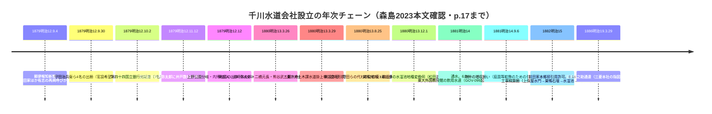
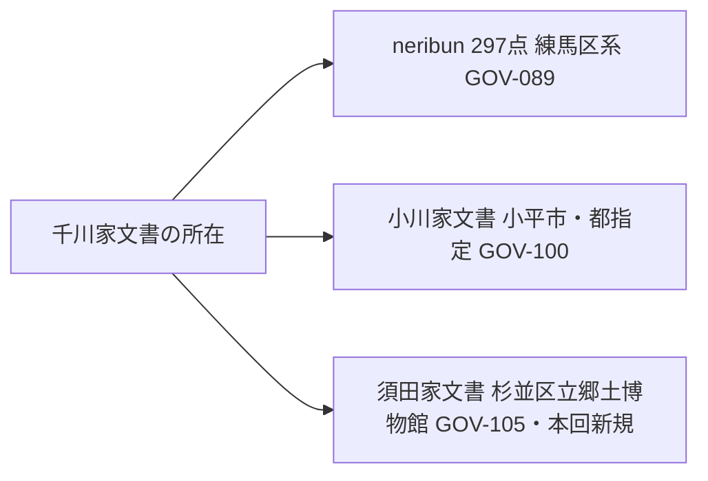

# 2026-11-14（第72回）・森島2023本文直接確認・小川家文書4件追記・杉並須田家文書・豊島区ADEAC目録所在特定の追加調査

第70〜71回で確立した**NDLサーチOpenSearch API＋ADEAC目録ページのSSR取得＋Wayback id_付きURL取得**を軸に、第71回（並行実行・コミット81e8902）が登録した「所在のみ」資料の**格上げ・所在特定**を中心に調査した。他実行との並走を考慮し、作業前に最新main（81e8902）を取り直してdedupe・採番をやり直した（第71回はNDL書誌レベルの登録で、本回のADEAC・本文レベルの到達分は重複なし）。

## 環境・手法の確認

- **meiji.repoの本文PDFをWayback id_付きURLで取得し、zlib＋ToUnicode CMap自作スクリプトでテキスト抽出に成功**（`sundaishigaku_179_(1).pdf`＝森島2023＝PAP-048）。第71回「CIDフォントエンコードで抽出不能」だった森島2021とは異なり、2023年論文はテキスト層のCMapが解決できた。**ただしcurlは1MB（1048576バイト）で打ち切られるため、全27コマ中約16コマ分（本文pp.1〜17程度）のみ取得**。以後のPDF取得はレンジ分割が必要。
- ADEACの各機関コレクション目録頁（`adeac.jp/<機関>/catalog/<ID>`）はcurl+UAでSSR本文取得可。小平市立図書館・杉並区立郷土博物館・としまひすとりぃ・駒込図書館で千川・谷端川関係の個別レコード探索。
- NDLサーチOpenSearch APIは継続有効（429回避にsleepを挟む）。吉井忠・吉村生の2記事の雑誌名を今回特定。

## 本回の格上げ・新規登録

### 1. PAP-048（森島知之2023『駿台史學』179）を「所在のみ」→「直接確認」へ格上げ〔本回最大の収穫〕

本文pp.1〜17程度（全27頁中）をテキスト抽出し、千川水道会社（1879-1886〜明治40年頃）の設立過程を文書の日付つきで確認した。年次チェーン:

- **新確認の要点**: ①主史料に**三菱史料館所蔵史料**（「千川上水 各自引用樋線切絵図11葉」MA-01209など）と尊経閣文庫。②**明治12年の再興運動の担い手（守田治兵衛・平山省斎・小木曽冨蔵・増田寿平）と明治13年の発起人（岩崎・二橋・熊谷・寺西）が交代している**。③**巣鴨村の水溜池の土地（7反1畝11歩）を会社が買入れ、地券は岩崎弥太郎名義**・水番人（澤田陶三）の雇入届＝水溜池の所有・管理が会社側。④根岸邸の引水は**上野公園の博物局引用権の一部譲渡**で、滝（瀧吹井146個6分）として利用・1896『古今秘伝・築山造庭法』に銅版画掲載。⑤水番人をめぐっては1880年10月の村人志願を東京府が「会社之所属」と却下。
- **未取得（pp.18〜26）**: 岩崎邸（富士前町邸ほか4邸）の詳細・結章・第1表。図版（第1図・第2図）も未判読。
- **千川家文書の所在が3系統になった**（下記）:

### 2. GOV-100（小川家文書）へ4件追記

- **宝永4年（1707）「証文之事（千川上水呑水水餘水田地掛ケの件）」SZ107279**: 宛所＝**「千川徳兵衛殿 他3名」**＝千川家請負人四軒（GOV-090）への宛所の目録レベル確認〔repo初出〕。
- **天明5年（1785）「（肥代御貸附願）」SZ106807**: 差出＝**千川上水請負人 小川村名主弥次郎**〔安永6年懸渡願の小川弥次郎と同人候補・比定は断定しない〕。
- **「辰御手当金請取証」SZ107253・「水番御手当金受取」SZ107262**＝**関前新田 水番所甚蔵**〔江戸期の水番所の運営記録としてrepo初出・BLOG-131（南長崎6丁目の水番所跡）と接続〕。

### 3. GOV-105（新規）: 杉並区立郷土博物館ADEACの千川関係3件

- **須田家文書「覚（分水口水門差蓋笠木ほか伏替のため立合に付）」mus-013863**: 差出＝**千川善蔵・千川金七**／受取＝遅野井・天沼・荻久保・阿左ヶ谷・鷺宮・井草・中村の7か村。〔千川家文書の第三系統・分水口水門修理への受益村立会い。GOV-016（星野家文書・樋口伏替願1877）と同じ杉並区コレクション群〕
- **矢嶋又次記憶画「天沼弁天池」mus-003877（1978・水彩）**: 公開解説に「千川上水の分流と共に、天沼、阿佐ヶ谷の田に利用され」〔BLOG-162の記憶画の一枚の所在特定〕。
- **広報写真「井草五丁目の千川上水街道」koho-photo-264（昭和23年＝1948年撮影）**: 「千川上水街道」呼称の1948年用例〔repo初出文言候補〕。

### 4. GOV-106（新規）: としまひすとりぃ（ADEAC）の所在特定

- GOV-103①②（NDL書誌レベル）の2件が**ADEACに個別レコードとして公開されている**ことを特定。特に**「谷端川一号幹線の一部完了について」mp15101290は会議録「13_H130731_00」＋資料5点でCC BY**＝谷端川三幹線処理区対応問題（第24回ノート）への本文アクセス経路が開けた。
- 併せて「谷端川緑道整備工事」mp10001890（H2.10.5企画総務委員会）・平成報道写真「谷端川緑道全線開通」gp1991040100（1991.4.1・プレスリリースH030514）を所在記録。

### 5. PAP-052/053（新規・所在のみ）: NDL雑誌記事索引の谷端川2記事の雑誌名特定

- **吉井忠「谷端川の近く--東長崎村に集まった画家たち」『清春』23号・1996年4月・pp.44–47（芸術村特集）**＝谷端川と東長崎の画家集団（中村彝ら芸術家村史）〔repo初出〕。
- **吉村生「谷端川 遺された橋に映る在りし日の営み。」『東京人』38巻6号（466）・2023年6月・pp.52-55（特集 東京地形散歩2023; 暗橋）**＝BOOK-062以来の橋遺構系記事〔repo初出〕。

### 6. BOOK-037（紙芝居『弦巻川がきえちゃったよ』）へADEAC個別レコード追記

- 駒込図書館「さくらデジタルコレクション・豊島区の民話」の**個別目録レコード（mp350180-200035）**を特定。製作＝雑司ヶ谷ルネサンスの会×豊島区親子読書連絡会。GOV-104③（NDL側レコード）との対応づけ。

## 未反映・次回への引き継ぎ

- 森島2023のpp.18〜26（岩崎邸・結章）は1MB上限のため未取得。レンジ分割リクエストかIIIFでの取得が次回課題。
- 杉並区立郷土博物館（adeac suginami-city）の千川関係の通し調査は初回で、須田家文書の千川関係の全体数・星野家文書（GOV-016）周辺の追加挖掘余地あり。
- 官報1931・1936（GOV-101/102・第71回）のIIIF画像判読（p.233・p.413）は第71回時点で未実施のまま。
- news_search相当の四河川新報道なし（前回から継続して変化なし）。
