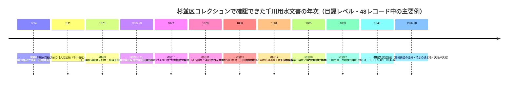

# 2026-11-14（第73回）・杉並区「千川」横断目録調査48レコード・千川養水路之件書類の所在特定・森島2023残頁の取得不能確認

## 概要

- 第72回の次回課題（①森島2023 pp.18〜26のレンジ分割取得・②mp15101290会議録本文・④adeac suginami-city通し調査）を中心に実施。
- **最大の成果: ADEAC杉並区立郷土博物館コレクションの詳細検索（mode=catalog・word=千川）で48目録レコードが一覧化できた**（[GOV-110](sources/gov/GOV-110.md)）。大部分は明治10〜20年代の須田家文書・星野家文書の千川用水経営文書。
- このうち新規source file: [GOV-107](sources/gov/GOV-107.md)（星野家文書「千川養水路之件書類」寛政6年1794）・[GOV-108](sources/gov/GOV-108.md)（須田家文書「（千川水口樋伏替に付人足出願）」・目録ページに翻刻全文掲載）・[GOV-109](sources/gov/GOV-109.md)（矢嶋又次記憶画2枚）・[GOV-110](sources/gov/GOV-110.md)（横断一覧＋星野家文書664点資料群レコード）。
- 既存更新: [GOV-105](sources/gov/GOV-105.md)（④koho-photo-084追記・未解決④の解消）・[GOV-005](sources/gov/GOV-005.md)（「千川養水路之件書類」「樋口伏替願」の所在特定）・[PAP-048](sources/papers/PAP-048.md)（残頁の取得不能を確認）。

## 1. 森島2023 pp.18〜26: 取得不能の確認〔PAP-048更新〕

- Waybackの当該PDF（`web.archive.org/web/20250119160027id_/…/record/2000160/files/sundaishigaku_179_(1).pdf`）をHEAD/レンジリクエストで確認したところ、**アーカイブ収蔵版自体が1,048,576バイト（1MB）で打ち切られた版**（`x-archive-orig-crawler-content-length: 1869796`・`x-archive-orig-content-length: 1048576`）。**残り約820KB分はアーカイブ上に存在せず、レンジ分割取得は不可能**。
- 他タイムスタンプ（20250320084114・20240601・20230901・20260101）指定はすべて同一1MB版へのリダイレクト。
- meiji.repo直（/records/2000160・handle 10291/0002000160）は503（JAIRO Cloudメンテ）継続。
- **結論: 森島2023の岩崎邸詳細・結章・第1表はWeb経由では本文確認手段が現状ない**（明治大学での現物閲覧が残る）。PAP-048の制限記述を「取得不能」に更新。

## 2. ADEAC杉並区「千川」横断目録調査〔GOV-110〕

- 詳細検索URL: `https://adeac.jp/suginami-city/detailed-search?mode=catalog&word=千川&op=and`（curl+UAでSSR本文取得可・結果は1ページに全48件）。
- **48レコード中37レコードは目録ID未特定**（検索結果カードのリンクがPostBack遷移で、デジタル化済み〔サムネイルあり〕の11レコードのみカード内に`catalog/<id>`が現れる）。個別目録ページのURL特定は次回課題。
- 目録レベルで読み取れる千川用水経営の主題別広がり（賦金・割附／護岸・修繕・橋梁／浚渫／樋伏替／分水口増水・新設／水番・見守人手当／玉川上水源費）の全体像は第73回ノートの下図のとおり:

- 注目の新文言（いずれもrepo初出・タイトルレベル）: 「**千川養水拾七ヶ村組合**」「**千川養水掛田**」「**関村地内千川田用水口線路へ青梅街道道路下水ヨリ掛樋ニテ流込**」（明治17年・[GOV-068](sources/gov/GOV-068.md)関村分水と接続）「**竹下新田分水口之義ニ付新井村武蔵屋出頭被下度**」（明治18年・差出下練馬村千川善造）「**神田・玉川両上水水源費・千川分水村々引取水積高書上**」（明治12年・千川を「分水」とする用例）。

## 3. 個別レコードの直接確認

- **mus-002476「千川養水路之件書類」寛政6年5月（1794）**（星野家文書・星野兼五郎差出・1冊竪帳・杉並区指定文化財平成23年度）＝[GOV-005](sources/gov/GOV-005.md)（練馬区の分水記事が引用し「所在は記事に記載なし」としていた史料）の**所在特定**。翻刻は[BOOK-032](sources/books/BOOK-032.md)の1〜8頁（[GOV-016](sources/gov/GOV-016.md)の伏替願＝同書22〜25頁と同じ翻刻書）。
- **mus-013119「（千川水口樋伏替に付人足出願）」**（江戸・千川善蔵・千川金蔵・須田家文書・整理番号8-4-2）＝**目録ページの「翻刻」欄に廻状本文が全文掲載**（「此度千川水口樋伏替仕候間…明廿日・廿一日人足二人宛…二日之間御出し被下候」）。千川家側が沿線村に伏替人足を直接求めた運営実務の本文確認（[GOV-108](sources/gov/GOV-108.md)）。連名者がGOV-105①の「千川金七」と本 recordでは「**千川金蔵**」で表記が異なる（異同は断定しない）。
- **mus-000820 星野家文書資料群レコード**: 664点（江戸期13点・寛永7年1670「武州井草村御地詰帳」含む）・初回調査は『文化財シリーズ5 杉並の古文書目録』昭和48年（270点）→寄贈後の再整理で664点として平成23年度指定。千川用水分はBOOK-032として昭和58年刊行。〔GOV-110に記録〕
- **矢嶋又次記憶画2枚**（[GOV-109](sources/gov/GOV-109.md)）: 「青梅街道の追分」（1976）＝**天沼田んぼ・阿佐ヶ谷田んぼへの用水分岐点・現在は暗渠で下水道・川の上は商店会の仮設自転車置場**という解説文。「清水の湧水地」（1978）＝**清水一丁目の湧水池が千川用水（青梅街道清水郵便局際の分水）と沓掛田圃用水に合流し稲作利用・現在は湧水減少で余水は下水道**。「清水の町名も此の遊水池に依るものと思ふ」は矢嶋私説。

## 4. mp15101290会議録本文（としまひすとりぃ）

- viewerページ（`/toshima-history/viewer/mp15101290/13_H130731_15/`）を取得し、**構成ファイル7点（13_H130731_00/03/08/11/13/15/16）を確認**。ただし**すべてスキャン画像（JPEG・IIIF系ビューア提供）でテキスト層なし**。pip導入禁止でOCR環境がなく**本文判読は今回も不可能**（谷端川一号幹線区間特定＝第71回課題③は引き続きOCR環境のある実行・現物確認待ち）。

## 5. その他の調査（いずれも新規なし・記録のみ）

- **NDL OpenSearchで水窪川・弦巻川・谷端川を走査**: ヒットした豊島区プレスリリース（水窪川跡FW1999・弦巻川講演会2000・BOOK-062広報記事2000）・『旧谷端川の橋の跡を探る』・谷端川北緑道のまち歩きアルバム写真2件（2021・CC BY）は**いずれもGOV-104/BOOK-062既出・または写真1枚で河川情報なし**でsource file化せず。
- **官報1931-06-09 IIIF p.233コマ判読**: pip導入禁止（OCR不可）のため今回も着手できず。次回課題継続。
- **かたりべ45号PDF**: 第64回で1.6MB取得済みだがスキャンのみでテキスト層なし（今回も同様にOCR不可）。

## 6. 次回課題

1. **GOV-110の残り37レコードの個別目録ページURL特定**（PostBack遷移の回避手段: タイトル個別検索・IIIFマニフェスト欄・資料グループ頁の探索。須田家文書の翻刻書の有無も）
2. **mus-002476「千川養水路之件書類」の本文（翻刻BOOK-032の1〜8頁全文・江古田村田養水の文言）**＝GOV-005の「江古田村田養水」との照合
3. **mus-013119・mus-013863の年代・画像**（杉並区立郷土博物館での現物閲覧候補）
4. 森島2023 pp.18〜26はWeb手段が尽きたため**明治大学での現物確認**（またはCiNii論文メタデータの再確認）
5. （継続）官報1931 IIIF判読・adeac toshima会議録OCR・echo-lab紀要20号・BOOK-062現物・西光院橋供養碑現地採録・角田2023本文・Fauna No.1種名・joshuanchinシリーズ
