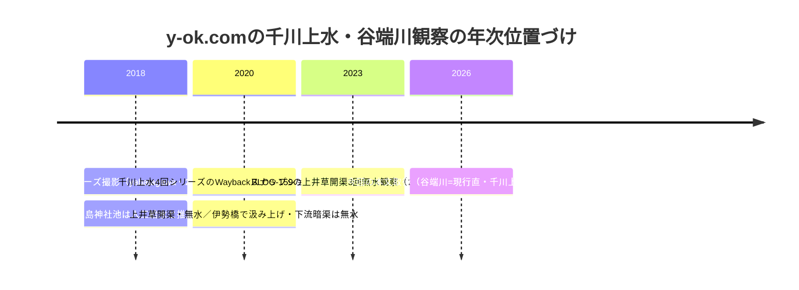

# 2026-11-14（第74回）・y-ok.com両シリーズの取得成功・文化遺産オンライン星野家文書・ADEAC残りレコードのデジタル化対象外確認

## 概要

- 第73回の次回課題（①GOV-110残りレコードのID特定・②BOOK-032翻刻・④諸課題）を中心に実施。
- **最大の成果: 第28回以来アクセス不能が継続していた y-ok.com（雄' Photo Page）の谷端川4回シリーズ（yabatagawa-1〜4）が現行で直接取得可能になった**（[BLOG-219](sources/blogs/BLOG-219.md)）。同サイトの千川上水4回シリーズ（senkawajosui-1〜4）は現行URLが空応答だが**Wayback id_付きURLで4頁すべて本文取得**（[BLOG-220](sources/blogs/BLOG-220.md)）。
- 新規source file: [BLOG-219](sources/blogs/BLOG-219.md)（谷端川4回・2018年撮影観察）・[BLOG-220](sources/blogs/BLOG-220.md)（千川上水4回・2020年時点観察）・[GOV-111](sources/gov/GOV-111.md)（文化遺産オンライン「星野家文書」指定データ）。
- 既存更新: [GOV-110](sources/gov/GOV-110.md)（第73回課題①「残り37レコードのID特定」を「デジタル化対象外でIDが存在しない」として解消）。

## 1. ADEAC杉並区「千川」横断: 残りレコードのID特定〔GOV-110更新〕

- 詳細検索（mode=catalog・word=千川）の結果ページを解析したところ、**48カードがすべて1ページに表示され、2ページ目は存在しない**（btnnextのPostBackも2ページ目なし）。
- 結果ページ内に個別目録ページ（catalog/<id>）へのリンクが現れるのは7レコードのみ: mus-000820（星野家文書資料群）・mus-002476（千川養水路之件書類）・mus-003860・mus-003877（矢嶋記憶画・天沼弁天池）・mus-003878・mus-013119（千川水口樋伏替）・mus-013863（須田家文書）。
- カードの`catalog_grid_rpt$ctlNN$catalogsLink`PostBackをパラメタ込みで再現（__EVENTTARGET/__EVENTVALIDATION等すべて送信）しても結果一覧が返るのみで個別カタログへは遷移しない。
- **結論: 残り41レコードはデジタル化されておらず、公開の個別目録IDを持たない**。第73回の「11レコードのみID判明」はサムネイル判定由来だが、リンク実在は7レコード。第73回課題①は解消（IDの不存在の確認）。

## 2. y-ok.com 谷端川4回シリーズ〔BLOG-219・repo初出〕

- 第28回以降「アクセス不能継続」としていた y-ok.com が2026-11-14時点で /photo/musasino/ 配下は直接取得可能に。谷端川-1（源流から緑道スタート）〜-4（不忍通りから神田川）の本文全文を確認。
- 内容は源流から合流点までの全流路観察記録（2018年撮影）。repo初出・新規の観察点:
  - **南谷端公園（板橋駅〜不忍通り間）に「谷端復興区画整理竣工記念」碑が現存**（碑名はREADME/BLOG-133既出だが南谷端公園という位置の具体化が初出）。
  - **谷端川第二親水公園の敷地内のポンプ施設らしき構造物の観察**（用途は未特定のまま記録）。
  - **千石三丁目交差点が谷底で、猫又坂（70m上った所）と白鷺坂が対になって昇る地形観察**（白鷺坂の対坂位置はrepo初出。「千川谷」「千石谷」呼称に言及）。
  - 猫又坂案内板の「この坂下にもと千川（小石川とも）が流れていた」文言（BLOG-164の系列の独立観察）。
  - 小石川区間の流路を「都道436コース」と「脇道コース」の2説として対置し断定しない筆者の読図（複数流路→一本化の経過に言及）。
  - 東京ドーム広場の人工水場=谷端川流路に沿って設計（伝聞）・外堀通りで排水口の表示なしの観察。
- 既出と整合する観察: 要町三丁目交差点=千川上水取水口（BLOG-042・GOV-080整合）・粟島神社池の人工給水推定（BLOG-217の2009年観察の2018年側の整合）・西武線二度渡りのU字（BLOG-135/153整合）。

## 3. y-ok.com 千川上水4回シリーズ〔BLOG-220・repo初出〕

- musashino/tamagawajosui 配下の senkawajosui-1〜4.html は現行がContent-Length 0の空応答。**Wayback Machineに各頁のスナップショット（1=2020-09-19・2=2020-09-14・3=2020-09-03・4=2020-08-31）が収蔵されていることを特定し、id_付きURLで4頁全文を取得**（Waybackは429レート制限があるため60秒弱の間隔を空けて1頁ずつ取得）。
- repo初出の文言:
  - **「境水衛所」＝玉川上水に32か所置かれたという水衛所の一つで、現在の千川上水分水口でもある**（境水衛所の名称と水衛所32か所の文言はrepo初出。README全体に「水衛所」の用例なしをgrep確認済み）。
  - **旧分水口は曙橋の上流側・明治4年設置で何度か付け替え**（BLOG-113の明治4年境橋上流分水口変更と整合する一般記事側の二次記録）。
  - **上井草駅西250mの開渠が2020年時点で無水**（BLOG-159の2023年無水観察の前史の時点データ。スナップショット日付に基づく推定であることを明記）。
  - 千川上水公園（調節池跡）で**六義園方面送水のバルブ（巻揚機）2基の2020年時点での現存撮影**（BLOG-095のバルブ現存観察の後年側の記録）。
  - 武蔵野大学前に石橋供養塔・庚申塔、その先の親水的遊歩道約440m（葭窪橋）・電通研究所前で一時暗渠・関前五丁目交差点で一時暗渠・伊勢橋=六ヶ村分水取水口跡の観察群。
- 取得上の教訓: y-ok.comの /musashino/ 配下（tamagawajosui系）は直が空応答・Wayback収蔵、/photo/musasino/ 配下（yabatagawa系）は直で取得可能、とサブツリーごとに応答が異なる。

## 4. 文化遺産オンライン「星野家文書」〔GOV-111・repo初出の指定データ〕

- 検索で発見した文化庁「文化遺産オンライン」の星野家文書詳細ページ（detail/182244）を直接確認。
- 指定年月日2012年2月23日・664点（モノ資料26点を除き近世13・明治598・大正昭和24・年未詳3）・寛永7年1630〜昭和23年1948・星野紋左衛門の経歴（明治11〜22年上下井草村連合戸長・26年6月〜36年9月井荻村長）・版木（「東京府多摩郡」・明治29年豊多摩郡改称時に「東」を削った説）・印章23点。
- GOV-107の「平成23年度指定」と2012年2月23日の指定年月日は矛盾しないが表記が異なるため並記（断定せず）。『文化財シリーズ5 杉並の古文書目録』（昭和48）はREADME第73回bulletで既出だが、点数内訳・版木・印章の詳細はrepo初出。

## 5. その他の調査と見送り

- **豊島区公式の紀要目次頁（005957）が直接取得可能に**（第25回はWayback代替だった）。紀要第34号（2025年3月発行・700円）の存在を確認したが、頁面には号ごとの論文目次はなく、第34号の内容（千川・谷端川関係記事の有無）は未確認のまま。
- 官報1931-06-09（PID 2957799）: IIIFマニフェストの全26コマの画像URL（R0000001〜R0000026）は確認済みだが、p.233該当コマの特定は本文判読（OCR環境）が必要で今回は未着手。NDLのfulltext API（api/fulltext・/fulltext/<pid>）は「システムエラー」・4KBの空シェルで利用不可。
- BOOK-032（星野家文書翻刻・ADEAC版はインターネット公開）のpp.1-8「千川養水路之件書類」翻刻全文の取得は、ADEAC書籍ビューア（lib-bukazai_s_029）の該当コマの判読手段（OCR環境）待ちで今回は未着手。
- news_search（2026-11-07〜11-14）で四河川関連の新報道なし。
- アクセス不能・継続: echo-lab.ddo.jp（No route・沈静化濃厚）・meiji.repo直（JAIRO Cloudメンテ・森島2023はWayback id_で回避可）・nabunken（429）・CiNii opensearch・pip導入禁止で武蔵アルバム・かたりべ45号・mp15101290会議録のOCRは不可。

## 6. y-ok.com取得と千川上水現況の年次メモ

## 7. 次回課題

1. BOOK-032のpp.1-8翻刻全文（ADEACビューア該当コマの判読・OCR環境のある実行）
2. 官報1931-06-09 p.233該当コマの特定と判読（OCR環境）
3. 紀要第34号（2025）の目次確認（豊島区立郷土資料館・電話等の現物手段）
4. 千川上水公園の巻揚機2基の現地確認（BLOG-220・2020年時点からの変化）
5. 境水衛所の名称・「32か所の水衛所」の一次史料（玉川上水側史料での裏付け）
6. 白鷺坂の対照表収録検討（猫又坂との対として）
7. （継続）echo-lab紀要20号・武蔵アルバムOCR・BOOK-062現物・西光院橋供養碑現地採録・角田2023本文・Fauna No.1種名・森島2023 pp.18-26は明治大学現物のみ
