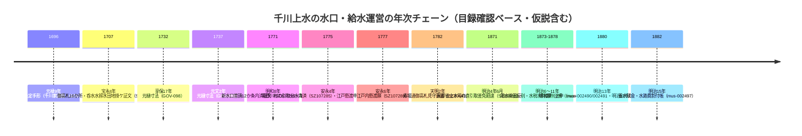

# 2026-11-14（第75回）・小川家文書千川74件横断・星野家文書mus-0024xx個別ID特定・豊島区紀要書誌確定

## 概要

- 第74回に引き続きADEAC横断と豊島区紀要書誌の確定を中心に実施。
- **最大の成果: ADEAC小平市立図書館「小川家文書」の詳細検索で「千川」が74件ヒット**し、そのうち6件の新規目録レコード（SZ107261・SZ107323・SZ107281・SZ107306・SZ107285・SZ104683）を個別目録ページまで直接確認して[GOV-100](sources/gov/GOV-100.md)に追記。**明和8（1771）年新水口普請内済証文・明治4年6月民部省土木司の直引取差免廻達・巣鴨町入口出桝の井戸間数順附**など、千川上水の水口・給水運営の年代を絞れる一次文書が揃った。
- **第2の成果: 第74回「残り41レコードはデジタル化対象外」の結論を部分修正**。NDLサーチのadeac索引経由でADEAC杉並の星野家文書千川養水シリーズ7件の個別目録ID（mus-002484・002486・002490・002491・002497・002478・002514）を特定・直接確認し[GOV-110](sources/gov/GOV-110.md)に追記。**NDL OpenSearch → ADEAC個別ID特定がPostBack遷移不可コレクションへの汎用手段として確立**。
- 新規source file: [GOV-112](sources/gov/GOV-112.md)（練馬区「調べ学習用地域資料カード『千川上水』」2021・葛城明彦監修）・[PAP-054](sources/papers/PAP-054.md)（鄧君龍「近世飴屋川口屋の流れを汲む」2024）・[PAP-055](sources/papers/PAP-055.md)（蔵持重裕「江戸期の川口屋」1986）・[PAP-056](sources/papers/PAP-056.md)（君塚仁彦「増上寺村々の『由緒』と巣鴨村」1990）。
- 既存更新: [GOV-100](sources/gov/GOV-100.md)・[GOV-110](sources/gov/GOV-110.md)・[BOOK-064](sources/books/BOOK-064.md)（『生活と文化』第11号・2001年12月25日発行と書誌確定）。

## 1. ADEAC小平「千川」74件横断〔GOV-100追記〕

- 詳細検索 `https://adeac.jp/kodaira-lib/detailed-search?mode=catalog&word=千川` で**74件の目録レコードがヒット**（1頁目49件の題名・差出・年は抽出済み・2頁目はPostBack必須でpage=パラメタ無効のため未抽出＝次回課題）。
- 既出10レコード（SZ107289・106411・107292・108190・107342・107354・107279・106807・107253・107262）と重複しない新規6件を個別目録ページで直接確認:
  - **SZ107281（明和8=1771亥10月頃）「千川上水新水口普請ニ付十二ヶ条之双方熟談内済証文」**: 千川上水願人4名＋保谷新田・関前新田村役人→飯塚伊兵衛御手代。元樋寸法変遷（1732・1737・1773〔GOV-098〕）に挟まる**1771年の水口普請の一次文書**。
  - **SZ104683（明治4=1871辛未6月）「廻達（千川用水上水堀ヨリ直引取差免達）」**: 民部省土木司→関前新田・田無新田・関野新田・鈴木新田・田無村・大沼田新田・小川村・野火止用水口。[BLOG-113](sources/blogs/BLOG-113.md)の明治4年境橋分水口新設と同年代の**行政側一次文書裏付け候補**。
  - **SZ107306「巣鴨町入口出桝より井戸間数順附覚」**（横帳・「［丑7］月10日ヨリ」）: **江戸内末端の給水対象井戸の台帳**でこの種の文書はrepo初出。
  - **SZ107323「千川上水滝野川村より江戸内掛渡上水樋桝仕様書」**（子12月）: 懸渡実施段階の技術文書候補。
  - **SZ107285（安永4=1775未7月）「内相仕証文之事（千川用水引取分水ニ付）」滝野川村太郎左衛門**: **反射炉以前の滝野川村の千川引水**の江戸期記録としてrepo初出候補。
  - **SZ107261「（千川分水口地所并水番屋明渡ニ付書状）」**: 分水口の地所・水番屋の明渡（K-1 23・用水支配・管理分類）。
- その他のnotable未特定タイトル（ID未抽出）: 「（千川上水絵図）〔前欠〕」「（千川上水江戸懸渡ニ付申合証文）〔安永4〕」「千川用水再興ノ儀ニ付上申御日延願〔明治13.6.25・鈴木新田〕」「千川用水増水之義ニ付上申〔明治13.7〕」「北側新井筋弐拾七ヶ村組合」（明治13上申）など。NDL OpenSearch（`https://ndlsearch.ndl.go.jp/api/opensearch?any=<語>&cnt=N`）で個別IDを引くのが次回の手法。

## 2. NDL索引経由のADEAC杉並個別ID特定〔GOV-110追記〕

- 第74回は「残り41レコードはデジタル化対象外」と結論したが、**NDLサーチがadeacの個別目録ページを索引している**ことを突き止め、星野家文書系7件のmus IDを特定:
  - mus-002514 千川養水掛田反別地価台帳写（明治以降・翻刻135〜136頁）
  - mus-002478 千川養水掛田反別并水税水料割附台帳（1873〜78・翻刻121〜134頁）
  - mus-002486 （千川養水**南七ヶ村組合**浚場所書上）（1878以降・翻刻120頁・**新組合文言**）
  - mus-002491 玉川上水源費明治十二年度千川養水掛賦金上申書（1880.11.15・翻刻71〜72頁・差出=星野紋左衛門・山崎清）
  - mus-002490 （南六ヶ村引取分口につき願書）（1880.9・翻刻71頁・翻刻名「用水増水願」）
  - mus-002497 明治十二・十三年度千川養水賦金并水路費割付帳（1882・翻刻74〜78頁）
  - mus-002484 明治十年ヨリ千川養水件書類綴込（1878.11・翻刻46〜59頁・星野紋左衛門）
- 個別ID判明は7→14レコード。残り34レコードも同手法で探索継続（次回課題）。

## 3. 練馬区「調べ学習用地域資料カード『千川上水』」〔GOV-112・repo初出〕

- ADEAC練馬区立貫井図書館 `mp000040-100020-0460`。令和3年度・作成=関町図書館・発行=石神井・大泉・関町・貫井・南田中の5図書館・**監修: 葛城明彦**・管理記号「河川-1」・分類「地形・土地」。デジタル画像あり（本環境では画像内容未確認）。

## 4. 豊島区立郷土資料館紀要『生活と文化』の書誌確定〔BOOK-064更新・PAP-054〜056新規〕

- 刊行物ページ（`https://www.city.toshima.lg.jp/129/bunka/bunka/shiryokan/kankobutu/005957.html`・更新2025-04-26）の目次を直接取得し、以下を確定:
  - 横山恵美「＜調査ノート＞豊島区の湧き水をたずねて」＝**第11号・2001年12月25日発行・800円**（[BOOK-064](sources/books/BOOK-064.md)の第74回課題を解消）。
  - 鄧君龍「近世飴屋川口屋の流れを汲む」＝**第33号・2024年3月22日発行・900円**（[PAP-054](sources/papers/PAP-054.md)・[BLOG-188](sources/blogs/BLOG-188.md)/[BLOG-190](sources/blogs/BLOG-190.md)に接続）。
  - 蔵持重裕「江戸期の川口屋」＝**第2号・1986年12月20日発行・1,500円**（[PAP-055](sources/papers/PAP-055.md)・川口屋最古級論文）。
  - 君塚仁彦「増上寺村々の『由緒』と巣鴨村」＝**第4号・1990年3月30日発行・1,100円**（[PAP-056](sources/papers/PAP-056.md)・本文未確認で関係の濃淡は要注記）。
  - 第34号（2025.3.25）は佐野史郎×平井憲太郎対談・井川蓮音（城北大空襲）のみで**四河川関連記事なし**（第74回課題③解消）。
  - 伊藤暢直「千川上水に関する若干の考察」＝第6号1992年3月31日発行（既出〔PAP-005相当〕の刊年も同一ページで再確認）。

## 5. 千川上水の水口・樋口運営の年次チェーン（第75回時点の整理・Mermaid）

- 〔観察〕SZ107281（1771）とSZ107285/申合証文（1775）・SZ107289懸渡願（1777）は**近接年代の連鎖**で、1770年代の江戸内給水拡大期の文書群として読める。ただし各文書の内容は本文未確認で、水口変更の因果は断定しない。

## 6. 次回課題

- ①ADEAC小平「千川」74件の2ページ目（PostBack必須）の抽出方法の検討（NDL OpenSearchでのID補完を優先）。特に「（千川上水絵図）〔前欠〕」「江戸懸渡申合証文〔安永4〕」「明治13再興願」のID特定。
- ②ADEAC杉並の残り34レコードのNDL索引探索。
- ③SZ107306（巣鴨出桝の井戸間数）・SZ107323（樋桝仕様書）・SZ107285（滝野川安永4）の本文確認（小平市中央図書館での閲覧）。
- ④練馬カード（GOV-112）画像内容の確認（別環境でOCR）。
- ⑤アクセス不能継続: echo-lab.ddo.jp・meiji.repo（JAIROメンテ）・nabunken 429・板橋区WAF・かたりべ45（画像のみ）＝再試行不要。
