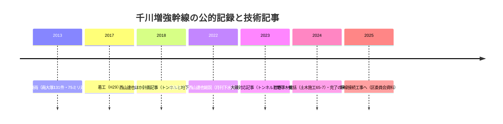
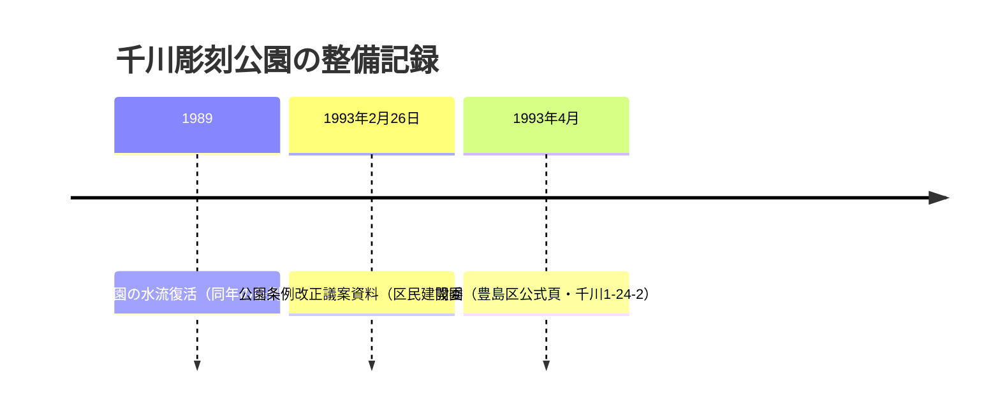

# 2026-11-14（第78回）・千川彫刻公園の所在地確定・千川増強幹線技術記事群・武蔵野市水質調査頁の追加調査

## 調査の概要

- push前head確認: **5c238a4d**（第76回）→反映前に並行実行の第77回（56505e58）がpushされたため、最新mainを取り直し第78回として反映（採番はGOV-117〜・PAP-058〜・BOOK-088〜で第77回との重複なし）。採番はGOV-117〜・PAP-058〜・BOOK-088〜（リモート最大番号の再確認済み）。
- 前回（第76回）の次回課題②「千川彫刻公園の所在地」を**豊島区公式施設案内頁の直接取得で解消**。NDL OpenSearchの「雑司ヶ谷幹線」「千川増強幹線」「千川上水公園」横断で**千川増強幹線の技術記事3本・雑司ヶ谷幹線の技術文献2本・千川上水公園の学術調査報告書1点**が新規に所在確認できた。

## 本回の新資料

| ID | 資料 | 状態 |
|---|---|---|
| [GOV-117](../sources/gov/GOV-117.md) | 豊島区公式「千川彫刻公園」頁（千川1-24-2・645.16㎡・**開園1993年4月**・元地主寄贈含む4体ブロンズ像） | 直接確認 |
| [GOV-118](../sources/gov/GOV-118.md) | 武蔵野市「玉川上水・千川上水水質調査」頁（掲載2024-12-03・多摩川上流水再生センター2次処理水・平成28年度測定結果） | 直接確認（Wayback 20250903） |
| [BOOK-088](../sources/books/BOOK-088.md) | 荒川康編・大正大学『都市公園の歴史・機能上の比較分析』（千川上水公園を3事例の一つに・2010-3） | 所在のみ |
| [PAP-058](../sources/papers/PAP-058.md) | 畠平ほか「突発的に出現した大礫への対応と立坑内注水によるシールド直接切削到達」（トンネルと地下2023推定） | 所在のみ |
| [PAP-059](../sources/papers/PAP-059.md) | 狩野ほか「1時間75ミリ降雨対応の浸水対策施設を構築」（土木施工65(7)=811・2024-7） | 所在のみ |
| [PAP-060](../sources/papers/PAP-060.md) | 西山達也「1時間75mm降雨への対策(浸水対策) : 千川増強幹線整備事業」（月刊下水道45(10)増刊・2022） | 所在のみ |
| [PAP-061](../sources/papers/PAP-061.md) | 葛西孝周「雑司ヶ谷幹線再構築工事事故を教訓とした安全管理の強化について」 | 所在のみ |
| [PAP-062](../sources/papers/PAP-062.md) | 「第二十二社幹線・第二雑司ヶ谷幹線の流下施設の検討及び水理模型実験に関する調査研究」 | 所在のみ |
| [PAP-063](../sources/papers/PAP-063.md) | 西山達也ほか「計画 1時間75mm降雨に対応する下水道施設をシールドトンネルで整備」（トンネルと地下49(10)・2018-10・README既述のSSOT化） | 所在のみ |

既存更新: [GOV-113](../sources/gov/GOV-113.md)（千川彫刻公園の所在地・開園年次の裏付け追記）。

## 解釈（観察・仮説の区別）

- **千川彫刻公園**: 1993年2月26日の条例改正議案資料→**1993年4月開園**（公式頁）という2か月の間隔が裏付けで並んだ〔観察〕。公式頁は公園名の「千川」が旧千川上水由来かを説明しないため、**敷地と旧千川流路の位置関係は断定しない**〔要現地・地籍照合〕。
- **千川増強幹線技術記事群**: 2018（計画・着工直後）→2022（下水道展記念総説）→2023（大礫トラブル）→2024（総括）と**着工から整備完了後までの技術誌上の記録が4時点揃った**〔観察〕。PAP-058の「大礫」はGOV-082「礫支障で3年遅延」との対応が疑われるが本文未見で断定しない〔仮説〕。
- **PAP-063はREADME既述のCiNii引用のSSOT化**（AGENTS.md規則: 本文で使う資料は資料ファイル化）。
- **武蔵野市水質調査頁**: 清流復活水=多摩川上流水再生センター2次処理水という行政側明記は、BLOG-090の水量内訳観察と突き合わせ可能〔観察〕。平成28年度PDF本文はWAFで未確認。

## 千川増強幹線の記録時系列（Mermaid）

## 千川彫刻公園の年次（Mermaid）

## アクセス不能・見送り

- **echo-lab.ddo.jp**: curlで000（接続不成立）を再確認。**沈静化が濃厚**、再試行不要。
- **meiji.repo.nii.ac.jp**: 503継続（JAIRO Cloud）。
- **nabunken sitereports**: 429（レート制限）継続。
- **武蔵野市公式の直アクセス・平成28年度測定結果PDF（291218.pdf）**: WAF 403。ページ本文はWayback 20250903保存版で取得可。
- **iko-yo.net**: 403（千川彫刻公園頁・施設情報は公式頁・PARKFULで代替）。
- **NDL OpenSearchの`any=`複数語**: 再び0件になることを確認（単語単位で投げること）。
- **news_search（2026-11-07以降）**: 四河川関連の新報道なし。機械的なキーワード一致の英語記事が混入するのみ。
- 見送り: R100000094のイベント記録2件（千川上水公園さくらそうフェア2007・中山道と千川上水公園歴史フェア予告2005）は公園の同時代イベント情報で水系の新事実が見込めないため本回はsource file化せず（要再考ならGOV-114的なグループ登録が妥当）。R061002「千川増強幹線事業について」はGOV-036で既登録、R070415分もREADME既述のため追加登録せず。

## 次回課題

1. **PAP-058〜063の本文確認**（NDL個人送信・図書館経由。PAP-058の掲載号特定とGOV-082「礫支障3年遅延」との対応が最重要）。
2. **武蔵野市水質調査の平成28年度PDF**（291218.pdf）の別ルート取得と令和期の測定結果の有無。
3. **千川彫刻公園の敷地と旧千川流路の位置関係**（1912年地籍図・空中写真との照合、元地主寄贈の経緯）。
4. **BOOK-088本文**（大正大学所蔵・千川上水公園の扱い）。
5. PAP-061の掲載誌特定（下水道協会誌55(665)2018-3の目次確認）・PAP-062の発行機関・年次特定（下水道新技術研究所年報2号の目次）。
6. （継続）echo-lab紀要20号・BOOK-062現物・西光院橋供養碑・角田2023本文・Fauna No.1種名・官報1931 IIIF p.233判読・武蔵アルバムOCR・かたりべ45号OCR・GOV-116の2件のコレクション帰属・GOV-114画像確認。
