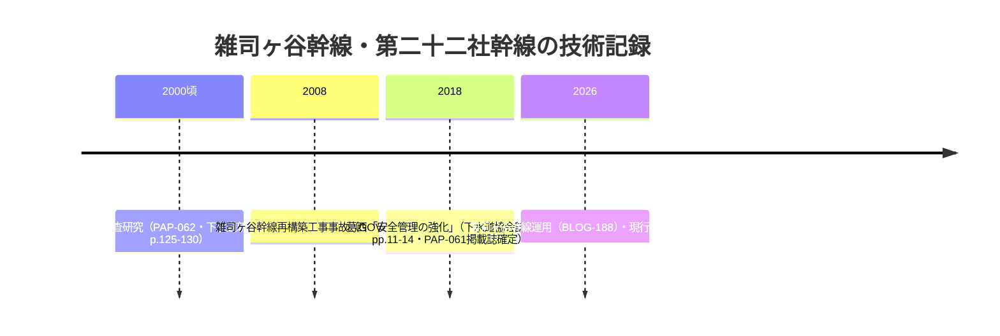

# 2026-11-14（第79回）・技術調査年報第二十二社幹線水理模型実験・神田上水1930年都市計画4,114間・桃園川河川廃止論文の追加調査

## 調査の概要

- ベース: main @ 24b2206a（第78回）。atom feedで並走なしを確認した上で第79回として作業。
- 既存採番max（GOV-118 / BLOG-221 / BOOK-088 / MAP-160 / ORG-033 / PAP-063 / GAZ-023 / LOST-005）を確認し、本回は**GOV-119・PAP-064・PAP-065**を採番。
- 東京都下水道局『技術調査年報』シリーズ（opendata PDF・直アクセス403 → Wayback id_ で本文取得可）を新規資料群として掘り起こし、2008年版「第二・十二社幹線水理模型実験」の全文PDFを取得・テキスト抽出できた。あわせて石原成幸らの土木史・水文学会誌の2論文を本文・書誌レベルで確認し、第78回の未解決（PAP-061の掲載誌・PAP-062の頁数）を解消した。

## 本回の新資料

| ID | 資料 | 状態 |
|---|---|---|
| [GOV-119](../sources/gov/GOV-119.md) | 東京都下水道局『技術調査年報2008』「第二・十二社幹線水理模型実験について」pp.55-64（第二十二社幹線: 内径1500-3500mm・延長約4.9km・昭和63年整備開始・神田川放流渠吐口・暫定貯留管供用・横越流/直接分水の実験） | 直接確認（Wayback id_ PDF本文） |
| [PAP-064](../sources/papers/PAP-064.md) | 石原成幸・河村明・高崎忠勝・天口英雄「東京都における中小河川改修と都市計画の歴史的経緯」土木史研究講演集31 (2011) pp.15-24（**1930年東京都市計画事業決定「立会川・神田上水ほか」・神田上水 市郡界〜中野町地内4,114間**・清流復活通水1989.3） | 直接確認（本文PDF） |
| [PAP-065](../sources/papers/PAP-065.md) | 石原成幸・天口英雄・高崎忠勝「神田川水系桃園川の法定河川廃止と下水道幹線化の経緯について」水文・水資源学会誌37 (2024) p.187-、DOI 10.11520/jshwr.37.0_187（谷端川1962年河川廃止の制度史背景文献） | 書誌・キーワード確認（本文PDF取得済・抽出失敗） |

既存更新: [PAP-061](../sources/papers/PAP-061.md)（掲載誌＝下水道協会誌665号 pp.11-14・2018年3月をNDL OpenSearchで確定）・[PAP-062](../sources/papers/PAP-062.md)（掲載誌＝下水道新技術研究所年報 p.125〜130・CiNii CRID確認、発行機関＝日本下水道新技術機構、収録号のみ未確定）・[PAP-032](../sources/papers/PAP-032.md)（羽村市公式紀要目次頁で頁数pp.39-85を確認）・[GOV-118](../sources/gov/GOV-118.md)（平成28年度測定結果PDF本文をWayback id_ で取得・千川上水測定点=下流側吉祥寺北町・計3地点4回・「著しい汚れなし」）。

## 解釈（観察・仮説の区別）

- **神田上水4,114間〔確認: PAP-064本文〕**: 1930年東京都市計画事業決定時の改修対象が「市郡界〜中野町地内 4,114間」。これはREADME既述の1930-31年改修告示の**定量値repo初出**。ただし4,114間が千川〜神田上水区間（弦巻川・水窪川の合流先）のどこに対応するかは本文の区間定義未確認のため**断定しない**〔要地図照合〕。清流復活の通水がH1.3（1989年3月）と年月レベルで確認できた点もBLOG-090等の観察と整合。
- **第二十二社幹線水理模型実験〔確認: GOV-119本文〕**: 第二雑司ヶ谷幹線（弦巻川・雑司ヶ谷低地）と系統を同じくする第十二社幹線流域の下水道技術文献群（PAP-061〜063）に、**下水道局の実験技術の背景（横越流・直接分水方式の模型実験）**が加わった。十二社流域自体は四河川流域外だが、PAP-062の水理模型実験（第二十二社幹線・第二雑司ヶ谷幹線）の**先行技術系譜**として記録する価値がある〔観察〕。
- **桃園川論文（PAP-065）**: 谷端川が1962年に法定河川廃止→下水道幹線化された経緯と、桃園川（同じ神田川水系の廃止河川）の比較制度史。谷端川の廃止（README既述）の**学術的文脈づけ文献**〔本文PDFは取得したがCID抽出失敗、書誌・キーワードのみ確認。内容の断定はしない〕。
- **技術調査年報シリーズ〔観察〕**: 東京都下水道局の技術調査年報（2000/2002/2008/2012/2013/2014年度PDF）がopendataに存在し、直アクセス403でもWayback id_で本文取得できることを確認した。**以後の回で未精査の年度PDFを順次確認する価値がある**（谷端川・千川関連幹線の記事有無）。

## 雑司ヶ谷幹線・第二十二社幹線技術文献の記録時系列（Mermaid）

## アクセス不能・見送り

- **官報1931-06-09 PID 2957799（IIIF）**: manifest取得済み・コマラベルは1-26のみ（頁番号なし）・判読はOCR環境待ち。
- **J-DAC/CiNii/echo-lab**: 今回もアクセス不能（echo-labは接続不成立を再確認・沈静化濃厚）。
- **板橋区公式WAF**: 403継続。
- **PAP-065（桃園川）J-STAGE本文PDF**: 取得成功したがCIDフォントのToUnicodeマップなしでテキスト抽出失敗。人手閲覧待ち。
- **武蔵野市水質PDFの数値表**: スキャン画像で機械抽出できず、BOD等の具体値は人手閲覧待ち。
- **news_search（2026-11-07〜14）**: 四河川関連の新報道なし。

## 次回課題

1. **技術調査年報の未精査年度**（2000/2002/2012/2013/2014年度）の谷端川・千川関連幹線記事の有無確認（Wayback id_ ルート）。
2. **神田上水4,114間の区間特定**（PAP-064本文の区間定義・1930年都市計画図との照合）。
3. **PAP-065本文の人手閲覧**（桃園川と谷端川の廃止制度の比較・1962年廃止の文言確認）。
4. （継続）echo-lab紀要20号・BOOK-062現物・西光院橋供養碑・角田2023本文・Fauna No.1種名・官報1931 IIIF p.233判読・武蔵アルバムOCR・かたりべ45号OCR・GOV-116の2件のコレクション帰属・GOV-114画像確認・PAP-058〜063本文・BOOK-088本文。
