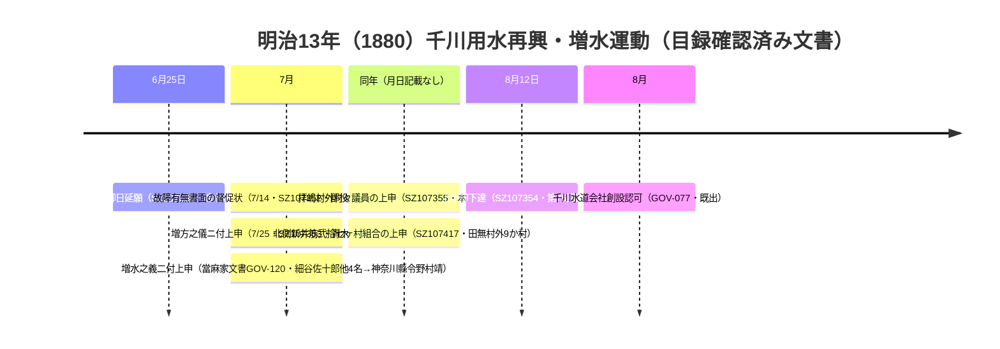

# 2026-11-14（第80回）・當麻家文書の明治13年増水運動・桃園川廃止論文の本文抽出・技術調査年報2013/2014の追加調査

## 調査の概要

- ベース: main @ b40a7cf8（第79回）。atom feedで並走なしを確認した上で第80回として作業。
- 既存採番maxはGOV-119（GOV系）のため本回は**GOV-120〜123**を採番。**PAP-065は新規採番なしの格上げ**（書誌確認→本文直接確認）。
- NDL OpenSearch（any=千川用水）の第2波走査で、第75回で未特定だった「増水之義ニ付上申」「北側新井筋27か村組合」の個別レコード特定に成功し、**明治13年（1880）の千川用水再興・増水運動の一次文書群（小川家文書4件・當麻家文書1件）**を月日・差出人・宛先レベルで揃えた。
- 第79回の最大の未解決だった**PAP-065（桃園川廃止論文）の本文抽出に成功**（独自PDF抽出器をContents配列対応に拡張）。表-2の協議経緯（S25建告740→S27都告22→36答申→S37移譲願い→S40都告279→S41都市計画河川廃止）を直接確認し、谷端川1962年廃止との制度史比較が可能になった。
- 技術調査年報の未精査年度（2013・2014）の完全版PDFをWayback id_で取得（9,348,371バイト／15,069,642バイト）し、谷端川・神田川関連記事を抽出（2002年版完全版も走査したが関連記事なし）。

## 本回の新資料

| ID | 資料 | 状態 |
|---|---|---|
| [GOV-120](../sources/gov/GOV-120.md) | 小平市中央図書館ADEAC「當麻家文書」（小平市指定有形文化財）「千川用水増水之義二付上申」SZ112720・明治13年7月・小川村議員細谷佐十郎他4名→神奈川縣令野村靖・分類「水利－新井筋組合」 | 所在のみ（目録確認） |
| [GOV-121](../sources/gov/GOV-121.md) | NDLサーチALIS索引「伺書」（玉川上水分水千川用水六ヶ村[編]）R100000074-ALIS_QQ20085235・農林水産系試験研究機関総合目録に現れる千川用水六ヶ村組合文書 | 所在のみ（書誌レコード確認） |
| [GOV-122](../sources/gov/GOV-122.md) | 東京都下水道局『技術調査年報2013』（2013年12月発行・平成24年度実施分）の2記事: ①三瓶武史「落合水再生センター～みやぎ水再生センター間送泥管敷設事業」pp.43-49（専用管廊方式最初の事業・φ400×2条・内径2600mm・約9.9km・**ルート図に谷端川親水公園・王子六丁目公園・板谷公園**・神田川流域人口約165万人）②比護一裕「大断面蓋掛け渠におけるSPR工法の施工－千駄ヶ谷幹線再構築工事－」pp.67-68（渋谷区神宮前5・6丁目・昭和38年施工の延長3,020m・5.75×3.70m蓋掛け渠・224.5mをSPR更生・**キャットストリート＝「旧渋谷川遊歩道」正式名称・橋の親柱残存**） | 直接確認（Wayback id_ PDF本文） |
| [GOV-123](../sources/gov/GOV-123.md) | 東京都下水道局『技術調査年報-2014- Vol.38』（2015年3月発行・平成25年度実施分）の2記事: ①鈴木淳也「区部河川における下水道からの雨水放流量の緩和について～神田川流域のケーススタディ～」pp.73-81（H20.3.31覚書・H20.4.30神田川流域確認書＝**後楽ポンプ所・坂下幹線・第二十二社幹線・第二妙正寺川幹線の4吐口**・H21.5後楽・H23.8坂下先行緩和・H25.3.29一部修正確認書・坂下幹線26.0/19.5/18.6m³/s・隅田川・新河岸川流域H20.12.19確認書9吐口）②今井翔子「老朽化対策先行整備（段階方式）…」pp.45-50（**p.50注※2「谷端川1号幹線の下流側は未整備となっている。（平成25年度現在）」**） | 直接確認（Wayback id_ PDF本文） |

既存更新: [GOV-100](../sources/gov/GOV-100.md)（明治13年再興・増水運動4件〔SZ107350/352/353/355〕+安永元断片SZ107282+北側新井筋27ヶ村組合SZ107417+元樋口御差塞請状SZ107622・制限⑦に當麻家文書を追加）・[GOV-110](../sources/gov/GOV-110.md)（№10/18/21/25のmus-ID・NDLレコードID対応追加、№1/2/4のNDL対応、計21レコードに）・[PAP-065](../sources/papers/PAP-065.md)（本文抽出による格上げ）・[ORG-029](../sources/org/ORG-029.md)（白井光太郎「池袋村貝塚發見の土偶と深大寺村發見の石匙」〔1902〕のNDL書誌追記）。

## 解釈（観察・仮説の区別）

- **明治13年増水運動の広がり〔確認: 目録群〕**: 6月25日の再興御日延願（鈴木新田→北多摩郡長）に始まり、7月14日の郡役所督促・7月25日の小川村議員上申・同月の當麻家文書上申（神奈川縣令あて）・拝嶋村外村々の本県令あて上申（SZ107355）と、**運動が鈴木新田・小川村・田無町から拝島（昭島市）まで西に広がり、宛先が郡長・県令の双方に現れる**。8月12日の上申却下達（SZ107354・既出）と千川水道会社創設認可（GOV-077・既出）の直前の運動の月単位の厚みが、5点の一次文書で裏付けられた。**各本文は未確認のため、運動の一体性は目録情報の積み重ねによる推定として扱う**。
- **當麻家文書の新系統〔確認→観察〕**: 千川用水文書の所在系統に杉並（須田家・星野家）・小平（小川家）・練馬（千川家neribun）に続き**小平の當麻家（大沼田新田の名主家・小平市指定文化財）が加わり、「水利－新井筋組合」分類が當麻家目録側にも存在**。玉川上水北側新井筋の組合事務が複数の村方文書に分散残存する像が強まった。
- **桃園川の廃止手続骨格〔確認: PAP-065本文〕**: 36答申（S36）→管理移譲願い（S37）→移譲方針決定（S38）→事前指揮→都告279（S40・準用認定解除・公有水面の公用廃止・知事から旧大蔵省関東財務局長へ）→都市計画河川廃止（S41）→暗渠化完了（S42）。**谷端川（都市計画河川・1962年廃止）と法定地位が異なるため単純比較はできないが、準用河川→下水道幹線化の年次骨格として谷端川廃止手続の類推材料**になる。**論文自身が昭和40年を「(1965)」と「(1968)」の両方に換算している内部矛盾**も確認し、都告279の公報登載日は原本確認まで断定しない。
- **送泥管ルート図上の谷端川親水公園〔確認: GOV-122本文図〕**: 落合水再生センター（弦巻川・水窪川流域の下水処理）とみやぎ水再生センター（谷端川幹線の流末）を結ぶ9.9kmの汚泥管廊ルート図に**谷端川親水公園・王子六丁目公園が立坑関連地点として描かれる**。両公園の役割は本文の明文になく、**候補扱いは図面判読による観察**とする。
- **神田川流域の放流量緩和制度〔確認: GOV-123本文〕**: 覚書→確認書→一部修正確認書という河川（建設局）・下水道（下水道局）間協議の制度史と、4吐口の名称・緩和実施年月が技術資料で固定された。**第二十二社幹線がGOV-119（2008年報・神田川放流渠吐口を残す工事中）と同一幹線として接続**でき〔観察: 幹線名一致による接続〕、2008年の水理模型実験から2013年の緩和承認への流れが読める。
- **谷端川1号幹線「下流側未整備」〔確認: GOV-123注※2〕**: 都下水道局自身が平成25年度（2013）時点で「谷端川1号幹線の下流側は未整備」と記した技術資料が、README既述の2013-14年区資料「完了」対2017年「一部」の表記差問題を**強める根拠**になった。
- **千駄ヶ谷幹線・渋谷川〔確認: GOV-122本文〕**: 水窪川の合流先・渋谷川下流の昭和38年（1963）施工・5.75m幅級の大断面蓋掛け渠の実在と、**キャットストリートの正式名称「旧渋谷川遊歩道」・オリンピック開催を契機とした暗渠化・橋の親柱の残存**を都技術資料が明記。千川の昭和9年（1934）暗渠化（GOV-105系・README既述）と同年代の東京オリンピック期の暗渠化を技術史の年代軸で並べられる〔観察〕。

## 明治13年（1880）千川用水再興・増水運動の月単位タイムライン（Mermaid）

※月日付き5件は目録の年月日記載による〔確認〕。SZ107417は目録上「近世」表記で、明治13年運動期の文書である可能性が高いが**断定しない**〔要本文確認〕。

## アクセス不能・見送り

- **NDL「九中を中心としたる史蹟名勝」1932（R100000002-I000000741733）**: 旧東京府立第九中学校＝現・都立北園高校（板橋区）で、**千川流域外の可能性が高く**、書誌レベルでは千川言及を確認できないため**登録見送り**とした。
- **GOV-121（ALIS伺書）の所蔵館名・作成年**: ndlsearchの所蔵情報はJS描画、ALIS本体（opac.cc.affrc.go.jp）はJSアプリでレコード直接取得不能。
- **技術調査年報2000/2012年版**: Waybackキャプチャが1MiB打ち切りで完全版全文取得不能（2002年版完全版は取得・走査済みだが谷端川/千川/渋谷川関連記事なし・落合処理場再生水のみ）。完全版スナップショットは年度により別途存在するためCDXのfrom=指定で再探索する価値あり。
- **白井光太郎1902年刊行物のNDL詳細頁**: JS遮断でタイトル・年のみ確認（ORG-029に書誌追記のみ）。
- **news_search（直近7日）**: 四河川の新報道なし。

## 次回課題

1. **神田川流域豪雨対策計画（改定）平成30年3月・東京都総合治水対策協議会**: GOV-123の2013年までの制度史の続きに当たる公文書。repo未収録のため取得・登録。
2. **當麻家文書目録の全体調査**（adeac kodaira-lib・JS描画の回避策）と、小平市3文書群（小川・小島・宮崎家）の横断。
3. **GOV-121伺書のALIS再試行**（QQ20085235の所蔵館特定・「玉川上水分水」「六ヶ村」での追加検索）。
4. **技術調査年報2000/2012年版の完全版取得**（Wayback CDX from=指定）と残り年度（2015以降・1990年代）の存在確認。
5. **PAP-065の表-1第5区間・図-1流路図の判読**（千川・神田上水の描かれ方）、**都告279の東京都公報昭和40年3月31日号の原本確認**（1965 vs 1968表記の矛盾解消）。
6. （継続）官報1931 IIIF p.233判読・echo-lab紀要20号・BOOK-062現物・西光院橋供養碑・角田2023本文・Fauna No.1種名・武蔵アルバムOCR・かたりべ45号OCR・GOV-116の2件のコレクション帰属・GOV-114画像確認・PAP-058〜063本文・BOOK-088本文。
