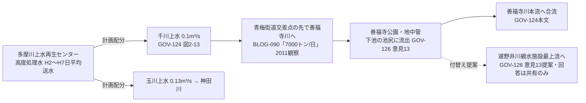

# 2026-11-14（第81回）・神田川流域整備計画・豪雨対策計画の本文確認・大橋欣治水利探訪その13「千川上水」の特定・技術調査年報スナップショット対応表の作成

## 調査の概要

- ベース: main @ d7a20db（第80回）。atom feedで並走なしを確認した上で第81回として作業。
- 既存採番maxはGOV-123・BOOK-088・PAP-065のため本回は**GOV-124〜126・PAP-066〜067・BOOK-089〜092**を採番し、**GOV-120に追記**（既存レコードの拡充）。
- 第80回の次回課題1「神田川流域豪雨対策計画（改定）平成30年3月」を取得・本文抽出し（Wayback id_ 10MB）、あわせて令和5年3月『神田川流域河川整備計画』（杉並区ミラー・59頁）と変更原案へのご意見資料（都建設局・資料5-3）の3点を新規登録。千川上水の現勢（清流復活導水0.1m³/s・善福寺川）と音羽・小日向の湧水量を都計画レベルで確認した。
- [PAP-023](../sources/papers/PAP-023.md)（大橋欣治水利探訪その4）の制限「同シリーズの千川上水個別の回は未確認」を解消: **その13＝「千川上水」**（水土の知76-4・pp.374-375・2008・DOI 10.11408/jjsidre2007.76.374）と特定。PDF（2頁・スキャン画像）を取得したがOCR不可のため本文未確認。その22「武蔵野の池沼・湧水・井戸」と合冊単行本『水利遺産探訪』（2009・添付図2枚付き）も所在確認。
- NDL書誌走査で新規書籍4件を確認: 中西慶爾『青梅街道』（木耳社1982・**目次に「千川上水と富士見池/29」**→[GOV-068](../sources/gov/GOV-068.md)関村分水と直結）、伊藤好一『江戸上水道の歴史』（吉川弘文館1996・2010復刊）、『板橋区の歴史』（名著出版1979）、大橋欣治『水利遺産探訪』。
- 當麻家文書の個別レコード群（NDL OpenSearch）に**水車税受取2通（明治12年前半期・第二期・いずれも明治13年付・北多摩郡長砂川源五右衛門）**を確認し[GOV-120](../sources/gov/GOV-120.md)に追記。當麻家の水車経営関与を示すが水車の所在は不明。
- 第80回課題4「技術調査年報2000/2012完全版」: CDX全スナップショット精査の結果、**2001〜2011年の「May/July 2024」スナップショットは完全版**（2003=129.7MB・2010=21.6MB等）だが、**2000・2006・2012は1MiB切断版のみ**で完全版取得不能と確定。ただし2001年完全版（36MB）の抽出テストで**日本語フォントにToUnicodeがなく本文抽出不可**（英文のみ抽出）のため、完全版の走査にはOCR相当の手段が今後必要。

## 本回の新資料

| ID | 資料 | 状態 |
|---|---|---|
| [GOV-124](../sources/gov/GOV-124.md) | 東京都建設局『荒川水系神田川流域河川整備計画』（令和5年3月・本文59頁・杉並区ミラーPDF直接取得）: ①図2-13で**清流復活事業により千川上水を通じて善福寺川に0.1m³/s導水**（玉川上水0.13m³/s→神田川と対。H2〜H7の多摩川上水RC送水の計画配分）②表2-4で**文京区音羽1丁目の湧水3件の定量値（今宮神社5.2m³/日・民家5.8m³/日・民家1.1m³/日※H3年度調査）**・小日向2丁目0.2m³/日・養徳学舎1.0m³/日、**高田1丁目・高田2丁目高南小学校は「H25調査時は確認されていない」**（弦巻川・水窪川系湧水の枯渇記録）③図3-1に「桃園川合流点」が残存④表2-3分水路諸元（高田馬場1,460m・江戸川橋1,644m・水道橋1,640m・お茶の水1,300m）⑤神田上水〜関口大洗堰〜江戸川〜神田川の旧呼称区分 | 直接確認（本文抽出） |
| [GOV-125](../sources/gov/GOV-125.md) | 東京都総合治水対策協議会『神田川流域豪雨対策計画（改定）』（平成30年3月・Wayback id_ 10MB取得）: ①表5-2で**対策促進地区5番「文京区後楽、音羽（完了）」**（音羽地区の50ミリ対策完了の公式記録）②表5-3で**市街地対策地区「文京区千石、豊島区南大塚 千川幹線の増強施設」**（75ミリ）・**「文京区大塚 主要枝線」**・**「中野区東中野、杉並区阿佐谷 第二桃園川幹線」**③新宿駅・池袋駅の地下街対策完了④支川は善福寺川・妙正寺川・江古田川のみで弦巻川・水窪川の記載なし | 直接確認（Wayback本文抽出） |
| [GOV-126](../sources/gov/GOV-126.md) | 東京都建設局「神田川流域河川整備計画（変更原案）へのご意見等について（資料5-3）」: **意見13「千川上水が地中管で公園内を通り、下池の池尻に流れ出ています。地中管を遅野井川親水施設の最上流部分に入れていただきたい」**（善福寺公園・遅野井川親水施設2018年整備の文脈・市民一次観察）＋意見20への回答で図2-13の赤数値＝放流・導水量を含む値と公式確認。発行時期は2022年頃と推定（断定しない） | 直接確認（open_url本文） |
| [PAP-066](../sources/papers/PAP-066.md) | 大橋欣治「江戸・東京の水利探訪（その13）**千川上水**」水土の知76巻4号 pp.374-375（2008）DOI 10.11408/jjsidre2007.76.374。**シリーズ千川上水単独回の存在確定**。PDF取得済みだがスキャン画像で本文未抽出 | 所在のみ（書誌・DOI確認） |
| [PAP-067](../sources/papers/PAP-067.md) | 大橋欣治「江戸・東京の水利探訪（その22）武蔵野の池沼・湧水・井戸」水土の知77巻1号 pp.57-58（2009）。repoの湧水・池沼調査に接続する観点 | 所在のみ（NDL書誌） |
| [BOOK-089](../sources/books/BOOK-089.md) | 中西慙爾→中西慶爾（1897-1987）『青梅街道』木耳社1982。**NDL目録に「千川上水と富士見池/29」の章**。関村分水（寛政6年「関村田養水」・天明4年「関村絵図」）を扱う二次資料候補 | 所在のみ（書誌・目次確認） |
| [BOOK-090](../sources/books/BOOK-090.md) | 大橋欣治『江戸・東京の水利探訪 : 水利遺産探訪』（自費出版2009.5）。その1〜その24合冊＋**添付図「江戸市中の上水系統図」「江戸・東京の上水・用水位置図（元図: 明治42年測図5万分の1）」** | 所在のみ（NDL書誌） |
| [BOOK-091](../sources/books/BOOK-091.md) | 伊藤好一（1916-1998）『江戸上水道の歴史』吉川弘文館1996（2010復刊・ISBN978-4-642-06367-8）。江戸上水道研究の基本書・NDL索引語に千川上水 | 所在のみ（NDL書誌） |
| [BOOK-092](../sources/books/BOOK-092.md) | 萩原竜夫・伊藤専成 文・東京にふる里をつくる会 編『板橋区の歴史』名著出版1979（東京ふる里文庫）。板橋区＝千川下流・谷端川放水路地域の区史。NDL索引語に千川上水 | 所在のみ（NDL書誌） |

既存更新: [GOV-120](../sources/gov/GOV-120.md)（當麻家文書「租税－請掛」群の水車税受取2通〔1880年3月13日・8月3日・北多摩郡長砂川源五右衛門・adeac SZ111770/SZ111773〕＋同時期の車税・飲食税・営業税・月税受取の存在を追記）。

## 解釈（観察・仮説の区別）

- **千川上水導水の現勢が都計画書で固定された〔確認〕**: 「千川上水を通じて善福寺川に導水 0.1m³/s」（図2-13）が、[BLOG-090](../sources/blogs/BLOG-090.md)（本田創「1万トン中7000トンを青梅街道交差点のすぐ先で善福寺川へ」）・[BLOG-094](../sources/blogs/BLOG-094.md)（sirakigi「善福寺池へ7000トン＝千川流水の約3分の2」）の個人観察（0.081m³/s相当）と**同水準で整合**。両ブログの配分叙述の典拠は不明だったが、都建設局の計画配分（H2〜H7多摩川上水RC送水）が背景にある可能性が強まった〔対応関係は両文書に明記がないため推定として扱う〕。
- **導水経路の末端が市民観察で具体化〔確認→観察〕**: [GOV-126](../sources/gov/GOV-126.md)意見13の「千川上水が地中管で善福寺公園内を通り、下池の池尻に流れ出る」が、GOV-124図2-13の導水の**流末位置を現地観察レベルで補う**。旧遅野井川筋への付替え提案への回答は「関係機関と共有」のみで、都の公式確認ではない。**千川上水現勢の流路（地中管の経路・池尻流出点）は本観察とBLOG-090/094の突合せによる推定として扱う**。
- **音羽谷・小日向の湧水定量値〔確認〕**: 今宮神社5.2m³/日・民家2件5.8/1.1m³/日（音羽1丁目・H3年度値）は水窪川流域の湧水の数値としてrepo初出。**高田1丁目・高田2丁目（高南小学校）がH25調査時に確認されなかった**記録は、弦巻川・水窪川上流側（池袋谷頭〜高田谷筋）の湧水枯渇を間接的に示す〔観察: 表の欄上は「神田川」で、枯渇原因の記述なし〕。
- **音羽地区の50ミリ対策完了〔確認〕**: 豪雨対策計画H30で「文京区後楽、音羽（完了）」が公式記録された。どの幹線・貯留で完了したかは本計画になし〔GOV-123（2014年報・後楽ポンプ所）と時期対応の推定は本文未確認のため保留〕。上位の千川幹線増強（千石・南大塚・75ミリ）は[GOV-082](../sources/gov/GOV-082.md)/[BLOG-134](../sources/blogs/BLOG-134.md)/[BLOG-194](../sources/blogs/BLOG-194.md)の工事記録の計画体系上の位置が固定された〔観察〕。
- **「桃園川合流点」の残存〔確認→観察〕**: 昭和42年暗渠化（[PAP-065](../sources/papers/PAP-065.md)）後60年を経た現行計画流量配分図に節点名称が残る。放棄された河川の合流点が計画図の骨格要素として生き続ける例で、**谷端川の計画図上の扱い（1962年廃止）との比較材料**。流量数値は画像未判読のため採らない。
- **當麻家の水車税〔確認→観察〕**: 明治12年分の水車税を當麻家が納付（受取は1880年）＝**水車経営への関与**。千川用水増水上申（同年7月・GOV-120本文）と千川水道会社設立期（明治13-14年）に水車を持つ家が増水運動に出た文脈の解釈は、水車の所在が不明のため本文確認まで保留する。
- **水利探訪シリーズの千川上水回〔確認〕**: PAP-023の未解決を解消。その13（2008・2頁）が千川上水、その22（2009）が武蔵野の池沼・湧水・井戸。**スキャン画像PDFでテキスト層がない**ため、本文の読み取りは今後の課題（合冊本BOOK-090の現物確認が代替手段）。
- **技術調査年報のスナップショット対応表〔確認: HEAD調査〕**: 2000all=1MiB切断のみ／2001all=**完全版36MB（20240522063302）あり**／2002all=7.6MB・2003all=129.7MB・2004all=3.5MB・2005all=7.3MB・2006all=1MiB切断のみ／2007all=20MB・2008all=8.2MB・2009all=14.1MB・2010all=21.6MB・2011all=19.8MB（完全版）／**2012all=1MiB切断のみ**／2017〜2019all=スナップショットなし／2013all・2014all=第80回取得済み。**2001年版完全版の抽出テストでは日本語テキスト層なし（ToUnicode 29個のみ・英文記事のみ抽出可）**——2000年代前半の年報はスキャン・埋め込みフォント構成で、完全版を取得しても本文抽出にはOCR相当の手段が要る。第80回が本文抽出に成功した2013/2014年版とは構成が異なる。

## 千川上水の現勢（清流復活導水）の情報接続（Mermaid）

※B→D→Eの経路は、都計画書の数値（確認）と市民観察・ブログ（観察）の突合せによる推定。地中管の諸元・管理者は未特定。

## アクセス不能・見送り

- **技術調査年報2000・2006・2012年版完全版**: Waybackに切断版（1MiB）のみ。Origin（opendata.metro.tokyo.lg.jp）は403・open_urlは「ページを表示できません」。**2012年版は第80回課題の対象だったが、スナップショット自体が存在しないため今後もWayback経由の取得は不可能**（gesui.metro.tokyo.lg.jp/data/report/gn/も403）。
- **技術調査年報2003年版（129.7MB）**: 完全版スナップショットの所在を確認したが、ダウンロードに約6分超を要し本回の時間内に完了不能だったため次回に回す（-C - での分割取得を推奨）。
- **J-STAGE 77-1号（その22）の記事ページ**: 500エラーで記事ID特定不能。
- **CiNii（cir.nii.ac.jp）**: Robot検証で遮断（curl・open_urlとも不可）。
- **NDL OpenSearch**: クエリにより空返却・レート制限が散発（リトライで回避）。
- **大橋欣治その13・その22・合冊本の本文**: スキャン画像・OCR不可（pip制限）。
- **news_search（弦巻川・水窪川・谷端川・千川）**: 直近の新報道なし。

## 次回課題

1. **PAP-066（水利探訪その13千川上水）の本文確認**: 合冊本BOOK-090（NDL蔵）の現物確認か、OCR可能な環境でのPDF読み取り。
2. **技術調査年報2003年版完全版（129.7MB・20240522032324）の取得と走査**（谷端川1号幹線2001年一部完了直後の年度で最有力）。ただし2001年版の実績から日本語抽出不能の可能性が高く、抽出手段（OCR）の確保が前提。2007〜2011年版（千川・谷端の工事期）の走査も同様。
3. **BOOK-089『青梅街道』「千川上水と富士見池」章の本文確認**（GOV-068関村分水・富士見池・関村絵図との突合せ）。
4. **GOV-124音羽1丁目湧水2件（民家）の比定**と、H3年度調査『東京の湧水』原本（東京都環境局・ GOV-124出典）の所在確認。
5. **GOV-126の会議名・発行年の特定**（資料5-3を掲げた会議体の議事録検索）。
6. 當麻家文書「租税－請掛」群の全レコード抽出（NDL OpenSearch残り・脚夫賃金の背景）と水車税の水車所在の追及。
7. （継続）GOV-121のALIS再試行・官報1931 IIIF p.233判読・echo-lab紀要20号・BOOK-062現物・西光院橋供養碑・角田2023本文・Fauna No.1種名・武蔵アルバム/かたりべ45号OCR・PAP-058〜063本文・BOOK-088本文・GOV-116のコレクション帰属・GOV-114画像確認。
