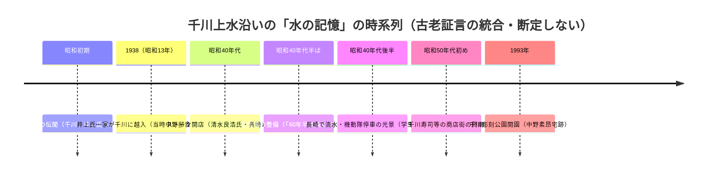

# 第84回（2026年11月14日）: 千川現地ロケ全文取得・たましん多摩のあゆみ肥留間博分水レポート・千川上水探訪マップの追加調査

## 概要

ADEAC「としまひすとりぃ」の「わが街ひすとりぃ」現地ロケ編（第9〜16回・20回）の全文テキストを系統的に取得し、千川・要町・長崎・駒込・巣鴨の古老証言を新規記録した（GOV-129〜133）。また、第83回に本文抽出に欠落のあった1998年「やばた川」プレスリリース（GOV-127）を自作PDF抽出器で再抽出して「江戸時代には千川上水からの分水も行われ、大正時代まで流域の生活用水、灌漑用水として活用されていた。」の一文を本文から直接確認し、旧記録〔S247〕依拠から本文直接確認へ格上げした。このほか、たましん地域文化財団『多摩のあゆみ』第34号の肥留間博「分水レポート『千川上水』」（PAP-068）と、秋田県公文書館所蔵の豊島区教育委員会「千川上水探訪マップ1996」（MAP-161）を書誌確認した。

## 現地ロケ編の採番法則（今後の定期調査で再利用可）

- **現地ロケ編**: 第N回＝目録ID `mp0000N10`（例: 第10回千川=mp00001010、第14回要町=mp00001410、第16回長崎=mp00001610）。全文テキストは `https://adeac.jp/toshima-history/texthtml/d000000/mp0000N10/ht420N10`（例: ht420100・ht420140・ht420160）。
- **例外**: 第15回千早だけ目録ID `mp00500101`・テキスト `ht420150`（第83回までにREADME反映済みの再確認）。
- **インタビュー編**: 第N回＝`mp0000N20`（例: 第10回千川インタビュー編=mp00001020・放送2019年3月30日・19分26秒）。**ht420210系のテキストは存在せず**、第10回インタビュー編に全文テキストがないことを確認済み（htテキストは現地ロケ編のみ）。

## 今回取得・精査した資料と判定

| ADEAC ID | 資料 | 判定 |
| --- | --- | --- |
| mp00001010 | 「わが街ひすとりぃ 第10回 千川 現地ロケ編」 平成31年2月12日収録・令和元年5月制作・14分05秒・CC BY 4.0 | **GOV-129として新規登録**。千川セクションbullet追加＋GOV-117（千川彫刻公園）に宅跡証言追記 |
| mp00001410 | 「第14回 要町 現地ロケ編」 令和元年6月6日収録・同年9月制作・14分37秒 | **GOV-130として新規登録**。README bullet追加（千早ブロックの直後） |
| mp00001610 | 「第16回 長崎 現地ロケ編」 令和元年7月10日収録・同年11月制作・15分32秒 | **GOV-131として新規登録**。README bullet追加（千川セクション） |
| mp00001110 | 「第11回 駒込 現地ロケ編」 平成31年4月16日収録・同年6月制作・17分08秒 | **GOV-132として新規登録**。谷田川系bulletに統合（隣接水系として記録） |
| mp00001310 | 「第13回 巣鴨 現地ロケ編」 令和元年5月29日収録・同年8月制作・14分40秒 | **GOV-133として新規登録**。谷田川系bulletに統合 |
| mp00001020 | 「第10回 千川 インタビュー編」 放送2019年3月30日・19分26秒 | **全文テキストなし**（ht420210は存在せずと確認）。目録情報のみ |
| mp00001210 | 「第12回 東池袋 現地ロケ編」 | **新規性なしと判断**（下記「東池袋の再確認」参照）。README化せず本ノートに記録 |
| mp00000910 | 「第9回 目白 現地ロケ編」 | **四河川言及なし**。全文走査済み |
| mp00001510 | 第15回千早（mp00500101・ht420150） | **README既反映の再確認**（第83回） |
| mp00002010 | 第20回北大塚（ht420200） | **README既反映の再確認**（第83回） |
| mp003405-100010 | 肥留間博「分水レポート『千川上水』」『多摩のあゆみ』第34号 1984年2月15日 | **PAP-068として新規登録（所在のみ）**。画像ビューアのみで本文未確認 |
| （秋田県公文書館 96-563） | 豊島区教育委員会「千川上水探訪マップ 1996」 平成8年 | **MAP-161として新規登録（所在のみ）**。画像なし |

そのほか「ひと×街ひすとりぃ」第1〜10回の全文走査（礒﨑たか子・杉本カネ子・小森香子・白熊千鶴子・小林和子・林英子・植野正与／山本ナミエ・本橋香里・栗林知絵子）を行い、四河川関連の重大な文言なし（第12回に相当する千川子どもの家=障害児施設言及は堀之内公園のみ）。

## 第10回千川現地ロケ編の要点（GOV-129）

- 千川上水の**蛇行**と**蛍・遊泳の伝聞**（井上氏が「川には蛍がいたんですよ、遊んで…」と伝え聞いた形。直接体験の年代・区間は本文中で特定されず伝聞扱い）。
- 板橋区境の四つ角の貝屋（貝を扱う店の記憶＝水場の流通の痕跡としては位置特定に至らず）。
- **千川寿司等の商店街（昭和50年代初めまで）**: 商店街としての千川の賑わいの終期の時点情報。
- **榛名神社の境窪（田島勝司氏・麦と大根畑）**: 2026-10-11音羽暗渠調査未反映分ノートに記録されていた「境窪」証言の出典が本映像（第10回）と特定できた。旧長崎村の字名として初めて出典固定。
- **千川彫刻公園=中野素昂宅跡**（井上氏）: 「公園ができる前はここは中野さんの御宅でした、全部。」。昭和13年の越入当時は中野邸含め3軒のみ。母屋・アトリエ・木彫室の配置。〔GOV-117に第84回追記。寄贈者名の公文書確認・宅跡範囲の地籍照合は未実施で断定しない〕
- 長谷川義起の3棟・**名井萬亀アトリエ（昭和15〜16年・石神井から移転）**。アトリエ村形成の編年が一段具体化。

## 第14回要町・第16回長崎の要点（GOV-130・GOV-131）

- 要小学校（**昭和29年創立・旧長崎第二尋常小学校**）前の「泥水の川」と長靴通学（稲富文子氏・**二重伝聞**・川の正体は未特定）。
- 粟島神社＝「弁天」呼称の古老確認（山田和夫氏・稲富氏）。千早証言の「弁天様の湧き水」の裏付け資料になるが、同定の断定は従来どおり保留。
- すずめが丘アトリエ村（道しるべあり）。
- 長崎1丁目のストーク（**清水良浩氏・52年前=昭和40年代開店**）前での千川流路の指差し「**向こう側の歩道のサミットのちょうど前あたり**」＝千川（上水）流路の位置情報。
- 学生運動期（1960年代後半）の機動隊停車と**流水の光景**＝千川の流水が1960年代後半まで witnesses された証言。
- さくらが丘アトリエ村（榑松正利氏）。

## 第11回駒込・第13回巣鴨の要点（GOV-132・GOV-133・谷田川系＝隣接水系）

- 秋山信行氏（巣鴨）: 「**谷戸川→谷田川→藍染川**」の区間別呼称（染井霊園周囲の最低部の実地説明）。湧水池「**長池**」（「明治時代の地図ですと湿地になってる。円になってる」）。朝日ほのぼのランドの井戸水ホタル・カワニナ（井戸水由来の現代のホタル生息）。
- 池上氏（駒込・共同菜園「わたしの庭・みんなの庭」）: 旧藤堂家下屋敷（染井）の池を源とする川筋・7メートルの浅井戸・ポンプ揚水による現代の水脈観察。
- 染井通り＝明暦の大火後の都市計画道路説（萩原氏）。
- **谷田川系は本repoの四河川ではない**点を明記のうえ、谷端川と谷田川に挟まれた巣鴨の枝状谷（ORG-009）の構造比較（池→湧水→川）の文脈でREADMEに記録。

## やばた川プレスリリースの格上げ（GOV-127）

自作PDF抽出器（/home/user/otowa84/pdfx.py・抽出結果pressH100911.txt・173,829バイトのPDF全文）で1998年やばた川プレス（mp404739）を再抽出し、第83回に欠落のあった以下を本文から直接確認した。

- 「**江戸時代には千川上水からの分水も行われ、大正時代まで流域の生活用水、灌漑用水として活用されていた。**」
- 「弥生時代にはすでに流域に集落が形成されていた」（考古学的検証は従来どおり採用しない）。

これによりGOV-127の本文依拠レベルを旧記録〔S247〕依拠から本文抽出の直接確認へ格上げし、制限①（抽出欠落）を解消した。

## 新規書誌（本文未確認・所在のみ）

- **PAP-068**: 肥留間博「分水レポート『千川上水』」『多摩のあゆみ』第34号（玉川上水そのⅡ特集・1984年2月15日・たましん地域文化財団・ADEAC mp003405-100010・資料番号065884）。**千川の会（BOOK-069）の肥留間の1984年記事**。たましんビューア（`https://adeac.jp/tamashin/viewer/mp003400-100010/tamanoayumi034/?p=28`・OpenSeadragon）は**画像のみでテキスト層がなくOCR不可**（環境にtesseractなし）。本文確認は次回以降の課題。
- **MAP-161**: 豊島区教育委員会「千川上水探訪マップ 1996」（平成8年・**秋田県公文書館所蔵**・資料番号96-563・ADEAC目録20-ref-C-109229）。画像なし。区外所蔵という所在情報自体が新情報。

## 東池袋（第12回）の再確認（README化せず・本ノートに記録）

- 辻広場の舊川筋の読みと**水窪川の碑1986年銘**の再確認は、いずれもBLOG-106（第83回までにREADME反映済み）と整合し、新規性がないと判断。
- 辻広場は「60年半ば頃にできた」（＝昭和40年代半ばの整備）という年代情報を取得（用途・出典の性格からREADME本文には採用せず本ノートに留める）。

## 千川の流水記憶の時系列（第84回取得証言の統合）

※蛍・遊泳は伝聞（年代・区間未特定）、「泥水の川」（要町）は二重伝聞で千川とは別水系の可能性も含むため本図には含めない。

## 未採用・次回候補

- **mp01800110**「としまの文化財第7集」（2004・谷戸川跡・千川上水跡）: docs/2026-10-11未反映分ノートに既記録。本文テキストなし・映像のみで今回は未深掘り→**次回候補**。
- **ma050047**「千川上水公園まちあるきアルバム」（令和4年4月・西巣鴨）: 画像ビューアのみとみられ未深掘り→**次回候補**。
- **ALIS（GOV-121）**: 今回もアクセス・本文確認とも未解決。
- **mp404418**（古地図複製第6集プレス・平成5年12月22日）= BOOK-014既知のため不採用。BE-PAL FILE.35=BLOG-186・FILE.36=BLOG-114既知。
- **朝日楽問のススメ**（2026-11-14・本田創氏インタビュー・田端の谷田川原体験）: 有料記事・四河川の新情報なし。

## READMEに反映した変更

1. 千川セクション: 第10回千川現地ロケ編bullet（境窪・商店街・中野素昂宅跡・アトリエ・蛍・蛇行）と第16回長崎bullet（ストーク前流路指差し・機動隊・流水）を追加。
2. 千早ブロック直後に第14回要町bullet（泥水の川・長靴通学・弁天呼称・すずめが丘アトリエ村）を追加。
3. ORG-009（巣鴨の埋没枝谷）bulletの直後に谷田川系bullet（第13回巣鴨＋第11回駒込）を追加。
4. 「## 現時点で重要なこと」に第84回サマリーbulletを追加（第83回bulletの前）。
5. ソースファイル: GOV-129〜133新規・PAP-068新規・MAP-161新規・GOV-127格上げ追記・GOV-117に宅跡証言追記。
