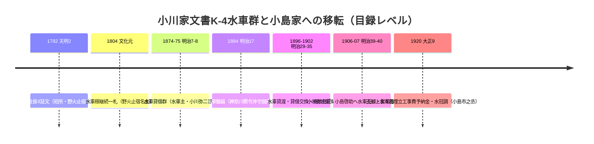

# 第85回（2026年11月14日）: ADEAC小平横断（小島・宮崎・水車）と當麻家文書水車群・技術調査年報2003-2011画像判定・としまの文化財第7集視聴手段特定

## 概要

ADEAC小平市立図書館の詳細検索を「小島」「水車」「宮崎」「水車通り」の4語で横断し、第82回の残課題だった小島家・宮崎家の横断を解決した（結論: **独立コレクションは存在せず、両家関係文書は小川家文書目録・當麻家文書目録内に分散**）。小川家文書K-4「水利－水車」群13件・小島家（小島啓助・小島市之丞）関係5件・宮崎家（熊野権現神主家）関係・小平市立図書館定点撮影写真「水車通り」シリーズ64件をGOV-100に、當麻家文書の水車・紛争群5件をGOV-120に追記した。また、東京都下水道局技術調査年報2003〜2011年版がいずれも画像スキャンのみでテキスト層がないことを確定し（第80回課題④の決着）、豊島区ADEACの『としまの文化財 第7集』（mp01800110）と「わが街ひすとりぃ 第10回 千川 インタビュー編」（mp00001020）の動画プレイヤーURLを特定した（GOV-134新規・GOV-129追記）。「千川上水公園」まち歩きアルバム写真（ma050047）をADEAC上で直接確認した（GOV-114追記）。

## ADEAC小平横断の手法（第82回手法の再利用・今後の定期調査で再利用可）

- **詳細検索のGET→再POST**: `https://adeac.jp/kodaira-lib/detailed-search?mode=catalog&word=<語>` をGET（cookie jar必須）→ 隠し欄一式を `searchBTN=検索` + `display_ddl=100` で再POST → 各行のPostBack（`catalog_grid_rpt$ctlNN$catalogsLink`＝行インデックス+1）をPOST →「Object moved」リダイレクト先（`/kodaira-lib/catalog/SZxxxxxx-800110?from=search` 等）で目録ID取得 → 詳細頁は `-800110`（小川家文書）／`-800120`（當麻家文書）サフィックスで直接GET可能。
- **限界（重要）**: word=水車の263件ヒットは**50件/頁の2頁目以降がPostBack・URL・sort・era・facetのいずれでも送れない**（1頁目50件のみ走査可能）。display_ddl=100は「千川」74件では効いたが、水車263件では効かず。小川家文書目録137件中の未走査分（約119件）が残る。定点撮影写真など他資料グループの多数ヒットも同様。
- **走査結果**: word=小島16件・word=水車263件（うち1頁目50件）・word=宮崎74件・word=水車通り64件。

## 横断の結論: 小島家・宮崎家の独立コレクションは存在せず

- ADEAC小平の資料グループは小川家文書目録（-800110）・當麻家文書目録（-800120）のほか、定点撮影写真（-200010）等で構成され、**小島家文書・宮崎家文書の独立目録は存在しない**。
- 宮崎家は**小川村熊野権現（熊野宮）の神主家**（宮崎采女・宮崎若狭・宮崎国五郎・宮崎泰雄〔砂川村戸長〕）で、関係文書は小川家・當麻家両目録の「水利－紛争」等に分散。
- 小島家は小島啓助（東村山村野口・明治39〜40年に小川弥二郎の水車を買収・営業権譲与許可願）と小島市之丞（小平村小川・水車・大正9年玉川上水々底埋立工事費予納金・水冠調）の2名が確認され、いずれも小川家文書目録内のレコード。

## 新規確認レコード（GOV-100第85回追記・GOV-120追記の内容）

### 小川家文書K-4「水利－水車」13件（GOV-100）

| SZ | K-4 | 年 | 差出／宛所 |
| --- | --- | --- | --- |
| SZ107515 | 10 | 天明2寅8月 | 小川村水車願人 名主弥治郎 他／野火止宿名主常右衛門 |
| SZ107516 | 11 | 天明2寅9月 | 名主弥次郎・加判人八郎右衛門・大岱村引請人半次郎／野火止宿名主常右衛門 |
| SZ107518 | 13 | 天明2寅9月 | 入間郡大岱村引請人半次郎／小川村弥次郎 |
| SZ107520 | 15 | 文化元甲子6月 | 名主弥四郎 他3名／野火止宿名主庄右衛門・安兵衛 |
| SZ107545 | 40 | 明治7年10月 | 借請人清水元右衛門（小川村）／水車主小川弥二郎 |
| SZ107546 | 41 | 明治7年10月 | 水車主小川弥二郎／立川勝五郎 |
| SZ107548 | 43 | 明治8年第4月 | ／水車主小川弥二郎 |
| SZ107549 | 44 | 明治8年9月6日 | 野嶋卯之助（下清戸村）／水車主小川弥二郎 |
| SZ107551 | 46 | 明治17年10月 | 小川弥二郎／神奈川県令沖守固 |
| SZ107561 | 56 | 明治29年2月11日 | 水車主斉藤安在（小平村字回り田） |
| SZ107562 | 57 | 明治29年2月 | 久野丑之助（東村山大岱） |
| SZ107563 | 58 | 明治30年4月13日 | 小川弥二郎「水車届」 |
| SZ107569 | 64 | 明治32年4月25日 | 水車主小川弥二郎・保証人小野弥右衛門等「貸借交換約定書」 |
| SZ107572 | 67 | 自明治35年 | 「小川水車」搗物日記帳〔一部破損〕 |
| SZ107605 | 100 | （記載なし） | 水車労金（内容年「近世」） |

〔観察〕天明2年3件と文化元年1件の宛所が野火止宿名主。水車の所在水路（千川上水筋か野火止用水筋か）は目録から確定できない。BLOG-094「文化4年以降千川筋は水車不許可」の検証には本文確認が必要。

### 小島家関係5件（小川家文書・GOV-100）

- 明治39.11.22 仮約定書（水車売買）SZ107574＝売主小川弥次郎→買主小島啓助（小平村字鈴木）
- 明治39.12.17 水車売渡証 SZ107575＝小川弥二郎→東村山村野口 小島啓助
- 明治40.10.30 御許可願（水車営業権譲与）SZ107577＝宛所東京府知事 千家尊福
- 大正9.6.7 仮預書（元樋前玉川上水々底埋立工事費予納金）SZ107395（K-2 118）＝小川用水組合惣代小川弥次郎→小嶋市之丞
- 分水口対岸上水河底切取平面図 SZ107422（K-2 142・差出欄に小島市之丞・内容年「近世」）／大正9.1.17 （玉川上水用水水冠調）SZ107830（K-6 66・小島市之丞）

### 宮崎家関係（小川家文書・GOV-100／當麻家文書・GOV-120）

- 安永9子8月 呑水出入一件一札 SZ107765（小川家 K-6 3）＝野中新田名主徳兵衛→御奉行所（大沼田新田上分并宮崎采女相掛り）
- （玉川上水分水用水三分塞二付差支如何の照会状）SZ107754（小川家 K-5 140）＝砂川村戸長宮崎泰雄→小川村戸長小川弥次郎
- （玉川上水堰元多摩村大堰修築ニ付水切通達）SZ107411（小川家 K-2 131）＝砂川憲三不在ニ付代理 宮崎泰雄→小川弥次郎
- （水路費徴収催促方願之書簡）SZ107491（小川家 K-3 69）＝野中善平・高橋七郎・中村庄五郎・宮崎国五郎→小川弥二郎
- 當麻家文書: 宮崎若狭水車出入一件 SZ112753（K-3 23）・呑用水堀出入一件〔後欠〕SZ112755（K-3 25・宮崎采女）

### 當麻家文書K-4「水利－水車」3件（GOV-120追記）

- 嘉永7寅4月5日 水車建家諸道具借請証文 SZ112773（K-4 16）＝大沼田新田水車貸主弥左衛門・大岱村証人弥重郎→政吉
- **（水車場所絵図）SZ112780（K-4 23・内容年「近世」）**＝水車の場所を描いた絵図の存在（画像未公開・IIIF欄空欄）
- 明治3庚午8月 飯料搗水車取建証文 SZ112782（K-4 25）＝小川新田水車主新助・組頭八左衛門→鈴木新田・野中新田・大沼田新田御役人衆中

### 定点撮影写真「水車通り」64件（GOV-100）

- 小平市立図書館の定点撮影写真（-200010）に、地点007「水車通り東」と地点023「たかの街道水車通り交差点西」の2地点が昭和56年度〜令和4年度の各年度分で計64件登録。**小平市に現役の道路名「水車通り」が存在し、図書館が約40年間定点観測してきた**ことの公的記録。サムネイルURL直取得は404・IIIF欄空欄で画像本文未確認。

## 技術調査年報2003〜2011年版＝画像のみ（第80回課題④の決着）

- Wayback CDXで東京都下水道局技術調査年報の完全版スナップショットを特定: 2003=20240522032324（125MB）・2004=20240519130433・2005=20240521060019・2007=20240708073227・2009=20240520020212・2010=20240708072731・2011=20240708073728（full版URLパターン: `https://www.opendata.metro.tokyo.lg.jp/gesui/R3/gijyututyousa/<year>all.pdf`）。
- 2003・2004・2005・2009年版をダウンロードし検査: **ToUnicode 0件・FontFile 0件・Image XObject数百＝画像スキャンのみでテキスト層なし**（2001年版〔第80回〕と同様）。2013年版以降（GOV-122/123）と異なり、2001〜2011年版はテキスト抽出不能と確定。陰性結果のためノート記録のみ（GOV-122/123の追記には「2001年版と同様に画像スキャンのみ」の注記を要するが、今回はGOV-122への反映は見送り次回判断）。

## 豊島区ADEAC映像の視聴手段特定（GOV-134新規・GOV-129/114追記）

- **mp01800110「としまの文化財 第7集」（平成16年=2004年・12分・内容: 谷戸川跡・千川上水跡・日光御成道・関連語: 千川通り・千川親水公園・千川上水公園・掘割・南長崎・要町・西巣鴨）**: 動画ビューア（`/toshima-history/viewer/movie/toshima_graphics_v017/index.html`）内iframeからプレイヤーURL `https://118.videoplayer.jp/player.asp?client_code=admin&video_file=1311605100/movie/toshima_graphics_v017/toshima_graphics_v017.mp4&serial=12345678&...` を特定。**READMEに本文参照があったがsourceファイルが存在しなかった**ため、SSOT原則に従いGOV-134として新規登録（第84回「次回深掘り候補」の解消）。
- **mp00001020「わが街ひすとりぃ 第10回 千川 広報番組インタビュー編」（放送 平成31年3月30日・19分26秒）**: 同様にプレイヤーURL `https://118.videoplayer.jp/player.asp?client_code=admin&video_file=1311605100/movie/toshima_wagamachi_v010_2/toshima_wagamachi_v010_2.mp4&serial=12345678&...` を特定（GOV-129追記）。目録解題: 「矢尾一枝さん、島功さんにご出演いただき、千川地域の特徴や、昭和から平成にかけての変遷などを語っていただきました」。映像本文の視聴は未実施。
- **ma050047「千川上水公園」（2021-22まち歩きアルバム西巣鴨・写真1枚）**: アルバム目次ページ（`/toshima-history/top/topg/07graphics/photo/05nishisugamo.html`）のキャプションで直接確認（GOV-114追記）。まち歩きアルバムの千川関連写真が「板橋高校前桜並木」（千川）と「千川上水公園」（西巣鴨）の少なくとも2地点にあることを確認。

## 小川水車史のタイムライン（第85回確認分・Mermaid）

〔注意: いずれも目録レベルの確認で本文未確認。水車の所在水路（千川上水筋か野火止用水筋か）は確定していない〕

## 残課題（次回以降）

1. **word=水車263件の2頁目以降の走査手段**（PostBack頁送り不能問題の回避策）。小川家文書目録137件の全体像。
2. K-4水車群・當麻家水車群の本文確認（IIIF画像は未公開・小平市立図書館での現地閲覧が必要か）。特に「水車場所絵図」（SZ112780）と「分水口対岸上水河底切取平面図」（SZ107422）の図内容。
3. 天明2年水車仕掛3件とBLOG-094「文化4年以降千川筋水車不許可」の関係（千川筋か野火止用水筋か）。
4. 技術調査年報2001〜2011年版の陰性結果をGOV-122（2013年版以降のファイル）に注記として反映するか（今回は見送り）。
5. mp01800110・mp00001020の映像本文視聴（プレイヤーURLは特定済み・再生確認未実施）。
6. ALIS伺書（GOV-121）再試行・都公報S40.3.31都告279のデジタル探索（今回は未着手）。

## 反映内容（第85回）

1. GOV-100: 第85回追記（K-4水車群13件・小島家5件・宮崎家5件・定点撮影写真64件）＋tags拡張＋制限⑦⑩更新。
2. GOV-120: 第85回追記（當麻家K-4水車3件・K-3紛争2件）＋tags拡張。
3. GOV-114: 第85回追記（ma050047西巣鴨「千川上水公園」の直接確認）。
4. GOV-129: 第85回追記（インタビュー編プレイヤーURL特定）＋制限④更新。
5. GOV-134: 新規（としまの文化財第7集・mp01800110・プレイヤーURL）。
6. README: 「## 現時点で重要なこと」に第85回bulletを追加（第84回bulletの前）＋「としまの文化財第7集」bulletの出典にGOV-134を追加。
7. INDEX.md・地図一覧.mdを `python3 tools/sources/build.py` で再生成。
