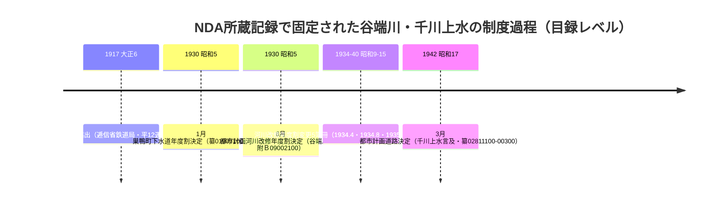
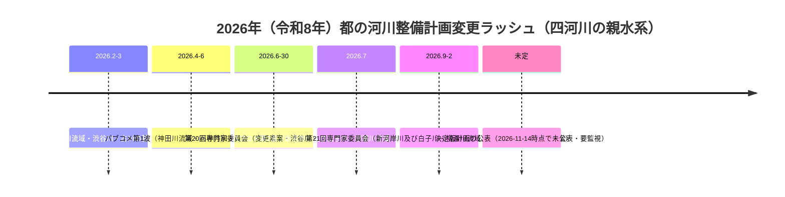

# 第86回（2026年11月14日）: NDA谷端川一次記録の所在と2026年都の河川整備計画変更ラッシュ

## 概要

国立公文書館デジタルアーカイブ（NDA）の検索APIで「谷端川」（9件）・「千川上水」（1件）を横断し、**1930年（昭和5年）8月8日の東京都市計画河川改修及其ノ事業執行年割決定ノ件（谷端川）附図**（請求番号 附Ｂ09002100・神田川・立合川と同時の3附図）をはじめ、1934〜1940年の年度割変更簿冊5件・1930年1月25日巣鴨町下水道決定・1917年3月15日谷端川橋梁橋桁変更届出・1942年3月30日道路決定（千川上水言及）の**未デジタル化一次記録群の所在**を固定した（GOV-135新規・いずれも所在のみ）。あわせて、東京都建設局の**2026年（令和8年）河川整備基本方針・河川整備計画変更ラッシュ**を確認した: 渋谷川・古川・新河岸川及び白子川・神田川流域・目黒川流域・石神井川・柳瀬川流域・呑川流域の計画変更原案が2026年4〜7月に2波のパブリックコメントにかけられ、目黒川流域・呑川流域・渋谷川・古川の基本方針3本が2026年2〜3月に変更済み（GOV-136新規）。令和8年3月版渋谷川・古川基本方針は**「渋谷川の上流部分や河骨川、宇田川、笄川などの支流は暗渠化され、下水道幹線となっていた」「平常時の流量は極めて少ない」**と明記し、建設局説明資料の流域図には**「隠田川（千駄ヶ谷幹線）」**の図中ラベルがあることをスニペット確認した（弦巻川・水窪川の親水系の現行制度枠組みとGOV-122の千駄ヶ谷幹線特定を補強）。池尻成二note（2026-07-24）で新河岸川及び白子川変更原案の計画降雨量75mm→85mm・調節池位置変更（向下橋→芝屋橋）・総容量502,000m³不変を確認した（BLOG-222新規）。さらに雑司ヶ谷絵図のデジタル化コピー2件（台東区立図書館・岡山大学附属図書館池田家文書）の新所在を確認した（ノート記録のみ）。

## NDA（国立公文書館）谷端川・千川上水一次記録群（GOV-135）

- **手法**: NDA検索API `https://www.digital.archives.go.jp/api/search?q=<語>`（2026-11-14実行・メタデータCC0）。「谷端川」9件・「千川上水」1件・「弦巻川」0件・「水窪川」25件（すべて静岡県の天竜川水系・無関係）。**いずれも未デジタル化**で、国立公文書館（東京本館）等での原本閲覧が必要。
- **主な収穫（詳細はGOV-135）**:
  - **1930-08-08 東京都市計画河川改修及其ノ事業執行年割決定ノ件（谷端川）附図**（附Ｂ09002100・aipId 1715352・`/file/1715352` で200 OK）。同決定の附図は神田川（1714864）・谷端川（1715352）・立合川（1714865）の3点。親簿冊纂01910100-00（件名4）は[PAP-064](../sources/papers/PAP-064.md)引用の決定に対応。**谷端川が1930年都市計画河川改修決定の附図対象であることを示す目録記録**（repo初出）。図面内容は未確認。
  - **年度割変更簿冊5件**（1934-04-05 纂02112100-01300・1934-08-21 纂02116100-01300・1935-12-28 纂02179100-00100・1936-04-02 纂02227100-01300・1940-03-23 纂02580100-00400）。1930年決定以降、遅くとも1940年まで谷端川の改修年度割が継続調整されていた行政記録列。
  - **1930-01-25 東京都市計画巣鴨町下水道及其ノ事業執行年割決定ノ件**（纂01907100-00600）。README既収録の西巣鴨町下水道（1932年内務省認可→1932年5月着工）の**2年4か月前の都市計画決定段階**の記録候補。
  - **1917-03-15 谷端川橋梁橋桁変更届出**（逓信省鉄道局・平12運輸02078100-05400・aipId 509497）。谷端川を跨ぐ鉄道橋の橋桁変更届出の存在（対象路線は未特定）。
  - **1942-03-30 東京都市計画道路決定**（纂02811100-00300・aipId 2468434）。「千川上水」キーワードの唯一のヒット。千川上水沿い道路化（千川通り）の都市計画決定であるかは件名のみでは断定できない。
- **注意**: すべて目録レベルの所在固定であり、本文・図面未見。放水路の着工年次・工区・流路図への直接の裏付けには使えない。

## 2026年都の河川整備基本方針・計画変更ラッシュ（GOV-136・BLOG-222）

- **パブコメ2波〔確認: 報道発表本文〕**: ①2026-05-15〜06-15 神田川流域・石神井川・目黒川流域（[2026042811](https://www.metro.tokyo.lg.jp/information/press/2026/04/2026042811)）②2026-07-01〜07-31 新河岸川及び白子川・柳瀬川流域・渋谷川・古川及び呑川流域（[2026062614](https://www.metro.tokyo.lg.jp/information/press/2026/06/2026062614)）。目的は将来の気候変動対応・「2050東京戦略」戦略21。
- **基本方針3本変更〔確認・スニペット〕**: 建設局は2026年2〜3月に目黒川流域・呑川流域・渋谷川・古川の河川整備基本方針を変更。**令和8年3月版渋谷川・古川基本方針**（kensetsu文書2026-03-25-111731-042・981KB）のスニペットに「渋谷川の上流部分や河骨川、宇田川、笄川などの支流は暗渠化され、下水道幹線となっていた」「平常時の流量は極めて少ない」「年超過確率1/50〜1/100規模の降雨への対応を目指す（計画降雨量は今後設定）」「渋谷川・古川河川再生計画（平成12年12月・建設省河川局長認定）」。**弦巻川・水窪川の合流先を含む渋谷川水系の暗渠化・下水道幹線化の現行基本方針による明文確認**（ただし両川名は同基本方針では未確認）。
- **「隠田川（千駄ヶ谷幹線）」の図中対応〔スニペット・repo初出〕**: 建設局渋谷川・古川説明資料（000053687）の流域図が渋谷川最上流の旧川を「隠田川（千駄ヶ谷幹線）」とラベル付けする。**隠田川（穏田川）＝千駄ヶ谷幹線**の公式図中対応で[GOV-122](../sources/gov/GOV-122.md)（千駄ヶ谷幹線＝旧渋谷川遊歩道＝キャットストリート）を補強。
- **渋谷川・古川流域ページの整備状況〔確認: open_url全文〕**: 令和6年度末 河川の安全度達成率 渋谷川79%・古川68%、護岸整備率 渋谷川100%・古川32%。古川地下調節池135,000m³（平成29年度完成・取水口は養老橋下流右岸）に加え**新並木橋〜渋谷橋付近に220,000m³の調節池を計画**。
- **渋谷川・古川の計画経過〔確認・一部スニペット〕**: H20.5基本方針→R6.1変更原案（000066496）→R6.9計画（000007317・2024-10-10変更公表・堤防耐震対策目的）→R8.3基本方針変更→R8変更素案（000066599・第20回専門家委員会資料6-2）→2026年7月パブコメ→第21回専門家委員会（2026-09-02）。
- **池尻成二note〔確認: 本文open_url取得〕**: 「白子川～河川整備計画改定についてのメモ②」2026-07-24。新河岸川及び白子川変更原案（39p）の**計画降雨量75mm→85mm**・**調節池位置変更（向下橋→芝屋橋）**・**総容量502,000m³不変**・**カット量208→345m³/s**（→BLOG-222）。谷端川の直接言及なし。
- **決定版は2026-11-14時点で未公表**〔2026-08-01時点の計画ページ「計画の公表時に掲載予定」〕。**次回以降の継続監視課題**。
- **四河川の位置づけ〔観察〕**: 弦巻川・水窪川＝渋谷川・古川計画、谷端川＝新河岸川及び白子川計画、千川上水＝神田川流域計画（GOV-124）の親水系で、**四河川いずれも2026年変更過程の対象流域**。変更原案本文での四河川の個別言及は未確認〔要原案PDF入手〕。

## 雑司ヶ谷絵図のデジタル化コピーの新所在（ノート記録のみ）

MAP-158（浜田義一郎編『地図帳 江戸切絵図 2 近吾堂版』・都立中央図書館蔵）収録の「**音羽目白雑司ヶ谷辺絵図（嘉永4）**」に対応するとみられるデジタル化コピー2件をADEAC横断で確認した。

- **台東区立図書館デジタルアーカイブ〔確認: 目録頁〕**: 「**音羽目白雑司ヶ谷辺絵図**」（嘉永4年〔1851〕冬新刻・**近江屋吾平/編**）。目録 [adeac.jp/taito-lib/catalog/mp070540-100070](https://adeac.jp/taito-lib/catalog/mp070540-100070)、コンテンツ `2017_chi_014_002`。**画像がデジタル公開されている**（図版閲覧可）。
- **岡山大学附属図書館池田家文書〔確認: 目録頁〕**: 「**雑司ヶ谷音羽辺図（T9-86）**」（池田家文庫絵図／他所図）。岡山県立図書館「デジタル岡山大百科」経由のADEAC目録 [adeac.jp/okayama-pref-digioka/catalog/M2016080515164983137](https://adeac.jp/okayama-pref-digioka/catalog/M2016080515164983137)。サムネイル画像あり（デジタル化済み）。
- **判断**: 両図とも図名・刊年がMAP-158収録図版と一致する**同一図の別所蔵デジタル化の可能性が高い**が、版次・異同は目録レベルでは確認できない。また画像本文の読図（水窪川・谷端川上流の描線）は未実施。**よって今回はMAPファイルを作らず・MAP-158への追記も見送り**、次回に読図のうえ別所蔵追記を判断する〔要読図〕。

## その他の確認・否定的結果

- **朝日新聞2026-11-14本田創インタビュー（ASVCF1TYMVCFOXIE01KM）**: 都下水道局長インタビュー記事。**有料記事で本文取得できず**、神田川・渋谷川・弦巻川・水窪川等への言及の有無は確認不能。ノート記録のみ。
- **GOV-126未解決①（会議名）の有力候補**: [GOV-126](../sources/gov/GOV-126.md)（000060776・kensetsu文書）の配付元会議は、神田川流域連絡会第5期第5回詳細議事録（kensetsu 2/5/5-5-2）の配付資料『荒川水系神田川流域河川計画(原案)の意見等について』が有力候補。ただし議事録ページも2026-11-14時点で「お探しのページ」で本文確認できず、断定は保留。

## アクセス不能・制約リスト（2026-11-14時点）

| 対象 | 状況 |
| --- | --- |
| kensetsu `/documents/`・`/content/` PDF | WAFでopen_url・curlとも取得不能（第81回はopen_urlで取得可だったため一時的ブロックの可能性） |
| jpsearch API（`jpsearch.go.jp`） | 404 |
| tokyoarchive.lg.jp | DNS解決不能 |
| echo-lab（東京都下水道局技術調査年報） | No route |
| meiji.repo.nii.ac.jp | JAIROメンテナンス中 |
| nabunken（奈文研） | 429 Too Many Requests |
| 板橋区立図書館デジタルアーカイブ | WAFで遮断 |
| CiNii | 取得不能 |
| 技術調査年報2000/2006/2012年版完全版 | Waybackに完全版スナップショットなし（2006・2012は単発記事PDFのみ） |
| 技術調査年報2001年版完全版 | スナップショットありだが画像スキャンのみ（第80回と同一結果） |
| 朝日新聞本田創記事 | 有料 |

## 谷端川の制度タイムライン（第86回NDA確認分・Mermaid）

## 残課題（次回以降）

1. **決定版計画の公表監視**（新河岸川及び白子川・渋谷川・古川・柳瀬川流域・神田川流域・目黒川流域・石神井川・呑川流域）。公表時は「意見と回答」資料を入手し、四河川の言及を確認する。
2. **kensetsu PDF取得手段の回復**（WAFの一時的ブロックの可能性が高いので再試行）。令和8年3月版渋谷川・古川基本方針・変更原案・000053687流域図の本文・図面確認。
3. **第21回専門家委員会（2026-09-02）の議事録・資料**の公開確認。
4. **NDA原本の閲覧・複写請求**（国立公文書館・東京本館）。附図 附Ｂ09002100の図面内容、1917年橋梁届出の対象路線、1942年道路決定の千川上水言及の文脈。
5. **雑司ヶ谷絵図2件の読図**（台東区立図書館mp070540-100070・岡山M2016080515164983137）。版次照合のうえMAP-158別所蔵追記を判断。
6. **GOV-126会議名の特定**（神田川流域連絡会詳細議事録の再取得試行）。
7. 朝日新聞本田創インタビュー本文（有料）の別取得手段。
8. 東京路地紀行112・音羽繪圖の所在（前回からの繰り越し）。

## 反映内容（第86回）

1. GOV-135: 新規（NDA谷端川・千川上水一次記録群の所在・status: 所在のみ）。
2. GOV-136: 新規（2026年計画変更ラッシュ・status: 直接確認）。
3. BLOG-222: 新規（池尻成二note・新河岸川及び白子川変更原案の数値・status: 直接確認）。
4. README: 「## 現時点で重要なこと」に第86回bulletを追加（第85回bulletの前）。
5. INDEX.md を `python3 tools/sources/build.py` で再生成。
