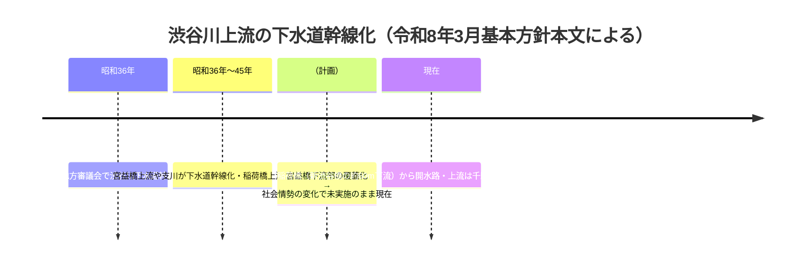

# 2026-11-14（第87回）追加調査ノート

第86回から継続した観点（kensetsu文書の取得・ADEAC小平の横断・ALIS所蔵館特定）で実施した調査の記録。成果はすべて最新mainとの照合後、GOV-136追記・GOV-121格上げ・GOV-100追記・GOV-141新規・READMEサマリーbulletとして反映した。

## 1. kensetsu文書URLの取得回復と令和8年3月渋谷川・古川基本方針の本文直接確認（GOV-136追記）

- 第86回にWAF遮断だった `https://www.kensetsu.metro.tokyo.lg.jp/documents/d/kensetsu/<ID>` が2026-11-14時点でcurl+UAにより再取得可能になった（`/content/<ID>.pdf`は301で同一名に解決）。
- **令和8年3月渋谷川・古川河川整備基本方針（2026-03-25-111731-042・13頁）の本文全文（26KB）を自作PDF抽出器（pdftext.py）で抽出**。第86回の「スニペット確認・PDF本文未取得」を格上げし、以下を本文から直接確認:
  1. 「上流の東京都公共下水道の**千駄ヶ谷、宇田川両幹線**で集水された雨水を収容」（千駄ヶ谷幹線・宇田川幹線の2幹線が渋谷川上流の集水幹線であることの令和8年基本方針の明文）
  2. 「河川の最上流（新渋谷橋）の**約60m下流側に位置する稲荷橋から開水路**」（稲荷橋＝開渠起点の都公式文言）
  3. 「**昭和36年～昭和45年に稲荷橋より上流の区間が暗渠化**された」（施工期間の年代明記）
  4. 「**昭和36年の都市計画地方審議会**において、渋谷川を下水道幹線化する**答申**が出された。この答申を受けて、昭和36年から昭和45年にかけて渋谷川の**宮益橋上流や支川**が下水道幹線化された。また、**宮益橋下流部の覆蓋化も計画されていたが**、その後の社会情勢等の変化を受けて**覆蓋化されないまま**現在に至っている」（制度起点・対象区間・覆蓋化未実施の3点）
  5. 童謡「**春の小川**」（大正元年）は、渋谷川の支流で現在は暗渠となっている**河骨川**をうたったものといわれている（河骨川説の令和8年公式維持）
  6. 「江戸時代の渋谷川は、四谷大木戸から引かれた**玉川上水の落とし水**と**新宿御苑、明治神宮の湧き水**等を源水…**明治31年に淀橋浄水場が完成し、およそ250年続いた玉川上水の落とし水がなくなり**、さらに後年の電力の普及と相まって**水車業も衰退**していった」（江戸期源水構成と明治31年の断絶の公式叙述）
- あわせて直接取得して確認した文書（いずれも弦巻川・水窪川・谷端川・千川上水の直接言及なし＝0ヒット）: 渋谷川・古川流域パネル（000053687・2頁・GOV-136既記録の範囲内）／渋谷川・古川河川整備計画R6.9（000007317・本文94KB）／同≪変更素案≫（000066599・78KB）／意見と回答（000007318）／呑川流域基本方針R8.3（2026-02-27-201326-147）／目黒川流域基本方針R8.3（2026-03-06-174919-521）／神田川流域計画の意見と回答（000062579・善福寺池意見はGOV-126と同内容）。
- kasenseibikeikaku一覧頁で全計画の現行版を確認: **神田川流域計画はR5.3のまま、2026年パブコメ分の決定版は2026-11-14時点で未公表**（GOV-136の見立てと整合）。第21回専門家委員会（2026-09-02）の議事録・配布資料はJS描画で本文取得不能。

## 2. ALIS「伺書」の所蔵館特定（GOV-121格上げ・第80〜86回の未解決を解消）

- 第80回に発見したNDLサーチALIS索引「伺書」（玉川上水分水千川用水六ヶ村[編]・QQ20085235）の所蔵館名が、NDL OpenSearchレコードの rdfs:seeAlso から辿れる **ALIS API経由**で特定できた:
  - `https://app.sys.affrc.go.jp/webopac/ufirdi.do?ufi_target=ctlsrh&bibid=QQ20085235&holar=99` の書誌詳細頁で**所蔵一覧1件**を確認 → 所蔵機関コード「情報セ」＝**農林水産研究情報総合センター（国立国会図書館支部農林水産省図書館 農林水産技術会議事務局つくば分館）**（opac.cc.affrc.go.jp/contactの機関一覧で「情報セ」の正式名称を確認）。
  - 書誌: 「伺書」玉川上水分水千川用水6ヶ村[編]・**六ヶ村[東京] : 玉川上水分水千川用水六ヶ村 , [1875]＝明治8年**・1v.／配置場所 **1Fデポ第9書庫**・請求記号 **政Ni//11337**・資料ID **01500001966223**。
  - RDFレコード（library.affrc.go.jp/api/QQ20085235.rdf）でも書誌・所蔵者（foaf:Organization・コード99）を確認。
- 意義: 千川用水六ヶ村組合文書の請求可能な所蔵情報が確定した（複写・貸借依頼の窓口はALIS WebOPACのILL機能）。作成年[1875]（明治8年）は、明治4年の直引取差免・明治13年増水運動の間の年代。ただし**本文は未確認**で、伺書の内容・六ヶ村の村名は今後の課題。

## 3. 小川家文書の水衛所文書3件（GOV-100第87回追記）

- NDL OpenSearch（any=水衛所）で小川家文書（東京都指定有形文化財・小平市中央図書館）の水衛所関連3文書を特定し、NDLサーチ書誌頁で詳細確認:
  - 「（小川分水樋文彫刻ノ件相談二付来駕願の葉書）」**SZ107821**・明治41年4月14日・差出「砂川水衛所ニテ 成美太一」→ 小川弥二郎宛
  - 「（分水樋吐尻護岸工事願書差出督促状）」**SZ107988**・明治41年5月12日・差出「砂川水衛所ニテ 成美太一」→ 小川弥二郎宛
  - 「（玉川上水路三分塞人足賃金御渡シ願）」**SZ107740**・大正8年7月7日・差出「水衛所 佐藤佐市」→ 小川弥次郎宛
- 「砂川水衛所」の個別名と職員名の文書レベル確認はrepo初出。三分塞人足賃金は第85回追記SZ107754（三分塞照会状）の継続を大正期に固定。明治41年5月の督促状は明治41年6月25日の千川水道会社解散の直前。
- **帰属の注意**: ADEAC小平詳細検索（word=分水樋・50件）で「新井筋小川分水樋」「御届（春期浚方二付小川分水樋口閉鎖）」「浄収第七九号（小川分水樋口閉鎖許可通知）」「東京市水丙第四八号…」などが表示され、**小川分水樋は新井筋（新井用水系統）の樋である可能性が高い**。千川上水取水樋（境分水口）とは別系統の管理文書である可能性をREADME・GOV-100に明記した（本文未確認のため断定はしない）。

## 4. こだいらデジタルアーカイブ「玉川上水の写真」の水衛所写真3点（GOV-141新規）

- 同じくNDL OpenSearch（any=水衛所）から、小平市立図書館こだいらデジタルアーカイブの資料グループ「玉川上水の写真」（151点）に含まれる水衛所写真3点を特定（いずれもCC BY・インターネット公開・IIIFマニフェスト確認）:
  - 「小平水衛所」（mp000960-200050/dgt00804・1975〜84年・「玉川上水の写真－建物」）
  - 「旧小川水衛所正面」（mp001250-200050/dgt01519・1984年・座標35.718132,139.473127）＝**1984年時点で旧小川水衛所の建物が現存・撮影されていた行政写真**
  - 「旧熊川水衛所」（mp000800-200050/dgt00726・1975〜84年・福生市熊川側）
- BLOG-220「境水衛所＝玉川上水32か所の水衛所の一つ」に対し、境・小平・小川・熊川の4か所の水衛所名が確認できたことになる。写真画像の判読は未実施（次回候補）。

## 5. 陰性・見送り記録

- **石神井川河川整備計画（平成28年3月・000007328_2・36頁・2.1MB）**: 取得に成功したが**画像系PDF（ToUnicodeなし）でテキスト抽出不能**。谷端川（石神井川支川系）言及の有無はOCR環境待ちとして次回候補に記録（概要000007327も同様・2頁）。石神井川計画はrepoに未登録の隣接河川計画。
- NDL OpenSearch「濯川」＝御裳濯川（三重）・河濯川（福井）などで四河川関連なし。「水衛所」の横断で熊川水衛所記事（或る水道人の生涯(その2)・水道公論）を確認したが、千川直接関係の記述は見つからず見送り。
- web_search: 時空散歩2009（＝BLOG-040既登録）・WANDER×WONDER 2026-09-23（＝BLOG-054既登録）・はてなブログmiwa3k（既存ノート記録済み）に変化なし。東京路地紀行の新回・J-STAGE新規文献は今回見つからず。
- news_search（前回実行済み・2026-11-07〜14）の四河川の新報道なしを再確認。

## 6. 反映手続きと並走実行との関係

- 反映前に最新main（codeload tarball・README 1,499,244 bytes）を再取得し、ローカルrepoと全ファイル一致（gov/blogs/maps/books/papers/org・README・INDEX全て同一・第86回並走実行からの新pushなし・採番重複なし）を確認した上で、GOV-141を採番。
- 本ノートの成果: GOV-136追記（基本方針本文直接確認・kensetsu取得回復）／GOV-121格上げ（所蔵館特定）／GOV-100第87回追記（水衛所文書3件）／GOV-141新規（水衛所写真3点）／README第87回bullet。
- push後はcodeload SHA固定tarballでREADME全バイト一致検証を実施する（手順は第84回以降と同じ）。

## 7. 次回候補

- ①石神井川計画H28.3本文のOCR判読（谷端川・放水路・雨水吐の言及確認）とrepoへの正式登録判断。②「玉川上水の写真」グループ全151点の走査（水衛所以外の千川・分水関連写真）。③ALIS「伺書」の複写依頼・本文確認（GoV-121の内容解明・六ヶ村の村名特定）。④kensetsu文書の追加探索（word=谷端川で意見と回答・計画変更原案の2026年7月パブコメ分の原案本文入手・決定版の公表監視）。⑤word=分水樋50件の全目録ID取得（新井筋小川分水樋群の詳細整理・小川家文書目録の体系走査）。⑥技術調査年報2003年版（Internet Archive復旧待ち）。⑦ADEAC小平詳細検索の他語（「境」「惣右衛門」「元樋」）の横断。
