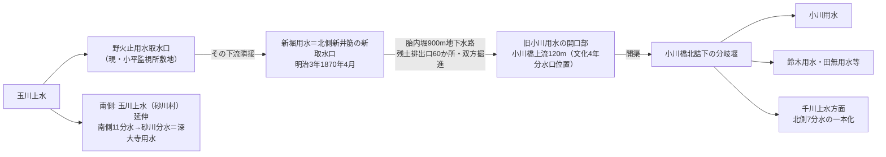
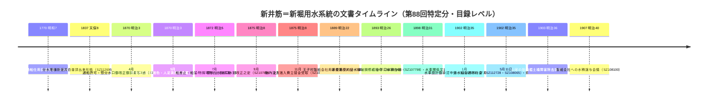

# 2026-11-14（第88回）追加調査ノート

第87回から継続した観点（ADEAC小平の横断・技術調査年報の年度判定・決定版計画の監視）で実施した調査の記録。最大の成果は、①ADEAC小平詳細検索 word=新井筋（145件）の横断とNDL OpenSearch→書誌頁→SZ番号マッピングの手法で明治3年（1870）「惣分水口御改正」の村方側一次文書群と新井筋組合の運営文書群を特定したこと、②kasen.info・玉川上水事典（守る会）・小平市教委看板という3系統のweb資料で「新堀用水＝北側新井筋」の同一名記載と胎内堀（900m地下水路）の構造を確認したこと。成果は最新main（head 6529c6c4）との照合後、GOV-100追記・GOV-122追記・BLOG-224・BLOG-225・BOOK-093・GOV-142新規・READMEサマリーbullet・§千川上水bulletとして反映した。

## 1. ADEAC小平「新井筋」145件の横断と明治3年惣分水口御改正の一次文書群（GOV-100第88回追記）

- 詳細検索（mode=catalog・word=新井筋）で**145件**（小川家文書目録133件＋當麻家文書目録12件）を確認。btnnextのページ送り・display_ddl=100の再POSTは不調で、1頁目50件の標題＋差出＋年代メタデータを抽出。**PostBack遷移の代替として「NDL OpenSearch（any=新井筋）→NDL書誌頁HTML内の adeac.jp/kodaira-lib/catalog/SZxxxxxx-800110 をgrep」で個別SZ番号を特定する手法が有効**（全95レコードを取得し、約20件の重要文書の目録詳細頁を直接取得して作成年・差出・宛所・資料番号を確認）。
- **明治3年（1870）惣分水口御改正の村方側一次文書3件**:
  - 「玉川御上水通村々惣分水口御改正御請書写」**SZ107882**（K-7 26・明治3午年4月・差出鈴木新田名主利左衛門他24ヵ村25名／宛所土木司御出役中様）
  - 同題**SZ107883**（K-7 27・明治3午年4月・差出柴崎村名主弥五左衛門他27ヵ村28名／同宛所）
  - 「玉川御上水通村々惣分水口御改正相成今般村々江被下置候惣分水口合樋諸色并人足賃銀其御筋へ取調書上候扣」**SZ107884**（K-7 28・明治3午年5月29日・差出小川村組頭茂十郎）
  - 意義: 通船許可（明治3年4月15日）と同月の28か村規模の御請書写2通と、翌5月の新分水口合樋諸色・人足賃銀の取調書上。README §千川上水既述の「1870年・新堀用水開削による取水口統合」（東京都水道局）・市教委看板「7つの分水口が埋められて1つの水路に統合」・守る会「北側の7分水は新堀用水に一本化」を、**村方側の一次文書レベルで裏付ける初の文書群**。差出28か村は「北側新井筋弐拾七ヶ村組合」（SZ107417・既出）と数値的に近いが、村名の異同は本文未確認のため断定しない。
- **通船史のR-3群**: 「玉川御上水通船仕用目論見帳」**SZ109835**（R-3 3・明和7寅年閏6月・小川村名主弥次郎父東磻→御普請方御役所様。守る会「元文・明和・慶応3回の出願が不許可」の明和出願に対応する候補）、「差上申御請書之事（運送船税上納二付）」**SZ109840**（R-3 8・明治4年4月25日）、「御請書之事（船差止二付船溜并物揚場埋方の件）」**SZ109843**（R-3 11・明治5年7月。kasen.info「明治5年5月30日通船禁止」の直後の埋立御請書）。
- **江戸期の分水樋普請**: 「玉川御上水通分水埋樋掛渡井自普請出来形帳樋口伏替仕様帳」**SZ112695**（當麻家文書 K-1 11・天保8酉2月・差出大沼田新田名主弥左衛門）。1870年統合以前の北側分水口の樋の普請実務。
- **胎内堀関係**: 「記（北側新井筋胎内浚方諸入費一時立替金受取）」**SZ107624**（K-5 14・明治8年11月25日・田無村下田半兵衛→小川弥次郎）、「申請書（小川新田字山家の胎内堀の土橋障害除去請求）」**SZ107952**（K-7 96・明治36年3月23日・差出小平村合併口衛生組長水路総代人野中弥市郎他3名→常任委員深谷定平他5名）。胎内堀の浚渕・維持実務と明治36年の実在・使用を伝える文書レベルの裏付け。
- **明治8年の野火止分水口**: 「玉川上水北側新井筋野火止分水口ト土木埋込并分水樋口水冠改正之定」**SZ107896**（K-7 40・明治8年9月10日・差出東京府第八大区八小区上石神井村副戸長高橋平蔵他5名）。千川沿線村（上石神井村）が新井筋の分水口管理に関与した大区小区制期の記録（ALIS伺書〔千川用水六ヶ村・1875〕と同年）。
- **新井筋組合の運営群**: 修繕指令（**SZ107918**・明治26年10月20日・東京府第二課吉村巌→小平村役場＝第87回の「小川分水樋＝新井筋系統」注意の文書レベル裏付け）、一円川浚願（**SZ107630**・明治32年3月27日・小川弥二郎→東京市水道部。「一円川」はrepo初出水路名候補）、王子村製紙会社用水契約証（**SZ107790**・明治22年12月19日・BLOG-113の明治8年千川系分水とは別系統）、保谷新田関前流シ樋終善費（**SZ107956**・明治37年）、原樋改築→山家付近溢水→水路変換の交換契約証（**SZ107914**・明治23年3月）、規約書（**SZ108131**）・明治35年5月11日通常総会議事録（**SZ112728**・當麻家文書）・出席名簿（**SZ108065**）、小平口水積台帳（**SZ107798**・明治31年9月・「大沼田上分聯合口」・29名連署）、**新井筋組合宛の水車文書**（**SZ107568**・明治31〜34年／**SZ107570**・明治35年1月・水車設計御承認ノ申請・差出回り田新田新井広次郎）、川越鉄道橋梁架設伺（**SZ107841**）、製紙会社水積譲与会議（**SZ108100**・明治40年6月26日）。
- 解釈上の注意: **「新井筋」＝新堀用水（1870年開削）の同一視は、kasen.info・市教委看板の同一名併記に基づく強い傍証つきの仮説として扱う**。千川沿線村々が明治初期に「北側新井筋より分水」（SZ107350既出）していた文脈と整合するが、本文確認までは確定しない。水車の所在水路（GOV-100制限⑩）は「新堀用水系」が第三の可能性として加わった。

## 2. 新堀用水（北側新井筋）の水路構造 — kasen.info・小平市教委看板・守る会（BLOG-224・BLOG-225・GOV-142）

- **kasen.info**（`kasen.info/view/104.html`・EUC-JP・最終更新2006/02/12）: 頁名「玉川上水(新堀用水)」に別名「**玉川上水(北側新井筋)**」を併記。明治3年4月15日通船許可・**千川上水までの計7つの分水口の付け替え**・南側の玉川上水(砂川村)延伸で11分水口付け替え・明治5年5月30日通船禁止（水質汚染）・野火止用水取水口の下流隣接箇所に取水口・**胎内掘（地下トンネル）で旧小川用水の開口部まで導水**（現在一部を除き埋設）。頁内の**小平市教育委員会看板（平成16年3月）**: 明暦2年小川村新田開発許可→小川分水開削（小川村地割図〔延宝2年頃〕の分水口は東小川橋付近）→**文化4年（1807）小川橋上流へ分水口付け替え**→**明治3年（1870）新堀用水（北側新井筋）開削・小川分水から千川上水までの7分水口を統合・新分水口から900mの地下水路＝胎内掘**。看板引用の「一尺四尺(30.3cm x 30.3cm)」は寸法として内部整合しないため数値採用は見送り（原本確認課題）。**水道局「9分水」説と「7分水」説の食い違いは差異として記録**。
- **玉川上水事典「新堀用水」頁**（`moguratushin.sakura.ne.jp/tamagawajitenHP/jyosuijiten/sinboriyosui/sinboriyosui.html`・Shift_JIS。第39回の「文字コード不一致で本文抽出不能」を`bytes.decode('shift_jis', errors='replace')`で解消し本文全文取得）: 小平市玉川上水を守る会編『新堀用水』。通船3回の不許可（元文・明和・慶応）→明治2年9月出願認可→明治3年4月から2年間。**小川家文書『玉川御上水通村々惣分水口御改正御請書写』記載の通り、文化4年二度目の分水口を小川橋上流120m左岸に付け替え**、新水路は**胎内堀＝残土排出口の穴を60か所掘り双方から掘り進み900m先の小川用水路の開渠口に繋いだ**＝新堀用水。小川橋北詰下に小川用水との分岐堰。盗水防止説（伝聞）。**北側7分水は新堀用水に・南側11分水は砂川分水（深大寺用水）に一本化**。水位は底部から1.6m以上必要（自然流下）。**監視所内の送水口から桜橋までの5.5kmを新堀用水という**。
- **1957年写真**: ADEAC小平「小平市史別冊写真集」「野火止用水と新堀用水の分水口」（mp004010-100040・飯山達雄撮影・昭和32年・小平市立喜平図書館・CC BY・IIIF欄あり）。解題「明治3 (1870) 年に小平市域北側の分水口は新堀用水に一本化され、ここに取水口が設けられた。手前の分水口が野火止用水。次が新堀用水。」（GOV-142新規・画像判読は未実施）。
- **『古文書に見る小平の水 : 玉川上水と分水』**（小平郷土研究会郷土史研究部会編・小平市文化財シリーズ3・1984年8月・NDL書誌I000001674303）を新規登録（BOOK-093・書誌のみ）。

## 3. 技術調査年報の年度判定修正（GOV-122第88回追記）

- Wayback CDXを再走査し、**2017〜2019年版に完全版スナップショットが存在することを確認**（第85〜86回の「スナップショット不存在」判定の一部が誤り）:
  - **2017年版**（20240708072734・約24MB）: テキスト層あり（ToUnicode 873）。自作抽出器（pdftext.py・ObjStm+xrefストリーム対応）で全262頁の本文抽出・全文走査 → **谷端川・千川・弦巻川・水窪川・雑司ヶ谷幹線の直接言及なし（陰性）**。言及のあった近隣施設: 志村坂下幹線・落合水再生センター・洗足池幹線等（いずれも四河川対象外）。
  - **2007年版**（20240708073227・19.9MB）・**2011年版**（20240708073728・19.7MB）・**2018年版**（20240708072735・36.5MB）・**2019年版**（20241124014548・22MB）: ToUnicode 0・画像スキャンのみ（テキスト抽出不能）と確定。
  - **2016年版**: 完全版スナップショットなし（単発記事PDFのみ）。
- 残る未走査年度: 2000・2006・2012年版（完全版なし）・2001年版（画像のみ）・2007・2011・2016・2018・2019年版（画像のみ・OCR待ち）。

## 4. 決定版計画公表の監視（変化なし）

- 建設局「河川整備計画について」頁（2026-11-09更新）を確認: 神田川流域・石神井川・目黒川流域・新河岸川及び白子川・柳瀬川流域・渋谷川・古川及び呑川流域の2026年パブコメ分は**終了済み**だが、策定済み一覧表は神田川流域=R5.3・新河岸川及び白子川=R4.12・渋谷川・古川=R6.9のまま。**決定版は2026-11-14時点で未公表**（第87回の見立てと整合・GOV-136の継続監視事項）。news_search・web_searchで四河川の新報道・新ブログも確認したが該当なし。

## 5. 次回以降の課題

- ①word=新井筋145件のうち未取得の約50件の目録ID・メタデータ（詳細検索のページ送りは不調。NDL OpenSearchのany=新井 組合等の別語でレコード補完、またはADEAC目録頁のSZ番号逐次試行）。
- ②ADEAC小平詳細検索の他語横断（第87回課題の「境」「惣右衛門」「元樋」等）と「小平市史別冊写真集」グループの全走査（水路関連写真）。
- ③明治3年御請書写の本文確認（28か村の村名の異同・SZ107417の27か村との関係・「御改正」の具体的内容）。BLOG-225の文化4年解釈（小川橋上流120mと野火止堰の右隣りの位置関係）の原本確認。
- ④『古文書に見る小平の水』（BOOK-093）・BOOK-074（小平市史料集27集）の本文確認（新井筋・千川関係の翻刻の有無）。
- ⑤「桜橋」の位置特定（守る会の新堀用水末端5.5km説）とGOV-142写真のIIIF画像判読。
- ⑥GOV-100制限⑩（水車の所在水路）の検証: SZ107568/SZ107570の本文で「回り田新田」の水車が新堀用水筋かを確認。
- ⑦技術調査年報の画像版年度のOCR（tesseract等が使える環境になった場合）・石神井川計画H28.3のOCR（谷端川言及確認）。
- ⑧再試行系: 板橋区WAF（板橋区立図書館デジタルアーカイブ）・nabunken・meiji.repo・GOV-126の会議名=000060776再取得。
