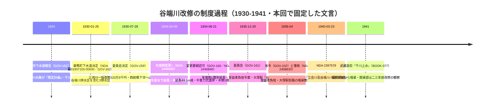

# 2026-11-15（第101回）・次世代デジタルライブラリーOCR全文検索の開通と谷端川1930年代改修の設計一次記録群

第101回の定期調査記録。**NDL次世代デジタルライブラリーの全文検索API（`https://lab.ndl.go.jp/dl/api/book/search?keyword=<語>&searchfield=contentonly`）がOCRテキスト単位で使えることを確認**し、「谷端川」（133件）・「水窪川」（380件・東京文脈は0件で陰性）・「弦巻川」（54件）を横断検索、ヒット書誌の全文OCR（`/dl/api/book/fulltext/<id>`のZIP）を取得して既存記録（INDEX.mdでの総当たり照合）と比較した。その結果、①**谷端川1930年代改修の委員会審議記録3点（決定・变更・負担令）の本文**、②**[BOOK-077](../sources/books/BOOK-077.md)『千川上水』（1941）の全文**、③1922年土地概評価3区町（**乞食橋**repo初出）・1924年市下水道報告（千川幹線・「谷端川より石神井川に達する水路」の既定計画）・1914年沿革誌（小石川＝谷端川の末）・1933年滝野川町誌（水害死者・千川全線暗渠の道路併用）・1890年「弦巻川観螢」など、**13点の新規資料＋2点の大幅更新**に値する本文記録を抽出した。すべての引用はOCR由来で、数値・文言は原文画像との照合を要する（各資料ファイルに明記）。

## 今回の新規登録・追記（GOV-159〜168・BOOK-109〜113・GOV-135/BOOK-077更新）

- **手法の開通〔確認〕**: 次世代デジタルライブラリーの非公式API（全文検索・全文ZIP・書誌頁 `https://lab.ndl.go.jp/dl/book/<id>`）で、従来「所在のみ」だった刊行物の本文がOCRテキストで読めるようになった。**repoの13書（土地概評価・議事速記録・下水道年報・滝野川町誌・小石川区史・市域拡張史等）はすべてrepo未収録の新出典**だった。検索語の検証: 「水窪川」380件はすべて静岡県（天竜川水系）で**東京文脈0件・陰性**（水窪川の文献での言及の少なさを量的に固定）。
- **谷端川1930年代改修の設計一次記録群〔確認・本回の目玉〕**:
  - **[GOV-159](../sources/gov/GOV-159.md) 議事速記録第2号（1930-07-28・議第七号）**: 立会川・神田上水・谷端川の一括改修決定（総経費520万9千円・昭和5〜8年度4箇年）。谷端川現況＝「**長崎町字境窪ニ於テ旧千川上水ヨリ分水シ**」→板橋駅附近で「**流水ノ殆ド全部**」を「**既ニ完成セル所謂板橋放水路**」で石神井川に放流→下流は「**市内ニ入リ千川トナリ**」→「**水道橋際ニ於テ神田川ニ合流**」・延長約8,000m・流域866ha。改修要綱＝**西前橋下流約百米〜山手線下の約3,001m**・上流矩形開渠（幅6m）＋下流全暗渠（円管0.3〜1.2m＋矩形渠）・改築11橋＋根固1橋（鋼桁・RC・**木桁**）・区間表に**谷端橋・鎌倉橋・蛇○橋**〔橋名はOCR要照合〕。
  - **[GOV-160](../sources/gov/GOV-160.md) 常務委員会第5号（1934-08-06申請→08-21認可）**: 変更要綱全文。延長3,001.8→**2,952.671m（約49.1m減・実測）**・構造3区分（上流開渠は板橋駅鉄橋下で石神井放水路に接続・下流矩形渠は大塚駅山手線下で**旧巣鴨町下水道幹線に接続**）・護岸T型→**半重力式RC（3.95〜5m）**・赤羽線鉄道橋下勾配**1/250〜1/18.6**・**木橋5橋を廃止しRC6橋**〔OCR要照合〕・不用額101,042円77は神田上水に流用。
  - **[GOV-161](../sources/gov/GOV-161.md) 議事速記録第8号（1935-12-20・第19回）**: 議第142号＝年度割を1箇年延長（総経費**563万余円**）＝NDA 2360164（1935-12-28）に対応。**議第160号＝受益者負担令案（負担区劇図つき・1935-12-16後藤文夫）**＝[GOV-102](../sources/gov/GOV-102.md)（1936-04-14省令）に先行する委員会決定。大塚駅街路変更で「**曩ニ都市計画事業トシテ執行済ニ係ル谷端川暗渠敷ヲ可成利用**」＝NDA 2408633（1936-04-02）と同一文言の**1935年12月時点での二重確認**（大塚駅区間の暗渠敷が執行済みであったこと）。
  - **[GOV-162](../sources/gov/GOV-162.md) 特別都市計画委員会第12号（1930）**: 巣鴨町下水道計画（566,810坪・人口7万・143万5千円・昭和4〜8年度）＝汚水を**谷田川・谷端川・悪水路に排出**、**谷田川・谷端川・白山の3排水区**＝NDA 纂01907100-00600（1930-01-25・GOV-135）の本文に相当〔同一案件の直接照合は保留〕。
  - **[GOV-135](../sources/gov/GOV-135.md)更新**: 年度割変更5簿冊（2448939・2440846・2360164・2397578・2408633）が**type=3（デジタル化済み・IIIF）**と判明。理由書文言の目録レベル取得: 1934-04-05（昭和10年度まで延長・神田上水屈曲匡正）・1934-08-21（些少変更）・1935-12-28（1箇年延長）・**1940-03-23「立会川及谷端川ハ既ニ完成」**・1936-04-02（谷端川暗渠敷文言）。
- **[BOOK-077](../sources/books/BOOK-077.md)『千川上水』（1941）の大幅更新**: 全文OCR開通（lab id 1043756・40コマ・4章）。
  - **谷端川＝「千川の分水の中最大のもの」「所謂長崎村分水」**、分水口＝**庚申橋下流の釣堀の裏・石積水門**、千川文書の水口「七寸四方」→現在は「四寸四方」（本文）／「三寸四方」（分水の章）と**寸法表記に揺れ**〔OCR要照合〕。
  - **1941年の流路観察**: 要町四丁目→椎名町駅横（武蔵野線横断）→北流→**金井窪駅附近**→板橋駅前→「**現在は板橋駅前から暗渠に入り、開渠部分も二三年前改修**」→小石川植物園・後楽園の横→神田川、**全長11km**。
  - **明治17（1884）年の千川水路変更**（下板橋宿・金井窪村・滝野川村・汚水浸入防止）＝**[MAP-120](../sources/maps/MAP-120.md)千川用水絵図（1884）と同年の変更事件の本文記述**〔絵図＝変更後水路とするREADME仮説を補強。同一性の直接照合は保留〕。
  - **落合分水（repo初出）**: 椎名町八丁目屈曲点→西落合1・2丁目→西武線→西落合5丁目で**妙正寺川に合流**・全長2.3km・新十三間道路（明治通り）工事で閉鎖・猫地蔵。**櫻台分水**: 桜台駅前→中荒井分水に合流・約1km。
  - **沿革の年代固定**: 宝永4（1707）年灌漑許可→享保7（1722）年廃止→安永8（1779）年再興→天明3（1783）年竣成→天明6（1786）年再廃止→慶応期反射炉水力→明治3砂川村分水→明治13千川水道会社→明治17水路変更→明治40会社閉鎖。昭和初年・**庚申塚開渠埋立・木製陰樋出土・明治15年分配石標現存**。
- **土地概評価3点（1922・東京興信所）〔確認〕**:
  - **[BOOK-109](../sources/books/BOOK-109.md) 西巣鴨町**: **乞食橋（repo初出・大塚終点の北約一丁・廃兵院の西〔位置はOCR要照合〕）**〜鎌倉橋間の谷端川両岸＝**工場地・住宅地で空地なし**・鎌倉橋以西＝田畑。境井田＝耕地整理で新道数条。宮の下＝**西前橋・田楽橋・中丸橋**〔OCR要照合〕。字三家が滝野川町字南北谷端と対峙。千川上水＝庚申塚の北の町境。**巣鴨町（921577）・板橋町（921578）巻の所在も確認（未精読）**。
  - **[BOOK-110](../sources/books/BOOK-110.md) 滝野川町**: 字南谷端・北谷端の1922年の土地利用・地価断面。
  - **[BOOK-111](../sources/books/BOOK-111.md) 小石川区**: 丸山町「**千川（谷端川）岸**」＝下流部の千川呼称の民間調査書レベルの傍証。
- **下水道史・行政史の追加〔確認〕**:
  - **[GOV-163](../sources/gov/GOV-163.md) 下水道改良実施調査報告書（1924）**: 谷端川流域**247.6万坪・人口123,800**。「谷端川ノ下流ハ千川ニシテ」・山手線以西172.8万坪の雨水は「**既定計画ニ依リ谷端川ヨリ石神井川ニ達スル水路ヲ新設**シ以テ荒川ニ放流」＝**板橋放水路が1924年時点で「既定計画」であった市側文言**（1924/25年次問題の上界）。以東74.8万坪＝**千川幹線**収容。**音羽流域83.4万坪**（雑司ヶ谷・高田町・巣鴨町一部）＝**音羽幹線**。
  - **[GOV-164](../sources/gov/GOV-164.md) 下水道沿革誌（1914）**: 「元巣鴨村ヨリ出ツル**野水谷端川ノ末**ナリシカ後**千川上水ノ剰水ヲ容レ**…**現今ハ直チニ神田川ニ注ク**」＝1914年の小石川＝谷端川末流の明文。
  - **[GOV-165](../sources/gov/GOV-165.md) 長崎町現状調査（1931）**: 「千川用水ハ町ノ西北ヲ桜井街道ニ沿ヒテ流レ、**谷端川ハ町ノ中央ヲ貫通シ**」＝1932年市域拡張前夜の上流域の平面配置。
  - **[GOV-166](../sources/gov/GOV-166.md) 下水道事業年報15・16回（1937）**: 巣鴨町（谷田川・谷端川・悪水路へ排出）・高田町（**鶴巻川排水区**・神田上水路排水区）・滝野川町（**石神井川・谷端川・音羽・谷田川の4排水区**「其ノ大部ハ谷端川及悪水路ニ排出」）〔OCR要照合〕。
  - **[GOV-167](../sources/gov/GOV-167.md) 高田町政概要（1930）**: 高田町独自の下水道実測（縦断面図・**東京府交付計画設計との対照**・1万分の1図に**音羽・鶴巻川・旧神田上水・谷端川の各流域区分**）〔OCRが劣弱で信頼度最低・要照合〕。
  - **[GOV-168](../sources/gov/GOV-168.md) NDA追加**: 東上線**金井窪駅**の行政記録2件（1931-12-05新設・1945-04-05営業休止）・**王子電気軌道 高田町〜長崎村間延長線の特許申請返付（1922-08-28・type=3）**＝弦巻川・谷端川谷域の未成路面電車計画・**雑司ヶ谷3件**（1869年「雑司谷植物地ヲ開成学校ノ附属トス」＝**IIIF4枚・判読は次回**・1834年2件）。
- **文学・町誌〔確認〕**:
  - **[BOOK-112](../sources/books/BOOK-112.md) 滝野川町誌（1933）**: 谷端川＝「南北谷端を経過して西巣鴨町に出で小石川区に入る、之れが小石川」・**数年前に水害で死者**〔年・規模はOCR要照合〕・千川上水「**大山から滝野川町堀割を経て醸造試験所に入る全部の延長を暗渠として道路に併用**」〔時制要照合〕・橋梁表あり（抽出は次回）・下水道計画（谷端川・石神井川・谷田川＋田端平坦地の排水区劃）。
  - **[BOOK-113](../sources/books/BOOK-113.md) 牧山楼詩鈔（1890）**: 漢詩「**弦巻川観螢**」＝**弦巻川で螢が見られた**旨の明治期文学記録候補〔詩句はOCR要照合・詠年の特定は次回〕。

## 谷端川1930年代改修の制度過程（本回で固定できた年代骨格）

## 陰性・見送り記録

- **「水窪川」全文検索（380件）**: すべて静岡県（天竜川水系・旧水窪町等）で**東京文脈0件・陰性**。水窪川が文献で（「水窪川」の表記では）ほとんど言及されないことを量的に固定。
- **官報1931-06-09 p.233（谷端川関係か）の判読**: 画像解析の呼び出し上限（会話単位20回）に到達し**未達**。k1〜k14の判読では「谷端川なし」との回答が得られたが幻覚リスクがあり**証拠として採用しない**（次回実行で再試行）。
- **議事速記録・年報類の数値の細部（年度割率の厘位・円管7種の寸法・立会川断面等）**: OCRの判読信頼性が足りず、資料ファイルの「要照合」扱いとした。

## 次回課題

- 次世代デジタルライブラリー全文検索で「千川」「音羽」「雑司ヶ谷」「谷田川」等の横断（検索角度の拡大）。
- 既読13書の残コンテキスト精読（特にGOV-159区間表の橋名・BOOK-112橋梁表・BOOK-109〜111の地価文言）。
- 土地概評価 巣鴨町（921577）・板橋町（921578）巻の精読。
- NDA 3170411（1869年 雑司谷植物地・IIIF4枚）・473933（王子電気軌道・type=3）の画像判読。
- 官報1931-06-09 p.233の判読再試行（画像解析は会話単位の上限があるため新規実行で）。
- OCR由来の数値・橋名（谷端橋・鎌倉橋・蛇○橋・乞食橋・田楽橋・中丸橋）の原文画像照合。
