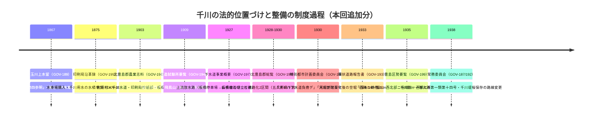

# 2026-11-15（第103回）・NDL全文横断第4弾・千川筋街路の路線番号特定と千川=下水道負担の1930年答弁・河村瑞賢伝記書・幕末樋口寸法

第103回の定期調査記録。第101回で開通したNDL次世代デジタルライブラリーの全文検索・全文OCR取得の第4弾として、約25点の書誌の全文OCRを取得・精読し、**15点の新規資料（GOV-187〜199・BOOK-118/119）**を登録した。中心は①**千川筋街路の都市計画上の路線番号の特定（1938・一等大路第一類第十四号）**、②**1930年委員会での千川＝「下水道負担デ、河川デアリマセヌ」答弁**、③**千川上水開削の河村瑞賢関与説の1912年伝記書記述**、④**幕末（1867）の千川口樋口開度「四歩明」**。すべての引用はOCR由来で、数値・文言は原文画像との照合を要する（各資料ファイルに明記）。

## 今回の新規登録（GOV-187〜199・BOOK-118/119）

- **千川筋街路＝一等大路第一類第十四号路線〔確認・repo初出〕**: [GOV-187](../sources/gov/GOV-187.md)（常務委員会議事速記録第7号・1938・[lab 1207593](https://lab.ndl.go.jp/dl/book/1207593)）。「**等大路第一類第十四號路線、即チ千川筋ノ道路**」＝竹早町電車通起点→久堅町→白山御殿町（植物園下）→指ヶ谷町→駒込蓬萊町→千駄木根津神社附近・幅員8間の環状系路線。執行者東京市長。路線変更の理由＝共同印刷工場2棟回避（経費約9万7千円節約）・小石川植物園の「みづき」保存（明治32年以来の帝大吸水試験）・**循環式交通広場設置**。[GOV-180](../sources/gov/GOV-180.md)（速成事業）・[GOV-178](../sources/gov/GOV-178.md)（緑道）の路線の計画番号レベルの特定。
- **千川＝「下水道負擔デ」「河川デアリマセヌ」（1930）〔確認・repo初出の一次文言〕**: [GOV-188](../sources/gov/GOV-188.md)（特別都市計画委員会議事速記録第11号・1930・[lab 1225207](https://lab.ndl.go.jp/dl/book/1225207)）。議第98号＝氷川下〜巣鴨町字宮下路線の変更で「**小石川區內千川筋ノ下水道事業ノ執行ニ便スル爲ニ路線ノ一部ヲ千川筋ニ變更**」「**千川敷ヲ利用シテ之ヲ十間ニ變更**」（8間→10間）。朝倉委員の「小石川ノ植物園ノ下ノ千川」質問に対する広瀬東京市助役の答弁＝**1930年時点の千川の法的位置づけ（市下水道事業負担・非法定河川）の一次文言**。「千川敷」の呼称も初出。[GOV-094](../sources/gov/GOV-094.md)（氷川下暗渠化昭和5年着工）と[GOV-159](../sources/gov/GOV-159.md)（同年の谷端川改修決定）の間の千川側の制度的実態。
- **幕末の千川口樋口開度（1867）〔確認・repo初出〕**: [GOV-189](../sources/gov/GOV-189.md)（『玉川上水留』慶応3卯年12月・分水口場所替伏下ヶ一件帳・[lab 2587452](https://lab.ndl.go.jp/dl/book/2587452)）。「**三田口定式三歩明 千川口当節四歩明**」「**千川用水…樋長三間大**」＝**千川用水元樋口の慶応3年時点の開度が定式より広い「四歩明」**。「**瀧之川村雁入水車掛水不足之趣 此上千川用水元樋口ニ而掛増之程モ難計**」＝幕末水車争論（[GOV-144](../sources/gov/GOV-144.md)慶応2年）に1867年官文書を追加。天保12丑年の「千川用水秋ゟ翌春迄皆留…呑水丈ヶ差暮明願済」等の分水先例一覧も収録。樋口寸法変遷（元文4年〔GOV-170〕→慶応3年）の観測点を追加。
- **江戸期の千川上水請負人・屋敷の町方文書〔確認・repo初出〕**: [GOV-190](../sources/gov/GOV-190.md)（『赦帳』第98冊・寛政5・[lab 2549152](https://lab.ndl.go.jp/dl/book/2549152)）＝浅草天王町の床見世が「**千川上水請負人下谷金杉上町家持長十郎**助成地ニ相渡候」＝**天明6年市中給水再廃後も請負人の氏名・住所作例**。[GOV-191](../sources/gov/GOV-191.md)（『諸事留帳』43巻嘉永分冊一・[lab 2548995](https://lab.ndl.go.jp/dl/book/2548995)）＝町方巡廻書上に「**元千川上水屋敷**」の地名。[GOV-175](../sources/gov/GOV-175.md)（千川宇兵衛）と併せ、請負体制の幕末までの連続の系譜の途上の2点。
- **千川堤桜保存のための道路変更（1938）〔確認・repo初出〕**: [GOV-192](../sources/gov/GOV-192.md)（常務委員会議事速記録第8号・[lab 1207598](https://lab.ndl.go.jp/dl/book/1207598)）。補助線道路第47号路線（江古田1丁目→板橋4丁目・幅員11m）のうち豊島区千川2〜3丁目約900m区間を「**千川堤ノ櫻並木ニ非常ニ接近**」のため西側に移動（昭和12-9-14決定）。理由書「**千川堤ノ櫻樹ヲ保存スルト共ニ屈曲ヲ緩和**」＝**千川桜の1938年所在区間の特定**。[BLOG-101](../sources/blogs/BLOG-101.md)（大正4年植桜楓碑）・[GOV-178](../sources/gov/GOV-178.md)（1941「櫻並木」）と連続。
- **千川用水大堀割の空堀と塵芥充填（1933）〔確認・repo初出〕**: [GOV-193](../sources/gov/GOV-193.md)（東京市『東京都市計画環状道路改修工事報告書』・[lab 1907000](https://lab.ndl.go.jp/dl/book/1907000)）。豊島区内新旧9号国道間＝「俗ニ**堀割**ト稱シ、**千川用水ノ大堀割ノあつたのを該用水組合にて暗渠に改造せる結果、深さ約四米乃至五米幅一〇米內外の空堀**」→旧滝野川町の塵芥捨場として**全部塵芥充填**→上部2m除去・良土埋戻し・転圧後に基礎コンクリート打設＝**暗渠化→空堀の塵芥捨場化→環状道路敷設という変遷段階の第一次記録**。「**千川上水路ニ沿フ鎌倉往還、飛鳥道、飛鳥山道**」の旧道名記述も初出。
- **明治期の千川用水工業利用の追加〔確認〕**:
  - [GOV-194](../sources/gov/GOV-194.md)（『醸造試験所要覧』・1909・[lab 848109](https://lab.ndl.go.jp/dl/book/848109)）＝旧王子反射炉→印刷局→醸造試験所敷地を「**東ハ逆川ヲ隔テテ飛鳥山ニ接シ**」「**千川用水南ヨリ來リテ域内ヲ貫流**」＝**「逆川」の1909年一次文言**＋砂濾過池による工場用水補給（使用後は水路に復帰）。明治35-10-13の農商務省への土地4,929坪7合1勺授受＝[GOV-157](../sources/gov/GOV-157.md)（NDA）の官庁側沿革。
  - [GOV-195](../sources/gov/GOV-195.md)（『印刷局沿革録』・1903・[lab 784387](https://lab.ndl.go.jp/dl/book/784387)）＝明治8-10-31「**王子村水車場ヲ購入**…**又水車ニ要スル千川用水ノ水積ヲ增加ス**」＝[GOV-150](../sources/gov/GOV-150.md)（明治8-3-10約定証書）の**官庁側対応記録**。同年の民間側・官庁側の双方が揃った。
  - [GOV-196](../sources/gov/GOV-196.md)（東京府『北豊島郡農業志料』・1903・[lab 802386](https://lab.ndl.go.jp/dl/book/802386)）＝千川用水利用村（中新井・長崎・上板橋・板橋・瀧野川・巣鴨等）＋「**千川水道株式會社、印刷局抄紙部、板橋火藥製造所等亦本川ヲ利用セリ**」＝**板橋火薬製造所の千川用水利用がrepo初出**。
- **千川筋土揚敷地と板橋宿埋立ての年月日〔確認・repo初出〕**: [GOV-198](../sources/gov/GOV-198.md)（『北豊島郡総覧（昭和5年度版）』・1931・[lab 1049150](https://lab.ndl.go.jp/dl/book/1049150)）。江古田新田「**千川筋土揚敷地四坪五合**」の消防器具置場無償使用認可（明治45年）＝「千川筋」小字・土揚げ敷地の地番記録。板橋宿＝千川用水**五兵衞橋下流（昭和3-12-6起工→4-3-14開通）・五兵衞橋上流〜大山橋（4-12-9起工→5-6竣工）**の埋立て道路化の年月日。「**千川用水路ノ暗渠計畫悉ク氏在職中ノ產績**」＝板橋町長花井源兵衛の人物記録。1931年時点の全流路記述（延長5里24町余）も収録。
- **1935年区勢要覧の三川並記〔確認〕**: [GOV-199](../sources/gov/GOV-199.md)（『東京市豊島区勢要覧（昭和10年版）』・1935・[lab 1281540](https://lab.ndl.go.jp/dl/book/1281540)）。「**西南ニ鶴卷川、西北部ニ谷端川、西部ニ千川ノ細流アリ**」＝**鶴巻川（弦巻川）・谷端川・千川の三川並記の1935年公式記述**（弦巻川の区勢要覧レベルでの存在確認）。
- **千川の下水道計画の中間年度文言（1927）〔確認〕**: [GOV-197](../sources/gov/GOV-197.md)（東京市『下水道事業概要』・1927・[lab 1191302](https://lab.ndl.go.jp/dl/book/1191302)）。「**千川上流ノ放水路ハ板橋停車場附近ヨリ山手鐵道線路ニ沿ヒ石神井川ニ通セシメ、下流氷川下町初音町間ノ改修暗渠ハ都市計畫路線ニ沿ヒテ敷設ス**」＝[GOV-163](../sources/gov/GOV-163.md)（1924既定計画）→[GOV-159](../sources/gov/GOV-159.md)（1930板橋放水路完成）の中間年度。藍染川・千川等の上流流域下水収容計画・江戸の上水系譜への千川上水の位置づけ文言も。
- **河村瑞賢関与説の1912年伝記書〔確認・repo初出〕**: [BOOK-118](../sources/books/BOOK-118.md)（『評伝河村瑞賢』・1912・[lab 946233](https://lab.ndl.go.jp/dl/book/946233)）。「**元祿九年、瑞賢千川太郞兵衞・千川德兵衞ノ兩人ニ命ジテ、千川上水ヲ始メサセタ**…保谷村デ多摩川ヲ引入レ、**巢鴨村マデ六里十八町ヲ掘割ツテ**…**庚申塚通リカラ本郷湯島淺草ヘ水ヲ供給スル**」＝風土記稿の「幕府ノ命＝太兵衞・徳兵衞」に**瑞賢の指揮を付加した伝記書レベルの伝承**（第102回課題④）。差止理由伝承「**水道ヲ拵ヘルト火災ガ多クナル**」享保7年10月廃止→安永9再興→天明6再廃→明治三たび開き岩崎所有→会社化の通史。人名「太郞兵衞」の表記食い違い・里数の差異は断定しない（要照合）。瑞賢説の史拠は本文では示されず。
- **千川用水の終点と落合の湧水群〔確認・湧水はrepo初出〕**: [BOOK-119](../sources/books/BOOK-119.md)（落合町町史編纂係『落合町誌』・1932・[lab 1190694](https://lab.ndl.go.jp/dl/book/1190694)）。千川用水の西端流路（長崎町→葛ヶ谷北端→長崎町との境堺→小字前耕地→下落合→妙正寺川合流）。**不動谷流・諏訪谷流・西ヶ谷流・丸山流**の小湧水4流の記録（1932年時点・その後の存否は未確認）。

## 千川の位置づけの変遷（本回で固定できた文言の追加）

## 陰性・見送り記録

- **報告第7回（[lab 1448230](https://lab.ndl.go.jp/dl/book/1448230)）・第8回（[lab 1710676](https://lab.ndl.go.jp/dl/book/1710676)）**: 谷端川・立会川の受益者負担区告示の表部分がOCR列崩れで読み取れず、新文言は得られず登録見送り（**原文画像照合は次回候補**）。
- **昭和8年度失業応急事業施行状況調（[lab 1281787](https://lab.ndl.go.jp/dl/book/1281787)）**: 立会川・谷端川改修と千川筋街路の実施記録を含むが**OCRが極端に劣悪で文言照合不能**（不採用・所在のみ記録）。
- **豊多摩郡誌（1916・[lab 1874656](https://lab.ndl.go.jp/dl/book/1874656)）**: 流路記述が既知内容と重複し登録見送り。**江戸川上水道誌（[lab 1075311](https://lab.ndl.go.jp/dl/book/1075311)）**: 藍染川鉄管橋のみで見送り。
- **kanzyou7.com**: 2026-11-13付週間工程表・シールド進捗図の更新を確認したが、**神田川流域（四河川・kanzyou神田川関連の2026年10〜11月のニュースは0件・陰性）**。決定版の発表はまだ（2026-11-15時点）。

## 次回課題

- 報告第7回・第8回の受益者負担区告示の**原文画像照合**（表の列崩れの復元）。
- 失業応急事業施行状況調（1281787）の原文照合（立会川・谷端川改修の実施記録の抽出）。
- 都市計画シリーズ未登録号（1212950・1212972・1207608・1207652・1264582・1264593・1448209・1448213・1448221・1448224・1463284）の全文取得。
- 予算案管見（1280176）未取得分・GOV-189分冊二（2587453）の精読。
