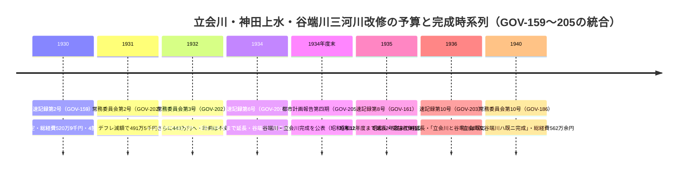

# 2026-11-15（第104回）・瀧野川町下水道1932決定の告示全文・谷端川改修の完成時系列とデフレ減額過程の固定・幕末年中定水運用

第104回の定期調査記録。第103回ノートの次回課題（都市計画シリーズ未登録号の全文取得・予算案管見・GOV-189分冊二の精読）を中心に、13点の全文OCRを取得・精読し、**7点の新規資料（GOV-200〜206）とGOV-189への分冊二追記**を登録した。中心は①**東京都市計画瀧野川町下水道決定（1932・内務省告示第242号）の告示全文**（谷端川排水区19.90ha・下水の大部は谷端川・谷田川へ合流）、②**谷端川改修の完成時系列の固定**（「暗渠敷の埋戻し・廃川敷の整理は昭和10年度繰越し」→昭和9年度完成の府側公表）、③**デフレ期の三河川改修予算の2段階削減（520.9万円→491.5万円→443万円）**、④**幕末の御用水車取建による千川・三田両用水の年中定水運用への変化**。すべての引用はOCR由来で、数値・文言は原文画像との照合を要する（各資料ファイルに明記）。

## 今回の新規登録（GOV-200〜206・GOV-189追記）

- **瀧野川町下水道決定の告示全文（1932）〔確認・repo初出〕**: [GOV-200](../sources/gov/GOV-200.md)（議事速記録第4号・[lab 1212950](https://lab.ndl.go.jp/dl/book/1212950)）。議第76号＝1932-9-16山本達雄発議→第九回委員会（9-20）可決→9-29内閣認可→**10-4内務省告示第242号**。下水排除区域約450.76ha（全町502ha）、**合流法**で「**其ノ大部ハ谷端川、谷田川竝王子町、尾久町及日暮里町下水道ニ合流シ一部ハ石神井川ニ放流**」、管渠は「**總テ暗渠**」、4排水区＝石神井川（201.52ha）・谷田川（132.90ha）・田端（96.44ha）・**谷端川（大字瀧野川ノ一部・19.90ha・4,291m）**、総延長約89,907m・約300万円・昭和7〜16年度の十箇年計画（市域拡張後は東京市長執行）。理由書＝人口10年間に2.47倍・既存下水は露渠で**氾濫区域約30万坪**。[GOV-180](../sources/gov/GOV-180.md)の西巣鴨町下水道（1932-1決定）と同年で、**谷端川を受容水域とする下水道計画が両岸で同年に告示**。[GOV-166](../sources/gov/GOV-166.md)（1937年報）の滝野川町「音羽を含む4区」表記と食い違い（本告示は**田端を含み音羽を含まない**）は照合課題として記録。
- **谷端川改修の残工事の内容（1934）〔確認・repo初出の重要文言〕**: [GOV-201](../sources/gov/GOV-201.md)（議事速記録第6号・[lab 1212972](https://lab.ndl.go.jp/dl/book/1212972)）。議第110号（1934-3-26発議）＝神田上水計画変更（7,166→6,929m・屈曲矯正6箇所・護岸T型鉄筋コンクリート高3.33〜4.67m）＋三河川年度割変更（総経費4,434,249→**5,630,722円40銭**・完成を昭和10年度まで延長）。**「谷端川ニ付テハ暗渠敷ノ埋戾シ及廢川敷ノ整理工事ノ一部未了ニ屬スルヲ以テ事業ノ一部ヲ明年度ニ繰越シ執行セムトス」**＝1934年3月時点の谷端川改修の未了部分が「暗渠敷の埋戻し」と「廃川敷の整理」であることを特定する唯一の文言。
- **谷端川・立会川完成の府側公表（1935）〔確認・repo初出〕**: [GOV-205](../sources/gov/GOV-205.md)（東京都市計画報告・昭和9年度第一期・[lab 1448209](https://lab.ndl.go.jp/dl/book/1448209)／第四期・[lab 1448221](https://lab.ndl.go.jp/dl/book/1448221)）。第四期「**完成シタル河川ハ東京府知事執行ノ谷端川、立會川ノ兩河川ニシテ**」（昭和9年第四期末・進捗表は昭和9年12月末現在）＝**谷端川改修の完成を東京府が完成直後に公表した記録**。第一期の上水道章には「三百年間ヲ通ジテ存在シタルモノハ**玉川上水、神田上水、千川上水ノ三上水ノミ**」の総説（1934年用例・[GOV-172](../sources/gov/GOV-172.md)に先行）・議第110号の再録（事業費5,630,722円40銭）も。
- **デフレ期の三河川改修予算の2段階削減（1931・1932）〔確認・repo初出〕**: [GOV-202](../sources/gov/GOV-202.md)（常務委員会議事速記録第2号・[lab 1264582](https://lab.ndl.go.jp/dl/book/1264582)／第3号・[lab 1264593](https://lab.ndl.go.jp/dl/book/1264593)）。第三回常務委員会（1931-7-28）＝総経費520万9千円→**物価下落を理由に491万5千円へ減額**、中村梅吉「金額ヲ減ジナイデ工事ヲ進メテ行クコトハ出來ナイノカ」に対し西村輝一事務官「財政上ノ都合…歲出ノ方モ落サナケレバナラナイ」。第四回常務委員会（1932-5-17）＝さらに48万円減額で**443万円**（対照表4,915,441→4,434,249円）・「**事業ノ計畫等ニハ何等變更ハ無イ**」＝計画不変のまま予算だけの削減。**[GOV-159](../sources/gov/GOV-159.md)（1930・520万9千円）→[GOV-201](../sources/gov/GOV-201.md)（1934・563万円）の間の減額過程を埋め、[GOV-161](../sources/gov/GOV-161.md)の「約42万円増額」との整合（563万0722−520万9000≈42万1722円）を説明する記録**。
- **三河川年度割の最終再延長と完成文言（1936）〔確認・repo初出〕**: [GOV-203](../sources/gov/GOV-203.md)（議事速記録第10号・[lab 1207652](https://lab.ndl.go.jp/dl/book/1207652)）。1936年11月の委員会で幹事高橋登一が「**三河川中立會川ト谷端川ノ方ハ既ニ昭和九年度ニ完成致シマシテ**、神田上水ノ方ハ本年度ニ完成スル筈ニナツテ居リマシタ所ガ、用地ノ買收、物件ノ移轉ナドニ非常ニ手間取リマシタノデ、已ムヲ得ズ事業年度ヲ一箇年延長致シマシテ」（経費562万円・昭和5年度〜11年度の7箇年→**12年度まで**）と説明し可決。**1936年時点の「昭和9年度完成」の公式説明**＝[GOV-186](../sources/gov/GOV-186.md)（1940）の4年前の追認。同号の内務省告示509号案（道路の都市計画事業化）の路線一覧に「**豐島區千川町二丁目**」が現れる（路線番号はOCR列崩れで特定不能）。
- **谷端川附近の工場地域指定の陳情（1935）〔確認・repo初出〕**: [GOV-204](../sources/gov/GOV-204.md)（議事速記録第7号・[lab 1207608](https://lab.ndl.go.jp/dl/book/1207608)）。浅香銀治郎（28番）が「**豐島區ニ接近シタ方ノ谷端川ニ接近シタアノ方面一帶ガ從來カラ非常ニ工場ガ發展シテ居ル**」「屢々當局ニ向ツテ指定方ヲ陳情シテ居ル」と工場地帯指定を要望、当局は「現在デハ變更提案トイフ所迄立チ至ツテ居リマセヌ」と回答＝**1935年時点の谷端川滝野川区側の工場集積と工業地域指定運動の一次記録**。
- **「千川筋一部改良費」の1927年予算計上〔確認・repo初出〕**: [GOV-206](../sources/gov/GOV-206.md)（東京市政調査会『東京市予算案管見』昭和2年度・[lab 1280176](https://lab.ndl.go.jp/dl/book/1280176)）。昭和2年度（1927）の東京市新規事業（道路築造費）に「**千川筋一部改良費 八六、〇〇〇円**」＝[GOV-180](../sources/gov/GOV-180.md)（1925街路速成事業「千川筋ノ街路」）と[GOV-187](../sources/gov/GOV-187.md)（1938路線確定）の間の**1927年観測点**（速成事業の継続か独立事業かは本文では区別できず断定しない）。民間監視団体の予算批判資料である点に注意。
- **幕末の年中定水運用への変化（『玉川上水留』分冊二）〔確認・GOV-189追記〕**: [GOV-189](../sources/gov/GOV-189.md)追記（[lab 2587453](https://lab.ndl.go.jp/dl/book/2587453)）。①**千川用水組合17ヶ村の水料台帳**（呑水田用水の仕料＝年金三分）。②「田用に付年々**秋ゟ翌春まて保谷新田地先元樋口にて津田留**（＝皆留のOCR誤読推定）之場所」＝秋〜翌春の元樋口での留め運用〔「天保二卯年」は分冊一の「天保12丑年」と食い違い・要照合〕。③「**近来三田千川両用水路江御用水車御取建…御取建以来者年中定水掛り相成**」＝**幕末の御用水車取建で両樋口が「田方養時節のみ掛り」から「年中定水掛り」に変わった**＝千川用水の幕末運用変化の一次文言（分冊一の千川口「当節四歩明」・瀧之川村水車水不足と連続）。

## 谷端川改修の予算・完成時系列（本回で固定できた全系統）

## 陰性・見送り記録

- **議事速記録第4号（1212950）の雜司ヶ谷hits（22件）**: 和田堀町風致地区（大宮八幡・鎌倉街道の堀ノ内・雑司ヶ谷方面言及）のみで、弦巻川・雑司ヶ谷谷田川の新情報なし。
- **東京都市計画概要・1939（[lab 1463284](https://lab.ndl.go.jp/dl/book/1463284)）**: 「立会川外三川改修」の府知事執行事業一覧のみで表組みはOCR劣悪、新文言得られず登録見送り。
- **東京都市計画報告・昭和10年第一期（[lab 1448224](https://lab.ndl.go.jp/dl/book/1448224)）**: 谷端川・千川上水のhitsなし（内容の重複も疑われるがOCR品質の問題もあり要再確認）。
- **報告第三回（[lab 1448213](https://lab.ndl.go.jp/dl/book/1448213)）**: 議第110号の再録（[GOV-201](../sources/gov/GOV-201.md)・[GOV-205](../sources/gov/GOV-205.md)の第二ソース）のみで単独登録は見送り。
- **水窪川・弦巻川の次世代DL全文検索**: 既に陰性固定（水窪川hitsは静岡のみ・弦巻は町名のみ）・本回も変化なし。

## 次回課題

- 報告第7回・第8回の受益者負担区告示の原文画像照合（第103回からの繰り越し）。
- 失業応急事業施行状況調（1281787）の原文照合（繰り越し）。
- GOV-200（瀧野川町下水道）とGOV-166（1937年報）の4排水区構成の食い違い（田端区 vs 音羽区）の原文照合。
- 神田川流域整備計画決定版の公表監視（2026-11-15時点で未公表）・kanzyou7.com週次進捗（GOV-156）。
- 報告昭和10年第一期（1448224）のOCR再取得・内容確認。
- NDA GOV-144くずし字判読（人手待ち・繰り越し）。
