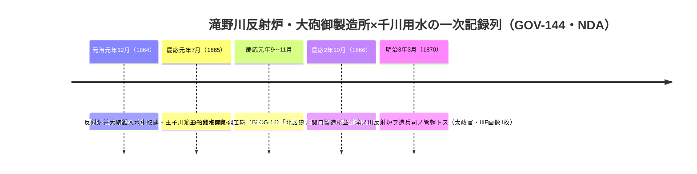

# 2026-11-15（第90回）調査ノート

## 概要

第90回定期実行。第89回継続2（head `6f065406`）以降の並走pushなしを確認した上で、NDA（国立公文書館デジタルアーカイブ）の幕末反射炉・大砲御製造所×千川用水の一次記録群5件（うち4件がIIIF画像公開済みと判明）、滝野川町谷端の土地区画整理・下水道NDA記録3件、すぎなみ学倶楽部の天保新堀用水解説、杉並区立郷土博物館の三ヶ村用水路図（大谷家文書）、松山洋・成宮博之（2025）の湧水論文、小平市史別冊写真集の新堀用水写真4点、『東京の湧水』報告書シリーズのNDL書誌、ゆる歴史散歩会の滝野川反射炉解説を新規収録した（GOV-144〜147・MAP-162・PAP-075・BLOG-226新規、GOV-142/GOV-124追記）。

## 1. NDA幕末反射炉・大砲御製造所×千川用水一次記録群（GOV-144）

- NDA検索APIの「千川用水」「大砲御製造所」「滝野川反射炉」の各検索で、同一事業（滝野川の反射炉・大砲御製造所に千川用水の水を引く事業）の4時点の一次記録列を発見・所在固定した。
- **最重要は慶応2年（1866）10月「武州豊島郡瀧野川村大砲御製造所江引入候千川用水稼水車之儀ニ付申上候書付」（多036963・差出織田宮内大輔ら5名・1通・未デジタル化）**。「千川用水」の語が件名に現れる公文書館レベルの一次文書はrepo初出。BLOG-127（北区史経由・慶応元年工期）の背後に一次文書の実体が残ることを示す。
- **今回の新事実は、元治元年12月の上知達2通（多24411・多24407）・慶応元年7月の伺（多010688・5枚）・明治3年3月の造兵司管轄文書（太00106100-04400・1枚）の4件がいずれもデジタル化済みで、IIIFマニフェストと高解像度画像（3000px級）が公開アクセス可であること**（`/img/<aipId>` ビューアと `/api/iiif/<aipId>/manifest.json` で確認・1点の画像取得まで実施）。くずし字の判読は未実施で、内容は件名由来の推定に留めている。
- 慶応元年7月の伺（反射炉并大砲錐入水車取建・王子川筋通船路取開）は、BLOG-127の「慶応元年9月中旬〜11月末の工期」の直前の伺段階、BLOG-226（2025年二次整理）の「1864年の上申と、その後に水路や施設の工事が進められた」という整理の背後の記録にあたる。

## 2. 滝野川町谷端の土地区画整理・下水道（GOV-145）

- NDA「滝野川」79件の走査から、①1951年1月の復興土地区画整理（滝野川谷端）設計変更認可申請、②1954年6月の同設計変更認可、③1942年3月の大久保町・滝野川町・郊外下水道事業の執行年度割変更（昭和17年内務省告示第230号）の3件を抽出・所在固定した。いずれも未デジタル化。
- 「滝野川谷端」は北区側の字地名で、豊島区の谷端川そのものの記録ではない可能性が高い点を明記した。同時に「谷端」という普通名詞由来の地名が隣接自治体にもあることは地名研究（GAZ-015）の比較材料になる。第86回NDA課題の未回収部分（GOV-135追記候補として保留していた案件）を独立エントリで解消。

## 3. 天保新堀用水（MAP-162・GOV-146）— 千川上水の分流と並ぶ桃園川流域の灌漑水系

- ADEAC杉並区デジタルアーカイブで**杉並区立郷土博物館所蔵「中野村高円寺村馬橋村三ヶ村用水路図」（mus-004203・大谷家文書・杉並区指定有形文化財・明治模写・270×467mm・CC BY）**を発見。公開解説は「天保12年（1841）に作られた2度目の開削ルート（西田端橋→須賀神社弁天池へ直線）」を描くと明記〔MAP-162〕。IIIF画像の判読は次回。
- 杉並区公式情報サイト すぎなみ学倶楽部「智慧と技術の結集！天保の水普請 新堀用水」（2007年12月7日）の本文全文を取得〔GOV-146〕。①三ヶ村の灌漑が「**天沼弁天池の湧水と千川上水からの分水を合わせた桃園川の流水**」に依存していた、②天保11年（1840）第一次開削（権現堰取水・掛樋・成宗弁天池・青梅街道下トンネル・代官中村八太夫の補助金270両・請負＝馬橋村名主大谷助次郎）、③完成直後の川獺の巣による漏水と大雨の土手崩壊→**取水口を広場堰に変更して天保12年に完成**、④三ヶ村用水記念碑（明治13年建立・成宗五色弁財天社境内・平成17年度区登録文化財）の碑文採録、を確認。
- 大谷家文書（馬橋村世襲名主）の絵図と「開削請負人＝馬橋村名主大谷助次郎」の記述が対応する点を観察した。ADEAC解説（第一次＝善福寺川沿い迂回）とすぎなみ解説（第一次＝権現堰から掛樋）の枠組みは完全には揃わないため、両説を併記して断定しない（西田端橋・権現堰・広場堰の実地照合が次回課題）。
- 天保新堀用水は善福寺川系で四河川の直接構成要素ではないが、①千川上水の分流（矢嶋又次記憶画・GOV-105/109）と並んで桃園川流域の灌漑を支えた隣接用水、②千川上水の分水が桃園川経由で中野方面まで灌漑に使われていた構図（GOV-146冒頭）が千川上水の灌漑範囲理解に直結することから、比較文脈として収録した（新規カテゴリではなく既存の隣接用水の位置づけに準拠）。

## 4. 松山洋・成宮博之（2025）の湧水論文（PAP-075）

- 「東京の湧水の湧出量は長期減少傾向にあるのか？」（水文・水資源学会誌38(2) pp.141-152・2025年5月5日・DOI 10.3178/jjshwr.38.1839）のJ-STAGE抄録を直接確認。成宮博之はPAP-019（2006）の著者。
- **氷川神社（品川区）の冬季枯渇（2017/19/21/23）は3段直列タンクモデルで「年々変動」で説明され、1973-2023の1-3月降水量・流出量に有意な長期変化なし（2月の蒸発量のみ増加）**——湧水減衰仮説（PAP-018/019・GOV-081・BLOG-130の文献列）に対する2025年時点の否定的・限定的知見として、repoの湧水論のnuanceを強めた。PDF本文はCID+ToUnicodeなしで抽出不能、品川区の事例であり音羽谷への直接適用は本文確認後に判断する。

## 5. その他の収録・追記

- **小平市史別冊写真集の新堀用水写真4点（GOV-142追記）**: NDLサーチで「上水公園南新堀用水」（I1457434）・「新堀用水と小川用水の分岐堰」（I1457435）・「新堀用水胎内堀坑口」（I1457460）・「新堀用水」（I1457494）を確認。GOV-142の「他写真走査は次回候補」を解消。胎内堀坑口の写真はBLOG-225（玉川上水事典・胎内堀900m）の構造説明の遺構写真の存在を示す。
- **『東京の湧水 湧水調査報告書』シリーズのNDL書誌（GOV-147）**: 平成2年度版（pid/13417342）・平成5年度版（pid/13417135）を所在固定。いずれも館内限定で本文不可。GOV-124の音羽湧水「H3年度値」※印の出典系列。H3年度値の掲載巻の特定は未解決。
- **ゆる歴史散歩会「滝野川反射炉とは？」（BLOG-226）**: 錐台の水車動力としての王子分水・1864年上申→工事進行・分配堰碑（1882）・明治5年鹿島万平の水力紡績（repo初出候補）を含む2025年の二次整理。BLOG-047/106の同サイト記事に続く収録。
- **陰性・誤検出（記録のみ）**: NDL「相渡申一札之事（新堀用水）」は福井県の鳥山新左衛門家文書（下荒井村1856年）で小平の新堀用水と無関係。「音羽川」「濯川」のNDLヒットは愛知県等で無関係。NDL「千川上水沿線集落」0件。NDA q=雑司ヶ谷・音羽繪圖 0件。直近1か月の報道（news_search: 谷端川・弦巻川・水窪川・千川上水・神田川決定版）は0件で、神田川流域整備計画の決定版は未公表のまま。

## 6. README更新とINDEX

- README「現時点で重要なこと」に第90回bulletをprepend。INDEX.mdはbuild.pyで再生成（763→771項目想定）。

## 7. 次回課題

1. GOV-144の4件のIIIF画像の判読（くずし字・要時間。元治元年12月上知達・慶応元年7月伺の内容確認が最優先）。
2. MAP-162のIIIF画像判読と西田端橋・権現堰・広場堰の位置照合。
3. 『東京の湧水』シリーズの平成3年度（H3）調査値掲載巻の特定（NDL館内またはILIS）。
4. 小平市史別冊写真集の新堀用水写真4点の画像取得・ADEAC経由の所在確認。
5. 決定版神田川流域整備計画の公表監視（継続）。
