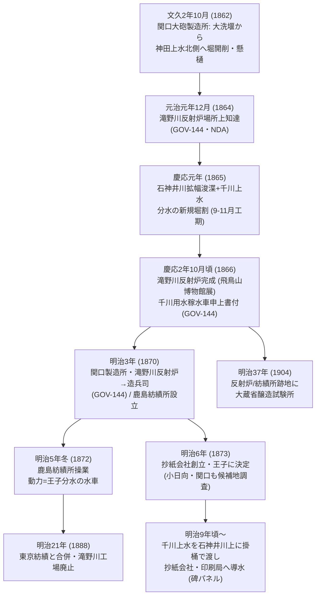

# 2026-11-15（第91回）・調節池広域整備検討公告・wheatbaku大砲製造所シリーズ②⑧⑨⑩・鹿島紡績水力文献の追加調査

第91回の定期調査記録。前回（第90回）のGOV-144（NDA幕末反射炉×千川用水一次記録群）・BLOG-226（滝野川反射炉）の系譜を、幕末の水利→明治の工業用水への継承の側と、令和の治水計画（調節池・地下河川）の側の両面から拡張した。

## 今回の新規登録

- [GOV-148](../sources/gov/GOV-148.md): 東京都財務局「調節池の広域的な整備に向けた検討委託（その２）」公告（2026-11-10公告・建設通信新聞2026-11-11掲載）。対象流域に**神田川流域（河川延長約52.3km・流域面積約105km²）**・石神井川流域・野川流域。履行期間2027年12月10日まで・開札12月2日・前回委託はパシフィックコンサルタンツ。
- [GOV-149](../sources/gov/GOV-149.md): 東京都建設局プレスリリース「『気候変動を踏まえた河川施設のあり方』の策定について」（2023-12-18）。**目標整備水準を年超過確率1/20の降雨へ引き上げ・トンネル式調節池の海への延伸（地下河川）・調節池のネットワーク化・高潮対応（0.6m海面上昇・930hPa伊勢湾台風級）**。概要版PDFはWAF遮断で未取得。
- [BLOG-227](../sources/blogs/BLOG-227.md): wheatbaku「関口大砲製造所（幕末の大砲製造所②）」（2022-07-06）。**文久2年10月・大洗堰から神田上水の北側に堀を開削し、神田上水を懸樋で渡して水利確保**（大松騏一著書所収文書の二次）。湯島大小砲鋳立場の移転候補としての小日向水道町（水車2基）・牛込船河原橋際（勾配不足で不採用）。
- [BLOG-228](../sources/blogs/BLOG-228.md): wheatbaku「滝野川・王子の近代工場の礎は滝野川大砲製造所（⑧）」（2022-08-10）。**反射炉の完成を慶応2年10月頃とする飛鳥山博物館展の最近の研究**＝GOV-144の慶応2年10月書付と同月。北区史「近代工場のあけぼの」引用（鹿島紡績所明治5年冬操業・抄紙会社1875.12・紙幣寮抄紙局1876.2・1865石神井川拡幅浚渫＋千川上水堀割・残余は石神井川へ流下・跡地は陸軍省用地）。
- [BLOG-229](../sources/blogs/BLOG-229.md): wheatbaku「鹿島紡績所と抄紙会社（⑨）」（2022-08-15）。鹿島万平（明治3年設立・5年操業・**動力は王子分水の水車**・反射炉跡地→明治37年醸造試験所）。抄紙会社の用地候補に**小日向・関口**のほか岩淵・王子・板橋。**『王子製紙社史』（昭和31年・第1巻）引用「会社の利用にまかされた水は…千川上水を巣鴨から分流して来たもの」**。
- [BLOG-230](../sources/blogs/BLOG-230.md): wheatbaku「『洋紙発祥之地』の石碑（⑩）」（2022-08-21）。王子駅前の碑（昭和28年建立）と2021年パネル「**石神井川上に掛桶(木桶)で渡して千川上水を工場に引いていました**」（抄紙会社・国立印刷局）・**水路利用の証書・嘆願書は紙の博物館に保存**。
- [PAP-076](../sources/papers/PAP-076.md): 末尾至行「明治初期紡績業と水力的基礎-1-滝野川鹿島紡績所」『史泉』35・36合併号 pp.70-98（1967-12-20・所在のみ）。
- [PAP-077](../sources/papers/PAP-077.md): 土屋喬雄「瀧野川鹿島紡績所の創立経営事情」『経済学雑誌』3(10)（1933・所在のみ）。関連書誌として「鹿島紡績工場並びに機械の圖解説」（1933）の所在も固定。

## 幕末→明治の水利継承の整理（今回で揃った年代列）

すべて確認できるのは各資料の記載時点のみで、矢印上の連続性は二次資料（BLOG-227〜230・GOV-144）間の照合による推定を含む。とくに「関口大砲製造所（文久2年）」と明治3年「関口製造所」（GOV-144）の同一性は未確認。

## 調査の経過と陰性記録

- 報道（news_search・2026-11-08以降）: 谷端川・弦巻川・水窪川・千川上水・雑司ヶ谷幹線すべて0件。
- 神田川流域決定版河川整備計画: 2026-11-15時点で未公表のまま（GOV-124の令和5年3月版が現行）。
- NDL OpenSearch「鹿島紡績」: PAP-076/077・圖解説の所在を固定。CiNii詳細頁はロボット確認に阻まれ、ndlsearch側の書誌・目次で代替確認。
- ゆる歴史散歩会「音羽絵図解説」頁: MAP-021/006で既知内容の再構成で見送り。
- 雨男note（2025）の水窪川・弦巻川記事: 既知情報の写真記録で、目白架道橋・自噴井戸の観察はあるが位置が特定できないため見送り（要再訪ならnote側の図示確認）。
- CBC「道との遭遇」水窪川回（2025-04頃）: 内容（蟹ヶ窪・イケ・サンパーク排水口・護国寺近くの屋敷のカルバート検証）は既収録の「道との遭遇」4件と重複範囲で、新規登録せず。
- 板橋史談会note「池と湧水その1」（2025-09-03）: 前谷津川・出井川系で四河川への直接言及なし。
- doushigawa FC2新堀用水頁・kawayura桜橋頁: アクセス遮断。Internet Archiveは引き続き「Temporarily Offline」。

## 次回への課題

- 大松騏一『関口大砲製造所』（文久2年10月文書の初出）の書誌特定。
- 飛鳥山博物館「近代工業のルーツ 滝野川反射炉展」図録の書誌と「慶応2年10月頃完成」の元論文。
- 紙の博物館の水路証書・嘆願書の目録確認。
- 『王子製紙社史』・『史泉』35/36号・『経済学雑誌』3(10)の本文閲覧。
- 「気候変動を踏まえた河川施設のあり方」概要版PDFの再取得（WAF遮断）。
- GOV-148の公告一次テキスト（都財務局調達情報）と「河川延長約52.3km」の定義確認。
