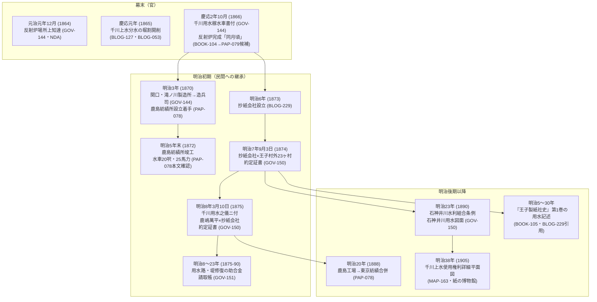

# 2026-11-15（第92回）・紙の博物館水利権文書124点の所在特定（明治8年鹿嶋萬平×抄紙会社約定証書）・幕末反射炉一次研究の書誌特定3点・鹿島紡績圖解説本文確認・気候変動あり方概要版全文取得の追加調査

第92回の定期調査記録。前回（第91回）の残課題（①大松騏一『関口大砲製造所』書誌・②飛鳥山図録書誌・③紙の博物館の水路証書・⑤気候変動あり方概要版PDF）を中心に進め、**第91回時点で「所在情報を発見したが未特定」として残っていたほぼすべての課題が解消・格上げされた**。とくに第91回のBLOG-230「証書・嘆願書は紙の博物館に保存」の発言に対し、収蔵品データベース（jmapps）から**明治7年9月3日の抄紙会社×王子村外23ヶ村の約定証書・明治8年3月10日の千川用水をめぐる鹿嶋萬平×抄紙会社の約定証書を含む「水利権関係書類」124点（画像公開済み）**を所在特定したのが本回最大の成果。

## 今回の新規登録

- [GOV-150](../sources/gov/GOV-150.md): 紙の博物館収蔵「**水利権関係書類**」（jmapps収蔵ID:945・文書124点・明治7〜26年・285×205mm）。内題「第五一号 王子 用水路ニ関スル書類」。**①明治7年（1874）9月3日付 約定証書（抄紙会社・王子村外23ヶ村）**・**②明治8年（1875）3月10日付「千川用水之儀ニ付 糸器械所鹿嶋萬平ト抄紙会社支配人谷敬三ト取結ヒタル約定証書」**・**③明治23年 石神井川水利組合条例・石神井川用水図面**、他〔**鹿島紡績所の用水が千川用水系であることを当事者間の約定証書という一次文書レベルで裏付ける資料の現存在の確認**。BLOG-229の二次記述（動力＝王子分水）の一次側〕。
- [GOV-151](../sources/gov/GOV-151.md): 紙の博物館収蔵「**用水路修復助合金・堤舗修復助合金 請取帳**」（jmapps ID:951・21点・明治8〜23年・作者＝王子村外廿三ヶ村・「抄紙会社御中」）〔**千川用水系の水路・堤の修復費を抄紙会社が助成した15年間の金銭記録**。GOV-150の約定の実施態様を窺う帳簿〕。
- [MAP-163](../sources/maps/MAP-163.md): 「**千川上水使用権利詳細平面図**」（**明治38年・紙の博物館所蔵**）。紙の博物館「抄紙会社設立150年」特設ページの紹介: 明治7年9月3日の約定に基づき、**用水使用権利者が所有した図面で、王子製紙王子工場（抄紙会社）までの水の流れを図示**〔千川用水の工場導水を描く明治後期図面の現存。jmapps上のレコード番号は未特定〕。
- [BOOK-103](../sources/books/BOOK-103.md): 大松騏一『**関口大砲製造所**』（**東京文献センター・2005年2月**・ISBN4-925187-46-5・145p・1524円・NDC9 559.09・NDL R100000002-I000007652492）〔BLOG-227の引用元研究書の書誌特定。大松の神田上水系著作（『神田上水覚え書』2015・『神田上水工事と松尾芭蕉』2003・『水神社と関口芭蕉庵』2000）の所在も固定。大松が千川上水と神田上水の両方に単著を持つことの確認〕。
- [BOOK-104](../sources/books/BOOK-104.md): 北区飛鳥山博物館編『**近代工業化のルーツ 滝野川反射炉展 日本・ベルギー友好150周年 まなぶ・つくる・うけいれる**』（**東京都北区教育委員会・2016年10月**・秋期企画展）〔BLOG-228が引用する「慶応2年10月頃完成」説の出展図録の書誌特定。NDL書誌3レコード〕。
- [BOOK-105](../sources/books/BOOK-105.md): 成田潔英（1884-1979）『**王子製紙社史**』（王子製紙・第1〜4巻＋付録編の5冊構成・**第1巻「明治5年〜明治30年」1956年5月**・R100000001-I01211001000585391）〔BLOG-229引用「千川上水を巣鴨から分流して来たもの」の原典社史の書誌特定。2001年新社史（本編・合併各社編・資料編）・1982年戦後30年史も所在確認〕。
- [PAP-078](../sources/papers/PAP-078.md): 土屋喬雄「**鹿島紡績工場並びに機械の圖解説**」『社会経済史学』3(3) pp.326-327（**1933年6月1日**・DOI 10.20624/sehs.3.3_326）〔**PAP-077の関連書誌節に「所在のみ」で挙がっていた論文の独立登録と本文確認（格上げ）**。J-STAGE公開PDF（RC4暗号）を取得・復号・本文テキスト抽出。**口絵＝木板鳥瞰図（動力たる水車・諸機械を含む）の解説**。鹿島万平（萬挙）の元治元年の建言→明治3年瀧野川に設立着手→**明治五年末竣工**（水車・直徑二十呎・25馬力）→**明治20年東京紡績に合併**の年次・規模を1933年の経済史家が鹿島家資料に基づき記録。**ただし水車の水源（千川上水か）への言当は本文2頁にない**〕。
- [PAP-079](../sources/papers/PAP-079.md): 馬場永子「**幕末の滝野川反射炉について**」『産業考古学研究』2014(1)（**2014年6月・東京産業考古学会**・NDL R000000004-I027090784・CiNii crid 1520290884874590848）〔**反射炉完成「慶応2年10月頃」説の有力な元研究候補**（飛鳥山図録・BOOK-104の「最近の研究」の候補）。所在のみ。本文はNDL雑誌記事の閲覧課題〕。

## 既存資料の更新

- [BLOG-227](../sources/blogs/BLOG-227.md): 制限①（大松書の初出情報）→解消（BOOK-103）。
- [BLOG-228](../sources/blogs/BLOG-228.md): 制限①（図録の書誌）→解消（BOOK-104・PAP-079）。
- [BLOG-229](../sources/blogs/BLOG-229.md): 制限①（社史の原典）→部分解消（BOOK-105）・制限②（取水地点）→PAP-078で「水車20呎・25馬力・明治5年末竣工」を確認したが水源の特定記述はなし。
- [BLOG-230](../sources/blogs/BLOG-230.md): 制限③（証書・嘆願書の所蔵番号）→所在特定（GOV-150・GOV-151・MAP-163）。「嘆願書」個別文書の特定は残る。
- [PAP-077](../sources/papers/PAP-077.md): 関連書誌（圖解説）→独立登録・本文確認（PAP-078）。
- [GOV-124](../sources/gov/GOV-124.md): 制限④に追記。都建設局サーバーの「神田川流域河川整備計画の概要」（content/000007274.pdf・**PDF作成日2016年4月7日**・Type3ビットマップフォントでテキスト抽出不可）を確認。**2016年作成のため令和5年3月版と同一版かは断定せず**。決定版の公表は2026-11-15時点で未確認。
- [GOV-149](../sources/gov/GOV-149.md): **直接確認に格上げ**。①概要版PDF（11_01.pdf・949,526bytes）をリファラ・ブラウザUA指定で取得し全文抽出（第91回のWAF遮断を突破）。**「10流域（神田川、石神井川、白子川、野川、境川等）優先対策」**・**「CC 1/20」の定義（確率雨量×2℃上昇時1.1倍・区部＝大手町観測所）**・地下トンネル式の整備手法（流下施設・ネットワーク化）・高潮対策の必要嵩上量（城南0.3〜0.5m/2040〜60年代・隅田川0〜0.9m/2050〜80年代・中川旧江戸川0〜0.6m）を確認。②産経新聞2026-10-21記事で**2026年3月の東京湾延伸（地下巨大河川）検討委員会設置**・**白子川連結（平成29年開始・総延長約13km・貯留量約143万m³）**の報道を追記。

## 千川用水の幕末→明治水利文書チェーン（本回で揃った一次側）

すべて確認できるのは各資料の記載時点のみ。矢印上の連続性（とくに幕末の官営水利と明治7年約定の間の権利の推移＝旧幕府引上げ後の帰属）は、GOV-150の124点画像の判読まで推定を含む。反射炉系の文書（GOV-144）と民間約定（GOV-150）の間をつなぐ明治2〜6年の水利権の空白は、repo最大の未解決として残る。

## 調査の経過と技術メモ

- **jmapps（紙の博物館収蔵品データベース）の検索方法**: `https://jmapps.ne.jp/kamihaku/list.html?keywords=<URLエンコード語>&kwd_and_or=and&list_type=LLA001&list_count=50` のGETで検索可（I.B.MUSEUM SaaS。「千川」でGOV-150が単独ヒット、「用水」で3件ヒット。「千川上水」「王子分水」「鹿嶋」は0件＝件名解説の索引語彙に偏りがあるため、短い語での総当たりが有効）。
- **J-STAGEのRC4暗号化PDF**: PAP-078（sehs 3(3)）はV2/R3のRC4 128bit。自作の復号器（/home/user/otowa92/pdfcrypt.py…環境リセットで消える可能性あり・メモとして記録）でobj 2/6/19を復号・解凍し、リテラル文字列形式の2バイトCID+ToUnicodeマップで本文抽出に成功した〔手法は将来のJ-STAGE古文献でも再現可能〕。
- **都サイトのWAF突破**: GOV-149の概要版PDF（11_01.pdf）は、ブラウザUA＋プレスリリース頁のリファラ指定で取得できた（第91回は素のcurlで遮断）。`-A "Mozilla/5.0..." -e <該当頁URL>`。ただしkensetsu.metro.tokyo.lg.jpの`content/`頁は301リダイレクト（`documents/d/kensetsu/`へ）で、`-L`が必要。
- **NDL OpenSearch**: 429（同時アクセス上限）が頻発。25〜45秒の待ち timeを入れると通る。`title=`パラメータが書名検索に有効（`any=`は全文検索で関係ないレコードが返る）。
- CiNii詳細頁（crid）は引き続き遮断。ndlsearch側の書誌・解説で代替確認。
- アクセス不能（継続）: echo-lab.ddo.jp（沈静化濃厚）・meiji.repo（JAIROメンテ）・nabunken（429）・CiNii（Robot検証）・板橋区WAF。

## 陰性記録

- 報道（news_search・2026-11-01〜15）: 谷端川・弦巻川・水窪川・千川上水・神田川流域計画・雑司ヶ谷幹線すべて0件（直近数回と同じく陰性）。
- 神田川流域決定版河川整備計画: 2026-11-15時点で未公表のまま（GOV-124の令和5年3月版が現行）。sumikae-lab（個人サイト・2026-10-05確認表記）が引用する都のPDFは2016年4月作成の概要版とみられ、決定版ではない。
- 紙の博物館特設ページの他コレクション（錦絵・古写真・銅版画・賞牌・明治17年警視庁提出平面図・ウォーターマーク型・レッテル）: 水路直接関連は「千川上水使用権利詳細平面図」のみで、他は水系記述なし。明治17年「製紙会社平面図」は石神井川沿いの納屋・印刷局工場との隣接が解説にあるのみ（jmapps DBレコードの個別確認は次回候補）。
- jmappsの「千川上水」キーワード: 0件（MAP-163の図面はDB検索に掛からず、特設ページ経由でのみ確認）。

## 次回への課題

- **GOV-150の124点画像の判読**（jmappsのビューア/PDFから取得）: ①明治7年9月3日証書の文言（当事者・村名・条件）・②明治8年3月10日証書の文言（鹿嶋萬平の「糸器械所」の位置・取水量）・③明治23年石神井川水利組合条例の内容。**repo最大の優先課題**。
- PAP-079（馬場永子2014）の本文取得（NDL）：「慶応2年10月頃」説の根拠史料の確認。BOOK-104（図録）との引用関係の確認。
- GOV-144のIIIF画像のくずし字判読（第91回から継続）。MAP-162（三ヶ村用水路図）のIIIF判読。
- 神田川流域決定版河川整備計画の公表監視（2026年3月都議会説明会での「今年度中」回答からの経過観測）。東京都豪雨対策基本方針（改定）（令和5年12月）の本文取得（GOV-149の残り5流域名の確認）。
- 大松騏一『関口大砲製造所』（BOOK-103）の本文閲覧（文久2年10月文書の一次確認）。BOOK-105（王子製紙社史第1巻）の該当頁照合。BOOK-104（図録）の「最近の研究」の文献名。
- 環七地下調節池の2026年3月検討委員会（東京湾延伸）の資料探索（都第三建設事務所・建設局の公表情報）。
