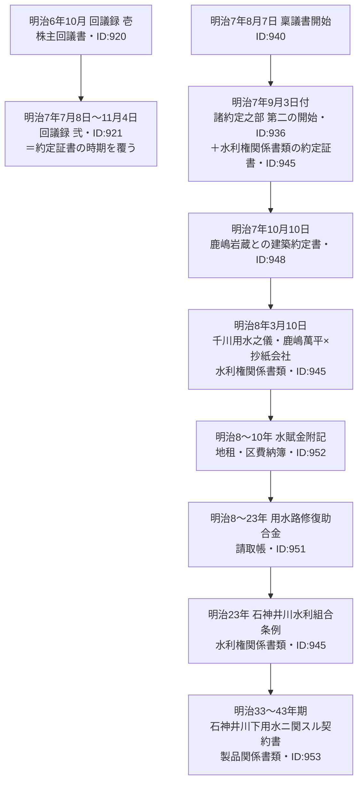

# 2026-11-15（第93回）・環七地下河川委員会資料2全文・紙の博物館石神井川下用水契約書と社内記録群・都調節池現況数値・増田剛己2010全5ページの追加調査

第93回の定期調査記録。前回（第92回）の残課題（①環七地下河川計画検討委員会・②紙の博物館周辺コレクション・④All About増田記事の重複確認・⑤PAP-079の頁範囲・⑥NDL OpenSearch新語走査）を中心に進めた。並走実行はなく、反映直前の最新main確認でhead=e5640afe（第92回）のまま競合なし。

## 今回の新規登録

- [GOV-153](../sources/gov/GOV-153.md): 東京都建設局「**環七地下河川計画検討委員会（第1回）配布資料2**」（令和8年3月4日・[PDF](https://www.kensetsu.metro.tokyo.lg.jp/documents/d/kensetsu/chikakasen-1-shiryo-2-pdf)・open_url経由で本文抽出成功）。**地下河川の全体像＝環七地下広域調節池・白子川地下調節池・石神井川区間・環七地下調節池・目黒川流域調節池（仮称）の連結・東京湾放流・相互融通機能を拡充（約190万m³）**、全体約30kmの水理模型実験、**学識委員6名（朝日ちさと・小堀洋美・知花武佳・土屋十圀・平林由希子・山田正）**、第2回＝計画諸元、第3回以降＝放流水理・「地下河川計画（案）」、水質等変化予測調査（ヒアリング: 小堀洋美・二瓶泰雄・風呂田利夫）。議事要旨はWAFで未取得。第2回の開催実績は未確認（Wayback最新2026-06-18でも第1回のみ）。
- [GOV-152](../sources/gov/GOV-152.md): 紙の博物館収蔵「**製品関係書類**」（jmapps収蔵ID:953・139点画像公開・キーワード「石神井川」でGOV-150とともにヒット）。解説に「**明治33～43年期石神井川下用水ニ関スル契約書**」を含む〔**千川上水流末＝石神井川下用水の契約関係が1900-1910年に現存した**ことを示す所在記録。MAP-163（明治38年平面図）と同時期の権利文書照合が次回課題。年代欄「明治11～15年」との不一致に注意〕。
- [BLOG-231](../sources/blogs/BLOG-231.md): 増田剛己「**池袋から江戸川橋まで、弦巻川の痕跡を歩く**」（All About・2010年7月13日・全5ページ・Wayback取得）。1・2・4・5ページがrepo初出。**①2010年時点の「雑司が谷いろはかるた」壁画の観察（「そ」＝卒塔婆橋）＝2024-25年撮影より14年遡る第三の独立観察、②丸池の「袋池」別呼称、③暗渠は弦巻通りの一本西というマンホール観察、④菊池寛旧宅の説明板（昭和12年転入）から「すでに暗渠」と読む2010年の傍観、⑤2010年時点の神田川放流口（旧合流点よりやや下流）の観察、⑥三角寛旧宅の料亭化・木村橋石碑の説明**。3ページ目（大鳥神社碑文）はREADME既収録。

## 既存資料の更新

- [GOV-150](../sources/gov/GOV-150.md): 第93回追記。jmapps同一コレクションの**用水交渉期の社内記録群**の所在確認——「**諸約定之部 第二**」（ID:936・自明治7年9月3日付～明治10年12月1日・第11～34号・109点画像＝**約定証書と同日付開始**の原簿候補）、「**回議録 壱～六**」（ID:920～925・株主回議書・明治6年10月～明治9年8月・**弐冊目が明治7年7月8日～11月4日＝約定時期を覆う**）、「**稟議書**」（ID:940・明治7年8月7日～明治9年12月27日・133点画像＝約定の1か月前から）、「**建築方諸証書**」（ID:948・**明治7年10月10日付・鹿嶋岩蔵トノ間ニ替シタル約定書**を含む・108点画像）、「**地租・区費 納簿**」（ID:952・明治8～10年・**「水賦金」の附記**・9点画像）。
- [GOV-149](../sources/gov/GOV-149.md): 第93回追記。都建設局「**東京都の調節池・分水路**」頁（更新2025-11-10・Wayback 2025-12-21取得）。**令和6年度末＝12河川29箇所・合計約268万m³稼働＋5河川8箇所・総延長約12kmの分水路**。**「神田川や野川など優先度が高い10流域から順次」**。**2035年度までに調節池容量を約1.4倍（令和2年度末比）の365万m³へ拡大**。残り5流域名は依然未確認。
- [PAP-079](../sources/papers/PAP-079.md): NDL OpenSearch記事レコードで**掲載誌＝『産業考古学研究』1号・p.16-23を確認**。本文は依然未取得。
- [BOOK-087](../sources/books/BOOK-087.md): NDL OpenSearch詳細で**デジタルコレクション書誌レコード（dl.ndl.go.jp/pid/3034788）の存在と75p・図版という頁数を確認**。公開範囲・本文は未確認（dl直取得はcookie/WAF遮断）。

## 陰性・再確認・次回回し

- 水徒zen 23248324＝[BLOG-065](../sources/blogs/BLOG-065.md)既収録（前回サマリの「重複確認未実施」を解消）。4travel 福ヒット 12046659（2026-04-22・谷端川暗渠緑道）＝第71回評価済み。としま案内人 2603231006.html＝README既収録（第92回反映分）。
- news_search（2026-11-01以降・四河川・神田川決定版・雑司ヶ谷幹線）＝0件。**神田川流域決定版河川整備計画は2026-11-15時点で依然未公表**（変更原案R4.9のまま・パブコメ終了済み）。
- **大乗淑徳学園 senkawa2026**（千川家文書「練馬区指定文化財」表記差問題・第33回）：直サイト（daijo.shukutoku.ac.jp）接続不可（curlタイムアウト・open_url遮断）・Waybackスナップショットなし。**次回回し**。
- **武井弘一「古文書を活用した地域史学習」**（『史海』51・2004-06-27・p.26-34・東京学芸大学附属高等学校大泉校舎の実践報告・hdl 2309/38632）・**「上水から都市江戸を考える」**（2004-12-20・p.41-52・hdl 2309/5550）：NDL「千川家文書」検索でヒットしたが、**TUFSリポジトリ（JAIRO Cloud）が2026-10-28からシステムメンテナンス中（終了日未定）で本文取得不可**。千川家文書・四河川との関係が確認できないため見送り（武井の専門は玉川上水系で、高校は大泉＝練馬区にある点のみ手掛かり）。
- NDL OpenSearch新語走査: 千川堀（1件＝SZ107280既収録GOV-100）・弦巻川（10件すべて既収録）・水窪川（27件・静岡県水窪川が大半、東京側は既収録）・雑司ヶ谷用水・目白湧水（0件）・千川家文書（4件→BOOK-087追記と武井2件見送り）。東京都立図書館の都下水道局技術調査年報2003-2011は画像スキャンのみ＝第85回確認済みの再確認。
- PAP-079本文・大松『関口大砲製造所』（BOOK-103）本文・jmapps 124点/139点画像の判読・dl.ndl pid/3034788の公開範囲確認＝次回以降の課題として残す。

## 千川用水の明治水利文書チェーン（jmapps内の所在まとめ・第93回時点）

いずれの矢印も「所在する文書の年代の並び」であって、文書間の内容上の連続性（権利の継承・当事者の同一性）は画像判読まで確認できない。
