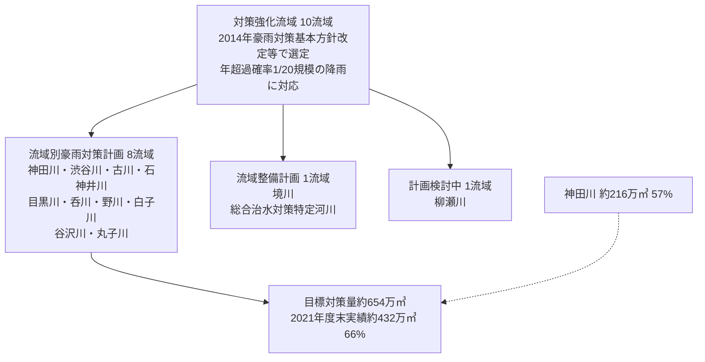

# 2026-11-15（第94回）・豪雨対策基本方針（改定）第1・2章全文取得と対策強化流域10流域の確定・NDA GOV-144のIIIF画像12枚確保・Vision判読予算の上限確認の追加調査

第94回の定期調査記録。前回までの残課題（豪雨対策基本方針（改定）本文の取得＝GOV-149未解決①・NDA GOV-144のIIIF画像確保・PAP-079本文探索）を中心に進めた。並走実行はなく、反映直前の最新main確認でhead=4bf038592（第93回）のまま競合なし。

## 今回の新規登録

- [GOV-154](../sources/gov/GOV-154.md): 東京都「**豪雨対策基本方針（改定）**」第1章（6頁・Waybackスナップショット20250513220450）・第2章（26頁・スナップショット20251114210931）の**本文全文抽出**（直URLはWAF遮断・Wayback経由。s02は9,120,316bytesで5MiB転送上限を超えるためHTTP Range分割で取得）。**対策強化流域＝10流域の構成を確定**（神田川・渋谷川・古川・石神井川・目黒川・呑川・野川・白子川・谷沢川・丸子川＋境川＋柳瀬川）し、GOV-149の未解決①（残る5流域名）を解消。**浸水重点地区67地区一覧のNo.28「北区滝野川」（事業中）・No.52「目黒区上目黒、世田谷区弦巻」（事業中）はrepo初出**（弦巻川・谷端川下流側の現在の浸水対策の地区別初出記録）。**雨水貯留管20幹線一覧に谷端川1号幹線32,000m³**（堀船1号幹線2,100m³・王子西1号幹線12,200m³・渋谷駅西口貯留管4,000m³等とともに）＝32,000m³公称値の第三の独立公表源。河川整備の現況（46河川324km・令和4年度末護岸220.9km/68%・調節池12河川27箇所264万m³・分水路5河川8箇所12km・安全度達成率63%/81%）・流域対策の指導基準（神田川流域等7流域600㎥/ha・その他500㎥/ha）も確認。

## 既存資料の更新

- [GOV-149](../sources/gov/GOV-149.md): 第94回追記。概要版の「10流域（神田川、石神井川、白子川、野川、境川等）」の全列挙をGOV-154で確定した旨を記録し、制限・未解決①を解消。

## NDA GOV-144のIIIF画像12枚の確保（判読は次回）

- GOV-144（幕末反射炉×千川用水一次記録群）のうち画像公開済み4件のIIIFマニフェスト（`/api/iiif/<id>/manifest.json`）と**原寸画像12枚（3000×2159px級）を取得・保存**した: 多24411（viewer ID:1160523・上知達・3枚）・多24407（1176286・上知達書抜・3枚）・多010688（1204387・慶応元年7月伺・5枚）・太00106100-04400（1354760・明治3年太政官・1枚）。**くずし字判読は`tools.uploads.analyze_image`（別のvisionモデルに画像を送る手法）で試みたが、1回の応答あたり約20回の呼び出し上限に達し、多010688の5枚は空応答に終わった**（画像は保存済み・質問の分割・リトライは次回）。上知達2通6枚と太政官文書1枚は未着。

## 手法の記録（今後の実行で使う）

- **HTTP Range分割取得**: この実行環境の外部HTTP転送は1接続約5MiB（5,242,880bytes）で切れる。WaybackのPDF等は`curl -r <offset>-`で続きを取って連結すれば完全取得できる（s02・s03・s04で実証）。
- **PDF本文抽出器（/home/user/otowa93/pdftext2.py）**: zlibでストリームを自己終端検出・ObjStm展開・ToUnicode CMap適用の自作抽出器。s01・s02（テキスト層あり）は全文抽出可。s03・s04は画像ベースPDF（ToUnicode 0）で抽出不能＝DCTDecode JPEGを直接切り出して画像判読に回すべき（s03:39枚・s04:61枚抽出済み・/home/user/otowa93/s03imgs・s04imgs）。
- **`tools.uploads.analyze_image`**: ファイルシステム上の任意のJPGをvisionモデルに送れるが、**1応答あたり約20回が上限**。並列呼び出しでも消費する。予算配分（最重要文書から・質問は1枚1問）が必要。空応答が返る場合もある（多010688の5枚）。
- **アセット在庫（次回のvision判読対象）**: /home/user/otowa93/nda/（GOV-144の12枚）・/home/user/otowa93/imgs/（jmapps GOV-150の124点・うち3019-3042は第93回までに判読済み棚卸し）・/home/user/otowa93/s03imgs・s04imgs（豪雨対策基本方針第3章等の100枚）・/home/user/otowa93/map163.jpg。

## 陰性・再確認・次回回し

- **PAP-079本文**: CiNii OpenSearch API（`/opensearch/articles?format=json`）で書誌を再確定（馬場永子「幕末の滝野川反射炉について」『産業考古学研究』1号・2014-06・p.16-23・ISSN 2188-5958・NAID 40020727530・東京産業考古学会）。**学術機関リポジトリでの公開は確認できず**（IRDBは一時エラー）、本文のオンライン公開なしと判断。資料請求・図書館由来しかない。
- **東京都豪雨対策基本方針（改定）のlanding page・s05以降**: Wayback CDX APIが「Temporarily Offline」でURL列挙不能。章構成の全容（s05以降の有無）は未確認のまま。
- **11/2インフラツアーの都プレスリリース**（2026110202）: 都公式・公園協会・配信社いずれも自動アクセス遮断で開封不能。内容不明のまま評価保留（見学会告知の可能性が高く、情報価値は低いと推定）。
- **神田川流域決定版河川整備計画**: 2026-11-15時点で依然未公表（GOV-124監視継続）。
- NDA GOV-144の判読・jmapps GOV-150の3043以降の棚卸し・GOV-152の139点からの石神井川下用水契約書特定・MAP-162/武蔵アルバム/かたりべ45号の画像判読＝**vision予算20回/応答の配分の下で次回実施**。

## 対策強化流域10流域の構成（GOV-154で確定）

※10流域の列挙は表2-5・表2-6の組み合わせによる特定（1箇所での明示列挙文言は未発見）。谷端川・弦巻川・水窪川は神田川流域（筆頭の対策強化流域）の支川側。
