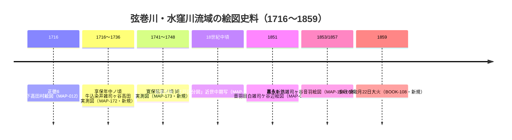

# 2026-11-15（第97回）・岩瀬文庫「江戸区分図」39舗の発見と7舗登録・NDL蔵享保・寛保延享「牛込染井雑司ヶ谷高田」実測図2舗・岡山大蔵「他所図」・環状七号線地下広域調節池の諸元の追加調査

第97回の定期調査記録。第96回ノートで「MAP候補として残置」としたNDL横断の江戸期絵図書誌の取得を進めた結果、**西尾市岩瀬文庫「江戸区分図」（江戸市中〜近郊を39枚の「舗」に分けた近世中期写の絵図群）を発見**し、四河川関連7舗を個別登録した。またNDL蔵の旧幕府引継書実測図「牛込染井雑司ヶ谷高田」の享保年中ノ頃・寛保延享ノ頃の2舗（IIIF画像公開）と、岡山大学附属図書館蔵の「他所図」（池田家保持・デジタル岡山大百科公開）を登録した。行政側は都第三建設事務所「河川の整備」頁（2026-07-19更新）で環状七号線地下広域調節池の諸元を直接確認した。

## 今回の新規登録

- **[MAP-165](../sources/maps/MAP-165.md)〜[MAP-171](../sources/maps/MAP-171.md)（7舗）**: 西尾市岩瀬文庫「**江戸区分図**」39舗のうち、四河川の谷を直接カバーする7舗〔いずれも函番号子-3・近世中期写・原写本（上写本）・原装・原題簽存・虫損あり（補修済）・ADEACでDeepZoom公開・目録頁の書誌を2026-11-15に直接取得〕:
    - MAP-165「高田馬場辺より雑司ヶ谷迄絵図」（第32舗・64.3/97.0cm・弦巻川主流域）
    - MAP-166「川田窪大窪高田辺迄絵図」（第14舗・66.5/88.0cm・弦巻川源流の窪地「川田窪」を題名に持つ）
    - MAP-167「大窪より四谷千駄ヶ谷辺迄絵図」（第27舗・67.0/78.8cm・目白の分水界）
    - MAP-168「小石川元御殿地跡より巣鴨染井辺迄絵図」（第10舗・74.6/113.9cm・谷端川中流〜源流）
    - MAP-169「小石川より小日向台大塚護国寺辺迄絵図」（第35舗・74.2/136.7cm・谷端川下流＋水窪川を1枚でカバー）
    - MAP-170「牛込御門より江戸川小日向辺まて絵図」（第38舗・50.7/85.7cm・江戸川と水窪川・谷端川の流末）
    - MAP-171「駒込千駄木根津谷中迄絵図」（第25舗・74.3/93.0cm・谷端川下流東側）
    - **観察**: 各舗の目録内容欄に方位（右上が南・上が東など舗ごとに異なる）とイロハ文字の符号（「ム」「ネ」「ナ」「ウ」「ラ」「ヌ」「ノ」「ヰ」）が記録されており、**符号は隣接舗との接合・配列の目印の可能性〔推定〕**（目録に符号の意味の説明なし・39舗の接合関係の復元は未実施）。
    - **画像の読図は未実施**（ADEACの画像はDeepZoom（DZI）タイル形式で、本実行環境では原図の取得・結合に至らず。次回課題）。
- **[MAP-172](../sources/maps/MAP-172.md)/[MAP-173](../sources/maps/MAP-173.md)**: NDL蔵「**牛込染井雑司ヶ谷高田**」（旧幕府引継書・実測図・彩色・請求記号819番台・PDM公開）の2時点版〔第96回ノート残置候補を解消〕: ①**享保年中ノ頃**（819-56・106×164cm・DOI 10.11501/2542299・IIIF canvas2/3=17824×15596px・書誌ID 000003282326）。②**寛保延享ノ頃**（819-105・98×156cm・DOI 10.11501/2542339・IIIF canvas2/3=13281×17306px・書誌ID 000003282341）。**同一区域（牛込〜染井〜雑司ヶ谷〜高田）の約20〜30年隔てた2時点の実測図の併存**＝時代比較の候補。IIIFの領域指定で部分画像（8912×7798px）を取得してvision判読を試みたが**解像度不足で不成立**（サイズ縮小パラメータはこのcanvasでInternal server error）。無年代版6舗（819-156・pid/2610808・2609502等・書誌ID 000003282391を含む）と東大史料編纂所所在（R100000039-I2589495〜98）はファイル内に他所蔵記録。
- **[MAP-174](../sources/maps/MAP-174.md)**: 岡山大学附属図書館蔵「**〔牛込市谷雑司ヶ谷早稲田辺絵図〕(T9-52)**」（45.1×57.2cm・出版年未詳・件名標目「**他所図**」・解題「**参勤交代の情報収集及び池田家の役人が常駐していたため**」・岡山県立図書館デジタル岡山大百科でインターネット公開・R100000094-I1479559）〔第96回ノートのT9-52残置候補を解消〕。大名家（岡山藩池田家）の実務資料として地方に残った江戸絵図。牛込・市谷〜雑司ヶ谷・早稲田＝弦巻川〜水窪川下流域をカバー。
- **[GOV-155](../sources/gov/GOV-155.md)**: 東京都第三建設事務所「河川の整備」頁（最終更新2026-07-19）〔open_urlで本文全文取得・直接確認〕: **環状七号線地下広域調節池＝環七と目白通りの地下**。**連結区間（白子川地下調節池〜神田川・環七地下調節池を結ぶトンネル）は内径12.5m・延長約5.4km・貯留量約68万m³**。施設概要表: 白子川10.0m/3.2km/21.2万m³＋連結12.5m/5.4km/68万m³＋神田川環七12.5m/4.5km/54万m³＝**計約13.1km/143万m³**（本文中に「総延長約13.2km・貯留容量約143.2万m³」の表記もあり**同一頁内で表記ゆれ**）。工事経過: H28年度末契約→H29立坑・シールド製作→H30.9シールド完成→R1.10中間立坑完成→現在本体トンネル構築中。令和7年12月進捗PDFへの言及あり。産経報道の「約13km・143万m³」の一次元確認・具現化。
- **[BOOK-107](../sources/books/BOOK-107.md)**: 『**石神井川下用水誌**』（石神井川下用水普通水利組合・1929年2月・93p・東京都立中央図書館B1書庫B東蔵・請求記号20-51C-A・R100000001-I13111101682501・本文非公開）。千川上水流末の水利権チェーン（GOV-150明治7年約定→明治23年条例→GOV-152明治33〜43年契約→本書1929年機関誌）の最後の一次資料の所在固定。
- **[BOOK-108](../sources/books/BOOK-108.md)**: 「**安政六年二月廿二日靑山より四ツ谷新宿雜司ヶ谷赤羽辺迄 大火場所明細附**」（[編者不明]・三康図書館蔵・請求記号国7-304・R100000126-I30007872）。安政6年（1859）の大火が雑司ヶ谷（弦巻川上流域）を含む範囲に及んだ記録の所在。MAP-164（嘉永6=1853年板）の6年後の大火で、図の景観が大火前後のどちらかという読図上の注意点を与える。

## 既存資料への追記

- **[MAP-164](../sources/maps/MAP-164.md)（嘉永新鐫雑司ヶ谷音羽絵図）**: ①**三康図書館（三康文化研究所）所蔵2舗をNDL横断で確認**（竹8-71「[江戸切繪圖]第一三鋪 嘉永新鐫 雜司ヶ谷音羽繪圖」〔R100000126-I70001609〕・国8-800「第一四鋪」〔R100000126-I30009456〕・**いずれも出版年=嘉永6（1853）＋注記「安政四修」**）。第96回未解決の「PAP-082論文の嘉永6 vs 都立書誌の安政4改」の年代食い違いを、嘉永6年板出版後の安政4年改修版本として両立させうる書誌的傍証〔断定せず記録〕。②zoom画像（6000×5042px・TOKYOアーカイブdownload/?size=zoom）を取得しvision読図を2回試行。地名ラベル（雑司ヶ谷・高田・染井・音羽）は複数回で概ね一致。2本の水路描写候補（染井→牛込＝水窪川系か、高田→神田＝弦巻川系か）の報告を得たが、**AI読図の幻覚混入リスクにより結論には使わない**（読図欄は「?」据え置き・人手確認必須）。

## 弦巻川・水窪川流域の絵図史料の時系列（repo収録分・今回の追加分を太字扱い）

## 手法の記録（今後の実行で使う）

- **ADEAC岩瀬文庫の目録取得**: `https://adeac.jp/iwasebunko/catalog/mpXXXXXXX`（curl・ブラウザUAで可）で書誌データテーブルが全欄入るHTMLが落ちてくる。39舗のmp番号はNDL横断OpenSearch `https://ndlsearch.ndl.go.jp/api/opensearch?any=<語>&cnt=N`（429頻発・sleep 3〜5秒）で「江戸区分図」を検索して取得できる。ビューアURLは `https://adeac.jp/iwasebunko/viewer/mpXXXXXXX/901-003-00-<舗番>/`。**画像はDZIタイル形式**（`/viewitem/iwasebunko/viewer/viewer/<sid>/data/001/dzc_output.xml`・TileSize254・Overlap1）で、PILなしの本実行環境では結合できず〔タイル取得・結合による読図が次回の鍵〕。
- **NDL IIIFの領域取得**: `https://dl.ndl.go.jp/api/iiif/<pid>/R0000002/pct:0,0,50,50/full/0/default.jpg` 形式で象限領域を取得できる（pid2542299のcanvas2で8912×7798px）。ただし**サイズ縮小パラメータ（/full/,w /）はこのcanvasでInternal server error**。vision判読はこの解像度では縮尺図の水路判読に不足（「too low-resolution」判定・2回で不成立）。より小さい領域を細かく取得して人手またはvisionでつなぐのが次回の手法候補。
- **TOKYOアーカイブのzoom画像**: 詳細頁のajax/imageで`{"imagePath":[...]}`を取り、`https://archive.library.metro.tokyo.lg.jp/da/download/?id=<tilcod>&size=zoom&type=image&file=<URLエンコード済みパス>`（ブラウザUA）でzoom画像（MAP-164は6000×5042px）が取れる〔第96回メモの「未試行」を解消〕。
- **都建設局頁のWAF**: `kensetsu.metro.tokyo.lg.jp` 直curlはWAF遮断だが、run_typescriptのtools.web_search.open_urlは通る（kasen_seibiで約1万字の本文を取得）。**陰性メモ**: vision予算は1ターン約20回・今回は3回消費。縦書き・くずし字のvision判読は引き続き期待できない。

## 陰性・再確認・次回回し

- **news_search（11/1以降・四河川・神田川決定版等6クエリ）**: 全0件。決定版神田川流域整備計画は2026-11-15時点で依然未公表。
- **NDA（国立公文書館）「谷端川」9件**: 全てGOV-135既収録（年度割変更簿冊5件＋巣鴨町下水道年度割＋親簿冊＋附図＋橋梁。差分なし）。
- **Internet Archive一時オフライン**: Wayback Machine・CDX APIとも不可（第96回から継続）。nabunken（歴博リポジトリ）429・接続不可も継続。JAIRO Cloud（jwu.repo等）503も継続。
- **岩瀬文庫「江戸区分図」の千駄ヶ谷・四谷系3舗**（牛込神楽坂より市谷I218069・内藤宿千駄ヶ谷I218088・青山百人町より下渋谷辺千駄ヶ谷迄I218070）: 主対象3河川流域外のため今回登録見送り〔MAP-165ファイルに記録〕。全39舗リスト（I番号一覧）は本実行で取得済みだがrepo未保存〔必要時にNDL横断で再取得〕。
- **MAP-ping系・ゆる歴史**: MAP-ping wixsite=BLOG-138・ゆる歴史250314=BLOG-047・251117=BLOG-06と既出（差分なし）。
- **環七地下調節池の線形**: GOV-155頁本文では立坑位置・目白通りのどの区間かは確認できず〔令和7年12月進捗PDF等の取得が次回課題〕。13.1km/143万m³と13.2km/143.2万m³の表記ゆれは頁内で未解決。
- **岡山大T9-86画像・牛込染井雑司ヶ谷高田の読図**: いずれも次回課題（DZI/IIIFの高倍率タイル取得）。石神井川下用水誌の本文は都立中央図書館館内限定〔要館内確認〕。
