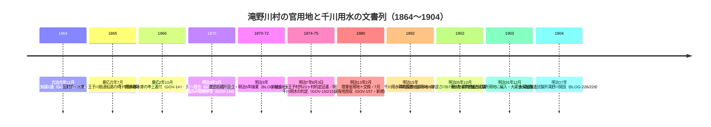
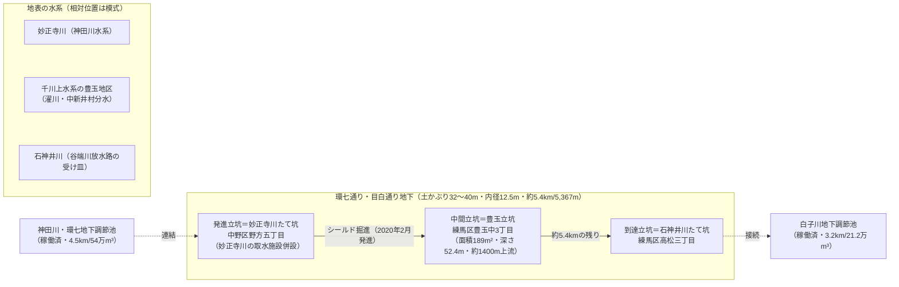

# 2026-11-15（第98回）・環状七号線地下広域調節池（石神井川区間）工事公式ホームページの発見・明治期滝野川村官用地NDA一次記録群・紙の博物館124点画像の観察の追加調査

第98回の定期調査記録。第97回で諸元を確認した環状七号線地下広域調節池について、**受注JVが運営する工事公式ホームページ kanzyou7.com（repo未収録）を発見**し、起終点・中間立坑・工法・週次シールド進捗図を確認した（GOV-156）。あわせて建設メディア「ラジエイト」の2025年5月現場潜入取材（妙正寺川たて坑・石神井川たて坑の固有名称・豊玉中3丁目の中間たて坑）をBLOG-232として登録した。国立公文書館デジタルアーカイブの「滝野川村」横断では、**明治期の官用地一次記録群6件（うち4件IIIF画像公開・計18枚）**を所在確認した（GOV-157）。字逆さ川97番の印刷局抄紙部用地の移転（1902-03）・1880年の陸軍省用地交換・1870年の兵部省懸合など、反射炉→鹿島紡績→醸造試験所の土地継承（BLOG-226/228/229）の背後の公文書列が揃った。紙の博物館の水利権文書124点画像（GOV-150）はvision判読を試みたが**誤読が混在し証拠として使えないことを実証**したため、明治7年9月3日約定証書の位置メモ（推定・要人手確認）のみ追記した。

## 今回の新規登録

- **[GOV-156](../sources/gov/GOV-156.md)**: 環状七号線地下広域調節池（石神井川区間）工事公式ホームページ [kanzyou7.com](http://kanzyou7.com/)（受注者「大成・鹿島・大林・京急建設共同企業体」運営のJVサイト・http）〔curlで全頁本文取得〕:
  - 事業概要: **中野区野方五丁目〜練馬区高松三丁目、環七通り及び目白通りの地下**・内径12.5m・延長約5.4km・貯留量約68万m³・中間立坑（豊玉立坑）1基・平成28年度〜令和9年度（**平成28年4月1日都市計画河川事業認可告示**）・75mm/h＋時間100mm対応。
  - 工事概要: 工期**平成29年3月9日〜令和10年2月29日**・中間立坑**面積189m²・深さ52.4m**（練馬区豊玉）・連絡管（内径4.35m・延長12.1m）・泥水式シールド／ニューマチックケーソン／開放型シールド・発進立坑から約1400m上流に中間立坑。
  - 週次シールド進捗図（2022年4月〜・**2026-11-12版が最新**）のPDFを取得し、テキスト層のない図面から自作抽出器（ToUnicode CMap対応）でラベル抽出。**「シールドトンネル＝約5,367ｍ」「掘進方向」「発進立坑」「豊玉立坑」**と地名ラベル（野方四・六丁目、丸山一・二丁目、豊玉北三〜六丁目、豊玉中二・三丁目、豊玉南二・三丁目、豊玉陸橋、練馬区役所、氷川神社、目白通り、環状七号線）を確認。リング番号は1984まで表示〔掘進位置の特定は推定の域を出ない〕。
  - **GOV-155の未解決①（連結区間の線形不明）を起終点・中間立坑の町名レベルで解消**。
- **[BLOG-232](../sources/blogs/BLOG-232.md)**: ラジエイト「[環状七号線地下広域調節池〈石神井川区間〉（2025年5月）](https://radiate.jp/20250523/kanzyou7_2025-05/)」（2025-05-23）〔open_urlで本文全文取得〕:
  - 立坑の固有名称: **発進=「妙正寺川たて坑」（中野区野方五丁目・妙正寺川の取水施設併設）／到達=「石神井川たて坑」（練馬区高松三丁目）／中間たて坑=練馬区豊玉中3丁目**。**両端が妙正寺川（神田川水系＝水窪川・弦巻川の合流先水系）と石神井川（谷端川放水路の受け皿）の取水施設**であることを示す数少ない記述〔観察〕。
  - シールド機直径13.45m・長さ12.91m・約2,500t・**土かぶり32〜40m**・セグメント9枚=1リング。**2020年2月のシールド発進式典**・2025-05-22時点で**掘削完了1km超**。2022年4月からの定期取材シリーズ。
- **[GOV-157](../sources/gov/GOV-157.md)**: NDA「滝野川村」横断（13件ヒット・GOV-144/135/145既収録と照合）の明治期官用地記録群6件:
  - **1902-10-21 印刷局抄紙部用地ノ内農商務省ヘ引渡済ノ件**（纂00588100-03500・IIIF 3枚）: 目録内容記述「**滝野川村字逆さ川97番**の内土地建物等存在之侭別紙目録之通**本月13日農商務省へ引渡済**」〔**千川上水の工業用水利用者（紙幣寮抄紙局→印刷局抄紙部: GOV-088/099/150/BOOK-105）の用地の所在が小字レベルで特定**されたrepo初出の一次記録〕。
  - **1903-12-11 滝野川村印刷局用地大蔵省用地ニ転換ノ件**（纂00683100-04600・IIIF 2枚）: 「大字滝野川**字逆川前耕地**」の地続**74坪2合5勺が醸造試験所用地に編入**・**大蔵省へ使用転換**の伺〔BLOG-226/229の「1904年大蔵省醸造試験所滝野川開設」の直前の用地移転公文書〕。
  - **1880-02 滝野川村外一ヶ所陸軍省用地ト交換ノ件**（公02627100-02100・IIIF 9枚・公副本2622751）: BLOG-228「跡地は陸軍省用地」の1880年時点の公文書候補〔本文未判読・内容記述なし〕。
  - **1880-07 滝野川村民有地買収ノ件**（公02635100-01700・IIIF 4枚・公副本2593360）〔同年の民有地の官収。主体・目的は本文未見〕。
  - **1870-02-13 武州滝野川村構内云々ノ義兵部省ヘ懸合**（昭56警察00012100-13500・**画像未公開**）: GOV-144の明治3年3月造兵司管轄移管と同年の兵部省交渉記録〔所在のみ〕。
  - その他のヒット（日本鉄道田端→千住1894・滝野川村田井村間鉄道免許1928・治安警察法請願1921）は所在のみ記録〔水系への言及は内容記述に未確認〕。
  - **小字「逆さ川」「逆川前耕地」**: 水路名由来と推定〔推定〕。ORG-014の「石神井川・逆川・千川上水の水道橋の遺構」・wanjin「逆川」カテゴリ8本（未取得）・BLOG-087の谷端川支流「逆川」との関係は未検討。

## 滝野川村の官用地・用水の文書列（1864〜1904）

## 環状七号線地下広域調節池（石神井川区間）の線形と立坑

## 既存資料への追記

- **[GOV-150](../sources/gov/GOV-150.md)（紙の博物館・水利権関係書類124点）**: 画像124点を取得しvision判読を試みたが**誤読を複数観測**（「石川県知事」等）。**判読モデルの結果を証拠に使わない方針を維持**し、data_id 3024（6枚目）左頁の「明治七年九月三日」の読み（収蔵DB解説の約定証書の日付と一致）のみ**将来の人手確認用の位置メモ（推定・未確認）**として追記。文言確認はOCR環境・人手待ち。
- **GOV-155（都「河川の整備」）**: 進捗PDFの令和7年12月版への言及は既出のまま。WAF遮断のkensetsu文書 `documents/d/kensetsu/000047149`（事業説明・貯留量540,000m³記載）はopen_urlもブロック（Do not retry）だが、**検索エンジンのスニペット経由で「白子川地下調節池と神田川・環状七号線地下調節池を連結した総延長13.1kmのトンネル式の調節池」という文言が存在することが確認**できた〔確認: スニペットレベル。直接取得は不可〕。

## 陰性・状況記録

- news_search・web_search（2026-11-01以降）で四河川関連の新報道なし（谷端川0件・弦巻/水窪/千川は誤検出のみ）。**決定版神田川流域河川整備計画は2026-11-15時点で依然未公表**。東京新聞518583（都議会・地下河川2030年目標）・FNN 1142045（「もう一つの川」構想）は既知の枠組み（GOV-148/149/155）の範囲。
- NDAの谷端川横断は9件ヒットしたが、**すべてGOV-135既収録**（1930年附図・年度割変更簿冊5件・巣鴨町下水道・1917年橋梁届出）で差分なし。「弦巻川」0件。「水窪川」は静岡県水窪川（天竜川水系）のみで誤検出。「中新井」は道路都市計画記録・鉄道敷設願却下記録のみで用水直接の記録なし。「千川」単独は全文検索ノイズ大。
- jmapps ID:951/936/940/948/952（第93回追記済みレコード）の解説再取得は差分なし。

## 次回課題（今回の成果に由来するもの）

- GOV-157のIIIF画像18枚（うち4件6画像を判読対象として優先: 字逆さ川97番の引渡目録・1880年陸軍省用地交換）の判読（人手・OCR環境待ち）。字逆さ川97番の位置の特定（明治地籍図）。
- kanzyou7.com進捗図の週次継続観察（完了は令和10年2月29日予定・閉鎖前のアーカイブ）。ラジエイトシリーズ（2022-04〜）の全記事リスト取得。
- wanjin「逆川」カテゴリ8本の取得（BLOG-183既出の未取得群）と、滝野川村小字「逆さ川」との関係検討。
- 紙の博物館124点のOCR・人手判読（明治7年9月3日約定証書の文言）。

## 既存の残置課題（第97回ノート由来・今回手つかず）

MAP-164読図人手確認・岩瀬文庫「江戸区分図」7舗DZIタイル結合読図・GOV-144 IIIFくずし字21枚判読・ADEAC通史編2「千川上水と水車業」節（data_0161〜0167）人手判読・GOV-152の139点棚卸し・MAP-163図面判読・明治3年御請書写本文・BOOK-062現物・西光院橋供養碑・角田2023本文・PAP-058〜063本文・BOOK-089章・PAP-079本文・大松『関口大砲製造所』本文。
