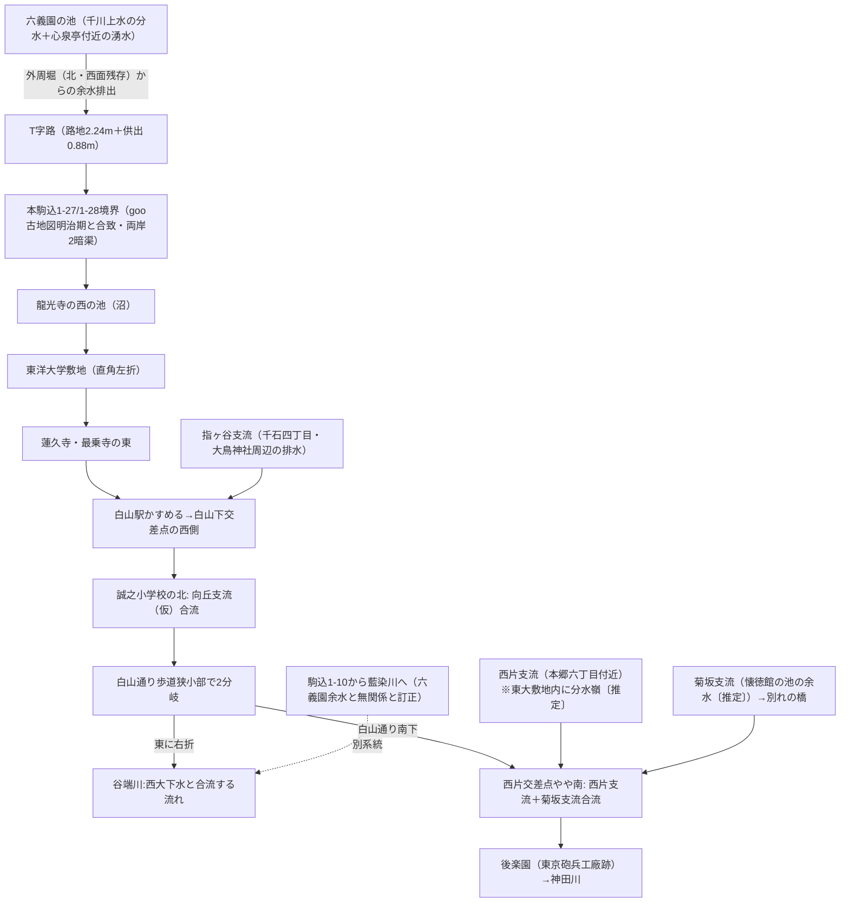
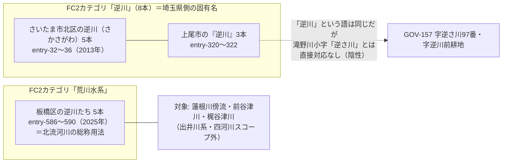

# 2026-11-15（第99回）・wanjinブログFC2全記事の直接取得法の開通・東大下水支流群（指ヶ谷・六義園訂正・向丘・西片・菊坂）・谷端川北緑道〜板橋駅・「逆川」カテゴリ構成の解明

第99回の定期調査記録。**長年の障害だったwanjinブログ（FC2）のhttps直アクセス遮断（Access Denied）問題を解消する取得法を発見した**: `http://wanjin.blog.fc2.com/blog-entry-N.html` をブラウザUA付きのcurlで `-L`（リダイレクト追従）で要求すると全entryが200で取得できる。**第50回以来未取得だった東大下水（千川下流）支流群シリーズ・谷端川北緑道シリーズ・「板橋区の逆川たち」シリーズの本文全文を直接確認**し、10件を新規登録した（BLOG-233〜242）。最大の成果は①[BLOG-240](../sources/blogs/BLOG-240.md)（六義園支流の訂正記事）で、**六義園支流の流路仮説がgoo古地図明治期との合致検証つきで提示され、駒込1-10から藍染川へ流れる支流は六義園余水と無関係と訂正された**こと、②[BLOG-242](../sources/blogs/BLOG-242.md)（シリーズ第1回）のコメント欄に、**江岸寺門前の石橋と吉祥寺（本駒込）南側の掘割の1950年代実見証言（北条光年氏）と「文京区ふるさと館の海老床店主が描いた江戸末期絵地図」（本郷通りを横断する水路と橋を描く）の所在情報**があり、README既収録の2025年深田年報論文の江岸寺石橋跡聞き取りに対する独立かつ年代を絞れる傍証となったこと、③wanjinのFC2カテゴリ「逆川」8本の構成（さいたま市北区5本＋上尾市3本＝埼玉県側の固有名）を確定し、[GOV-157](../sources/gov/GOV-157.md)の未解決を解消したこと、④[BLOG-235](../sources/blogs/BLOG-235.md)の千石一丁目の**東京市燈孔マンホール**（高橋甚也『下水道』1937引用・大正〜昭和初期遺構）が元河川の蛇行部を示唆する遺構候補として記録されたこと。

## 今回の新規登録（BLOG-233〜241・9件）

- **[BLOG-233](../sources/blogs/BLOG-233.md)**: わんじん「谷端川　－名前に偽りあり、の状況に陥った駅の顛末－」（2018-04-11）〔FC2直取得〕:
  - **谷端川北緑道（板橋区管轄）の橋列**: 前田上の橋→前田橋→北浦上橋→北浦橋→中丸橋→金井窪橋→西前橋→豊橋。**前田橋・北浦上橋・北浦橋は耕地整理時の橋（江戸・明治期にはなし）、中丸橋が江戸・明治期からあり中丸橋までが耕地整理の対象地域**。
  - 「金井」＝鉄錆湧水語源説（典拠不明）。**金井窪橋先の左岸に千川上水分水の「中丸川」が、西前橋の北で左岸に「出端川」が合流**。
  - **西前橋＝高田雑司ヶ谷道（古道: 中山道仲宿〜池袋〜雑司ヶ谷〜高田）**。
  - **下板橋駅＝東上線開業時の起点**（大塚辻町起点の免許を東京市に阻まれ当駅開業・1930年代〔昭和10年頃〕移転説）＝**第5回ノートの「東上線大塚辻町起点計画」の独立傍証**。**金井窪駅（1931年9月開業・1945年4月13日空襲→営業休止→1951年廃止・駅間400m弱）**。前田上の橋の地籍図根点の観察。
- **[BLOG-234](../sources/blogs/BLOG-234.md)**: わんじん「谷端川　－まあ、いろいろ胡散臭いわけです－」（2018-04-18）〔FC2直取得〕:
  - **第二石神井川放水路の分岐位置**（下板橋駅を過ぎ、谷端川がカラー舗装の途切れた位置から右に折れる地点で直進）。三の橋・二の橋・一の橋。**三の橋と一の橋の袂に池袋六辻（国道254号・明治通り等の交差点）から流れる二条の支流が合流**。
  - **「矢畑川自由通路地下道ガード」の「矢畑川」標記〔repo初出候補〕**（誤字か表記ゆれかはwanjinも「不明」と保留）。
  - 近藤勇供養塔（**「板橋刑場」は後世の創作で馬捨場斬首説・昭和4年の首なし遺骨発掘・供養塔の諱「冝昌」は「昌冝」の誤り**という整理。典拠は子母澤寛『新選組遺聞』ほか）。
- **[BLOG-235](../sources/blogs/BLOG-235.md)**: わんじん「東大下水：指ヶ谷支流（仮）」（2014-02-11）〔FC2直取得〕:
  - **指ヶ谷支流＝東大下水最長支流**（千石四丁目・大鳥神社周辺の水を集める。排水路で明確な源流なし）。「さしがや」「さすがや」両読み（指ヶ谷保育園＝さしがや、指ヶ谷小学校＝さすがや）。**千石地名「千川＋小石川」説の引用と疑義**。
  - **千石一丁目の東京市燈孔マンホール**（高橋甚也『下水道』アルス・1937引用: 「大管渠の彎曲箇所、又は特に距離長大なる部分の中間にして、人孔を必要とせざる程度の場合には燈孔を代用する」。**大正〜昭和初期の設置で現在新設なし**。彎曲箇所は元々河川だった管渠の蛇行箇所であるケースが多い）〔wanjin経由の二次引用。原本確認は課題〕。京華学園敷地に池。
- **[BLOG-236](../sources/blogs/BLOG-236.md)**: わんじん「東大下水：六義園支流（仮）」（2014-02-18）〔FC2直取得・**訂正前の旧版**〕:
  - 元禄8年（1695）拝領・約2万7千坪・7年造営・**千川上水を引いて池を掘る**。**六義園支流＝千川上水分水の余水で始まる唯一の支流**〔wanjin観察〕。旧流路（東洋文庫と昭和小学校の間）はentry-49で訂正。
- **[BLOG-237](../sources/blogs/BLOG-237.md)**: わんじん「東大下水　－後楽園－」（2014-02-25）〔FC2直取得〕:
  - **誠之小学校の北で向丘（むこうがおか）支流（仮）合流**（丸山福山町・指ヶ谷町の境）。**白山通りの歩道が狭くなる箇所で東に右折し「谷端川:西大下水と合流する流れ」と「白山通り南下流」の2分岐**。西片交差点やや南で西片支流＋菊坂支流合流。後楽園史（1629年頼房築庭・朱舜水選名・東京砲兵工廠→1931年から小倉集約移転→跡地後楽園球場）。「東西の大下水＝千川が本郷台地の西側に谷を刻んだ」。
- **[BLOG-238](../sources/blogs/BLOG-238.md)**: わんじん「東大下水：西片支流（仮）」（2014-03-04）〔FC2直取得〕:
  - 西片支流は本郷六丁目あたりの路から。**東京大学敷地内に分水嶺（西片側と根津方面）〔推定〕**。
- **[BLOG-239](../sources/blogs/BLOG-239.md)**: わんじん「東大下水：菊坂支流（仮）」（2014-03-11）〔FC2直取得〕:
  - **懐徳館の池の余水が菊坂支流の源と推定**（加賀前田家上屋敷・1910年明治天皇御行幸で庭園整備・昭和20年空襲で焼失）。**本郷通り「別れの橋」・見送り坂・見返り坂**（江戸市中はかねやすまで）。ホテル磯山館裏の滝〔伝聞〕。菊坂の由来＝菊畑、元来の菊坂は胸突坂。
- **[BLOG-240](../sources/blogs/BLOG-240.md)**: わんじん「東大下水：六義園支流（仮）　－訂正するに吝かではない件－」（2014-07-16・7/24・10/8追記）〔FC2直取得・**訂正版**〕:
  - **現六義園は築造当時の半分の規模**（南東側に屋敷棟）。江戸期地図の「松平家」表記＝吉保の松平姓拝領に由来か〔読者情報〕。**明治2年東京全図「柳沢カヒ（甲斐）」「江カンシ（江岸寺）」表記**。**外周堀は北・西二面を残し埋立**（池の排水のためと推定）。岩崎弥太郎の買い上げ・**煉瓦塀は造り変え**（7/24追記）。
  - **心泉亭付近の湧水と「玉藻の磯」への水路（下屋敷全体図の絵図面で確認）**。
  - **訂正流路**: 堀→T字路（**路地幅2.24m＋道路供出0.88mの実例**〔10/8追記・4m基準〕）→**本駒込1-27/1-28境界（goo古地図明治期と合致・右岸左岸2暗渠の観察）**→龍光寺西の池（沼）→東洋大学敷地→蓮久寺・最乗寺東→白山駅→**白山下交差点の西側で指ヶ谷支流と合流**。廃止時期・堀埋立との先後は不明と明記。
  - 鶏声ヶ窪＝**「傾城」表記が多い**・『江戸砂子』の金銀の鶏故事。**lotus62（東京Peeling!）「六義園の水のゆくえ」コメント欄が訂正の契機。駒込1-10から藍染川へ流れる支流は六義園の余水と無関係と訂正**。
- **[BLOG-242](../sources/blogs/BLOG-242.md)**: わんじん「東大下水（ひがしおおげすい）　－誤解を招く現代用語との意味の違い－」（2014-02-04・シリーズ第1回の定義記事）〔FC2直取得・コメント欄含む〕:
  - **東大下水の定義**: 「東大の下水」ではなく谷端川（西大下水）と対をなす「東側の大下水」。**4方面（巣鴨大鳥神社付近・六義園・西片・菊坂）の流れの総称**で、西大下水も東大下水も水戸藩邸（後楽園）に流れ込む。最長支流は現在の下水道**白山幹線**。
  - **コメント欄の北条光年氏（昭和26年生まれ・旧上富士前町育ち）の実見証言〔repo初出〕**: ①**江岸寺の入り口に石橋があった（1950年代の実見記憶）**②**吉祥寺（本駒込）の南側の道路で掘割に水が流れていた**③「**文京区ふるさと館の海老床店主が描いた江戸末期の絵地図**に吉祥寺の少し本郷よりで**本郷通りを横断する水路と橋**が書かれている」。→**2025年4月の江岸寺聞き取り・石橋跡＝東大下水とする深田年報26論文（README既収録）に対する独立かつ年代を絞れる傍証**。海老床店主絵地図の所在確認は次回課題。
- **[BLOG-241](../sources/blogs/BLOG-241.md)**: わんじん「板橋区の逆川たち」シリーズ（2025-03-12〜04-09・全5本）〔FC2直取得〕:
  - wanjinの「逆川」は**「荒川・新河岸川低地に南から北へ流入する北流河川の総称」**（固有名ではない）。対象は蓮根川傍流・前谷津川・梶谷津川（出井川系・四河川スコープ外）。
  - **FC2カテゴリ「逆川」8本の構成解明**: カテゴリ頁を直接取得し、**8本＝さいたま市北区の逆川（さかさがわ）5本（entry-32〜36）＋上尾市の『逆川』3本（entry-320〜322）**と確定。**板橋区の「逆川たち」5本は「荒川水系」カテゴリで計数外**。→[GOV-157](../sources/gov/GOV-157.md)の「wanjin逆川カテゴリ8本（未取得）」を解消。滝野川小字「逆さ川」・BLOG-087の谷端川支流「逆川」との直接対応なし（陰性確認）。

## 東大下水（千川下流）の支流群の流路仮説（wanjin 2014・BLOG-235〜240）

## wanjinブログ「逆川」の用法とカテゴリの解明

## 取得手法のメモ（FC2 httpリダイレクト法・次回以降も有効）

- **方法**: `curl -sL -A "Mozilla/5.0 (Windows NT 10.0; Win64; x64) AppleWebKit/537.36 (KHTML, like Gecko) Chrome/124.0 Safari/537.36" "http://wanjin.blog.fc2.com/blog-entry-N.html"`（**https直はAccess Denied、http://＋-L追従で全entryが200**）。カテゴリ頁も同様（`http://wanjin.blog.fc2.com/blog-category-NN.html`）。
- 第50回以来の「FC2直はAccess DeniedのためWayback id_付きURL」を経る迂回が不要になった。ただしFC2側の仕様変更の可能性は常にあり、失敗した場合はWayback id_付き法（第53回）に戻る。
- 本回でwanjinカテゴリの取得状況: 水窪川5本（全取得済み）・弦巻川3本（全取得済み）・千川上水1本（entry-249=BLOG-142既収録）・**東大下水7本（entry-26/27/28/29/30/31/49＝今回全7本の本文取得が完結）**・西大下水23本（今回240/241取得・既登録は239/243/250等・残り多数）・「逆川」8本（カテゴリ頁で構成確認・本文はスコープ外）。

## 陰性・状況記録

- **環状七号線地下広域調節池（石神井川区間）**: kanzyou7.comの2026年11月アップロードは週次進捗図（261029・261105・261112）のみで、**2026-11-12版が最新のまま変化なし**（GOV-156の記録の継続）。新topics「インフォメーションセンター公開終了」「10月分現場見学会終了」（進捗写真20261106）あり。261112版PDFはToUnicode付きで自作抽出器が機能。
- **news_search（2026-11-08〜15）**: 谷端川・弦巻川・水窪川・千川上水・神田川決定版・環七・雑司ヶ谷幹線の全クエリ0件。**神田川流域決定版河川整備計画は2026-11-15時点で依然未公表**。
- **特別展「水を守る―千川家と千川上水の330年―」（石神井公園ふるさと文化館・2026-09-12〜11-03）**: 「とっておきの練馬」のイベント頁（nerimakanko event_id=e000002916）は**同一イベントの案内でGOV-038・BLOG-170で既収録**（会期は既に終了・図録の情報は未確認）。
- **大乗淑徳学園「歴史講座と史跡見学『千川上水と千川家』」（2026-10-04開催）**: README既出（西巣鴨の溜池・堀割の項の出典）。検索スニペットで開催事実を再確認。直サイトは接続不可のまま。
- **sirakigi「千川上水展」頁（wwr3.ucom.ne.jp/sirakigi/senkawa1.html）**: BLOG-113（Wayback取得済み）と同一頁で既収録。
- **wanjin entry-237/238（谷端川南緑道の橋跡）**: 橋名列挙は[BLOG-138](../sources/blogs/BLOG-138.md)（南緑道18橋）・BLOG-069/114と重複し、要町支流の命名のみ新規のため個別登録は見送り〔ノート記録のみ〕。entry-235「千川上水引水路」はカテゴリ「千川上水」の1本でBLOG-142（entry-249）と別記事だが未取得（次回候補）。
- 読図・判読系（岩瀬文庫DZI・NDAくずし字・通史編2画像・GOV-152の139点棚卸し）はvision判読の信頼性問題から人手待ちのまま（前回と同じ）。jmapps GOV-152の棚卸しは今回も未実施（時間不足）。
