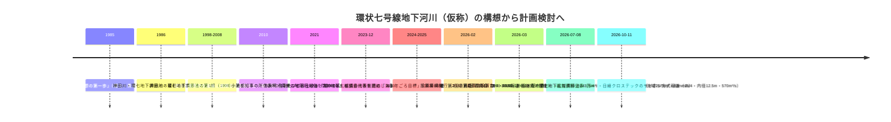

# 2026-11-16（第126回）・環七地下河川計画検討委員会配布資料の本文取得（設置要綱・委員会資料〔第1回〕・第1回議事要旨・委員名簿）と第2回報告資料の建設通信新聞報道（自然流下圧力管方式・5流域267km²・83mm/h）・地下河川構想の1985年起源報道（鈴木俊一所信表明）・潜樋伏下ヶ冊の参照候補化・原画像照合ページの特定

第126回の定期調査記録。第125回の課題（①GOV-291の委員会配布資料の精読〔WAF回避の入手方法の検討〕 ②開札結果の確認〔2026-12-02前なのでまだ〕 ③遠山1905等の原画像照合〔ページ特定まで前進〕 ④潜樋・伏下ヶ冊の参照候補化）に対応し、**①都建設局サイトのWAFをopen_url経由で回避して第1回配布資料本文（設置要綱・委員会資料〔第1回〕・議事次第）・第1回議事要旨・委員名簿を全文取得 ②第2回報告資料（2026-08-04公表）の内容を伝える建設通信新聞報道（2026-08-05）の本文取得 ③テレビ朝日報道（2024-06-21・Wayback）で地下河川構想の1985年起源（鈴木俊一所信表明）と2010年以降の会議録消失・2021年復活を確認 ④東京新聞報道（2025-02-18）で環七地下広域調節池の総事業費1252億円等を確認 ⑤2587366・2587432・2587433（潜樋・伏下ヶ冊）のfulltext内容確認 ⑥遠山1905・武蔵野歴史地理1930・鳥居1924の原画像照合用ページ（jp2番号）の特定**を行い、**GOV-291への大幅追記（新規採番なし）**を登録した。四河川・千川・狹山池に関する新規の文字史料・古地図・学術論文は今回新たに確認できず、既存仮説を直接動かす発見は環七地下河川（神田川の地下分身の広域整備）の計画諸元の具体化にとどまった。

## 今回の登録（採番：なし・GOV-291追記のみ）

| ID | 資料 | 年 | 主な内容 |
| --- | --- | --- | --- |
| [GOV-291](../sources/gov/GOV-291.md)〔**追記**〕 | 東京都建設局「環七地下河川計画検討委員会」配布資料（第1回・設置要綱・委員会資料・議事次第・第1回議事要旨・委員名簿）＋建設通信新聞2026-08-05＋テレビ朝日2024-06-21＋東京新聞2025-02-18 | 2024-2026 | **委員会配布資料の本文を初めて直接確認**: ①設置要綱＝所掌（基本構造・水理・その他）・任期2年以内・原則公開・事務局＝河川部計画課・**施行令和8年2月16日** ②委員会資料（第1回）＝**調節池容量の相互融通機能を拡充（約190万m³）**〔repo初出〕・平面ルート構成（東京湾＋相互融通＋目黒川流域調節池〔仮称〕＋環七地下広域調節池＋白子川地下調節池＋石神井川区間＋環七地下調節池）・「“貯める”から“流す”に進化」・議題計画（第2回＝計画諸元の設定→第3回以降＝放流水理・トンネル立坑水理・効果整理→「地下河川計画（案）」とりまとめ）・有識者ヒアリング（小堀洋美・二瓶泰雄〔東京理科大〕・風呂田利夫〔東邦大名誉教授〕）・**水理模型実験で「全体約30kmを模型で確認」**・東京湾の水質等変化予測調査（別途実施） ③委員名簿6名（朝日ちさと・小堀洋美・知花武佳・土屋十圀・平林由希子・山田正〔委員長〕） ④第1回議事要旨＝上部の土地利用制限・海外類似事例・線状降水帯・模型での形状再現・**神田川・環七地下調節池等の泥の堆積状況を参考にメンテナンスしやすい構造**・**完成後の利用はインフラツアーなど多目的な活用**・放流先周辺の水質変化も・模型実験の現場視察希望 ⑤第2回（プレス2026-06-30＝7/14 15:00〜16:20・冒頭のみ公開）＋**建設通信新聞2026-08-05＝第2回報告資料の要約報道**: **自然流下圧力管方式・最下流区間内径12.5m（仮設定）・5流域約267km²（白子川・石神井川・神田川・目黒川・呑川）〔5河川名初出〕・構成＝環七地下広域調節池13.1km＋目黒川流域調節池（仮称・4.2km・事業中）＋最下流区間12.7km（今後の事業化予定）＝約30km・1時間約83mm対応〔repo初出〕・事例＝川崎市五反田川放水路・土かぶり約35〜50m・ピーク流入量約570m³/s・日本工営（水理模型実験）・エイト日本技術開発（基礎調査）〔repo初出〕** ⑥テレビ朝日2024-06-21＝**1985年鈴木俊一所信表明「環状七号線の青海街道から甲州街道までの地下に約3kmの巨大調節池…将来区部各河川の地下調節池群を連結させ、放水路として利用する地下河川構想の第一歩」〔repo初出〕・1986年神田川・環七地下調節池の最初の都市計画決定・2010年建設局長答弁を最後に会議録から消失・2021年小池都知事所信表明で36年ぶり復活・TOKYO強靭化プロジェクト水害対策費7.1兆円・白子川49万m³・2027年度までにシールド掘削終了予定** ⑦東京新聞2025-02-18＝**環状七号線地下広域調節池の総事業費1252億円・2027年度末使用開始目標**〔repo初出〕・5河川100mm/h・調節池12河川27カ所264万m³運用・2024年都水防本部19回・2025年度当初予算案整備費約550億円 |

**新規採番なし・対照表の変更なし**（GOV-291は既存資料ファイルへの追記のためINDEX.mdの再生成も不要）。手法のメモ：都建設局サイト（kensetsu.metro.tokyo.lg.jp）は直curlに403/WAFで応答するが、**web_searchファopen_url（tools.web_search.open_url）経由ではページ本文テキスト・PDFテキストが取得できる**ことを第126回に確認（第125回まで「WAF・SPAで本文読み取り不可」としていた制限を解消・第1回PDFのURL命名規則は chikakasen-1-shiryo-2-pdf〔委員会資料〕・chikakasen-1-shiryo-1-pdf〔設置要綱〕・chikakasen-1-gijiyoshi1-pdf〔第1回議事要旨〕・chikakasen-1-gijishidai-pdf〔議事次第〕・2nd_iinmeibo〔委員名簿〕・**第2回は命名規則が異なり未特定**）。

## 今回の要点（観察）

1. **「地下河川構想」の原点が1985年の鈴木俊一所信表明にさかのぼることが報道で確認できた**（[GOV-291](../sources/gov/GOV-291.md)追記・テレビ朝日2024-06-21）: 「環状七号線の青海街道から甲州街道までの地下に約3kmの巨大調節池を設置…将来区部各河川の地下調節池群を連結させ、放水路として利用する**地下河川構想の第一歩**」＝**環七地下広域調節池の最初の区間が、当初から「区部各河川の地下調節池群の連結・放水路化」という地下河川構想の一部として構想されていた**ことを示す1985年の一次文言（都議会会議録121件中最古の「地下河川」）。神田川・環七地下調節池の1986年の最初の都市計画決定（第1期1998・第2期2008）はこの構想の実現の第一段階で、**2010年の建設局長答弁以降「地下河川」が都議会会議録から消失した時期（バブル崩壊後の財政再建・三宅島噴火）を挟んで、2021年の小池都知事所信表明で36年ぶりに復活し、2026年の計画検討委員会設置に至る系譜**が報道ベースでつながった。repoの神田川（水窪川・弦巻川・谷端川・千川の幹川）の地下分身の監視記録（第116・121・125回）に、構想の40年の通時が加わった。
2. **計画諸元の具体化（第2回報告資料・建設通信新聞2026-08-05）**: ①方式＝**自然流下圧力管方式**（ポンプ不使用の自然流下・管路内残水は洪水収束後にポンプ排出＝2026-11-04のサイホン方式報道と同一方式の別表記と判断・断定はしない）②対象＝**5流域約267km²＝白子川・石神井川・神田川・目黒川・呑川**（5河川名が初めて全部確定）③構成＝環七地下広域調節池13.1km＋**目黒川流域調節池（仮称・4.2km・事業中）＋最下流区間12.7km（今後の事業化予定）**＝約30km（**最下流区間という新設トンネル区間の存在と延長**〔repo初出〕）④**1時間約83mm対応**（第1回資料の計画降雨の年超過確率1/20対応の具体値か・知花武佳教授の85mm説明との関係は断定しない）⑤最下流内径12.5m＝直上流の目黒川流域調節池と同サイズ・**土かぶり約35〜50m**⑥ピーク流入量約570m³/s（日経クロステック2026-11-04の「最大570m³/s」と整合）⑦**日本工営（水理模型実験）・エイト日本技術開発（基礎調査）**の実施体制。
3. **委員会資料（第1回）の「相互融通（約190万m³）」**: 「調節池容量の**相互融通機能を拡充（約190万m³）**」＝第121回FNN報道の「総容量143万m³の国内最大級」（環七地下広域調節池＋神田川側）と別の、**連結された調節池群の融通可能容量の規模**の文言候補（定義域は本文で完全には確定できないため断定しない）。平面ルート構成の図（東京湾−相互融通−目黒川流域調節池〔仮称〕−環七地下広域調節池−白子川地下調節池−石神井川区間−環七地下調節池）は、第125回の報道ベースの構成（神田川・環七地下調節池の延伸＋複数の地下箱式調節池の連結）を公式資料側で裏付ける。
4. **第1回議事要旨の委員意見とrepoの監視記録の対応**: ①**「運用中の神田川・環状七号線地下調節池等の泥の堆積状況を参考にメンテナンスしやすい構造を検討」**＝運用中の調節池の実務課題（土砂堆積）が新設計画に反映されるべきという委員指摘＝神田川の地下分身の長期運用史の観察datapoint ②**「完成後の利用はインフラツアーなど多目的な活用を検討できる」**＝第123-124回記録の環七インフラツアー（第1期2026-01〜03開催済・第2期2027-01〜02）と直接対応する発言由来候補 ③**水理模型実験で「全体約30kmを模型で確認」**＝全体系統の模型実験の規模の文言〔repo初出〕。
5. **環七地下広域調節池の定量の追加**（東京新聞2025-02-18・テレビ朝日2024-06-21）: **総事業費1252億円・2027年度末使用開始目標**・143万m³（プール約4800杯）・3調節池の事業費計2500億円ほど・**TOKYO強靭化プロジェクトの水害対策費2040年代までに7.1兆円**・白子川地下調節池の台風19号時の9割貯水（49万m³）・2024年の都水防本部設置19回（2023年8回）・調節池12河川27カ所264万m³運用・整備中9・設計中3・2025年度当初予算案整備費約550億円（前年度比1.5倍）＝**神田川流域の調節池整備の財政的・制度的文脈の datapoint 群**（決定版神田川流域河川整備計画〔未公表〕・調節池広域整備検討委託〔開札2026-12-02〕と併せ継続監視）。
6. **潜樋・伏下ヶ冊の参照候補化（第125回課題・fulltext内容確認済み）**: ①2587366（玉川上水留 弘化4年分冊ノ二）＝「**上掛半蔵口御門前段堀内潜樋出枡共御普請**」・「**潜板御持樋**」え仮樋仕付（OCR変種「階樋」「潜極」混在）・仮樋への水移し・10/12水留・西丸への水仕掛・西丸小普請方定式への「**水畠銀**」返書一件＝**江戸城内の潜樋（伏せ越し系の構造用語）の出枡普請の実務** ②2587432（文久3年12月〜元治元年8月分冊ノ一）＝「**清水御屋敷掛樋筋御普請**」落札**一金百九両弐分**・**安政6年神田橋御門内御普請所の古樋の払い下げ材の転用**（「安政六未年神田橋御門内御普請所古樋之内御払可相成分木…相撰相用」）・惣体朽腐・「**吹水いたし…土手下通芝地往還江溢出**」＝**上水樋の材木再利用（払い下げ材の転用）と漏水の実務** ③2587433（分冊ノ二）＝「**清水御屋敷内北之方奥向御泉水掛樋枡伏下ヶ（仕下げ）御修復**」・**一樋長延百拾四間壱尺五寸（大サ内法三寸四方）**・**高枡大サ内法弐尺五寸四方深壱丈弐尺九寸壱ケ所**・埋枡群（内法2尺四方深1尺・2尺5寸四方深7尺〔OCR「源七尺」〕・4尺四方深3尺等）・**弐重蓋・粕土詰上蓋掛埋立**＝**「伏下げ／仕下げ」の修復の定量仕様＝潜樋・埋枡・伏せ越し系構造の実務用例**（[GAZ-035](../sources/gazetteers/GAZ-035.md)の桜木町の万年樋・[GOV-232](../sources/gov/GOV-232.md)/[GOV-233](../sources/gov/GOV-233.md)の石樋・[GOV-238](../sources/gov/GOV-238.md)の対校の将来参照資料・いずれもOCR由来で文言は要原文照合）。
7. **原画像照合用ページの特定（第125回課題①の前進）**: NDL次世代DLの書籍API（lab.ndl.go.jp/dl/api/book/）のindexから、①845983（遠山1905）＝狹山助水ノ水質＝**0022.jp2**（本文p.18）②1178661（武蔵野歴史地理1930）＝第五篇砂川条（惡水堀・元和3年洪水・源五右衞門由緒書上帳）＝**0273.jp2**／第六篇殘堀川条（蛇堀川・箱の池・國分寺西方の崖下）＝**0345〜0346.jp2**③983038（鳥居1924）＝狹山一帶の遺蹟章＝**0018.jp2〜**／殘堀川の多摩川直接合流の観察（立川の普濟寺の西）＝**0021.jp2**・標高列（狹山の池144m→殘堀川中流108m→合流点75m）＝**0022.jp2**＝**次回の原画像照合（GOV-283・GOV-290・BOOK-138・BOOK-142の文言確認）の作業対象がコマ単位で固定された**（判読はAI visionの幻覚リスク〔GOV-101の記録〕があるため人手での確認が原則）。
8. **監視系**: 変化なし（下記陰性記録のとおり・開札2026-12-02・環七インフラツアー第2期〔2027-01-09〜02-28〕・決定版神田川流域河川整備計画〔R5.3版のまま〕は次回以降の継続監視対象）。

## 陰性記録・棚卸し

- **news_search**（谷端川・弦巻川・水窪川 音羽・千川上水・環七地下河川・狹山池助水の6クエリ・2026-11-14以降）＝**全0件**。
- **kanzyou7.com**＝WHAT'S NEW **2026/11/13のまま**変化なし。
- **都建設局（kensetsu）サイト**: 直curl（wget）は403/WAF。**open_url経由で本文取得可を確認**（本回の成果）。第2回配布資料PDFのURLは第1回の命名規則（chikakasen-1-*）を踏襲した推測URL（chikakasen-2-gijishidai-pdf・chikakasen-2-shiryo-1-pdf・chikakasen-2-shiryo-2-pdf・chikakasen-2-gijiyoshi1-pdf・2nd_gijishidai・2nd_shiryo 等計11種）で**すべて404／ページなし**＝命名規則が第1回と異なる・Waybackに2_haifushiryoページのスナップショットなし＝**次回課題**（第2回配布資料ページ〔2_haifushiryo・更新2026-08-04・記事ID 017-001-20260730-015276〕自体は本文確認済み）。
- **決定版「神田川流域河川整備計画」**＝R5.3版のまま未公表。**調節池広域整備検討委託（その２）**＝開札2026-12-02はまだ。**環七インフラツアー第2期**＝新情報なし。
- **官報p.233（PID 2957799・IIIF R0000008）のOCR判読**＝実行環境でapt/pipパッケージ導入が禁止されているため今回も不可（GOV-101に記録のAI vision判読の幻覚問題もあるため人手待ち・IIIFの画像URL特定まで進んでいる）。
- **NDL次世代DL横断検索APIのendpoint**＝search?keyword=等はSPA殻で応答せず、API仕様の特定は次回も継続課題（fulltext取得API〔lab.ndl.go.jp/dl/api/book/<id>〕は今回も正常動作）。
- **jmapps GOV-152・ADEAC通史編2・PAP-079**＝画像判読・本文アクセス不可で継続。
- **四河川の最近のweb検索**（谷端川・弦巻川・水窪川 音羽・千川上水・2026-11以降）＝ノイズのみで新情報なし。

## 経緯のMermaid年次チェーン（環七地下河川の通時）

## 次回課題

1. **第2回配布資料・第2回議事要旨のPDFのURL特定と本文取得**（2_haifushiryoページのリンクの入手方法：Waybackの新規スナップショット待ち・ブラウザ経由のHTML取得・記事件名からの推測の継続）＝第2回報告資料の本文直接確認（建設通信新聞報道ベースからの格上げ）。
2. **遠山1905・武蔵野歴史地理1930・鳥居1924の原画像照合**（特定済みページ: 845983=0022.jp2・1178661=0273.jp2・0345-0346.jp2・983038=0018-0022.jp2・文言の原文確認・AI visionの幻覚リスクのため人手確認が原則）。
3. **調節池広域整備検討委託（その２）の開札結果の確認（2026-12-02以降）**・第3回委員会（放流に関する水理検討）・水理模型実験（日本工営）・基礎調査（エイト日本技術開発）の進捗監視。
4. **2587340の矢来木戸門文言の原画像照合**（水道橋・神田川揚場の比定）・**2587423の広書の原画像照合**（20か村リストの欠落2村）・**白堀系の原画像照合**（余垂板/余乗板428対378・「白泥/白堀」・荒ヶ谷/承ヶ谷）。
5. 継続監視（決定版神田川流域計画〔未公表〕・kanzyou7.com〔2026/11/13のまま〕・環七インフラツアー第2期〔2027-01-09〜02-28〕・官報p.233判読・GOV-144くずし字・jmapps GOV-152棚卸し・岩瀬文庫DZI読図・ADEAC通史編2・PAP-079本文・海老床絵地図実物・千川家橋数対立の原文照合・GAZ-050絵図本体読図・かくれ閭第1冊の原画像確認・MAP-176滝野川村絵図の読図・蟹川文言の原文照合）。
