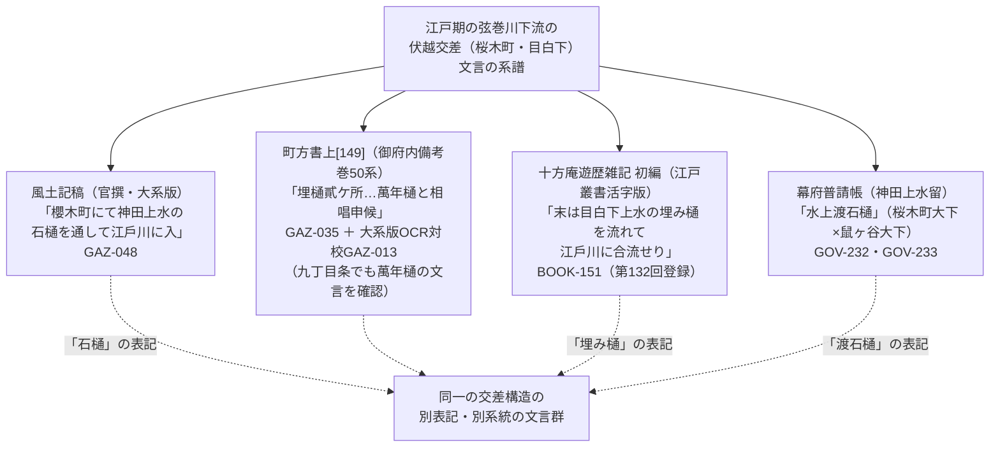

# 2026-11-16（第132回）・廃止年月・千川出銀・大系版対校・名所図会・遊歴雑記初編四編の追加調査

## 概要

第132回。NDL次世代デジタルライブラリーの横断検索・fulltext精読を中心に、千川上水（神田上水を含む）の近代の行政史料と、音羽谷・弦巻川周辺の江戸期地誌の新出文言を調査した。新規資料ファイル10件（GOV-306〜309・GAZ-058〜060・BOOK-151〜153）＋既存ファイルの更新2件（GAZ-013・GAZ-047）＋対照表・橋名調査ドキュメントの追記。

## 調査経緯

1. NDL次世代DL API（`https://lab.ndl.go.jp/dl/api/book/search?keyword=<URLエンコード>&searchfield=contentonly&size=500`）で千川上水・弦巻川・谷端川等の横断検索。応答は`{"facets":..,"list":[..]}`形式。
2. 候補18冊のfulltext（`/dl/api/book/fulltext/<id>`）を取得し精読。うち12冊は環境リセットで失われたが6冊分を再取得、本実行で再び18冊分を確保してから文言の再確認・資料化を行った。
3. 大きな方針修正: 当初『大日本地誌大系』第3巻（1214872）を新規GAZ登録候補と考えていたが、**同書は既に[GAZ-013](../sources/gazetteers/GAZ-013.md)として登録済み**だったことが判明。新規ファイルの作成を取りやめ、同書の次世代DL OCR全文による対校追記（第132回追記）として整理した。1資料1ファイル規則の遵守。

## 新情報（採用・登録分）

### 千川上水・神田上水の近代行政史料

- **[GOV-306](../sources/gov/GOV-306.md)『東京水道の沿革』（1896）**: 「現時給水する所の水道三條＝神田・玉川・千川」＝1896年時点の千川上水現役給水の明言。千川上水の樋管3,707間・井数1,129。「多摩郡**仙石村**農徳兵衛、太兵衛」＝仙川村系文言と対立する表記変種（原字照合まで断定しない）。神田上水の1896年流路（関口大洗堰→目白台下→砲兵工廠内→樋管で神田川を横断→神田・日本橋）。
- **[GOV-307](../sources/gov/GOV-307.md)『東京市水道小誌』（1911）**: **神田上水の飲用廃止＝明治34年（1901）6月**（以後は沿岸の水車業と東京砲兵工廠に供給のみ）、**千川上水の廃止＝明治40年（1907）6月・岩崎久彌の所有化と同時**という年月日の市側公式記録。GOV-290（1905現役）とBOOK-140（明治40所有化）の間を埋める決定的な基準点。六派（玉川・神田・千川・三田・青山・亀有）の総説も。
- **[GOV-308](../sources/gov/GOV-308.md)『衛生試驗彙報』第3號（1888）**: 「千川上水ハ近年ノ創設ニ係リ亦木樋ヲ用ヒテ小石川區巢鴨ヨリ本〓下谷ノ兩區ニ派流スト雖其供用尚タタラス」＝1888年時点の千川上水の給水経路・設備（木樋）・供用状況の一次文言。明治17年4月〜18年3月の千川上水分析表（極口他2ヶ所・2回）の立項（数値は列崩れで未採録）。
- **[GOV-309](../sources/gov/GOV-309.md)『町会所一件書留』寛政6年上（写）**: 湯島三組町の町入用・七分積金の書出に「**千川上水出銀**」が負担項目として現れる＝千川上水の受益町（湯島側）の実務帳簿の一次記録。千川上水水銭分（年額九両十匁余）が寛政4年（1792）3月に引除。天明6年差止後の寛政期に「出銀」が町の帳簿に残る点の解釈は断定しない。
- **[BOOK-153](../sources/books/BOOK-153.md)『遠足の栞』（1919）**: 千川用水堤の桜「新小金井」の1919年用例。保谷村の境橋分岐・「仙川の人」起源説。板橋町「南には千川上水、北には石神井川」＝1919年時点の千川上水現役の傍証。

### 音羽谷・弦巻川の江戸期地誌

- **[GAZ-058](../sources/gazetteers/GAZ-058.md)『江戸名所図会』有朋堂版（1927）**: 法明寺条「水源は**池谷〔イケヤド〕**の邊に發し、下流は**〓土（清土）**の邊へ出て、音羽町の西の方を歷て、江戶川に會せり」＝[GAZ-047](../sources/gazetteers/GAZ-047.md)（1893覆刻版・OCR崩れ「源ハ弛谷ノ辺」「下流ハ清主ノ辺」）の判読が前進。布引川の異名文言も。
- **[BOOK-151](../sources/books/BOOK-151.md)『十方庵遊歴雑記』初編（江戸叢書1916）**: 音羽の瀧の造営年代（**文化初年**）・規模（幅6尺・高さ5尺余）・人工性。**「末は目白下上水の埋み樋を流れて江戶川に合流せり」＝伏越交差の第4系統文言**。南畝「玉水簾」命名。潭弦亭（長田右兵衛督抱屋敷・音羽の瀧の北四丁・清土町北側）と南畝の詠歌（BLOG-185の魯山人句説との対校課題）。
- **[BOOK-152](../sources/books/BOOK-152.md)『十方庵遊歴雑記』四編‖江戸雀 後編（江戸叢書1916）**: 「上は池袋村の池上より湧出し…**金が窪村**より**御鷹部屋**の東を流るゝ小溝の水双方、**護國寺角西門前石橋下にて合流**し、弦卷川と成て…**觀世音に因み町名を所緣に、音羽の瀧とは作りしもの也**」＝音羽の瀧の人工性・観音由来説の江戸期文言＋金ヶ窪村・御鷹部屋の新地名＋護国寺角西門前石橋下の合流点。
- **[GAZ-059](../sources/gazetteers/GAZ-059.md)『新撰名勝地誌』（1914）**: 「弦巻川は關口臺と小日向臺との間に流れたり」＝[GAZ-029](../sources/gazetteers/GAZ-029.md)（1925）の11年先行の同型文言。1914年現勢。
- **[GAZ-060](../sources/gazetteers/GAZ-060.md)『東都新繁昌記』（1918）**: 「小石川は源を北豊島郡長崎村に發し、**田柄川・羽田川の小溝を合せて**巢鴨村に入りて**谷端川と云ひ**…砲兵工廠に入り、後樂園の池水と合し、水道橋の西に出で、神田川に注ぐ、**長さ二里三十二丁**」＝1918年の谷端川流路現勢＋**羽田川**（支川名として資料ファイルではrepo初出）。

### 既存ファイルの更新

- **[GAZ-013](../sources/gazetteers/GAZ-013.md)（御府内備考巻50・大系版）**: 次世代DL OCR全文の対校追記。①東青柳町条の地震橋の全文文言＝**里俗は芋洗橋**・寛政9年11月石橋化・以前は土橋（[GAZ-035](../sources/gazetteers/GAZ-035.md)の判読不能部分の前進）。②音羽町九丁目条＝神田御上水堀（承応2年御堀割）・駒止橋・九丁目橋・**萬年樋**。③音羽町五丁目条＝壱貫橋・鼠坂（[GAZ-035](../sources/gazetteers/GAZ-035.md)と対校一致）。④西青柳町条＝松屋橋（駒寄は護国寺掛）。⑤**関口之一（巻48）＝関口の地名由来（宿坂の関／「堰を仮借して関と書く」の2説）と駒止橋の橋名由来（丸木橋→板橋・駒込馬市の白馬・「目白はめ白」）**。⑥**関口之二（巻49）＝御水屋敷（御水奉行大田新左衛門屋敷・里俗水屋舗・大田稲荷）**。
- **[GAZ-047](../sources/gazetteers/GAZ-047.md)（江戸名所図会1893覆刻版）**: GAZ-058対校による判読前進の追記。
- **対照表**: 芋洗橋（地震橋の里俗・一次文言候補）・金が窪村・御鷹部屋・関口（地名由来2説）の新行＋千貫橋・池ヶ谷行の追記。
- **[四河川の橋名・橋跡調査](四河川の橋名・橋跡調査.md)**: 第132回追補（地震橋＝芋洗橋文言候補・駒止橋由来・松屋橋の駒寄・壱貫橋対校・萬年樋・護国寺角西門前石橋・音羽の瀧の造営）＋水窪川節の芋洗橋注記の更新。

## 弦巻川の伏越交差文言の4系統の系譜（Mermaid）

## 見送り・陰性（ノートのみの記録）

- **1150320『東京都史蹟名勝天然紀念物 旧市域内』（1943）**: 庚申塚条に「千川上水阯…元祿九年…明和六年再起…天明六年遂に」の記述があるがOCRが著しく崩れており、既出の元禄9年・明和6年・天明6年の公式に対する新しい情報はないため登録見送り。
- **764121東京市史稿皇城篇第五**: 「巻石蓋」は皇居内の石樋で四河川対象外（第131回からの BOOK-147明治10年巻石蓋原典特定の謎は未解決のまま）。
- **1051345大日本地誌大系（1934年版）**: GAZ-048=1214832と同文。小平村字水窪は別地名。
- **1463284東京都市計画概要（1939）**・**1073832土木局統計年報（1938）**: 谷端川関係の表は列崩れで採録不可。
- **1460041江戸の生活（1941）**: 江戸惣鹿子の二次引用（BOOK-151の対校として言及価値のみ）。
- **889104小品十種（1908）**: 七碗歌の「音羽の弦卷川」名水言及（既出の同系列の補強にとどまる）。
- **900924東京名物志（1901）**: 神田上水廃撤の薄い言及。
- **952980内の江戸雀本文**: 弦巻川の直接言及はなし（音羽の瀧条は十方庵側の文言）。
- 「毒橋」「田替橋」「駒振橋」「花水橋」「巻石蓋」「素樋」「戸山落」「秣川」「蟹川」「清水川」「洗堰」の横断再検索は新情報なし。

## 監視系の結果（変化なし）

- **news_search**（谷端川・弦巻川・千川上水・水窪川）: 直近1週間の該当ニュースなし。
- **kanzyou7.com WHAT'S NEW**: 2026/11/13の週間工程表・シールド進捗図更新のみ（石神井川区間の常规更新。新情報なし）。
- **東京都建設局・神田川流域ページ**: 従来どおり（神田川・環状七号線地下調節池等の記述。決定版計画の更新なし。末尾スラッシュなしのURL `https://www.kensetsu.metro.tokyo.lg.jp/river/seibi/kanda` で開ける）。
- 環状七号線地下調節池広域整備検討（その2）開札: 2026-12-02予定（まだ先）。環七委員会第2回配布資料PDF: Wayback待ち。

## 次回課題

1. GOV-308の分析表の原画像での表起こし（千川上水の水質数値の採録）。
2. BOOK-151の南畝の歌とBLOG-185の魯山人句説の対校（原典照合）。音羽の瀧の造営年代の「文化初年」（BOOK-151）と「文化13年5月」（GAZ-035）の整理。
3. 「護國寺角西門前石橋」の比定（地図・地籍との照合）。「金ヶ窪村」「御鷹部屋」の位置の特定。
4. 神田上水の明治34年6月断絶の前後の給水実態（GOV-306の1896流路とGOV-307の1901断絶の間の資料）。
5. 第131回からの継承: 省令12号官報p.413原画像照合・帝都復興史130万対立・遠山1905/武蔵野歴史地理1930/鳥居1924のjp2照合（845983=0022.jp2・1178661=0273/0345-0346.jp2・983038=0018-0022.jp2）・蟹川の同名異川問題・BOOK-147明治10年巻石蓋の原典特定・決定版神田川流域計画の公表監視・kanzyou7週次。

## 手法メモ

- 1MB級1行テキストへの `.{0,600}` 型正規表現grepは環境ごと落ちる。文脈抽出は必ず `ctx.py`（素朴なfindベース）を使うこと。本実行中に環境リセットが一度発生し、ft/のfulltext 18冊分を再取得した。
- NDL次世代DL API: 検索=`/dl/api/book/search?keyword=<URLエンコード>&searchfield=contentonly&size=500`（応答`{"facets":..,"list":[..]}`）、fulltext=`/dl/api/book/fulltext/<id>`（ZIP内`<id>.txt`）、書誌=`/dl/api/book/<id>`。
- 採番現況（第132回終了時）: **GOV-309・GAZ-060・BOOK-153・MAP-176・BLOG-246・PAP-082・ORG-033・LOST-005 が使用済み最大**。次は GOV-310・GAZ-061・BOOK-154・MAP-177・BLOG-247・PAP-083・ORG-034・LOST-006 から（push直前に要再確認）。
