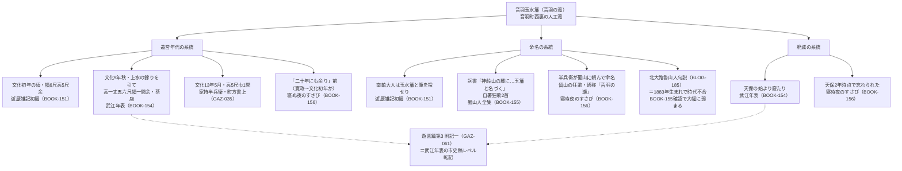

# 2026-11-16（第133回）・玉水簾四史料・命名由来譚・吹上御鷹部屋の追加調査

## 概要

第133回。NDL次世代デジタルライブラリー横断検索・fulltext精読を中心に、音羽玉水簾（音羽の滝）の江戸期史料を深掘りし、**造営年代・給水源（上水の余り引水）・廃滅時期・命名の由来譚**を含む4史料（BOOK-154〜156・GAZ-061）を新規登録した。あわせて第132回課題の金ヶ窪・御鷹部屋の対照資料として玉川上水留の四谷代官町「吹上御鷹部屋」帳簿（GOV-310）を登録し、明治35年便覧の「金ヶ窪」が山梨県下吉田村の小字であることを陰性確定した。新規4件＋既存追記5ファイル（BOOK-151・BLOG-185・GAZ-035・GAZ-056・対照表）。

## 調査経緯

1. 第132回の音羽の瀧（BOOK-151/152）・玉簾（GAZ-035）の流れを受けて、玉水簾・音羽の滝系の横断検索（`/dl/api/book/search?keyword=<URLエンコード>&searchfield=contentonly&size=100`）で武江年表・蜀山人全集・寝ぬ夜のすさび・遊園篇第3を発見。
2. 各fulltext（`/dl/api/book/fulltext/<id>`）を取得して文言を検証。武江年表（BOOK-154）は原本1849年版OCRの崩れが大きく、江戸叢書巻の十二の活字版（1913086）で対校して文言を整形。
3. 金ヶ窪・御鷹部屋（第132回課題③）の追加角度として郵便区画町村便覧明治35（762998）と玉川上水留（2587360/2587361）を確認。
4. 「神田上水」「音羽谷」のcontentonly横断で陰性確定（下記）。

## 新情報（採用・登録分）

### 音羽玉水簾（音羽の滝）の4史料

- **[BOOK-154](../sources/books/BOOK-154.md)『武江年表』巻之七（1849・須原屋伊八ほか・lab 2563436）**: 文化9年（1812）秋「**音羽町二丁目三丁目あたりの西の裏手に、上水の餘りを引て瀧を拵へ、玉水簾と號す**」（高一丈五六尺・幅一間余・道左右山・四時の花木・茶店・往来人の休み所）＋「**天保の始より廢たり**」＋狂歌2首（蜀山人・縣麿）。**「上水の余り引水」＝神田上水からの分水による人工滝という水文的新文言**。造営年代の独立系統（文化9年秋）。
- **[GAZ-061](../sources/gazetteers/GAZ-061.md)『東京市史稿 遊園篇 第3』（1929・lab 1915739）**: 「**附記一 音羽玉水簾**」の独立節＝武江年表の転記（市史稿レベルで同系統が採用された記録の広がり）。GAZ-056の隣接巻。
- **[BOOK-155](../sources/books/BOOK-155.md)『蜀山人全集』巻2（1908・lab 993337）**: 「千とせの門」中の南畝自署作品2首＝①狂歌「音羽町玉水簾に養老の瀧の…」②**詞書「神齡山の麓に音羽町瀧あり玉簾と名づく」**付き「深山より…」（武江年表版は末句「水無月の空」、全集版は「水無月の雪」の異同）。**BOOK-151の南畝命名説を一次資料レベルで強化**。BLOG-185の北大路魯山人命名句説（1883年生まれ・時代不合）を大幅に弱める。「神齡山」の山名はrepo初出。
- **[BOOK-156](../sources/books/BOOK-156.md)『寝ぬ夜のすさび』下（天保2年1831写・lab 11607891）**: **命名由来譚**＝音羽3丁目の道具屋半兵衛裏の山の下の流の滝に、留山が矢立の墨で狂歌「深山より…」を木に書き、半兵衛が彫りつけ茶店等をこしらえ評判に、**蜀山に頼んで「玉水簾」と命名**、通称「**音羽の瀬**」（repo初出の呼称）、天保2年時点で「二十年にも余り」忘れられた。半兵衛（GAZ-035の「家持半兵衛」と同人か・要照合）・留山・命名の主導（依頼者側）＝いずれもrepo初出。著者（蜀山）・「田家大人」比定は未解決と明記。

### 御鷹部屋・金ヶ窪（第132回課題③）

- **[GOV-310](../sources/gov/GOV-310.md)『玉川上水留』[26][27]（弘化2年・lab 2587360/2587361）**: 冊名「玉川上水代官町通**吹上御鷹部屋**掛其外共樋枡御普請一件」＝**四谷代官町の別の御鷹部屋**への玉川上水給水樋の帳簿（工費389両2分・弘化2年7月26日〜11月11日・104日）。「御鷹部屋」が一般名詞であることの対照資料（GAZ-048⑭の雑司ヶ谷御鷹部屋と混同しない注意書きつき）。
- **金ヶ窪の陰性確定**: 明治35年刊『郵便区画町村便覧』（lab 762998）の「金ヶ窪」は**山梨県下吉田村の小字**（false positive・対照表の金ヶ窪行に追記）。

### 既存ファイルの更新

- **[BOOK-151](../sources/books/BOOK-151.md)**: ⑤南畝命名説の一次資料対校（BOOK-154/155/156・年代対立の併記・魯山人説の弱化）を追記。
- **[BLOG-185](../sources/blogs/BLOG-185.md)**: 魯山人句の作者帰属が年代からみて成立しにくい旨（潭弦亭位置情報の価値は不変）を追記。
- **[GAZ-035](../sources/gazetteers/GAZ-035.md)**: 小滝（玉簾）条に武江年表「文化9年秋」対立の追記＋関連リンク整備。
- **[GAZ-056](../sources/gazetteers/GAZ-056.md)**: 隣接巻1915739＝GAZ-061（附記一音羽玉水簾）の追記。
- **対照表**: 「音羽の瀬／玉水簾」行の新設（造営・命名・廃滅・位置の5史料併記）＋御鷹部屋行への四谷代官町の別用例注意＋金ヶ窪行への明治35便覧false positive注意。

## 玉水簾の造営・命名・廃滅の情報系譜（Mermaid）

## 見送り・陰性（ノートのみの記録）

- **「神田上水」contentonly横断（100件）**: 神田上水留・神田玉川上水留シリーズは第113〜124回で棚卸し済み。白堀帳簿2587468（弘化3[13]）・2587492（文久2[37]）の「桜木町大下渡石樋」「鼠ヶ谷大下」「承ヶ谷」等は**GOV-232/233に第114回で完全登録済み**。神田上水廃止（明治34・GOV-307）前後の新行政資料は出ず。
- **「音羽谷」contentonly横断（77件）**: 鶯宿雑記（10303658）・連城叢書（2533400）の「音羽谷」は京都・近江・尾張文脈（false positive）。江都古墳志（2568632）の「音羽谷中」塚分布帯は第118回で見送り済み。
- **874715『正調新案和歌作法指南』（1892）**: 「つるまき川」狂歌の用例。登録は低いと判断（ノート記録のみ）。
- **1912982『江戸叢書』巻3**: BOOK-151と同一テキスト（重複登録回避）。
- **2605169武江年表別版（1850刊）**: fulltext取得不能（0バイト）。1849年刊版で足りると判断。

## 監視系の結果（変化なし）

- **news_search** 6クエリ（谷端川・弦巻川・水窪川・千川上水・環七地下河川・神田川流域計画、2026-11-02〜16）: 全0件。
- **kanzyou7.com WHAT'S NEW**: トップ=2026/11/11「現場見学会10月分終了」（目立った変化なし）。
- **東京都建設局・神田川流域ページ**: 更新なし・決定版神田川流域計画は未公表のまま。
- 環状七号線地下調節池広域整備検討（その2）開札: 2026-12-02予定（まだ先）。

## 次回課題

1. 玉水簾の位置の対校: 「音羽2-3丁目西裏手」（BOOK-154）vs「1丁目西横丁崖下」（BOOK-151）vs「3丁目半兵衛裏」（BOOK-156/GAZ-035）の整理（潭弦亭・音羽富士前説との対応含む）。
2. 「田家大人」の比定（BOOK-156の筆記者・南畝の別号か）。「留山」の人物比定。「神齡山」の比定・他史料用例。
3. 江戸叢書巻の十二の武江年表全条走査（音羽・弦巻・雑司ヶ谷関連の他条の拾い上げ）。
4. 「上水の餘りを引て」の引水経路の探索（神田上水側の樋・枡の帳簿群の再調査）。
5. 神田上水廃止（明治34・GOV-307）前後の別角度（水車業・砲兵工廠供給の実務史料）。
6. 874715『正調新案和歌作法指南』の「つるまき川」狂歌の詳細確認。
7. 継承監視: 決定版神田川流域計画の公表・kanzyou7週次・環七委員会資料。

## 手法メモ

- 武江年表原本（1849刊）のOCR崩れは江戸叢書活字版（1913086）で対校して整形できる（「瀧をこゝきよくすゐれんらへ」→「瀧を拵へ玉水簾と號す」等）。**OCR由来の引用は「文言は要原文照合」を必ず明記**。
- 蜀山人全集の歌の末句異同（「水無月の雪」vs「水無月の空」）は版本系統の問題として対照表・BOOK-155に併記（原形は未解決）。
- 採番現況（第133回終了時）: **GOV-310・GAZ-061・BOOK-156 が使用済み最大**（MAP-176・BLOG-246・PAP-082・ORG-033・LOST-005は不変）。次は **GOV-311・GAZ-062・BOOK-157・MAP-177・BLOG-247・PAP-083・ORG-034・LOST-006** から（push直前に要再確認）。
