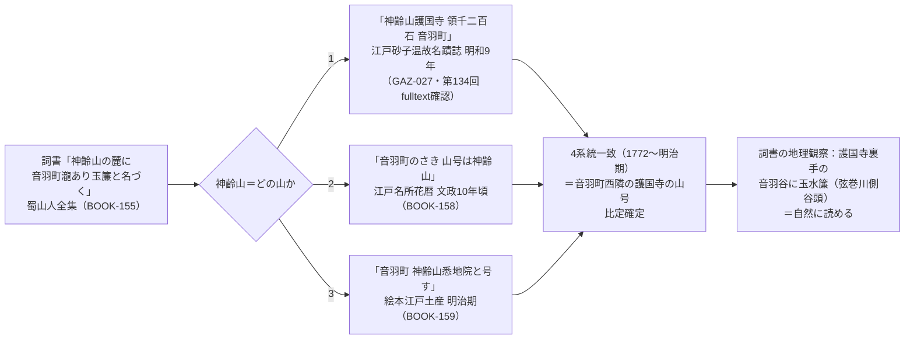
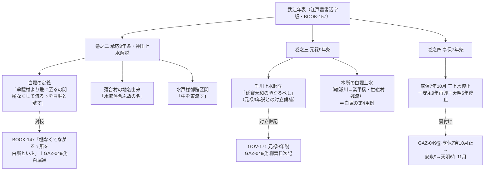

# 2026-11-16（第134回）・武江年表全条走査・白堀の定義・千川起立延宝天和説・神齢山比定・清土出現地の追加調査

## 概要

第134回。前回（第133回）の対校に使用した江戸叢書巻の十二（1917・lab 1913086）の**武江年表全巻活字版の四河川関連全条を体系的に走査**し、BOOK-157として一挙登録した。あわせてfulltext横断で拾った江戸名所花暦（2537156）・絵本江戸土産（8369309）・正調新案和歌作法指南（874715）を精読・登録し、**第133回課題②（BOOK-155詞書「神齡山」の比定）を4系統一致で解決**、**白堀の定義文言（樋なくして流るゝを白堀と號す）と千川上水起立の「延寳天和の頃なるべし」説（元禄9年説との新対立候補）をrepo初出級の文言として**記録した。新規4件（BOOK-157〜160）＋既存追記4ファイル（GAZ-027・BOOK-154・BOOK-155・対照表）＋橋名調査追補。

## 調査経緯

1. 第133回のBOOK-154（武江年表巻之七・玉水簾条）の対校に使った江戸叢書巻の十二のfulltext（1913086）を**巻之二〜巻の八の全条走査**し、四河川関連文言をgrep（上水・白堀・千川・江戸川・音羽・雑司・巣鴨・小石川・神田・橋・出水・出火等の多数語）で拾い出し、文言を文脈込みで検証。
2. 同fulltext横断の過程で拾った江戸名所花暦（2537156・表紙文言「江戸名所花曆 共三 夏巻二」で書誌確定・岡山鳥著・長谷川雪旦画・文政10年頃刊）の護国寺条・蛍の条を精読。
3. 第118回で見送った絵本江戸土産（8369309）の雑司ヶ谷条に「清土」の出現地文言があることを再確認し格上げ登録。第133回ノートで見送った正調新案和歌作法指南（874715）の弦巻川和歌2首も作者・文言を検証のうえ格上げ登録。
4. 神齡山（BOOK-155詞書）の比定: 2565900（江戸砂子・GAZ-027）の「神齢山護国寺領千二百石音羽町」＋2537156「山号は神齢山」＋8369309「神齢山悉地院と号す」の3系統で比定を確定。

## 新情報（採用・登録分）

### 武江年表（江戸叢書巻の十二活字版）の全条走査＝BOOK-157

- **[BOOK-157](../sources/books/BOOK-157.md)『江戸叢書 巻の十二』（1917・lab 1913086）**: 斎藤幸成（月岑）輯『武江年表』の全巻活字版（巻之二〜八）の四河川関連全16条を初の体系的走査で登録。主な文言:
  - **巻之二・承応3年条**: 神田上水解説＝**白堀の定義「すべて牟禮村より爰に至るの間樋なくして流るゝを白堀と號す」**（樋なし開渠の呼称＝repo初出級・BOOK-147の「樋なくてながるゝ所を白堀といふ」と江戸期年代記レベルで一致）＋**落合村の地名由来「水流落合ふ故の名」**＋水戸様御館区間の「東流す」観察＋両上水前は赤坂溜池用水＋芭蕉再修奉行説（俳家奇人談引用）。
  - **巻之三・元禄9年条**: **千川上水起立「延寳天和の頃なるべし」説**（元禄9年説〔GOV-171・GAZ-049⑫・柳營日次記〕と対立する新しい候補・帰属の解釈は断定せず）＋**本所側の「白堀上水」**（綾瀨川→業平橋・世繼村の残流）＝白堀の第4の別地用例。
  - **巻之四・享保7年10月条**: 千川・青山・三田上水一斉停止＋安永9年再興＋天明6年停止の**通史（GAZ-049⑫の停止→再興→停止の全過程を年代記が裏付け）**。
  - **享保8年条**: **音羽町九丁目靑柳町家作取払と売女の発生「音羽のくつわ虫」**（音羽岡場所〔BOOK-009〕の起源の年代記＝repo初出級。享保8年取締〔BOOK-009〕と同年で発生→取締の前後関係は断定せず）。
  - **寛延2年8月13日大水**: 高田関口家流失・江戸川通り橋々押流し・神田上水掛樋流失・昌平橋筋違橋流失＝**GOV-241（帳簿側）の対側の被害全体像**。
  - **天明6年7月12日大水**: 江戸川橋流失・**神田上水掛樋が危うく人夫防衛（樋の上1尺の水）・目白下山崩れで上水樋潰れ・水道1ヶ月余断絶**・雑司ヶ谷大水＝神田上水の最大級被災の年代記記録（repo初出の文言群）。
  - **安政2年地震**: 立慶橋手前・江戸川続き武家地・上水端（白堀端）の焼亡。
  - **巻之一**: **平川＝江戸川流路考証**（龍慶橋→水道橋→魚板橋→一ツ橋→常盤橋）＋正保年中江戸図写本・寛文遠近道印図（**郊外加載「雑司谷」の始まり**）。
  - **雑司ヶ谷鬼子母神**: **元禄初めに参詣群集が始まり伊勢屋式兵衛が社を再建**（参詣の起源の年代記記録＝repo初出級）＋延宝5年霊験譚＋延享期流行物（会式飾物・百度参・風車）。

### 江戸名所花暦（江戸遊覧花暦）＝BOOK-158

- **[BOOK-158](../sources/books/BOOK-158.md)『江戸名所花暦』（別称・江戸遊覧花暦・岡山鳥著・長谷川雪旦画・文政10年〔1827〕頃刊・lab 2537156）**: 夏之部巻2等の合集。
  - **音羽九丁目橋の丁目体系の由来**: 「**音羽町は護固寺門前の方を一丁目と定む故に順を追ひて目白のした神田上水へ懸りたるはしは九丁目の橋といふ**」＝**九丁目橋の橋名の成り立ちの明文（repo初出）**＝護国寺門前から神田上水まで町並みが続く観察としても読める。
  - **護国寺条**: 「山号は神齢山」・本尊馬脳石如意輪観音・**元御薬園（建立時に白山へ移す）**・猿はしら。
  - **蛍の条**: 谷中三崎宗林寺の地の「**蛍川**」＋「**落合すかたみ橋より三丁…上水川と雑司谷の細流との間なり**」（神田上水と弦巻川の並行区間の蛍の生息地の観察）＋一枚岩の口碑＋「小日向龍慶橋の川」。

### 絵本江戸土産＝BOOK-159（第118回見送りからの格上げ）

- **[BOOK-159](../sources/books/BOOK-159.md)『絵本江戸土産』（菊池純編・明治期・lab 8369309・第四編）**:
  - **清土＝鬼子母神出現地**: 「**この神出現の地は護国寺より神にあたり清土といへる所の義に小さき程ありて始めその処に死れりとぞ**」＝清土の地名と出現地伝承の結びの明治期文言（第128回対照表の清土行の裏付け・文言はOCR崩れで要照合）。
  - **護国寺**: 「**音羽町 神齢山悉地院と号す 新義真言の大梵刹なり**」＝神齢山系統の第3系統。
  - **姿見橋の名称由来**: 「**むかしこの橋の左右に池あり其永淀みて流れず故に行人この橋にて姿を模し見たるよりの名也**」＝**橋名の語源説明の明文（repo初出級）**＝BOOK-158のすかたみ橋と対校可。
  - **巣鴨〜板橋間の庚申塚**: 左右に茶店・草原の広原で月雪に絶景＝明治期の土地利用史の基準点。

### 正調新案和歌作法指南＝BOOK-160（第133回見送りからの格上げ）

- **[BOOK-160](../sources/books/BOOK-160.md)（笹村良昌著・頴才新誌社・明治25年〔1892〕・lab 874715）**: 附錄「詠歌の名に付て武藏名所」に弦巻川を詠んだ和歌2首＝「**梓弓つるまき川の本末をさやにてらして飛ほたるかな**」＋「**もの〓ふの腰に付ゑる弦卷い里の名にのみ殘りける哉**」＝**明治期の歌題としての弦巻川（蛍・地名由来の意識「名にのみ残る」）の残存例**（雑司ヶ谷八景絃卷川螢の系統。実景か因襲かは断定せず）。

### 既存ファイルの更新

- **[GAZ-027](../sources/gazetteers/GAZ-027.md)**（江戸砂子温故名蹟誌）: 2565900のfulltextから**護国寺条（神齢山護国寺領千二百石音羽町・馬脳石如意輪観音・元御薬園→白山移転・本尊伝来譚）**を追記。神齢山比定の系統①となった。
- **[BOOK-155](../sources/books/BOOK-155.md)**（蜀山人全集）: **詞書の「神齡山」＝護国寺の山号「神齢山」と比定確定**（第133回課題②の解決・4系統一致の根拠を明記）。
- **[BOOK-154](../sources/books/BOOK-154.md)**（武江年表巻之七）: 対校活字版の全条走査の完成（BOOK-157化）と関連文言（白堀の定義・水戸様御館「東流」・三上水消長）を追記。
- **[対照表](地名・河川名対照表.md)**: ①**神齢山／神齡山**行（4系統一致・比定確定）・②**白堀上水（本所・業平橋筋）**行（白堀の第4の別地用例）・③**平川**行（江戸川流路考証）・④**蛍川（谷中三崎・宗林寺）**行（別地点の蛍の名所）・⑤**つるまき川／弦卷い里**行（明治25年の和歌の表記）の新設＋清土行（BOOK-159の裏付け）・音羽の瀬行（神齡山比定確定）の追記。
- **[橋名調査](四河川の橋名・橋跡調査.md)**: 第134回追補＝**九丁目橋の丁目体系の由来**・**寛延2年/天明6年の橋流失群**（GOV-241の対側）・安政2年の江戸川・立慶橋被災・延宝8年江戸川浚・龍慶橋の流路考証文言・**姿見橋の名称由来**。

## 神齢山＝護国寺の山号の比定（第133回課題②の解決・Mermaid）

## 武江年表の白堀・千川文言の構造（Mermaid）

## 見送り・陰性（ノートのみの記録）

- **江戸名所花暦の書誌**: 前セッションで「江戸遊覧花暦・寛政期」と仮置きしていた書誌を、表紙「江戸名所花暦 共三 夏巻二」＋柱「江戸遊覧花暦巻之二 江戸岡山鳥編輯」で**『江戸名所花暦』（別称・江戸遊覧花暦・文政10年頃刊）に訂正**（日本歴史地名大系の書誌と一致。NDL本の版年〔文政原版か天保6年/8年版か〕は留保）。
- **武江年表の同一文言2回出現**: 1913086のfulltextに同一文言が2回現れる箇所（本編と補注・巻末重複か）の構造の精査は未了（BOOK-157制限⑧）。
- **「石神の池」の比定**（BOOK-157千川条）: 石神井川上流側かは未照合（断定せず）。
- **本所白堀上水の流路比定**（本庄・横川・世繼村）: 江戸図との対校が未了。
- **「田家大人」「留山」の比定**（BOOK-156の課題）: 今回も手掛かりなし。田家大人＝大田南畝候補のまま。

## 監視系の結果（変化なし）

- **news_search** 6クエリ（谷端川・弦巻川・水窪川・千川上水・神田川河川整備計画・環七地下河川調節池・直近14日）: **全0件**。
- **kanzyou7.com WHAT'S NEW**: 最新=**2026/11/13「週間工程表、シールド進捗図を更新」のまま**（前回と変化なし）。
- **東京都建設局・神田川流域ページ・河川整備計画について**: 「河川整備計画について」ページは**2026年11月9日に更新**されているが、**神田川流域河川整備計画の決定版はR5.3版のまま**（2026年4月パブコレ終了後の変更版公表はまだ）。
- **環七地下河川計画検討委員会**: 第1回（2026年3月4日）・第2回（2026年6月30日）までの掲載のまま（第3回の情報なし）。
- **調節池広域整備検討委託（その2）の開札**: 2026-12-02予定（まだ先）。

## 次回以降の課題

1. **武江年表の同一文言2回出現の構造**（本編・補注・巻末重複）の精査と、原本（2563436）との照合による判読崩れ箇所（「音羽のくつわ虫」「隱野」「川筯」「魚板橋」等）の確定。
2. **千川上水起立の「延寳天和の頃なるべし」説**の他史料での検証（年代記側の推定文言の系統を追う）。
3. **本所白堀上水**の江戸図との対校（業平橋・世継村・横川の流路比定）。
4. 第133回課題⑤: 神田上水廃止（明治34年・GOV-307）前後の水車業・砲兵工廠供給の実務史料。
5. 第133回課題④: 玉水簾「上水の餘りを引て」の引水経路（白堀帳簿群の再調査・BOOK-157の白堀定義文言を手掛かりに）。
6. 「神齡山」のcontentonly横断の残り（墓碑史蹟研究1242818・東都寺院普集2540381・御府内八十八ケ所道しるべ763835・醇堂漫筆2568106・蒼梧随筆2567957・東京府文獻叢書2577110等のヒットの精査＝比定確定後の補強資料として）。
7. 雑司ヶ谷鬼子母神の参詣史（BOOK-157⑬の元禄初め参詣開始・伊勢屋式兵衛の社再建）の他史料での対校。
