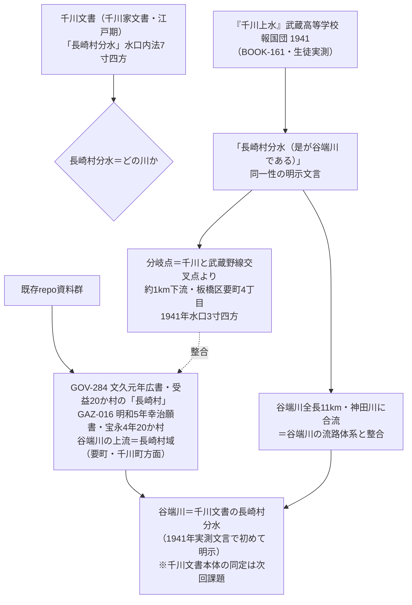

# 2026-11-16（第135回）・千川上水1941全流実測・谷端川=長崎村分水の文言・千川水道取締禁例・墓碑史蹟研究の追加調査

## 概要

第135回。**最重要発見は『千川上水』（武蔵高等学校報国団民族文化部門編・1941年6月30日発行・非売品・39頁・NDL lab 1043756）**＝生徒実測による千川上水全流の1941年記録で、**「谷端川＝千川文書の『長崎村分水』」の明示文言**（分岐点＝千川と武蔵野線交叉点より約1km下流・板橋区要町4丁目・水口7寸四方〔千川文書〕→1941年3寸四方・全長11km・神田川に合流）をrepo初出級の文言として登録した（BOOK-161）。あわせて『東京警視本署布達全書』明治14年分の**「千川水道取締禁例」明治14年5月11日甲第25号全文5か条**（GOV-311・BOOK-161の警視庁標木の法的根拠）、三田村鳶魚『江戸の生活』の**玉水簾「音羽町一丁目の崖下」第4説**と**弦巻川「末は目白下上水の埋み樋を流れて、江戶川に合流せり」の伏越交差本文**（BOOK-162）、磯ケ谷紫江『墓碑史蹟研究』第6巻の**神齡山大聖護國寺梵鐘銘（天和2年・1682・牧野成貞）と観音堂銅燈籠銘（元禄10年・本庄宗俊謹記）**の実物銘文用例（BOOK-163）を登録。新規4件（BOOK-161〜163・GOV-311）＋既存追記（対照表3行）＋橋名調査追補（千川中流部橋梁5件＋筋違橋対校）。

## 調査経緯

1. 第134回課題⑥（「神齡山」のcontentonly横断の残り）を消化すべく、ヒットしていた墓碑史蹟研究（1242818）・東都寺院普集（2540381）・御府内八十八ケ所道しるべ（763835）・醇堂漫筆（2568106）・蒼梧随筆（2567957）・東京府文獻叢書（2577110）のfulltextを取得して神齡山用例を検証。**墓碑史蹟研究の梵鐘銘・銅燈籠銘が実物史料の銘文用例**として格上げ登録に値すると判断（BOOK-163）。他4冊は神齡山比定確定後の補強資料としてノート記録に留めた。
2. NDL検索で千川上水関連の新資料を探した結果、**『千川上水』（武蔵高等学校報国団・1941）**を発見。fulltext取得後に全流実測記録と核心文言（谷端川＝長崎村分水・取水口改造史・庚申塚濾過池・千川家現況等）を検証し、**BOOK-161として全文構造化して登録**。
3. BOOK-161の「明治十四年千川水道取締禁令」の文言を手掛かりに、『東京警視本署布達全書』明治14年分（791201）のfulltextから**「千川水道取締禁例」甲第25号全文**を取得（GOV-311）。目次に「神田玉川兩上水取締禁例」（明治12年）の言及あり（本文は未取得・次回課題）。
4. 三田村鳶魚『江戸の生活』（1460041）の「江戶の瀧」章を精読し、玉水簾の位置説・構造寸法・弦巻川流路の引用文言を検証（BOOK-162）。
5. 関連文言の対照表・橋名調査への反映。伊勢屋式兵衛のcontentonly再確認（江戸叢書=BOOK-157既登録のみで陰性）・松屋筆記（2574509）の「田家大人」は法苑珠林の引用と判明（false positive）。

## 新情報（採用・登録分）

### 『千川上水』（武蔵高等学校報国団・1941）＝BOOK-161・最重要

- **[BOOK-161](../sources/books/BOOK-161.md)『千川上水』（武蔵高等学校報国団民族文化部門編・1941年6月30日発行・非売品・39頁・図版41葉・lab 1043756）**: 生徒実測・踏査による千川上水全流の1941年記録。主な文言:
  - **谷端川＝千川文書の「長崎村分水」の明示〔今回の最大の核心〕**: 分水節「所謂千川文書には左の諸分水を記してある」として長崎村分水を列挙し、**「長崎村分水（是が谷端川である）」の形で谷端川との同一性を明示**。水口内法**7寸四方**（千川文書）→1941年3寸四方・**全長11km**・神田川に合流・分岐点＝**千川と武蔵野線交叉点より約1km下流・板橋区要町4丁目**＝谷端川分岐点の実測文言（repo初出級。要町4丁目/3丁目の表記揺れは要原画像照合）。
  - **取水口＝境橋上流約250m・明治3〜5年改造史**: 明治3年「多摩郡砂川村の各村合併口から分水」→水勢不足→同年及び翌4年「增口を許可」→「保谷村地先舊分水口から上流に隧道を穿ち、直分水口を設けて分水」＝明治5年変更拡大説の本文構造（行政文書での裏付けは次回課題）。
  - **巣鴨庚申塚**: 千川水道会社濾過池・**明治15年7月建立の分配石標が現存**（受益地の記載）・千川上水公園は紀元2600年（1940）5月開園・庚申塚区間の暗渠化＝昭和初年（木製陰樋堀出の記録）。
  - **水車小屋6ヶ所→3ヶ所**: 「昭和四年頃に於てすら六ヶ所を數へ得るが、現在は僅かに三ヶ所」＝水車廃絶の定量観察（BOOK-140・GAZ-051と対校可能）。
  - **千川家の1941年現況**: 当主惣平氏は「現在千川上水監視の任にあるとか」・墓地＝練馬阿弥陀堂（金乗院末）境内・**天明以前の墓なし**。
  - **石神井川揚水の合流点＝日川地蔵と筋違橋の中間（練馬宿中央）**＝揚水合流水路の実測位置（BOOK-152の下板橋説との対校・両方の揚水点かは断定しない）。
  - **警視庁標木「本上水は飲料水につき汚損すべからず」現存**＝GOV-311（明治14年禁例）の実物側の観察記録。
  - **その他**: 樋管延長「約一里十五町」・室鳩巣建議説・白山御殿正徳4年閉鎖説・明和6/安永4/5年千川善蔵歎願3回説・慶応年間滝野川反射炉水力利用説・王子製紙等の工業用水・巣鴨から上野公園への陰樋送水・千川上水出張所（板橋町四丁目・東京市の管理）。
  - **制限**: 年号は神武紀元併記（例:二三五六=元禄9年）でOCR崩れの風があり、全文言原画像照合を要する。

### 『東京警視本署布達全書』明治14年分＝GOV-311

- **[GOV-311](../sources/gov/GOV-311.md)『東京警視本署布達全書』（1886・lab 791201）**: **「千川水道取締禁例」明治14年5月11日甲第25号（東京府知事連署）全文5か条**＝千川上水の汚水・洗濯・家畜等の投棄を禁じる布達。BOOK-161の警視庁標木の法的根拠。第2条・第4条はOCR割付崩れで文言候補扱い。**目次に「神田玉川兩上水取締禁例」（明治12年）の言及あり**（本文未取得・次回課題）。

### 三田村鳶魚『江戸の生活』＝BOOK-162

- **[BOOK-162](../sources/books/BOOK-162.md)『江戸の生活』（大東出版社・1941・lab 1460041）**「江戶の瀧」章:
  - **玉水簾の位置説「音羽町一丁目の崖下」＝第4の位置説**（第133回の玉水簾4史料に追加）。
  - **構造寸法「瀧の幅六尺許り、高さ五尺餘有」**（引用元の同定は未了・次回課題）＝玉水簾の高さ対立（1丈5〜6尺 vs 5尺余）の新しい datapoint。
  - **弦巻川流路の引用文言「一體此水、池袋村より出で雜司ケ谷村みたけの下を過て弦卷川といひ、末は目白下上水の埋み樋を流れて、江戶川に合流せり」**＝弦巻川と神田上水の伏越交差の第3の本文テキスト。
  - 根津音羽岡場所の記述。

### 磯ケ谷紫江『墓碑史蹟研究』第6巻＝BOOK-163

- **[BOOK-163](../sources/books/BOOK-163.md)『墓碑史蹟研究』第6巻（後苑荘・1935・lab 1242818）**:
  - **梵鐘銘「神齡山大聖護國寺鐘樓前 天和二壬戌年（1682）九月吉祥日…牧野氏成貞朝臣」**＝神齡山の最古級の実物銘文用例（天和2年・牧野成貞＝現在住。
  - **観音堂前銅燈籠銘「元祿十年丁丑之秋 神齡山護國寺之觀音堂造畢」**＝**観音堂造営が元禄10年（1697）に確定**・本庄宗俊謹記・治工椎名伊豫作（桂昌院実家の本庄氏と関わる銘）＝第134回の神齡山比定（4系統一致）の実物史料側の補強。

### 既存ファイルの更新

- **[対照表](地名・河川名対照表.md)**: ①**神齢山**行にBOOK-163の梵鐘銘（天和2年・最古級実物用例）・観音堂銅燈籠銘を追記。②**音羽の瀬／玉水簾**行に「音羽町一丁目の崖下」第4説と構造寸法（幅6尺・高さ5尺余）を追記。③**長崎村外三村分水**行の次に**「長崎村分水（谷端川・千川文書）」行**（BOOK-161の同一性明示文言・水口7寸→3寸・全長11km・分岐点要町4丁目）と**「千川街道」行**を新設。
- **[橋名調査](四河川の橋名・橋跡調査.md)**: 第135回追補＝1941年実測の千川上水中流部橋梁群（**東北浦橋=昭和9年2月竣工・立野橋=宝永元年庚申塔・三兵橋=石の道標・九頭龍橋=千川唯一の堂々たる橋梁で水深約2米・中村橋=川幅5米**）＋練馬宿の筋違橋の1941年位置（GOV-256の板橋側筋違橋との対校課題）＋柳橋（上流部・橋名候補）。

## 谷端川＝長崎村分水の同定構造（Mermaid）

## 見送り・陰性（ノートのみの記録）

- **神齡山用例の個別登録見送り4冊**: ①東都寺院普集（2540381）②御府内八十八ケ所道しるべ（763835）③醇堂漫筆（2568106・延宝9年桂昌院建立説）④蒼梧随筆（2567957・天明6年開帳・「田領」＝田柄崩れ候補）⑤東京府文獻叢書（2577110・元御薬園説）＝第134回で比定確定した神齡山の補強資料だが、銘文実物のBOOK-163で代表させた（再訪時にBOOK-163から相互リンク）。
- **伊勢屋式兵衛のcontentonly**: 1913086（江戸叢書=BOOK-157既登録）のみで陰性。
- **松屋筆記（2574509）の「田家大人」**: 法苑珠林の仏相の引用でfalse positive。
- **「田家大人」「留山」の比定**（第134回から継続）: 未解決のまま。田家大人＝大田南畝候補のまま。

## 監視系の結果

- **news_search** 6クエリ（谷端川・弦巻川・水窪川・千川上水・神田川河川整備計画・環状七号線地下調節池・limit 5）: **全0件**。
- **kanzyou7.com WHAT'S NEW**: 最新=**2026/11/13「週間工程表、シールド進捗図を更新」のまま**（変化なし）。
- **東京都建設局・神田川流域ページ・環七委員会ページ**: open_urlで「お探しのページを表示できません」（第128回と同状態）＝**決定版神田川流域計画はR5.3版のまま未公表**と判断。
- **環七インフラツアー（新情報）**: 神田川・環状七号線地下調節池見学申込ページに「**令和9年1月末までの見学受付は終了いたしました**」＝インフラツアー第2期（2027-01-09〜02-28）の見学申込受付終了済み。
- **調節池広域整備検討委託その2の開札**: 2026-12-02予定（まだ先）。

## 次回以降の課題

1. **BOOK-161の原画像照合**: 年号の神武紀元換算（二三五六=元禄9年等）の確定・谷端川分岐点の要町4丁目/3丁目表記揺れの確認・樋管延長「約一里十五町」vs 3,707間の対校。
2. **「千川文書」の同定**: BOOK-161が引用する千川文書（千川家文書=GOV-089 neribun 297点か）の実体確認。
3. **BOOK-162の引用元文献の同定**: 玉水簾の構造寸法「幅六尺・高さ五尺餘」の出典（江戸雀・静のとぎは等の候補）。
4. **玉水簾の高さ対立**（1丈5〜6尺 vs 5尺余）の検証。
5. **「神田玉川兩上水取締禁例」（明治12年）の本文取得**（GOV-311の目次言及から）。
6. **明治3〜5年取水口改造の行政文書裏付け**（BOOK-161の明治5年変更拡大説）。
7. 第134回課題④（継承）: 砲兵工廠への千川供給の実務史料。
8. （継続監視）2026-12-02開札・決定版神田川流域計画・kanzyou7.com・環七インフラツアー第2期の実施状況・省令12号官報p.413・帝都復興史130万対立・遊歴雑記原画像・白堀系原画像照合等。
