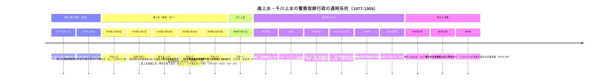

# 2026-11-16（第137回）・兩上水取締禁例の最終形全文と兩上水取締心得・三上水巡視訓令・第三方面第四分署所轄の追加調査

## 概要

第137回。**第136回の最大の未解決課題（兩上水取締禁例の改名後の全文）が、『警視庁令類纂』第5版（明治29年4月末日現行・1898）のfulltext精読で解決した**。①**兩上水取締禁例の最終形全文5か条**（第5条＝「此規則ニ違背シタル者ハ違警罪ヲ以テ罰セラルヘシ」の罰則条に置き換わった構成）＝**第136回課題①解決**。②**千川水道取締禁例が6か条構成と確定**（令類纂第5版＋『現行日本衛生類典』1894の2系統で第4条本文・第6条罰則条を復元）＝GOV-311制限①④解決。③**「神田玉川兩上水取締心得」（明治12年2月26日番外・第三方面第四分署）全文3か条＝repo初出文書**（神奈川県下敷地の違犯者送付・変死人・**従来の下水溝渠の流溢は「當分不問」**＝神田上水の汚染史の運用側一次記録）。④**訓令明治26年12月13日甲第62号「神田玉川千川三上水水路取締狀況申報方」＝repo初出**（三上水統称の公式文言・月2回以上巡視の制度化）。⑤**明治10年9月19日丙第5号「飮用水營業人心得」全文＝repo初出の規則**（兩上水＋利根川を汲売水源に指定・「上水樋口」での汲取文言）＝取締行政の通時系列の前端拡張。⑥**番外達（巡査交番）の10月29日付を支持する再録3系統**（東京警吏要覧1879・警視類聚規則坤1879・令類纂第5版）＝GOV-314の「十月十七日」説への独立裏付け。⑦**第三方面第四分署＝新宿警察署の前身・所轄に小石川区関口町（神田上水取水口）・東多摩郡上高井戸村外31か村**（警視庁史稿下巻1894）＝第136回課題⑤解決（文言候補・割付照合残る）。⑧**銀行会社要録第4版（明治33年5月刊）で莊田平五郎・豊川良平の続投確認、第13版（明治42年）で千川水道記載消滅**＝明治40年6月廃止後の会社消滅と整合（解散・吸収の別は断定しない）。新規8件（GOV-315〜321・BOOK-166）＋既存追記（GOV-311〜314）＋対照表1行。

## 調査経緯

1. 第136回課題①（兩上水取締禁例の改名後の全文）を消化すべく、令類纂系の現行規令集を探索。『警視庁令類纂』第5版（791005・明治29年4月末日現行）のfulltextを取得し、第九章衛生第四款飮料水及氷雪から**兩上水禁例の最終形全文5か条・千川禁例の6か条全文・兩上水取締心得全文3か条・訓令甲第62号**を抽出（GOV-315）。
2. 同じく791005から**番外（明治11年10月29日）巡査交番達の再録**を確認＝GOV-314の「十月十七日」説への裏付け。さらに『東京警吏要覧』2版（791206・1879・第二方面第四分署編）と『警視類聚規則』坤（791012・1879）のfulltextで**同一内容の番外達が「十一年十月廿九日」付で再録されていることを2系統確認**（GOV-316・GOV-317）。警吏要覧側は**禁例の改正注記（十二月廿六日改正）つき再録で、第5条として仮規則の旧第5条（告知条）の本文が並ぶ**再録構造も記録（刪除の解釈は原画像照合まで保留）。
3. 千川禁例の6か条構成の独立確認のため『現行日本衛生類典』（797094・1894）のfulltextを精読し、**第1〜6条のほぼ同文言の再録**と**沿革目次（明治10年丙5号→明治11年甲57号→明治14年甲25号→明治21年警察令第9号の系譜提示）**を取得（GOV-320）。兩上水禁例の項目書誌「明治十一年十月 警視廳甲第五十(七)號」も甲57号原布達説と整合。
4. 通時系列の明治20年頃の定点として『現行規則万民法典』（787333・1887）の警視廳規則リストを確認し、**両禁例の現行収録＋「以上諸規則ニ違背シタル者ハ何レモ違警罪ヲ以テ罰セラルヘシ」の適用文言**を取得（GOV-318）。番号表記「甲第廿七號」は割付崩れ候補として原画像照合まで保留。あわせて『法規分類大全』刑法門（994199・1891）の罰則節に「**兩上水取締禁例罰則（甲第五十八號警視廳布達節錄）**」「千川水道取締禁例罰則」の項目立てを確認（GOV-312追記・日付列の割付照合は次回課題）。
5. 沿革目次に見えた明治10年丙5号を探索し、『衛生法規 : 沿革類纂』（797019・1880）から**明治10年9月19日東京警視本署丙第5号「飮用水營業人心得」全文5か条**（神田玉川兩上水及ヒ利根川ヨリ汲取候販賣ノ飮水運送船の取締・他川汲取禁止・板蓋・水漉器具・桶蓋）と**明治11年5月9日乙第18号「飮料水注意法」全文**を抽出（GOV-319）＝**甲57号（水源保全）の2年前の水商人（営業人）側の汲取・運搬の心得**。
6. 第136回課題⑤（第三方面第四分署の所轄範囲）を消化すべく『警視庁史稿』下巻（785267・1894）のfulltextから新宿警察署系統条を精読し、**「前ニ同 警視第三方面第四分署…十一年十一月二日…牛込區ノ内若松町外五ケ町 小石川區ノ内關口町 四ツ谷區ノ内永住町(側西?) 東多摩郡ノ内上高井戶村外三十一ヶ村」**の文言候補を取得（GOV-321）。**小石川区関口町＝神田上水取水地・東多摩郡村々＝玉川上水沿線**を所轄した分署だったことが取締達の宛先の行政的背景として読める〔観察〕。明治14年1月14日の警視庁再置で方面分署制終了・警察署制（新宿警察署）へ改組。2ブロックの所轄区域リストの帰属（分署期vs警察署期）は原表照合まで保留。
7. 第136回課題④（銀行会社要録の中間年度）の続きとして第四版（803641・明治33年5月刊）と第十三版（803649・明治42年）のfulltextを精読。**第4版の役員録で莊田平五郎（取締役・三菱合資管事）・豊川良平（監査役・三菱合資銀行部長）の続投**を確認、**第13版で千川水道の記載が統計・役員録ともに消滅**（grep陰性）＝明治40年6月の上水廃止後の会社消滅と整合（解散・吸収・漏載の別は断定しない）（BOOK-166）。
8. 対照表に「**神田玉川千川三上水**」行を新設（千川上水行の直下）＝訓令甲62号の統称文言と1891年談話筆記（GOV-173）の「玉川神田千川ノ三上水」を統称側から読み直し。
9. 陰性探索: 「高田川」の他文献横断（岡山・青森のfalse positiveのみ）、「増口/千川上水 分水口」0件、845862（談話筆記系）は既登録GOV-173の重複、806564（東京府統計書・明治16-17）の千川水道行は割付崩れで数値帰属不能（ノート記録のみ・採用見送り）。
10. 監視系: news_search 6クエリ全0件・kanzyou7.com WHAT'S NEWは2026/11/13のまま・都建設局神田川流域ページは令和5年3月版のまま・環七調節池広域整備検討委託(その2)の開札2026-12-02は未了。

## 新情報（採用・登録分）

### 『警視庁令類纂』第5版（明治29年現行・1898）＝GOV-315

- **[GOV-315](../sources/gov/GOV-315.md)**: ①**兩上水取締禁例の最終形全文5か条**（明治11年10月29日甲第57号布達・明治29年現行）: 第1条魚鳥捕獲・游泳・物品洗浄禁止／第2条塵芥瓦礫汚穢物投棄禁止／第3条沿面汚水混入禁止／第4条堤上竹木下草伐採禁止／**第5条「此規則ニ違背シタル者ハ違警罪ヲ以テ罰セラルヘシ」＝罰則条**。旧第5条（堤防破損の告知条）刪除後に罰則が新第5条として置かれた構成＝**第136回課題①解決**。いつ罰則条が追加されたかは本書では確認できず（違式罪目第76条の代置か後年布達〔法規分類大全の甲第58号候補〕かは未確認）。②**千川禁例の6か条全文**（第4条堤上竹木下草伐採禁止の独立条化・第6条違警罪罰則条の内蔵）＝**千川禁例は布達当初から罰則条つき**〔観察〕。③**兩上水取締心得全文3か条**（神奈川県下敷地の違犯者は同県警察署へ送付・変死人の通知・**沿面の従来の下水溝渠の流溢は禁例第3条に抵触しても「當分不問」**）＝**下水流入の実態を運用細則で「不問」とした一次記録**（神田上水の汚染史の証拠群を補強）。④**訓令明治26年12月13日甲第62号**（三上水の月2回以上の署員巡視・都度申報の制度化）。

### 『東京警吏要覧』2版（1879）＝GOV-316・『警視類聚規則』坤（1879）＝GOV-317

- **[GOV-316](../sources/gov/GOV-316.md)**: ①兩上水禁例の**改正注記（十二月廿六日改正）つき現行再録**（第3・4条に注記・一方で第5条として仮規則の旧第5条の本文が並ぶ再録構造・解釈は原画像照合まで保留）。②巡査交番番外達の**「十一年十月廿九日」付の再録**＝GOV-314の「十月十七日」説への独立裏付け。③違式罪目第76条の再録。編者が**第二方面第四分署**である点も方面内の分署が横断的に規令を共有した実像の副次資料。
- **[GOV-317](../sources/gov/GOV-317.md)**: ①甲57号布達の**「（第六號ヲ以テ改正 十二年二月廿六日甲）」注記つき再録**＝改正の条文対応（第3・4条）の類聚レベルの明示（改正後の実質文言の変更の有無は確定しない）。②**兩上水路取締心得の冒頭再録**＝心得が明治12年2月26日の番外達であることの同時代側の裏付け。③**境村外5か村新田の玉川上水際汲取場許可の再録**＝GOV-314②の文言・日付の裏付け（新田名「鈴水／鈴木」の判読対立を併記）。

### 『現行規則万民法典』（1887）＝GOV-318・『現行日本衛生類典』（1894）＝GOV-320

- **[GOV-318](../sources/gov/GOV-318.md)**: 警視廳の現行規則リストに**両禁例が並んで収録**＋リスト末尾の**「以上諸規則ニ違背シタル者ハ何レモ違警罪ヲ以テ罰セラルヘシ」**＝**違式罪目第76条の刪除（明治12年11月）後、遅くとも明治20年頃までに罰則が違警罪体系で運用に復帰していた**ことの書誌記録。兩上水禁例の番号「甲第廿七號」は割付崩れ候補（五十七号の「五」脱落説が有力・原画像照合まで保留）。
- **[GOV-320](../sources/gov/GOV-320.md)**: **沿革目次（丙5号→甲57号→甲25号→明治21年警察令第9号の系譜提示）**＋**千川禁例6か条のほぼ同文言の再録**（第2の独立系統）＝明治27年時点で両禁例が現行衛生法規体系に揃って収録。

### 『衛生法規 : 沿革類纂』（1880）＝GOV-319

- **[GOV-319](../sources/gov/GOV-319.md)**: **明治10年9月19日東京警視本署丙第5号「飮用水營業人心得」全文5か条**＝①**神田玉川兩上水及ヒ利根川以外の他川での飮水汲取禁止**（兩上水＋利根川が汲売水源として指定）②汲取飮水への潮水・汚穢物混入防止の板蓋③日々の清掃④**「上水樋口ヨリ汲取候節ハ微塵鐵網或ハ麻布張枠等ノ水漉器具ヲ用ユベシ」＝上水の樋口で水商人が直接汲取していた運用の一次文言**〔repo初出〕⑤飮水販賣の桶蓋。＋明治11年5月9日乙第18号「飮料水注意法」全文。**甲57号（明治11年10月・水源保全）の2年前の営業人側の規則**として取締行政の通時系列の前端を拡張。

### 『警視庁史稿』下巻（1894）＝GOV-321

- **[GOV-321](../sources/gov/GOV-321.md)**: 新宿警察署系統条の「**前ニ同 警視第三方面第四分署**」記述。明治11年11月2日の區郡名称区域改め後の所轄として**牛込區若松町外5ケ町・小石川區關口町・四ツ谷區（永住町?）・東多摩郡上高井戶村外31ヶ村**（文言候補）＝**神田上水の取水地（関口）と玉川上水沿線郡部を一手に管轄した分署**が兩上水取締の達の宛先だったことの行政的背景〔観察〕。明治14年1月14日の警視庁再置で方面分署制終了・警察署制へ。分署長人事（山崎重應二等少警部等）の断片も記録。

### 『銀行会社要録』第四版・第十三版＝BOOK-166

- **[BOOK-166](../sources/books/BOOK-166.md)**: **第4版（明治33年5月刊）の役員録で莊田平五郎（取締役）・豊川良平（監査役）の続投**＝明治30年代を通じた三菱系役員の連続性の第3定点。**第13版（明治42年）で千川水道株式會社の記載が統計・役員録ともに消滅**（grep陰性）＝明治40年6月の上水廃止後の会社消滅と整合（解散・吸収・漏載の別は断定しない・中間版の最終掲載版の特定は次回課題）。

### 既存ファイルの更新

- **[GOV-311](../sources/gov/GOV-311.md)**: 千川禁例の条構成を**6か条構成に修正**（第4・第6条の復元・制限①④解消）。**兩上水禁例（罰則は外部の違式罪目経由→後に第5条内蔵）と千川禁例（布達当初から罰則条内蔵）の形式の対比**を追記。
- **[GOV-312](../sources/gov/GOV-312.md)**: ④追記（**改正後の最終形全文5か条**〔GOV-315〕・**法規分類大全の「兩上水取締禁例罰則 甲第58号」項目**・罰則の明治19〜20年頃の再整備の書誌記録）。制限③④を更新。
- **[GOV-313](../sources/gov/GOV-313.md)**: 関連の重複解消・GOV-315〜317・319〜321を追記。
- **[GOV-314](../sources/gov/GOV-314.md)**: 番外達の**10月29日付を支持する再録3系統**（GOV-315⑤・316②・317）の独立裏付けを追記（「十月十七日」は判読候補として維持）。制限①②更新（第三方面第四分署の所轄はGOV-321で部分的に前進）。
- **[対照表](地名・河川名対照表.md)**: 千川上水行の直下に**「神田玉川千川三上水」行を新設**（統称（行政文書）・訓令甲62号の公式文言＋1891年談話筆記の統称側の読み直し・千川上水の略称ではない3水路併記の統称として管理）。

## 取締行政の通時系列（第137回時点の整理）

## 陰性・見送り

- **「高田川」の他文献横断**（第136回の推懸橋・高田川文言の用例探索の続き）: NDL横断で「高田川」の新用例なし（岡山県高田川・青森県高田川等のfalse positiveのみ・第136回取得の1690年増補名所大全文言〔BOOK-151〕を超える前進なし）。
- **「増口/千川上水 分水口」の横断**: 0件（千川上水の玉川上水からの分水口の呼称探索・陰性記録）。
- **845862（水道改良談話筆記系）**: 精読の結果、既登録の[GOV-173](../sources/gov/GOV-173.md)と同一底本の重複と確認（新規登録せず）。
- **806564（東京府統計書・明治16-17）の千川水道行**: fulltextの割付崩れで数値の帰属が確定できない（統計行としての採用見送り・存在の観察のみ記録）。
- **監視系**: news_search 6クエリ（谷端川・弦巻川・水窪川・千川上水・神田川・環七調節池）＝全陰性。kanzyou7.com WHAT'S NEW＝2026/11/13のまま更新なし。都建設局・神田川流域河川整備計画ページ＝令和5年3月版のまま。環七調節池広域整備検討委託(その2)の開札＝2026-12-02予定のまま未了（次回監視）。

## 次回課題

1. **兩上水禁例罰則条（第5条）の追加布達の番号・年次の特定**: 法規分類大全の「兩上水取締禁例罰則 甲第58号」候補（994199）の原画像照合・日付列（「十九年八月七日」「十九年七月二十二日」等）の割付確定＝**明治12年11月の違式罪目刪除後、いつ罰則が違警罪として再整備されたか**の確定が最大の空白。
2. **791189（布達全書明治11年坤）の番外第125号「十月十七日」の原画像照合**（再録3系統が支持する「十月廿九日」説の最終確認・791189コマ89付近）。
3. **GOV-321の所轄区域2ブロックの帰属**（明治11年分署期vs明治14年警察署期の管轄の別）の原表照合と「四ツ谷區ノ内永住町側西」の判読。
4. **銀行会社要録第5〜12版で千川水道の最終掲載版の特定**と**第13版欠載の解釈**（解散登記・買収契約等の一次資料での確定）。BOOK-165の大株主欄（コマ550）の原画像照合も未実施。
5. **791005の第5版→第6版（791007）以降で兩上水禁例がいつ削除されるか**（神田上水廃止〔明治34年6月〕以降の類纂での扱い＝廃止布達の有無の傍証）。
6. **明治3〜5年千川取水口改造の行政文書**（NDLでは陰性・千川家文書neribun 297点が本命）。
7. 監視系の継続（2026-12-02開札の結果確認・決定版神田川流域計画・kanzyou7.com・環七委員会の新URL探索）。
