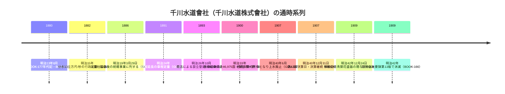

# 2026-11-17（第139回）・NDL次世代DL横断第5弾・千川水道會社の解散時期の決め手と上野陰樋の行政記録・谷端川暗渠化の住民陳情・千川分水量1882年定量

第139回。NDL次世代デジタルライブラリーのfulltext精読（第5弾・16書）と監視系チェックを1回の実行として消化した。

## 今回の主要成果（すべて新規・fulltextのgrep検証済み文言）

| 資料ID | 資料 | 年 | 要点 |
| --- | --- | --- | --- |
| [BOOK-170](../sources/books/BOOK-170.md) | 莊田平五郎傳 | 1932 | **明治42年12月24日「千川水道會社解散記念靑銅花盛器贈與」**＝第138回課題②（解散時期）の決め手。明治19年3月29日三菱社届書後の千川水道會社の統轄記述（『三菱創世物語』1935の対校） |
| [GOV-323](../sources/gov/GOV-323.md) | 第三回内国勧業博覧会事務報告 | 1891 | 帝国博物館用水＝**千川水道會社給水の分取**、水管架設工事の請負、**樋長820間・吹井4所並井4所**、水量（博物館3,357立方尺/12h・動物園7,520余・博覧会局4,983分取）＝BOOK-161「巣鴨→上野公園陰樋送水」の行政記録裏付け |
| [GOV-324](../sources/gov/GOV-324.md) | 東京市区改正委員会議事録 第2巻 | 1900 | **明治15年11月調査・千川水道への分水13立方尺/秒**（四ツ谷大木戸到達38・神田32・戸田0.9・計83.9）＝1882年の分水量の行政側定量 |
| [GOV-325](../sources/gov/GOV-325.md) | 法規分類大全 第43 地方税第2 | 1891 | 千川水道會社の水源及水路費賦課（**分水寸積150坪・納付額142圓89錢→151圓3錢→226圓54錢**の年度推移）・**井賦金（井数6,734箇所・1井4圓85錢5釐・瀧10倍・吹井2倍・明治15年7月1日現在）**・**印刷局抄紙部83坪4合＋千束村外22箇村33坪4合＝116坪8合**（BLOG-095分配堰碑の帳簿側対応） |
| [GOV-326](../sources/gov/GOV-326.md) | 陸軍歴史 巻七 | 1889 | 幕末の「**千川堀割長九百間餘**」・「**百姓持用水呑水等之名義ヲ以テ上水引入候分四拾餘箇所**（＝無用引水の指摘）」・湯島鑄立塲・關口錐入塲の文言＝GOV-144（NDA一次記録群・本文未判読）の引用文言側の対応候補 |
| [GOV-327](../sources/gov/GOV-327.md) | 東京市政概要 大正3年 | 1926 | 「千川上水ハ近年迄**本〓下谷ノ一部**ニ給水セシモ**明治四十年六月岩崎久彌ノ所有トナリ同時ニ之ヲ廢セリ**」・神田上水の水車業・砲兵工廠給存続・下水管網の「千川線」 |
| [GOV-328](../sources/gov/GOV-328.md) | 豊島区政読本 | 1936 | **谷端川暗渠工事陳情委員（7名）**（改良下水の幅員拡張→暗渠式/覆蓋式を府市に陳情・進捗中）・千川沿岸の緑地計画の要請・「**昭和十一年度造修豫定橋ハ（庚申橋）千川町地内**」 |
| [GOV-329](../sources/gov/GOV-329.md) | 本郷区勢要覧 昭和5年 | 1931 | **六義園の大池に千川上水の余水を注ぐ（1931年現勢）**＝廃止後の余水利用の本郷区側観察・続江戸砂子引用の流路説・再興明治13年8月・翌年工事完成 |
| [BOOK-171](../sources/books/BOOK-171.md) | 日本会社銀行録 | 1900 | **明治26年10月商法による設立登記**・資本金4萬圓・積立金25,887圓・**水道樋線起業資金46,975圓**（資本金超え）・配当年一割・役員（莊田平五郎・橋元長・豐川良平・瓜生震） |
| [BOOK-172](../sources/books/BOOK-172.md) | 財閥研究 第2輯 | 1930 | 千川水道株式會社の三菱傍系事業記載（資本金4萬圓・明治13年8月創立）・OCR崩壊箇所は采用不可の記録 |
| [BOOK-173](../sources/books/BOOK-173.md) | 東京勧業博覧会衛生調査報告 | 1907 | 沿革総説（河村瑞賢計画・仙川村德兵衞太兵衞・元禄9年）＋「**本〓下谷ノ一部ニ給水ス**」系沿革説の1907年確認・**露渠170間＋樋管3,700余間**の定量 |
| [BOOK-174](../sources/books/BOOK-174.md) | 市町村の水道（龜井重麿） | 1926 | **保谷村の新座郡→北多摩郡変換の明示注記**・「**改良水道給水開始ノ頃迄營業ヲ繼續**」＝営業終期の説明原理・露渠樋管3,900余間 |
| [BOOK-175](../sources/books/BOOK-175.md) | 歴史の跡を尋ねて | 1926 | 廃止（明治40年6月・岩崎久彌の個人所有）の一般書側再録＝GOV-327と同年の並走 |
| [BOOK-176](../sources/books/BOOK-176.md) | 英字新選東京方方 | 1872 | **関口水車のローマ字付き地図ランドマーク記載**＝関口水車通時系列（安永5年→明治2年→**明治5年**→1912地籍図）の補間 |
| [BOOK-177](../sources/books/BOOK-177.md) | 南梁遺稿 | 1911 | 年代記「**十三年八月千川水道を用興す** 九月麻布水道を開鑿す」＝明治13年8月再興の独立系裏付け |
| [GAZ-062](../sources/gazetteers/GAZ-062.md) | 日本地名大辞典 第5巻 | 1938 | **千川溪谷の断層谷説**（東北-西南行断層に沿う・別箇所の西北-東南行併記との対立はOCR由来で要照合）・山ノ手台地区画と千川上水・水窪川＝静岡の同名川（false positive記録） |

## 追記（既存資料）

- [GOV-290](../sources/gov/GOV-290.md): 「本〓下谷ノ一部ニ給水」系沿革説が1905〜1931年の5文献で一致＝**「本〓」＝本郷区読みの大幅強化**（原字照合まで断定しない）。
- [BOOK-169](../sources/books/BOOK-169.md): 解散記念品の贈与（明治42年12月24日・BOOK-170）と設立登記（明治26年10月・BOOK-171）を版次系列の空白の対応として追記。
- [BOOK-161](../sources/books/BOOK-161.md): 巣鴨→上野公園陰樋送水の観察にGOV-323（行政記録）の裏付けを追記。
- [docs/四河川の橋名・橋跡調査.md](橋名・橋跡調査.md): **庚申橋（千川町・昭和11年度造修予定）**の追補（茗荷谷の庚申橋とは同名異橋候補）。

## 千川水道會社の通時系列（本回で強化後）

## 監視系チェック（第139回・陰性）

- ニュース検索6クエリ（谷端川・弦巻川・水窪川・千川上水・神田川河川整備計画・環状七号線地下調節池）: **該当記事なし**（過去7日）。
- [kanzyou7.com](https://www.kanzyou7.com/): WHAT'S NEW 最新=2026/11/13のまま（変化なし）。
- 都建設局サイト: 現行URL（`/river/seibi/kanda` 等）は403/ボット対策で直接取得不可だが、検索経由でページ存続・主要内容に変化なしを確認。調節池広域整備検討委託（その2）開札=2026-12-02予定（まだ先）。

## 陰性・見送りの記録

- 801532 東京府農商工要覧（1891）: 会社一覧表の千川水道會社行がOCR崩壊で読み取り不能→独立登録見送り（表組みの原画像照合が前提）。
- 988905「子七月」等の干支年次: 原画像照合まで特定せず（元治〜慶応期候補のまま）。
- 谷端川検索の日本都市年鑑・時事年鑑・職員録類: 地名羅列のみで採用価値なし。
- 1280570 三菱創世物語: BOOK-170に併記する形で採用（独立登録せず）。
- 1116352の「水窪川」: 静岡県龍山村の同名川でfalse positive（GAZ-062に記録）。

## 文言の扱い（注意書き）

- 本回の全引用文言は**NDL次世代デジタルライブラリーのOCR由来**で、grepによるfulltext検証のみ実施済み。**原画像照合まで「文言は要原文照合」扱い**（特に988905の幕末文書の崩れ・764197のローマ字・994215の賦課表の列割付・1280521の「本江」）。
- 断定しない事項: 千川水道會社の解散の登記年月日（明治42年12月24日は解散記念品の贈与日）、「本〓」の原字、『陸軍歴史』の引用とNDA一次記録（GOV-144）の対応関係、庚申橋（千川町）の位置。

## 次回の課題

1. 荘田平五郎伝の原画像照合（解散記念文言・年譜の「同二十四日」の帰属・p.109-110付近）。
2. GOV-323の水量表・樋管の原表照合。水管架設の工事年の特定。
3. 784702の分水量の前後精読（測定地点の特定）。
4. 保谷村の新座郡→北多摩郡変換の行政記録（BOOK-174注記の一次確認）。
5. 988905の幕末文書の年次（原画像）とGOV-144のIIIF画像判読（多010688との対応確認）。
6. GOV-328の委員会一覧の原表照合（谷端川暗渠工事陳情委員の設置年・庚申橋の構造欄）。
