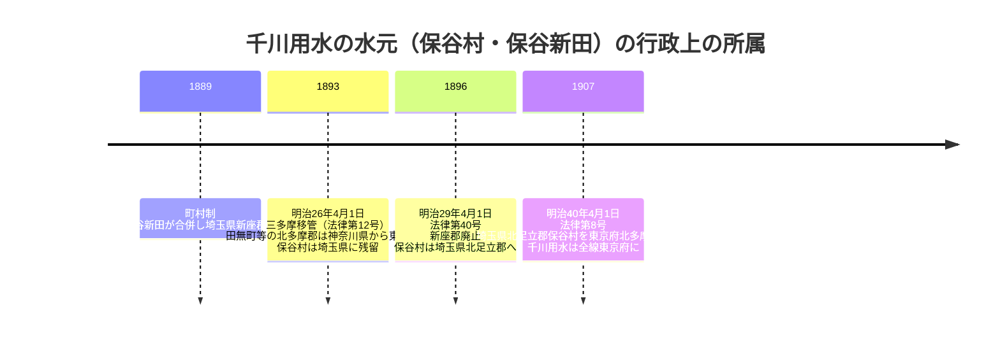

# 2026-11-17（第140回）・保谷村移管の法律本体（明治40年法律第8号）・上水設計第一報告の狹山池観察・元治元年の關口水車塲の追加調査

第140回。第139回ノートの未消化課題（③GOV-324前後文精読・⑤GOV-326年次確定・④保谷村の郡変換の行政記録）の消化とNDL次世代DLの追加取得（法令全書明治26年・府県及北海道境域沿革一覧）を1回の実行として消化した。

## 今回の主要成果

| 資料ID | 資料 | 年 | 要点 |
| --- | --- | --- | --- |
| [GOV-330](../sources/gov/GOV-330.md) | 府県及北海道境域沿革一覧 第2,3編（内閣統計局） | 1910 | **保谷村の東京府移管の法律本体**＝明治40年3月16日法律第8号「東京府北多摩郡埼玉縣北足立郡境界變更法律」の条文採録（「埼玉縣北足立郡保谷村ヲ東京府北多摩郡ニ編入ス」・施行明治40年4月1日）＋明治29年法律第40号（新座郡廃止・北足立郡統合）・明治26年法律第12号（三多摩移管）の条文＝**第139回課題④の解決・[BOOK-174](../sources/books/BOOK-174.md)制限②の解消** |

### GOV-330（新規）＝保谷村の郡変換の全chainの確定

- 「**埼玉縣北足立郡保谷村ヲ東京府北多摩郡ニ編入ス** 附則 本法ハ明治四十年四月一日ヨリ之ヲ施行ス」（內閣總理大臣候爵西園寺公望・內務大臣原敬）＝**千川用水の水元の村が1907年4月1日に法律第8号で東京府へ移った**一次文言（同書の東京府条・埼玉県条の双方の沿革記事とも一致）。
- 中間段階＝明治29年3月29日法律第40号「北足立、新座、入間、高麗、比企、橫見、兒玉、賀美、那珂、大里、幡維、榛澤、男衾ノ十三郡ヲ廢シ…更ニ北足立、入間、比企、兒玉、大里ノ五郡ヲ置キ」（同年4月1日実施）＝**保谷村は埼玉県新座郡→同県北足立郡へ（1896）**。
- **田無町は神奈川県北多摩郡（1878年以降）→1893年4月1日東京府（法律第12号「神奈川縣下武藏國西多摩郡北多摩郡南多摩郡ヲ東京府ニ移ス」）＝第139回ノートの「田無村と同時の埼玉県→東京府移管」という想定は誤り**（埼玉県から東京府へ移ったのは保谷村のみ。田無町の所属は西東京市公式資料等の外側資料で確認）。
- 観察＝千川用水の流路の府県跨ぎの時期構造（〜1893年=埼玉・神奈川・東京の3府県跨ぎ、1893〜1907年=水元の保谷村のみ埼玉県残留の2府県跨ぎ・14年間、1907年4月1日以降=全線東京府）。境橋の「境」が府県境由来かは本書からは確認できず断定しない。

### GOV-324追記＝明治15年11月文言の帰属確定と狹山池の1888年観察（第139回課題③）

- 明治15年11月水量文言（千川13・神田32・戸田0.9・大木戸到達38・計83.9立方尺）は**明治21年12月「東京市區上水設計第一報告」**（調査主任バルトン・委員長芳川顕正宛）の**水源論（玉川の水量十分性の根拠として1882年調査を引用）**の中の文言と確定＝目的（改良水道の水源選定の前提調査）と測定の性格（水渠の分岐点群での配水構造の把握）が判明し、制限③②が大幅解消。
- 同報告に**狹山池の1888年実地観察**「羽村ノ近傍ニ狭山ノ池ナルモノアリテ其水ヲ上水渠ニ排出ス…瀦水ヲ水渠ニ排出スルノ小溝ハ近傍人家ノ下水ヲ受ク…是汚水侵入ノ一例ナリ」＋改良案「前記ノ狭山池ハ水渠ヲ越ヘテ玉川ノ下流ヘ放流セシムルカ又ハ此池ヲ埋立テ平地ト爲スコト」＝**狹山池助水堀系（GOV-283）の水質問題を指摘し、池を玉川上水系から外す2案（放流か埋立）を提示した1888年の行政側検分の記録**（実施の有無は確認できず断定しない）。バルトンの実地検分（往復5日・10月28日から）の時期と整合。
- 同報告に**四ツ谷大木戸樋口の玉川上水分析表**（明治17年4月〜18年5月の採水・固形物・塩素・硫酸・硬度等）の所在も確認（列崩れで数値の採録は原表照合まで見送り）。

### GOV-326追記＝元治元年（1864）の年次強化と關口水車塲の行政記録（第139回課題⑤一部）

- 「子七月」書付の周辺文書群に「元治元年甲子三月」「文久三年癸亥四月發業 元治元年甲子八月成功」の記載が一貫＝**「子」＝甲子＝元治元年（1864年7月候補）が文書群の年次体系として強く支持**（原画像照合までの確定は留保）。
- 「**湯島鑄立塲關口水車塲等…江川太郎左衞門義ハ右御用御免被成候間…大小砲製造塲之義此度御仕法替被仰出**」＋目録「**一關口水車塲取建地請取方ノ上申**」「**一水車錐臺機械〓水路堀割等費用ノ上申**」「**一湯島鑄立塲仕法替ノ建議**」＝**関口水車（水車場）の元治元年の行政記録**（江川太郎左衞門の御免・小栗上野介への引継ぎ・仕法替）＝関口水車通時系列（安永5年〔BOOK-168〕→**元治元年〔GOV-326〕**→明治2年→明治5年〔BOOK-176〕→1912年地籍〔BOOK-139〕）の幕末側の中間datapoint。
- 天城山白土関係の書付（子十一月）に「今般武州瀧野川村地内に反射爐御建築之義被仰出候處…最前關口水車塲御圍內ヒ御取建之積」＝**關口水車塲の囲内への取建の計画文言候補**（解釈は原画像照合まで留保）。

## 追記（既存資料）

- [BOOK-174](../sources/books/BOOK-174.md): 制限②（保谷村の郡変換の年次・法的根拠）が**解消**＝GOV-330で明治40年4月1日（法律第8号）と確定。
- [docs/地名・河川名対照表.md](地名・河川名対照表.md): **狹山池行**に1888年観察・改良案の追記、**蟹川行**に元治元年の關口水車塲文言の追記、**保谷村（新座郡→北足立郡→北多摩郡）行を新設**（水元の村の府県所属の通時系列）。

## 保谷村の郡変換の通時系列

## 監視系チェック（第140回・陰性）

- ニュース検索6クエリ（谷端川・弦巻川・水窪川・千川上水・神田川河川整備計画・環状七号線地下調節池・2026-11-01〜17）: **該当記事なし**。
- [kanzyou7.com](https://www.kanzyou7.com/): WHAT'S NEW 最新=**2026/11/13のまま**（変化なし）。
- 都建設局の神田川流域河川整備計画: 検索経由で最新版は**令和5年3月版のまま**（文書URLはボット対策で直接取得不可）。なお2026-04-28付「河川整備計画（変更原案）について意見募集」の都のプレスリリースのページは既に削除されており**対象河川の確認は今回できず**（神田川の変更原案かは未確認・次回の監視対象とする）。
- 調節池広域整備検討委託（その2）: 開札=2026-12-02予定（**まだ**）。

## 陰性・見送りの記録

- [法令全書明治26年](https://lab.ndl.go.jp/dl/book/787990)（中巻）: 「保谷」ヒット3件はすべて埼玉県比企郡の「三保谷村」で無関係。「田無」ヒット2件は司法省令（裁判所管轄区）の町村列挙で、移管後の管轄再編の間接資料にとどまる。法律目録（第1〜19号）に埼玉県関係の境域変更法律はなし＝保谷村移管が明治26年ではない傍証。
- 法令全書明治28年（[787997](https://lab.ndl.go.jp/dl/book/787997)）: 「三保谷村」のfalse positiveのみ（既知の再確認）。
- 法令全書明治26年上巻（787989）の「境域變更」11件: すべて法律第12号の索引・目録項。
- 銀行会社要録第13版（803649）: 今回は千川水道會社行の再確認に使用せず（第139回のBOOK-166/169/171で足りると判断）。

## 次回課題

- ①法令全書明治40年（法律第8号の原本）の所在確認。②境橋の位置と保谷村・小川村（田無町）村境の位置関係（「境」の由来の考察の前提）。③GOV-324の玉川上水分析表・GOV-323水量表の原表照合。④GOV-326の「子七月」書付・「御圍內」文言の原画像照合。⑤GOV-144（NDA多聞櫓文書・多010688）のIIIF画像判読による『陸軍歴史』採録文の対応確認。⑥2026-04-28都の河川整備計画変更原案パブコメの対象河川の確認（都のプレスリリースのアーカイブ検索）。⑦第139回ノートの未消化照合課題（荘田平五郎傳p.109-110・GOV-328委員会一覧の原表照合）。

〔いずれもOCR由来で文言・数値は原文画像との照合を要する〕
