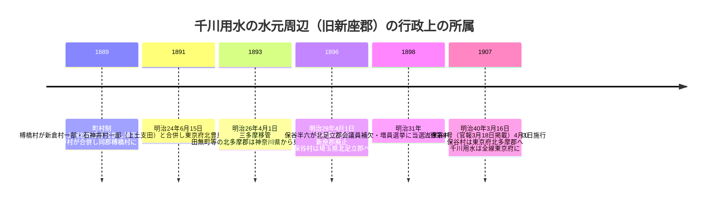

# 2026-11-17（第141回）・風土記稿新座郡巻の千川上水村境文言と保谷氏開発説・榑橋村の先行移管・法令全書明治40年対校

第141回。第140回ノートの未消化課題（①法令全書明治40年・②境橋と村境・⑥パブコメ対象河川）の消化と、NDL次世代DLの追加取得（風土記稿新座郡巻・北足立郡誌・法令全書明治40年）で**旧新座郡の保谷周辺の行政史と千川上水の上流端の地形記述**を一括して精読した。

## 今回の主要成果

| 資料ID | 資料 | 年 | 要点 |
| --- | --- | --- | --- |
| [GAZ-064](../sources/gazetteers/GAZ-064.md) | 新編武蔵風土記稿 新座郡巻（巻之129〜134） | 1884刊 | **上保谷村条の四至「東西ハ千川上水ノ流ヲ隔テ」＝千川上水が上保谷村の村境をなす幕末官撰地誌の文言候補**＋保谷氏開発説（下田・岩崎・桃井・野口・中村＋瀧島氏の6家系）＋上保谷新田条「千川上水ノ水涯ニ至リ凡十八町許」・開発者伊右衛門・元文元年大岡越前守検地＋小榑村・橋戸村条の四至＝**1891年大泉村編入の地理的基礎** |
| [GAZ-063](../sources/gazetteers/GAZ-063.md) | 北足立郡誌（北足立郡役所） | 1924 | 沿革年表「(四月保谷村を東京府に移す)」「(六月樽橋村を東京府に移す)」（樽橋＝榑橋村のOCR誤読候補）＋新座郡章「(今は樽橋、保谷の二村東京府に入れり)」＋郡会議員「保谷半六」（保谷村・明治31年選挙）＝**旧新座郡から東京府へ移った村は保谷村・榑橋村の2村** |
| [GOV-330](../sources/gov/GOV-330.md)（追記） | 法令全書明治40年（三月〜六月） | 1907 | 法律第8号の条文が[法令全書明治40年](https://lab.ndl.go.jp/dl/book/788052)にも採録＝**府県及北海道境域沿革一覧の条文との対校一致**＋「(官報三月十八日)」＝**官報掲載日明治40年3月18日の新datapoint**＝第140回課題①の解消 |

### GAZ-064（新規）＝千川上水の上流端の官撰地誌の文言群

- 上保谷村条の四至に「**東西ハ千川上水ノ流ヲ隔テ**」を含む文言候補＝**千川上水の流れが上保谷村の村境（多磨郡關前村との間と読める）を区切る**幕末官撰地誌の文言＝**境橋の「境」考察（第140回課題②）への初の四至文言**。ただしOCRが高度に崩壊しており「東西」の読み（「西ハ」等の可能性）・「關前村」の帰属は原画像照合まで確定しない＝[BOOK-137](../sources/books/BOOK-137.md)（境橋＝「相岐るゝさかい所」）・[BOOK-153](../sources/books/BOOK-153.md)（保谷村の西南隅境橋）の解釈を侵さない。
- 同条の**保谷氏開発説**: 「保谷氏ノ人主トシテ開墾セシ故ニコノ名アリ」＋下田・岩崎・桃井・野口・中村の5氏＋「**又瀧島氏アリ**」＝開発関与6家系の伝承＝**保谷の村名由来の一次文言候補**。瀧島氏は[BLOG-096](../sources/blogs/BLOG-096.md)（滝島俊「千川上水と上保谷新田の水車」）の研究者の姓と一致するが**家系の対応は確認できず断定しない**。開発年代は「北條分限帳ニモ地名ヲ載セサレハ永祿以後」＋東祥寺開基保谷出雲守直政（元和7年卒）の領知期開発説。
- **上保谷新田条**: 「本村ノ民**伊右衛門**ナルモノ開發セリ」＋「地形ハ東ノ方ヘ長ク**千川上水ノ水涯ニ至リ凡十八町許**」＋「**元文元年大岡越前守檢地**セリ」（下保谷新田も同時検地）＝水元周辺の新田の開発者・検地年代・千川上水の水涯までの距離（東方18町）の一次文言候補。伊右衛門と幕末の上保谷新田名主**伊左衛門**（[GOV-251](../sources/gov/GOV-251.md)・[GOV-254](../sources/gov/GOV-254.md)）の関係は同一人物・家系か未確認。
- **小榑村条（OCR「小樽村」）・橋戸村条**: 小榑村の四至（東=白子川を隔て土支田村・西=下保谷村・南=関村及上保谷村）＝**豊島郡の村々に囲まれた飛地状の村**、橋戸村は上白子村地に大半が包摂（天正19年伊賀組給地・庄忠右衞門家文書）＝**1891年（明治24年）6月15日の榑橋村（小榑＋橋戸）の東京府北豊島郡大泉村編入の地理的基礎**。小榑村・橋戸村条に千川上水の文言なし（用水hitsは黒目川・白子川・伊呂波樋等の他水系）。

### GAZ-063（新規）＝「移管は保谷村のみ」観察の修正

- 北足立郡誌（1924・北足立郡長武田熊蔵序・郡制廃止記念誌）の沿革年表に「(四月保谷村を東京府に移す)」と「(六月**樽橋**村を東京府に移す)」が並ぶ（**樽橋＝榑橋のOCR誤読候補**・原画像照合待ち）＋新座郡章「(今は樽橋、保谷の二村東京府に入れり)」＝**第140回GOV-330の「埼玉県から東京府へ移ったのは保谷村のみ」という観察は「保谷村・榑橋村の2村」に修正**。
- 榑橋村の移管年月日（1891年6月15日・新倉村一部＋石神井村一部（上土支田）との合併による大泉村発足・動機は小学校統合）は[Wikipedia「榑橋村」](https://ja.wikipedia.org/wiki/%E6%A6%91%E6%A9%8B%E6%9D%91)・[「大泉村 (東京府)」](https://ja.wikipedia.org/wiki/%E5%A4%A7%E6%B3%89%E6%9D%91_(%E6%9D%B1%E4%BA%AC%E5%BA%9C))による三次資料で**行政史料レベルの一次確認は未了**（郡誌の年表条は年次割付がOCR表崩れで読めない）。
- 郡会議員補欠・増員選挙の当選者名簿に「**保谷半六**」（住所=保谷村・明治31年）＝**1898年時点で保谷村が埼玉県北足立郡の郡会選挙区を構成**＝1907年移管の9年前の所属の傍証。

### 府県跨ぎ構造の精密化（通時系列の更新）

- **修正後の観察**: ①〜1891年＝水元の保谷村（埼玉県）・榑橋村（埼玉県）・北多摩郡域（神奈川県→1893年東京府）・北豊島郡（東京府）、②1891〜1907年＝**旧新座郡側では榑橋村域が先行して東京府へ移り、水元の保谷村のみ埼玉県に残置（16年間）**、③1907年4月1日以降＝全線東京府。榑橋村・大泉村域と千川用水の流路の位置関係（用水が旧榑橋村域を通るか）は本資料群からは確認できず断定しない（[GAZ-051](../sources/gazetteers/GAZ-051.md)石神井村竹下出棚橋・1918北豊島郡誌「保谷村より石神井村に來り」の流路記述との関係は今後課題）。

### GOV-330追記（第140回課題①の解消）・法令全書明治40年

- 「**法律第八號(官報三月十八日)埼玉縣北足立郡保谷村ヲ東京府北多摩郡ニ編入ス附則本法ハ明治四十年四月一日ヨリ之ヲ施行ス**」（明治40年3月16日・西園寺公望・原敬）＝府県及北海道境域沿革一覧の条文と同一文言の採録＝**官報掲載日（3月18日）の新datapoint**。「北足立部」「協贊」等はOCR崩れの可能性あり。
- もう1冊の[法令全書明治40年](https://lab.ndl.go.jp/dl/book/788051)（788051）は「保谷」0件＝同一書誌の別月分冊か別書で、採録は788052（三月〜六月）側のみ。

## 監視系チェック（第141回）

- **2026-04-28都プレス「河川整備計画（変更原案）についてご意見を募集します」の対象河川を特定（第140回課題⑥の解決）**: [Waybackスナップショット](http://web.archive.org/web/20260512121132id_/https://www.metro.tokyo.lg.jp/information/press/2026/04/2026042811)の本文全文で**対象＝神田川流域・石神井川・目黒川流域**（意見募集期間2028年5月15日〜6月15日・都建設局河川部計画課・「2050東京戦略」の戦略21に基づく変更原案）＝**千川・谷端川は対象外**。第2弾（2026-06-26プレス[2026062614](https://www.metro.tokyo.lg.jp/information/press/2026/06/2026062614)）は**新河岸川及び白子川・柳瀬川流域・渋谷川・古川及び呑川流域**（検索snippetで確認・本文はSPA殻で未取得）＝**白子川流域は千川上水の上流端（井頭池・白子川）の水系に関連**するが千川上水の変更原案はこの2弾のいずれにも現れず。
- 都建設局「[河川整備計画について](https://www.kensetsu.metro.tokyo.lg.jp/river/jigyo/kasenseibikeikaku)」ページ（2026-11-09更新）: パブコメ終了の明記＝**神田川流域の河川整備計画は令和5年3月版のまま・決定版（変更後）はまだ公表されていない**＝引き続き監視継続。
- ニュース検索6クエリ（谷端川・弦巻川・水窪川・千川上水・神田川河川整備計画・環状七号線地下調節池・2026-11-01〜17）: **該当記事なし**。
- [kanzyou7.com](https://www.kanzyou7.com/): WHAT'S NEW最新=**2026/11/13のまま**（変化なし）。
- 調節池広域整備検討委託（その2）: 開札=2026-12-02予定（**まだ**）。

## 陰性・見送りの記録

- 788051（法令全書明治40年の別冊候補）: 「保谷」0件。
- 風土記稿新座郡巻の「用水」16hits・「水車」2hits: 黒目川の水車（中澤村）・白子川の分水（下白子村）・伊呂波樋（引又橋・野火止用水系）・広沢池の用水等の他水系に帰属＝**千川上水の文言は上保谷村条・上保谷新田条の2箇所のみ**。
- 北足立郡誌の「保谷」66hits: 大半が郡会議員名簿・沿革年表の重複（巻頭にOCRの表崩れによる重複スキャンあり）。保谷半六の生年月日の割付は原表照合まで見送り。
- Wikipedia「榑橋村」「大泉村 (東京府)」: 三次資料としてGOV-283の先例（一次確認未了と明記）に従って扱い、単独では採用しない。

## 次回課題

- ①GAZ-063・GAZ-064の原画像照合（「樽橋」＝榑橋の字体・上保谷村条四至の「東西」の読み・「關前村」の帰属・小榑村「小樽」読み・保谷半六の生年月日割付）。②榑橋村の1891年移管の法的根拠の行政史料確認（勅令・告示・県議会史料）。③榑橋村・大泉村域と千川用水の流路の位置関係の確認（大泉村の用水の受益・1912年地籍図の読図）。④BOOK-153「村の西南隅境橋」・BOOK-137「相岐るゝさかい所」・風土記稿上保谷村条四至の対校整理（「境」の由来の考察の更新）。⑤第140回課題③④⑤⑦（GOV-324/323原表・GOV-326原画像・GOV-144 IIIF判読・荘田平五郎傳p.109-110）は画像・くずし字照合が必要で人手待ち。⑥神田川流域計画決定版の公表監視・kanzyou7更新監視・2026-12-02開札の確認を継続。

〔いずれもOCR由来で文言・数値は原文画像との照合を要する〕
