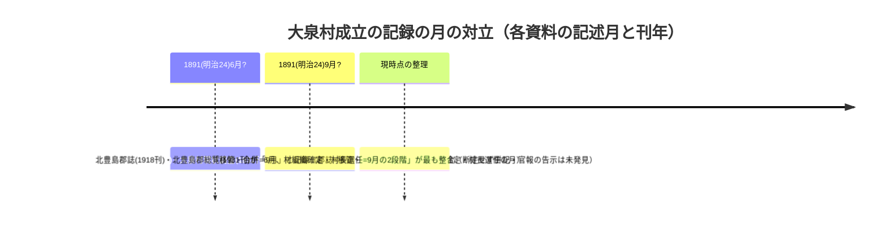

# 第142回調査ノート（2026-11-17）: 大泉村成立の「月の対立」（6月/9月）・井頭溜池＝白子川源流・千川用水1931年暗渠現状

## 調査の経緯

第141回で榑橋村（小榑村＋橋戸村）の1891年（明治24年）の東京府移管が判明したが、その月日・法的根拠はWikipediaの三次資料止まりだった。今回はNDL次世代デジタルライブラリーで「大泉村」を単一キーワードに検索したところ、明治39年埼玉県統計書（移管元側）・北豊島郡総覧（大泉村章）・北豊島郡大泉村現状調査（1931・臨時市域擴張部の現状調査シリーズ）の3冊のfulltextを確認でき、大泉村成立の文言が一気に揃った。北豊島郡総覧は[GOV-198](../sources/gov/GOV-198.md)として既登録だったため、今回の追加文言は同ファイルへの追記として処理した（新規資料ファイルの乱立を避ける）。

## 本回の成果（新規2件＋追記2件）

- 新規: [GOV-331](../sources/gov/GOV-331.md)（北豊島郡大泉村現状調査・1931）・[GOV-333](../sources/gov/GOV-333.md)（明治39年埼玉県統計書 第一卷・1907）
- 追記: [GOV-198](../sources/gov/GOV-198.md)（北豊島郡総覧・1931＝大泉村章・千川用水・谷端川の追加文言）・[GAZ-002](../sources/gazetteers/GAZ-002.md)（北豊島郡誌・1918＝大泉村章・井頭池由来・四至・水利）
- 対照表: 大泉村の新設行＋榑橋村行の追記（第142回分）

### ① 大泉村成立の「月の対立」の確立

「明治24年（1891）」で一致するが月が資料ごとに対立する:

| 月 | 資料 | 文言 |
|---|---|---|
| 6月 | [GOV-333](../sources/gov/GOV-333.md) 埼玉県統計書（1907・移管元） | 「**二十四年六月**新座郡榑橋村ヲ東京府北豐島郡石神井村ノ內元上土支田村ト合併シ大泉村ト稱シ」 |
| 6月 | [GAZ-063](../sources/gazetteers/GAZ-063.md) 北足立郡誌（1924） | 「(**六月**樽橋村を東京府に移す)」 |
| 6月 | [GOV-331](../sources/gov/GOV-331.md) 大泉村現状調査（1931） | 「(明治二十)**四年六月**前記三大字ヲ合併シテ現在ノ大泉村ヲ創設」 |
| 6月 | Wikipedia「榑橋村」（三次資料） | 6月15日 |
| 9月 | [GAZ-002](../sources/gazetteers/GAZ-002.md) 北豊島郡誌（1918） | 「明治二十四年**九月**埼玉縣新座郡樽橋(榑?)村と新倉村の一部字長久保の地、東京府の管轄に移り…」 |
| 9月 | [GOV-198](../sources/gov/GOV-198.md) 北豊島郡総覧（1931） | 「明治二十四年**九月**村の組織を定めらるゝと共に第一次の村長として鈴木政和氏」 |

- **埼玉県統計書（GOV-333）の重み**: 移管元の県が自県の管轄喪失の年月として「六月」を記録する点と、「樽橋」を介さない「榑橋村」の表記が正確に現れる点（[GAZ-063](../sources/gazetteers/GAZ-063.md)のOCR誤読説を補強）。
- **2段階説の根拠**: 北豊島郡総覧の9月文言は「村の組織を定めらるゝと共に第一次の村長」という**村組織・村長選任**の文言で、移管そのものとは別事象を指す可能性がある。ただし北豊島郡誌の9月文言は「東京府の管轄に移り、北豐島郡に編入せられ」という**移管そのもの**を9月としており、単純な別事象説では解消できない。官報明治24年（1891）の告示の探索が決め手になる（次回課題）。

### ② 井頭溜池＝白子川源流・大泉村名由来（repo初出）

- 大泉村現状調査（1931）: 「**白子川ハ其ノ源ヲ本村井頭溜池ニ(発)シ土支田小樾ヲ経テ東流**」＝白子川の源流＝大泉村の井頭溜池。
- 北豊島郡誌（1918）: 「**村内に井頭と稱する小池あり、泉水四時滾々として湧出するを以て、名づけしと云ふ**」＝大泉村の村名由来＝井頭池。
- 2書を対校すると**井頭池＝井頭溜池＝白子川の源流**という対応が揃う。README既記録の「田柄川・白子川の大泉村発源」が源流位置（井頭溜池）まで具体化された。井ノ頭公園（三鷹・吉祥寺）の井の頭池とは別水域（大泉の溜池）で、混同に注意。

### ③ 千川用水の1931年現状（GOV-198追記）

- 「**現在は上板橋以東水田無く、板橋町山中より下流を悉く暗渠し河身を道路に併用せり**」＝板橋宿埋立て（既記録・昭和3〜5年）に加えて、暗渠化の範囲を「板橋町山中より下流」と明示（「山中」の位置は要確認）。
- 「**瀧野川堀割にて(瀧野川三軒家と西巢鴨庚中塚境界地點)暗渠とし上駒込岩崎邸鴨池に引く清冽の水も亦千川用水の一支流たり**」＝六義園（旧岩崎邸）鴨池への引水の1931年現勢＝[GOV-329](../sources/gov/GOV-329.md)（本郷区勢要覧・同年刊）の「六義園の大池に千川上水の余水を注ぐ現勢」の**独立出典による裏付け**。「鴨池」の池名の原字は要照合。

### ④ 谷端川＝板橋駅傍の石神井川分落隧道の実施済み（GOV-198追記）

- 「**東京市は曩に板橋驛傍より隧道を石神井川に貫き、堰を以て之に分落せしめ。東京府は之れが治水策として改修を斷行しつゝあり**」＝[BOOK-126](../sources/books/BOOK-126.md)の明治41年（1908）下水道設計文言（「千川上流ノ放水路ハ板橋停車場附近ヨリ…石神井川ニ通ゼシメ」）の**実施側の確認**＝放水路（板橋駅傍→石神井川）が1908年設計〜1931年以前の間に実施されていたことが郡総覧の観察で裏付けられた（実施年月は特定できない）。

### ⑤ 課題③（大泉村域と千川用水の位置関係）の進展

- 北豊島郡誌（1918）の大泉村「**水利は白子川にこれ賴る**」＋千川用水の流路村列挙（保谷→石神井→…）に大泉村なし＝**旧榑橋村域は白子川水系の受益村で、千川用水の受益範囲外にある方向の裏付け**＝READMEの第141回記録の「未確認で断定しない」を前進（流路図レベルの逆裏付けは待つ）。

### ⑥ 榑橋村の命名（GOV-198追記・repo初出）

- 「同二十二年町村制施行に際し**橋戶小樾兩村を合して榑橋村と稱し**、同二十四年東京府管轄に移る」＝**明治22年（1889）の榑橋村命名の文言**＋小榑（OCR「小樾」）・橋戸・下保谷・上保谷・上保谷新田の**5ヶ村連合戸長役場**（大小区制廃止後）＝榑橋村の前史の行政記録。小榑村旧記の県庁変遷（品川県→入間県→熊谷県）もrepo初出。

## 陰性・見送り

- news_search 6クエリ（四河川・神田川流域計画・雑司ヶ谷幹線）= 全0件。
- kanzyou7.com WHAT'S NEW = 2026/11/13 のまま（変化なし）。
- 神田川流域河川整備計画の決定版 = 令和5年3月版のまま未公表。開札2026-12-02はまだ未来。
- 課題④（境橋の「境」の対校整理）は今回も時間切れで未着手（次回回帰）。
- アクセス不能（再試行不要）: echo-lab.ddo.jp・板橋区WAF・nabunken 429・CiNii直接・都建設局のcurl直アクセス（unified_searchで代替）。

## 次回課題

1. **官報明治24年（1891）の榑橋村移管の告示の探索**（月の対立の決め手。NDLの官報アーカイブ・太政官達・内務省達を想定）。
2. GOV-331・GAZ-002の原画像照合（「(明治二十)」欠落部・「小樾」=小榑・「先山村」=片山村誤読説・「井頭溜池ニ(発)シ」欠落部・「樽橋(榑?)」）。
3. 井頭溜池の位置の特定（大泉町内の現地・古地図・地籍図レベルの確認。現在も「井頭」の地名が残るか）。
4. 千川用水「板橋町山中」の位置特定（板橋町の小字か）。
5. 課題④（境橋の「境」の対校整理）の回帰。

## 採番現況

- 本回使用: GOV-331・GOV-333（GOV-332は番号を飛ばした形。GOV-198追記に振り替えたため欠番とする）
- 次回から: GOV-334〜・GAZ-065〜・BOOK-178〜・BLOG-247〜・PAP-083〜・MAP-177〜・ORG-034〜・LOST-006〜

（本ノートの文言はすべてNDL次世代デジタルライブラリーのOCRテキスト由来で、原文画像との照合を要する。断定できる範囲は「確認」「観察」「推定」「仮説」の区別のとおり。）
