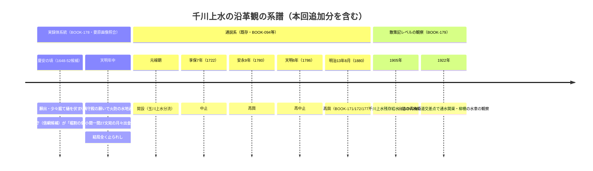
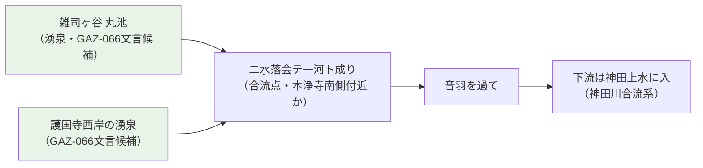

# 2026-11-17（第144回）・名水品彙の源流二流説と星谷3湧水・田沼実記の千川堀停止逸話・神田上水留明治帳簿の追加調査

## 概要

NDL次世代デジタルライブラリーのfulltext横断検索（第11弾の続き）を中心に、名水・実録・帳簿・散策記の4系統を新規に精査した。新規資料7件（BOOK-178/179・GAZ-066/067・GOV-334/335/336）を登録し、対照表に布引川行・星谷系2行の追記を行った。監視系（ニュース・都河川整備計画・環状七号線調節池）はすべて陰性・変化なし。

## 監視系の結果（すべて陰性・変化なし）

- ニュース検索6クエリ（谷端川・弦巻川・水窪川・千川上水 河川整備計画・環状七号線 地下調節池・神田川 河川整備計画、2026-11-03以降）＝全0件。
- kanzyou7.com WHAT'S NEW＝2026/11/13のまま。
- 都建設局「河川整備計画について」ページ（2026-11-09更新）＝策定済み表で神田川流域はR5.3のまま。決定版の公表はまだ（変更原案PDF〔000060774等〕は404化したまま）。
- 調節池広域整備検討委託（その2）開札＝2026-12-02予定のまま。

## 新規登録7件

1. **[GAZ-066](../sources/gazetteers/GAZ-066.md) 乗化亭著『名水品彙』（1枚・刊年未詳・幕末〜明治初期候補）〔本回の核心〕**: fulltext取得・全文確認。①「**張巻川一名布引川 源は二流あり一流は雑司谷丸池の濫泉一流ハ護国寺西岸ノ沃泉也 二水落会テ一河ト成り音羽ヲ過テ下流ハ神田上水ニ入ナリ**」＝**弦巻川の源流二流説（丸池＋護国寺西岸）の本文文言候補**。1772年絵図の「丸池系本流＋護国寺裏門付近の独立水源・支流が本浄寺南側で接続する水系」仮説（[弦巻川](弦巻川.md)）を、名水品評録という独立の資料種から支える。布引川の別名は[BOOK-001](../sources/books/BOOK-001.md)・[GAZ-002](../sources/gazetteers/GAZ-002.md)・[GAZ-058](../sources/gazetteers/GAZ-058.md)系の既出系統の対校資料（repo初出ではない点に注意）。②**三角井泉（一名星之清水・護国寺西雑司谷の東青折町）・星清水（三角井の西の野中・今宮崎氏の部内に引水）・星之井（護国寺西の山麓・今乞食の井水と成）の3湧水を別条で記す**＝星谷水系の呼称の重層の新datapoint。③神田上水条＝「**其源泉ハ農夫長内田氏ノ舊家地ヨリ流注ス**」（**長内田氏旧家地＝井の頭池源泉の所在のrepo初出候補**）・井頭池七井の湧泉・寛永大帝遊歴→井頭の称・善福寺妙正寺の三水合流→関口分流。④全条項に温度（分度）・秤量の実測値。刊年はIIIF manifest・NDL書誌にもなく未詳（「濵田侯ハ本上州館林」・「酸素」等の語彙から幕末〜明治初期と推定・要書誌確認）。
2. **[BOOK-178](../sources/books/BOOK-178.md) 『田沼実記：今古実録』（1884・栄泉社）**: 目録「**千川上水堀割松平伊豆守殿名言の事**」の実録体逸話＝①千川上水の願出・起工が「**慶安の頃**」（1648〜52）〔repo初出の年代情報・通説の元禄期開設より約50年遡る候補。慶安期の老中松平伊豆守＝松平信綱の比定候補と整合〕、②「**千川上水堀割の儀相止サベシ**」による町奉行経由の停止（理由は「玉川神田の上水のための出金」〔既存二上水との費用競合〕・「堀は土なり樋は木なり」の文言候補）、③天明年中に**大隅守殿の願いで火防のため水を地通し**、④「**水の掛る處ハ小間一間廿七文宛の割合にて月々出金**」の給水料金文言候補→結局全く止られし。**実録体（脚色を含む読み物）のため史実採用は対校後。OCR高度崩れで全て文言候補**。天明期再興試行（安永9年再興→天明6年再中止の通説）に火防目的・料金体系という新側面を加える。
3. **[BOOK-179](../sources/books/BOOK-179.md) 横山信著『撮影探勝武蔵野めぐり』（1922・アルス）**: 大正末期の散策案内記。①千川用水の1922年現地観察＝「**上石神井字出店…青梅街道をクロツスする位置…ゴー〓〓と音を立てゝ流れる野水**」・境駅〜田無街道の「**柳橋**」橋畔の水車＝**千川用水開渠の通水実態（水量・水車）の位置付き観察**。②流路（境橋→石神井村→練馬村→中新井村→長崎村→板橋町→巣鴨→滝野川→飛鳥山西で石神井川に合流）。③沿革通説（常憲公の代・享保7中止・安永9再起・天明6再中止・灌漑用水転用）の大正期一般書への定着。④神田上水の1922年観察（灌漑転用・「寛永六年」工事の記述〔「將軍家綱の時分」との混同候補〕）。
4. **[GOV-334](../sources/gov/GOV-334.md) 『神田上水留』分冊ノ一（明治2年・1869）**: 井の頭の刈所・土留柵修復の一件帳（上水方）＋**井之頭池弁天社廻り・聖天社廻りの石橋群（相詰長延七拾六間）の部材明細**＋「**品川県支配所 武州多摩郡…吉祥寺村**」＝明治2年時点の井の頭（神田上水源）の行政所属が品川県である文言候補。[GOV-247](../sources/gov/GOV-247.md)/[GOV-249](../sources/gov/GOV-249.md)系統の兄弟冊。
5. **[GOV-335](../sources/gov/GOV-335.md) 『神田上水留』分冊ノ二（明治3年・1870年7月）**: 井の頭池の**藻草刈取・茶苅船・土留柵の入札公告**（土木司の開札・「書損算違等申立引請御免」・茶苅日数八日限）＋**吉祥寺村・久我山村・野川村・西窪村・北野村・下連村の名主・百姓代連署**＝明治3年の井の頭池の入札行政と周辺6村の村組織の一次記録。
6. **[GOV-336](../sources/gov/GOV-336.md) 『神田上水留』元治元年（1864）条**: 神田橋御門外の**騎兵当番所構内の灌馬堀掛樋の新規普請**（「**灌馬堀 是ハ馬養生之為時々相護度候間 最寄上水ヲ以取建度**」）＝**神田上水からの幕末騎兵屯所給水の行政記録**。[GOV-326](../sources/gov/GOV-326.md)（同年・関口水車塲の仕法替）と同年の神田上水系統で、幕末の上水の軍事利用の側面を補強。「元治元子年」と本文中「亥八月」の干支の食い違いは要原画像照合。
7. **[GAZ-067](../sources/gazetteers/GAZ-067.md) 『江戸志（写）』＝新編江戸志 巻之九・十**: 第105回の対照本候補を登録。「御鷹へや前 絃巻川 法妙寺前の細き流れをいふ」（「絃」字・「御鷹へや前」の語の帰属は要照合）・「**星跡清水 護因寺（＝護国寺のOCR誤読候補）と雑司谷田の中…絃巻川の流の下也 夜毎に此所に星下りを…鬼子母神の塚有となり**」＝[GAZ-027](../sources/gazetteers/GAZ-027.md)/[GAZ-030](../sources/gazetteers/GAZ-030.md)系統の原典系写本の文言候補（星下り伝承の物語形）。

## 棚卸し（登録せず・記録のみ）

- **『神田上水留』の普請帳簿5冊（2587462〔天保13・小川町石垣樋〕・2587466〔天保15〜弘化2・石垣樋場所替〕・2587467〔弘化3・神田橋外明地掛樋枡修復〕・2587482〔嘉永5・石垣樋場所替〕・2587483〔嘉永6・小川町火消御役屋敷掛樋枡井戸〕）**: fulltext取得済み。いずれも既登録の普請帳簿系統（神田上水の樋管普請）に属し、新規source file化は見送り。要原画像照合・詳細精読は今後の棚卸し課題。
- **965105の著者**: 広告頁のOCRで「**横山信氏著 撮影探勝武藏野めぐり**」＝著者横山信の確認（三宅克己は別書目の広告）。BOOK-179の書誌に反映。
- **1181016 新編武蔵風土記（相武史料刊行会1930）の「鼠ヶ谷」**: 大岡川村・最戸村・中里村系（多摩郡）＝**音羽の鼠ヶ谷ではないfalse positive**。
- **牛込染井雑司ヶ谷高田写本群（2589495-2589500・2542299・2542339）**: [MAP-172](../sources/maps/MAP-172.md)/[MAP-173](../sources/maps/MAP-173.md)に他所蔵記録済み（享保年中/寛保延享実測図の別版）。新規登録不要。
- **江戸名所図会7巻（2563390/2559050天保5）**: 既登録GAZ系統（[GAZ-047](../sources/gazetteers/GAZ-047.md)/[GAZ-058](../sources/gazetteers/GAZ-058.md)）の原典側。法明寺条の布引川文言は既出のため新規登録せず（版本対校は今後の課題）。
- **東京府地誌略（991444・1881「神田上水ハ井頭池」）・東京誌略（764128・1877「水道ニ二源アリ一ヲ多摩川一ヲ井頭池」）**: 神田上水起源記述の対校候補だが、既存の起源論（寛永6年疏通説系）に新文言を加えるほどの差がpreviewの範囲では確認できず、登録見送り（fulltext精読は次回以降の候補）。

## 千川上水の沿革観の系譜（本回の追加で変わった点）

田沼実記の「慶安の頃」願出→松平伊豆守停止→天明年中火防の水地通し→全く止られし、という実録体の筋は、享保7中止→安永9再興→天明6再中止の通説系（[BOOK-094](../sources/books/BOOK-094.md)等）に対し、①最初期の願出を慶安期に置く年代観、②停止理由を「玉川神田の上水のための出金」に置く観点、③天明期の再興試行を火防目的・小間一間27文の料金体系で語る観点、の3点で独立の系統をなす（史実の採用は原画像照合と典拠特定まで留保）。

## 弦巻川の源流観の補強（GAZ-066の位置づけ）

1772年絵図の読図（丸池系本流＋護国寺裏門付近の独立水源の接続仮説）に、名水品評録（刊年未詳・幕末〜明治初期候補）の「源は二流あり」の本文文言候補が整合する。ただし品評録の刊年未確定・OCR要照合のため、仮説の強化資料として扱い、流路の確定とはしない。

## 対照表の追記

- 布引川行：GAZ-066「張巻川一名布引川」の追記（「一名」形式の独立系統）。
- 星谷の井／星跡の清水行：GAZ-066の3湧水（三角井一名星之清水・星清水・星之井）とGAZ-067の星下り伝承文言候補の追記。
- 星の井／星の清水行：GAZ-066の3湧水を対校に加える（清土の井戸との対応は断定しない）。

## 手法メモ

- NDL lab fulltext API（`https://lab.ndl.go.jp/dl/api/book/fulltext/<id>`）で11冊のZIP全文を取得、`ft/<id>/ALL.txt`に結合保存（alltext結合時は`*.jsonl`を除外しないとJSON行が混入するため`<id>_0*.txt`形式の列挙が安全）。
- IIIF manifest（`https://dl.ndl.go.jp/api/iiif/<id>/manifest.json`）で名水品彙の書誌（請求記号特1-2994・PDM・刊年記載なし）を確認。
- `search.py`（lab.ndl contentonly検索＋registered_ids照合）で水窪・弦巻・谷端・千川・神田上水系キーワードの新規ID探索を継続。

## 次回以降の課題

1. **GAZ-066名水品彙の刊年の特定**（原画像の序跋・書誌。IIIF画像の判読）。
2. **BOOK-178田沼実記の原画像照合**（「慶安の頃」「小間一間廿七文宛」「大隅守」の字面・目録条目の本文帰属）と典拠の特定。
3. **第143回継承課題**: 官報明治24年（1891）榑橋村移管告示の探索・小字「山中」の地番範囲の直接確認・神田上水廃止明治33年説（GAZ-065）vs 明治34年6月説（GOV-307）の深い対校（東京都水道歴史館系資料）・井頭溜池（大泉）の公園整備沿革。
4. **GOV-334/335の原画像照合**（「品川県支配所」の文言・名主連署の人名・入札の決着）と、『神田上水留』残冊（2587462等5冊）の詳細精読の可否。
5. BOOK-179の「柳橋」「出店」の比定（千川用水の他の柳橋記録・地図照合）。
6. 東京府地誌略（991444）・東京誌略（764128）のfulltext精読（神田上水起源記述の対校候補）。
