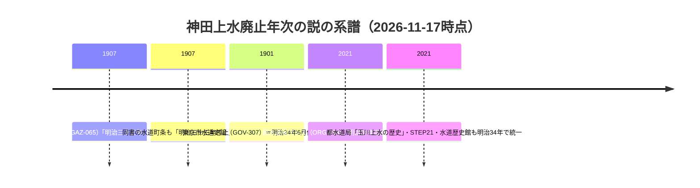

# 2026-11-17（第145回）・東京府地誌略と東京誌略の神田上水記録・都水道局の明治34年説・名水品彙刊年の再検討

## 概要

第144回でfulltext取得のみで見送った東京府地誌略（1881）と東京誌略（1877）の全文精読を本体に、神田上水・江戸川・千川用水系の新しい文言を新規登録した。新規資料3件（GAZ-068/069・ORG-034）＋追記3件（GAZ-065/066＋対照表4行）+名水品彙の刊年推定の修正。監視系（ニュース・都河川整備計画・環状七号線調節池）はすべて陰性・変化なし。

## 監視系の結果（すべて陰性・変化なし）

- ニュース検索6クエリ（谷端川・弦巻川・水窪川・千川上水・神田川河川整備計画・環状七号線地下調節池、2026-11-10〜17）＝全0件。
- kanzyou7.com WHAT'S NEW＝2026/11/13（週間工程表・シールド進捗図）のまま。
- 都建設局「河川整備計画について」ページ＝神田川流域はR5.3版のまま、決定版（変更版）は2026-11-17時点でも未公表。
- 調節池広域整備検討委託（その2）開札＝2026-12-02予定のまま（結果確認は次回以降）。

## 新規登録3件

1. **[GAZ-068](../sources/gazetteers/GAZ-068.md) 東京府学務課編『東京府地誌略』（1881）〔本回の核心①〕**: 第144回で「previewの範囲では差が確認できず」と見送った書のfulltext精読で、①「**承應年間始メテ玉川神田ノ両上水ヲ設ク**」＝**両上水の承応年間設置説の1881年府編纂版**（御府内備考・武江年表系の承応説の公式再録。両上水一括の表現で神田上水単独への適用は断定しない）、②「**神田上水ハ、井頭池ヨリ發シ、北流シテ十二所社ノ下ニ至リ、玉川上水ノ支流ヲ合セ、上落合村ニ至リテ、又井草川ヲ合セ…萬年樋ヲ經テ城内ニ入リ**」＝**千川用水（玉川上水の支流）の神田上水合流地点を「十二所社ノ下」と記す1881年文言（repo初出級）**。明治10年府統計の「上落合村ニテ神田上水ニ合ス」（[GOV-302](../sources/gov/GOV-302.md)）を一段上流側に具体化する候補。③「**善福寺池アリ、其流井草川トナリ、神田上水ニ合ス**」＝**井草川＝善福寺池流下の別称という系統の文言**＝[GAZ-051](../sources/gazetteers/GAZ-051.md)（井草川＝千川用水の井荻村区間呼称）との帰属対立候補、④関口二派の1881年現勢（伏管ルート＋江戸川ルート・旧水戸邸と後楽園の現存）、⑤水道橋の下の萬年樋と「下流の東岸＝御茶ノ水」、⑥江戸川＝神田上水の支流（関口町分派〜船河原橋南の神田川合流）、⑦「**鼠山ハ長崎村ナル小丘ニシテ、德川幕府ノ時練兵ノ地タリ、今變シテ田圃ト爲ル**」＝鼠山の1881年土地利用観察、⑧溜池の「神田玉川止水ノ設」文言候補（OCR高度乱れ）。**本書はOCRが極めて乱れており全文言要原文照合**。
2. **[GAZ-069](../sources/gazetteers/GAZ-069.md) 大滝確荘編『東京誌略』（1877）〔本回の核心②〕**: ①「**水道ニ二源アリ一ヲ多摩川ト云ヒ一ヲ井頭池ト云フ**」＝二源説＋「**井頭ノ上水ハ目白小石川ヲ經テ神田以南ノ飮料ニ供シ、俗此レヲ神田上水ト稱セリ**」＝**神田上水の流路を目白→小石川の順で記し「俗呼」と明示する1877年の文言**（白堀区間の流路観察）。②「**神田川ハ江戶川大洗堰ノ下流ニシテ…明曆万治ノ間仙臺矦ノ疏スル所ナリ**」＝**江戸川区間（関口大洗堰〜神田）の開掘・疏浚を明暦〜万治（1655〜1661）の仙台侯の所為とする1877年の説＝repo初出候補の文言**。江戸川開削年代というrepoの未解決事案に対し、年代と実行者の両面の新datapoint（典拠記載なし・通俗説流用の可能性を残し採用は対校まで留保）。
3. **[ORG-034](../sources/org/ORG-034.md) 東京都水道局プレスリリース（2021-10-29）**: 「**明治34（1901）年の神田・玉川上水廃止から120年になることを記念**」＝**都水道局（水道歴史館）側は神田・玉川両上水の廃止を明治34年説とする公式見解**（「玉川上水の歴史」頁・STEP21・水道歴史館サイトで一貫）。[GAZ-065](../sources/gazetteers/GAZ-065.md)（大日本地名辞書1907）の明治33年説との対立において、[GOV-307](../sources/gov/GOV-307.md)（明治34年6月停止）と都側が揃う形。別過程（府内給水廃止と市内停止）の可能性は残し断定しない。

## 追記3件＋名水品彙の刊年推定の修正

1. **[GAZ-065](../sources/gazetteers/GAZ-065.md)（大日本地名辞書）への対校追記**: 明治33年説に対して都水道局が明治34年説を公式採用（ORG-034）という構図を追記。
2. **[GAZ-066](../sources/gazetteers/GAZ-066.md)（名水品彙）の刊年推定の修正（第144回推定の訂正）**: 第144回は「**濵田侯ハ本上州館林**」を「館林→浜田の転封は明治元年（1868）以降」と読んだが、**浜田藩主・越智松平家の館林→浜田移封は天保7年（1836）**（斉厚の代・二次資料で確認）であり明治以降を示す証拠でないことを確認し、推定を修正。むしろ同家は**慶応2年（1866）に浜田城を自焼し慶応3年（1867）に美作鶴田藩を立藩**するため、「**今ハ浜田ノ内ト成ル**」（西久保の井が浜田侯の江戸/東京邸内）の観察と「浜田侯」呼称からは**成立は天保7年〜慶応3年（1836〜1867）頃＝幕末説が有力候補**となる。「酸素」「元素」の語彙も幕末期蘭学系訳語（宇田川榕菴系）と整合し、明治以降を示さない。明治初期の慣用呼称の可能性は排除できず、書誌確認は今後の課題のまま。
3. **対照表4行**: ①白堀上水／白堀通行行にGAZ-069の「目白小石川ヲ經テ」文言とGAZ-068の「承應年間設置説の府版」を追記、②仙川用水行の次に「**十二所社ノ下／十二所ノ池（角筈村）**」の新行（千川用水の合流地点の具体化候補）、③船河原橋行の次に「**江戸川区間の開削年代（明暦万治仙台侯疏浚説）**」の新行、④井草川行にGAZ-068の善福寺池流下別称説（帰属対立候補）を追記。布引川行の名水品彙の刊年表記も修正に合わせて更新。

## 棚上げ・見送り（記録のみ）

- **『神田上水留』の普請帳簿5冊（2587462/2587466/2587467/2587482/2587483・第144回取得分）**: いずれも小川町錦小路石垣樋・神田橋御門外通石垣樋・小川町火消御役屋敷掛樋枡井戸など城内・神田橋周辺の樋枡普請帳簿で、白堀・音羽・桜木・関口・千川の直接記述なし＝新規source file化は見送り（第144回と同判定）。唯一の小収穫＝2587482（嘉永5年）の「**右樋筋之儀ハ明和度上水方御普請奉行掛被仰渡候**」＝神田橋外石垣樋の明和期普請の傍証文言候補（帰属の確定は原文照合まで保留）。
- **官報明治24年榑橋村移管告示**: 今回も告示・勅令番号の一次文言には到達せず（Wikipedia等の三次資料のみ）。国会図書館の官報アーカイブ等の別手段を次回以降試みる（第142回課題①継続）。

## 神田上水の廃止年次の対立の現況（本回で揃った材料）

断定はしないが、現代の事業継承者（都水道局）側と水道史論側が明治34年で揃い、明治33年説は1907年辞書に孤立する形になった。「府内の給水」廃止（明治33）と市内給水の完全停止（明治34年6月）を別時点と読む仮説は引き続き残す。

## 次回以降の課題（継承）

1. 官報明治24年榑橋村移管告示の一次文言の探索（国会図書館官報アーカイブ等の別手段）。
2. 小字「山中」地番範囲の直接確認（都主税局地籍図は要インタラクティブ操作）。
3. BOOK-179「柳橋」「出店」の比定（武蔵野市観光機構むー観の千川上水頁・ブログが参考候補・repo未登録か要確認）。
4. GAZ-066「三角井（青折町）」とBOOK-144「三角の井筒」の対応整理。
5. 2026-12-02の調節池広域整備検討委託（その2）開札結果の確認。
6. GAZ-068・GAZ-069の原画像照合（OCR乱れの激しい2冊・特に十二所社・明暦万治仙台侯・溜池の各文言）。
