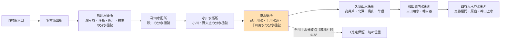
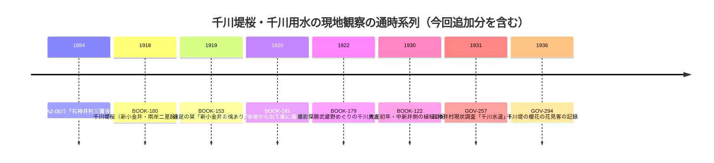

# 2026-11-17（第146回）定期調査ノート — 境水衞所の分水樋鍵保管（明治31年水衞心得）・高田町下水道の1930-31年着手・千川堤桜の1918年観察・田山花袋の千川用水・三宝寺池観察（1920）

## 実行概要

- 第146回。前回（第145回・HEAD 427d3a74）を引き継ぎ。NDL次世代デジタルライブラリーの全文検索（contentonly）を主軸に、東京市行政資料（例規類集・臨時市域擴張部現状調査）・大正期紀行・案内記・江戸絵図の新規取り込みを実施。
- **採番**: [GOV-337](sources/gov/GOV-337.md)（高田町現状調査・1931）・[GOV-338](sources/gov/GOV-338.md)（東京市例規類集・1913）・[BOOK-180](sources/books/BOOK-180.md)（三府及近郊名所名物案内・1918）・[BOOK-181](sources/books/BOOK-181.md)（東京の近郊・田山花袋・1920）・[MAP-177](sources/maps/MAP-177.md)（牛込小日向音羽町辺場末絵図・天保13年之形）の5件。既存の[BOOK-002](sources/books/BOOK-002.md)（『郷土の観察』の指導体系・1941）に第146回追記（神田上水沿革章の序列文言）。
- **重複回避の教訓〔重要〕**: 当初「BOOK-182」として新規登録を計画していた『郷土の観察』の指導体系（lab 1275204）は、**docs側にBOOK-002として既登録であった**（第118回で音羽谷二細流の全文文言を追記済み・『郷土の観察』読書メモもdocsに既存）。新規採番の前に「書名・lab ID・既出文言」の3点でgrep検証した結果、同一書籍と判明したため**BOOK-182の採番は取りやめ、未登録の文言（東京市水道の沿革章＝神田上水天正18年起工説の採録＋千川上水を玉川上水以後の「後年」とする序列記述）のみBOOK-002への追記に切り替えた**。lab IDのgrepは今回registered_labids.txt（402件）でも拾えたが、書名でのgrep（『郷土の観察』）が決め手になった。**新規登録前に書名・著者名のgrepをlab IDと並行して行う運用を継続する**。

## 成果1: 境水衞所の千川水道・千川用水の分水樋鍵保管（GOV-338・repo初出）

- 東京市内記課編『東京市例規類集』（1913）の第十二類水道「水衞心得」（**明治31年＝1898年2月21日設定**）に、「**品川用水.千川水道、千川用水分水樋鍵境水衞所詰水衞保管**」＝千川水道（民営水道）と千川用水の分水樋の鍵を境水衞所の水衞が保管する制度文言を確認（「水衞」語はrepo全体で初出）。
- 水衞の受持区域は四谷大木戸水衞所〜和田堀内水衞所〜久我山水衞所〜境水衞所〜小川水衞所〜砂川水衞所〜熊川水衞所〜羽村派出所（玉川上水沿いの配列・表組のOCR崩れあり）。明治41年の電話信号ベル押方にも境水衞所が含まれ、1908年時点で通信網の結節点であった。
- 「境水衞所」は境（旧保谷村境橋＝千川上水分岐点）の水衞所と読めるが、**位置の比定は保留**（境橋付近か・境浄水場〔後の淀橋浄水場系〕との関係かは原画像・他資料と照合してから）。
- 同書の市區改正附改良下水の千川線文言（「千川ハ郡部ニ廣大ナル流域ヲ有スルヲ以テ瀧ノ川堰堤上流ヨリ雨水ヲ疏通スルニ足ル可キ新水路ヲ設ケ隅田川ニ放流セシメ…」）は[BOOK-126](sources/books/BOOK-126.md)（小石川区史の明治41年市下水道設計記述）と一部異同があり、**対校案件**として次回に回した（「瀧ノ川堰堤」「隅田川」の判読・版年の確定は原画像照合まで断定しない）。

（出典: [GOV-338](sources/gov/GOV-338.md)・明治31年水衞心得・文言はOCR要照合。境水衞所の位置は未確定のため推定線は引かない。）

## 成果2: 高田町下水道の1930-31年着手（GOV-337）

- 東京市臨時市域擴張部『北豊島郡高田町現状調査』（1931）に、**昭和4年度（1930）に下水道調査費4,900余円を計上→昭和5年（1931）1月18日から実地着手（中心線選定）**、既設=石神井系統・新設=三河島系統、管渠延長19,034米候補・総工費152万8千円候補の文言を確認（文言候補・要原画像照合）。
- 高田町域＝水窪川・弦巻川・千川下流・谷端川下流域（現在の豊島区高田・目白・雑司が谷〜新宿区早稲田〜文京区大塚側）で、[GOV-207](sources/gov/GOV-207.md)（1938水道事業年報・高田町4排水区＝音羽・鶴巻川・神田上水路・谷端川）の7年前の起点側記録にあたる。
- 王子電車の水久保停留場（1931年現勢・repo初出の停留場）・字名「高田雑司ヶ谷西谷戸」（[GOV-062](sources/gov/GOV-062.md)系を補強）・大正9年4月3日町制施行も記録。
- **陰性〔観察〕**: 同書OCR全文に弦巻川・水窪川・千川・谷端川・神田川が**すべて0件**＝1931年の公式町勢調査の河水項目から4河川が消えている観察（OCR品質の限界は排除できず断定しないが、同シリーズの石神井村（千川水道・石神井川を列挙〔GOV-257〕）との対比で意味のある陰性）。

## 成果3: 千川堤桜の1918年観察と田山花袋の1920年観察（BOOK-180・BOOK-181）

- [BOOK-180](sources/books/BOOK-180.md)（三府及近郊名所名物案内・1918・特再版）の「**下練馬、長崎兩村を流るゝ千川用水の兩岸二里餘に亘つて、櫻樹が植ゑられて居る、花時の美觀は幾紙に蓋し難く**」＝千川堤桜（新小金井）の1918年の現地観察。[BOOK-153](sources/books/BOOK-153.md)（1919・ほぼ同一表現）の1年前倒しの定点で、千川堤桜の戦間期の連続記録の起点側を更新。
- [BOOK-181](sources/books/BOOK-181.md)（田山花袋『東京の近郊 一日二日の旅』1920・磯部甲陽堂）の3点:
  1. 「**三寶寺池から出て東に流れてゐる千川**」＝千川用水の水源を三宝寺池とする1920年の現地観察文言（境分水説との対校案件＝観察文言として断定しない）。
  2. 「**神田上水が南から北に流れてゐて、新井に行く路に橋が一つかゝつてゐる。そこには秋は柿など並べた休茶屋がある、橋の前後には芦荻が繁つてゐる**」＝下落合〜新井薬師間の神田上水（白堀区間）の1920年現勢。
  3. 「**落合の水車の傍を通つて**」＝早稲田→戸塚→落合→新井薬師経路上の水車の1920年観察（比定保留・八成水車〔第12回〕との同一視はしない）。
  - 『花袋紀行集』（1923・977044）に同文収録＝同一テキストとしてBOOK-181に併記（独立登録せず）。

## 成果4: MAP-177（牛込小日向音羽町辺場末絵図・天保13年之形）

- 題簽「**天保十三寅年六月之形牛込小日向音羽町辺場末**」＝1842年6月時点の音羽町周辺の絵図（写・刊年不詳）。**凡例に「此色堀川」**があり水路の彩色描写の存在候補。図面範囲は音羽谷〜雑司ヶ谷〜戸塚〜高田で、**弦巻川・水窪川の1842年の定点図候補**。1842年は音羽岡場所廃止（天保13年）と同年。
- 弘化3年（1846）下戸塚村出火等の書込群を含む（江戸火保図系の可能性〔推定〕）。OCRは断片のみのため**status=所在記録のみ**、読図は次回以降の原画像確認課題。

## 成果5: BOOK-002への追記（千川上水の成立序列）

- 『郷土の観察』の指導体系（1941）の「東京市水道の沿革」章に「**後年 總有上水、千川上水、三田上水が出來た**」＝**千川上水の成立を玉川上水（家光時代）以後の「後年」とする1941年教材側の序列記述**を追記（千川上水成立年代論の対立構造〔延宝天和説・常憲公の代説・寛文期説〕へのdatapoint）。神田上水天正18年起工説の採録例も記録（起工説の史実性の検証資料ではない）。

## 監視系（全陰性・変化なし）

- news_search 6クエリ（谷端川・弦巻川・水窪川・千川上水・神田川 河川整備計画・環状七号線地下調節池）＝**全0件**。
- kanzyou7.com WHAT'S NEW = 2026/11/13のまま変化なし。
- 都建設局HP = curl 403（WAF・例年どおり）。神田川流域計画はR5.3版のまま。
- 調節池広域整備検討委託（その2）開札 = **2026-12-02予定**（まだ未来・次回以降で結果確認）。

## 陰性・見送り記録

- 徳川禁令考の諸版（994330等）= [BOOK-121](sources/books/BOOK-121.md)（786982）と同文・陰性。
- 960716・1874952・1050221・1114654等 = 既登録（960716=BOOK-140、1874952=下水道改良実施調査報告書）。
- 1900508（上練馬村現状調査）= 第143回で陰性記録済み。
- 水窪川キーワードの上位200件 = 静岡県の水窪川（false positive）が大半・見送り。

## 次回課題

1. **音羽谷「寛文十年の古圖」の特定**: [MAP-055](sources/maps/MAP-055.md)（寛文五枚図・1670年代前半・status=所在のみ）が第一候補。原画像で護国寺前の合流の描出を確認する。
2. **境水衞所の位置の比定**: 境橋（保谷）付近か。GOV-338の原画像（受持区域表の行対応）＋水道事業年報・境浄水場系資料との照合。
3. **水衞心得の原画像照合**: 「境水衞所＝千川水道・千川用水の鍵保管」の行対応の確定。
4. **GOV-338千川線文言の対校**: BOOK-126（明治41年告示系）との文言異同（「瀧ノ川堰堤」「隅田川」の判読・版年）。
5. **高田町下水道の数値の原画像照合**: 計上年月日（昭和4年12月29日候補）・着手（昭和5年1月18日候補）・19,034米・152万8千円の各文言候補の確定。
6. **MAP-177の読図**: 天保13年6月之形の音羽町周辺の「此色堀川」の対象（弦巻川・水窪川・白堀のどれか）＝原画像の彩色確認。
7. **BOOK-181の比定**: 神田上水の橋と休茶屋（下落合〜新井薬師間）・「落合の水車」の比定。
8. 第145回継承課題: 官報明治24年榑橋村告示・GAZ-068/069原画像照合・小字「山中」・2026-12-02開札結果・井頭溜池公園の沿革。

## 手法メモ

- NDL次世代デジタルライブラリーのcontentonly全文検索→ft_get.sh（fulltext取得）→ctx.py（文言の文脈抽出・原テキスト検証）→資料ファイル作成のフローは第146回も有効。段組崩れのある例規類集・絵図系は文言候補として原画像照合に回す。
- **新規登録前の重複検証はlab ID grepに加えて書名grepが必須**（BOOK-002の例）。採番はpush直前にlist_commitsで他の実行との衝突を再確認する。
